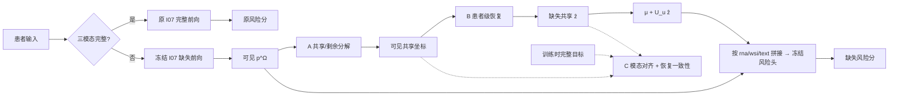

# index-工作1-_v1

> 工作1｜v1｜2026-11-06｜故事线：`02_总故事线.md` 的 **A**｜算子组合：**A1-B1-C1**（`02_总算子卡槽与候选池.md`）｜状态：方案稿，尚未实施或验证。
> 本文件可以独立阅读；总库只在需要换故事或换算子时再打开。失败时复制为 `index-工作1-_v2.md` 修改，本版保留。

## 1. 本版故事线

**核心卖点**：按患者实际可见的模态，动态恢复缺失模态中可以跨模态预测的部分；不给所有患者同一个占位值，也不强求恢复全部个体细节。

- **研究问题**：测试患者缺少某些模态时，怎样利用该患者自己手头的模态，为缺失位置提供因人而异的表示，从而维持生存风险排序？
- **现有不足**：①静态填零 / 填均值给所有缺失患者同一个值，缺失位置上没有患者差异；②不加区分地重建整个缺失表示，会把难以从现有模态推断的部分也纳入恢复目标，增加估计负担。
- **核心思路**：先确定缺失表示中适合跨模态恢复的部分（共享 / 可恢复），再按每名患者的可见模态动态恢复这一部分，并在训练中约束恢复结果与真实目标保持一致；完整输入保持原路径。

# 科研写论文·实验与撰稿核销沙盘（从 Idea 定案到投稿一张表管到底）

> **双车间定轴说明**：本节严格遵循 [画布发散与表格消消乐-双车间定轴引擎.md](file://<HOME>/Desktop/vscode%20%E9%87%8D%E6%9E%84/%E6%AF%8F%E6%97%A5%E5%A4%8D%E4%B9%A0/%E7%94%BB%E5%B8%83%E5%8F%91%E6%95%A3%E4%B8%8E%E8%A1%A8%E6%A0%BC%E6%B6%88%E6%B6%88%E4%B9%90-%E5%8F%8C%E8%BD%A6%E9%97%B4%E5%AE%9A%E8%BD%B4%E5%BC%95%E6%93%8E.md) 与 [念头捕捉.md](file://<HOME>/Desktop/vscode%20%E9%87%8D%E6%9E%84/%E6%AF%8F%E6%97%A5%E5%A4%8D%E4%B9%A0/%E5%BF%B5%E5%A4%B4%E6%8D%95%E6%8D%89.md#L38-L57) 的 **「第 ① 列锁死 6 大解剖学模块（常亮不划） × 横轴 5 列左慢右快」** 规范，并作为 [handoff-论文生成.md](<handoff-%E8%AE%BA%E6%96%87%E7%94%9F%E6%88%90.md>) 的唯一全局进度导航栏。已核验闭环的颗粒直接加 `~~删除线~~` 核销；**阶段二、阶段四、阶段五保持未划线待办态**，按小步快进原则逐阶段验收后再核销。

### 📋 总表一：🎓 科研写论文·实验与撰稿核销沙盘（`A1 + B6-LOO + C1`｜目标期刊：SCI 三区 *BMC Bioinformatics*）

| ① 论文固定模块（常亮不划） | ② 子战役 / 小节（二级母列） | ③ 画布收敛出的核心结论 / 审稿防御点 | ④ 最小可执行 Todo 颗粒（做完即划 `~~`） | ⑤ 交付物锚点 / 实验数据 & 卡点 |
| :--- | :--- | :--- | :--- | :--- |
| **① Storyline & Gap** *(立论根基)* | `1.1 现有方法痛点证伪` | **痛点一（静态填充退化）**：零填充与训练集均值填充在线性风险头下仅差常数偏移（Prop. 1），缺失位无患者间差异（`M0-a = 0.6519`）；**痛点二（256 维全空间对正则敏感）**：采纳 Claude Code 审查修正，不写“必然负迁移”，改为“256 维全空间恢复参数冗余（$788,736$ 参数）、对正则强度高度敏感，默认超参下产生负迁移（`M7@default = 0.6406 < 0.6519`，`M1-a@default = 0.6423`），而 32 维正交共享子空间免调参即获稳健增益（`M10-a@default = 0.6559`）” | ~~完成 Prop. 1 恒等性核验（风险差极差 $\le 1.3\times 10^{-6}$）与 256 维默认超参负迁移对照（`M7@default = 0.6406`）~~ | ~~已完成，对应 `Sec 1` 动机与 `Table 2 / 3`~~ |
| | `1.2 核心贡献三点 (Contributions)` | 锁死 **3 条正交贡献点**：① `A1` 32 维 Cayley 正交投影（占全维 $12.5\%$）截断 224 维剩余噪声，参数量从全维线性映射 $788,736$ 降至 $37,152$（仅占 $4.71\%$，压缩 $95.29\%$）；② `C1` 跨模态余弦对齐 + 恢复一致性 + 正交重构能量锚定；③ `B6-LOO` 全局线性趋势 `B1` + Hat 矩阵留一杠杆去偏训练残差检索与零参数 IQR 门控插件（如实表述为“训练残差留一杠杆校准检索”） | 提炼 `Introduction` 最后一段的 3 个 Bullet Points，严格按 25/25 折锁定 $r=32$（秩占 $12.5\%$）、参数量 $37,152$（占 $788,736$ 的 $4.71\%$）落文 | 对应 `Sec 1.3`（已由 `val_dev-5c508587` 锁定 25/25 折 $r=32$；待阶段五落文） |
| **② Method** *(方法与公式)* | `2.1 符号体系与整体 Pipeline` | 统一三模态严格顺序 $\mathcal{M}=(\text{rna}, \text{wsi}, \text{text})$、完整输入 $D_0$ 硬旁路（零损保留 `I07` 原风险分）与缺失输入两阶段恢复流向 | ~~核对 `contract.py` / `operators.py` / `losses.py`，统一全文 18 个张量形状与公式 (1)–(14)，写入 `handoff-论文生成.md`~~ | ~~已完成，对应 `Sec 3.1` & `Eq. (1)`~~ |
| | `2.2 算子 A1：恢复导向正交共享子空间` | 借 Cayley 变换（`float64` 计算转 `float32`）维护 $U_m \in \mathbb{R}^{256\times 32}$（$U_m^\top U_m = I_{32}$），缺失模态仅恢复 32 维共享坐标 $\hat{z}_u$，显式截断 224 维正交补噪声，可见模态 100% 保留原始特征 $p_m^\Omega$ | ~~推导并对齐式 (2)–(5) 及无参数解码 $\hat{p}_u = \mu_u^F + U_u \hat{z}_u$，核实参数量 $37,152$ vs $788,736$（$4.71\%$）~~ | ~~已闭环，对应 `Sec 3.2` & `Eq. (2)-(5)`~~ |
| | `2.3 算子 B6-LOO：线性基座 + 留一杠杆残差检索插件` | Stage 2a 训练 `B1` 线性映射；Stage 2b **推理期零重训插件**构建经闭式岭回归 Hat 矩阵对角元 $(1-H_{jj}^\Omega)^{-1}$ 去偏的 `B1` 训练残差池 $e_{j,u}^{\text{LOO},\Omega}$，结合**逐可见模态平均余弦**相似度与 **IQR 自适应缩放**密度门控做患者级局部校准 | ~~修复 `operators.py:residual_pool_in_fold` 留一杠杆去偏并跑通 76 项单测、全库 CI（596 passed）与 25 折重跑（`val_dev-5c508587`）~~ | ~~已完成（commit `5c508587`），对应 `Sec 3.3` & `Eq. (6)-(10)`~~ |
| | `2.4 算子 C1：跨模态对齐与恢复一致性损失` | 仅在 Stage 2a 训练期监督 `A1 + B1` 输出 $\hat{z}_u^{\text{B1}}$（不经过 `B6`）：$\mathcal{L}_{\text{Cox}}^{\text{missing}} + \lambda_a \mathcal{L}_{\text{anchor}} + \lambda_m \mathcal{L}_{\text{modal}} + \lambda_c \mathcal{L}_{\text{cons}}$，其中 $\mathcal{L}_{\text{anchor}} = \frac{1}{3 N_{\text{tr}} d}\sum \lVert x_m^F - U_m U_m^\top x_m^F \rVert_2^2$（$\lambda_a=1.0, \lambda_m=0.1, \lambda_c=1.0$，无风险蒸馏项） | ~~按 Claude Code 首审意见修正 $\mathcal{L}_{\text{anchor}}$ 与 `B6` 训练边界公式，并覆盖更新阶段一全部 MD 报告与 `handoff-论文生成.md`~~ | ~~已闭环，对应 `Sec 3.4` & `Eq. (11)-(14)`~~ |
| **③ Main Experiments** *(主实验对比)* | `3.1 数据集与外部 Baseline 溯源排雷` | 5 个 TCGA 队列（BLCA/BRCA/LUAD/LGG/UCEC，共 2,501 例）5 折 70/10/20；彻底清除无出处的 `DrFuse/RedCore/M3Care/MedFuse/ShaSpec` 5 行，100% 逐字引用 [Prime.pdf](file://<HOME>/Desktop/vscode%20%E9%87%8D%E6%9E%84/Template_refactor/%E7%A7%91%E7%A0%94/%E8%AE%BA%E6%96%87%E9%98%85%E8%AF%BB/Prime/Prime.pdf) 第 6 页 `TABLE II` 与第 8 页 `TABLE IV`（标 `$^\dagger$` 注明划分差异）并补齐同划分 `I07` 独立单模态（`0.635 / 0.665 / 0.660`） | ~~完成 Claude Code 二审 5 项纠偏，逐单元格核实 `Prime.pdf`、`I07 render/results.md` 与 `val_dev-5c508587` 原始数据~~ | ~~已完成，对应 `Sec 4.1–4.2`~~ |
| | `3.2 仿 PRIME 双主表自动生成（阶段二）` | 严格仿照 `PRIME` 拆为两张主对比表：**`Table 1`（仿 `PRIME Table II`）**按 `UCEC / LUAD / LGG / BRCA / BLCA / Avg.` 展示单模态 + 多模态完整旁路参照（Val $D_0$ `0.678` / Test `0.681` 均不加粗）+ 同划分五癌 `6-Missing Macro-Avg` 正面对比（`Ours M6-a = 0.666`）；**`Table 2`（仿 `PRIME Table IV`）**按 `Full / LI / LR / LT / OI / OR / OT / 6-Missing Avg` 对比 `PRIME` 三行缺失基准与同划分 `M0-a/b`、`M1-a/b@default`、`M7@default`、**`Ours M6-a (0.6657)`** | 审查并运行 `tools/generate_paper_tables.py` 从 `val_runs/*.json` 自动导出 `tables/table1.tex` 与 `tables/table2.tex`（零人工转写） | 对应正文 `Table 1 & Table 2`（**待执行：阶段二 Subagent P2**） |
| **④ Ablation & Analysis** *(消融与深挖)* | `4.1 6 行渐进式主消融（Table 3）` | 锁定「仅 `Ours M6-a` 用选参后 `0.6657`，其余消融行一律 `@default`」：`M0-a (0.6519)` → `M7@default (0.6406)` → `M10-a@default (0.6559)` → `M2@default (0.6565)` → `M8@default (0.6579)` → **`Ours M6-a (0.6657)`**（最右侧以 `6-Missing Avg` 收尾，删去 `Full/Overall/val Cox/√` 列，配对胜场 `22/25` 与单侧 Wilcoxon $p=1.25\times 10^{-4}$ 写入表注与正文） | ~~完成 `val_dev-5c508587` 25 折重跑与阶段一全部 MD 报告同步~~ | ~~实验已完成（`0.6657`，`22/25` 折胜，5/5 癌种全正）~~ |
| | | | 审查并运行 `tools/generate_paper_tables.py` 自动导出极简版 `tables/table3.tex` | 对应正文 `Table 3`（**待执行：阶段二 Subagent P2**） |
| | `4.2 模块内算子横向对比（Table 4）` | Block A 证明 `A1 Cayley-32 (0.6657)` 优于 `w/o A (0.6406)` 与 `A5 PCA-32 (0.6586)`；Block B 证明 `B6-LOO (0.6657)` 全面优于 `w/o B (0.6519) / B0 (0.6423) / C0 (0.6394) / B5-DirectCoord (0.6473) / B3 (0.6526) / B1 (0.6565) / B5-MapPrecision (0.6567) / B6-Naive (0.6589)`（对比项均 `@default`） | 审查并运行 `tools/generate_paper_tables.py` 自动导出 `tables/table4.tex` | 对应正文 `Table 4`（**待执行：阶段二 Subagent P2**） |
| | `4.3 附录五表（S1–S5）与诚实机理分析` | 5 个癌种 `6-Missing Avg` 全部正向提升（未舍入精确差：BLCA `+1.62%`, BRCA `+2.33%`, LUAD `+0.22%`, LGG `+1.09%`, UCEC `+1.64%`）；如实披露机理表 S4 的 WSI 样本外 $R^2=-0.2492$ 与可解释性表 S5 的 **20 次** 80% 子采样、Top-1 擦除及门控高低置信半区表现 | 审查并运行 `tools/generate_paper_tables.py` 自动导出 `tables/table_s1.tex` ～ `table_s5.tex` 与 `paper_tables_preview.md` | 对应附录 `Appendix Tables S1–S5`（**待执行：阶段二 Subagent P2**） |
| **⑤ Figures & Tables** *(图表门面)* | `5.1 期刊级方法架构大图（阶段四）` | 严格对标 `index.excalidraw` 母版 `3FAgJOquwRE_a8wscpw8D` + `Prime.pdf Fig. 1` + `M3Surv.pdf Fig. 2–3` 双层 `(A)+(B)` 期刊学术风（三大圆角深灰虚线框 `18% : 62% : 20%` + 莫兰迪蓝/杏色模块卡 + 矩阵格块与 KM 曲线图元，零大段文字墙）；无参数解码与拼接合并为右侧三段向量长条；`C1` 的 $\mathcal{L}_{\text{cons}}$ 指向 `B1` 输出 $\hat{z}_u^{\text{B1}}$，`B6-LOO` 标明零重训无反传插件 | 在 Claude Desktop（`/artifact-page`）生成单文件 `figures/framework.html`（内联 SVG + KaTeX）交互微调至审美满意，经 `export_framework_pdf.sh`（Chrome Headless + `pdfcrop`）转纯矢量 `framework.pdf` 与 `framework.png` 并分块目视验收 | 对应正文跨栏大图 `Fig. 1`（**待执行：阶段四 Claude Design 定锚先行**） |
| **⑥ Drafting & Polish** *(成文与投稿)* | `6.1 Related Work 与 Methods 落文` | 图表定锚先行后文随图定：第一棒由 Claude Code 调用 `nature-writing` + `nature-ref-verifier` 严格对照定稿 `Fig. 1` 与式 (1)–(14) 撰写技术初稿；分「多模态癌症生存分析」与「缺失模态表征恢复」两脉评述前人工作 | Claude Code 撰写 `manuscript/bmc_initial_draft/main.tex` 的 `Abstract`、`Background`、`Methods` 与核真后的 `references.bib` | 对应 `Sec 1–3`（**待执行：阶段五 A Claude Code 初稿**） |
| | `6.2 Results、Discussion、受控润色与编译` | 通过 `\input{tables/...}` 与 `\includegraphics{figures/framework.pdf}` 零手抄组装；第二棒由 Antigravity (Gemini) 同工作树调用 `nature-polishing` 按 `git diff` 硬锁公式/数字/术语账本做受控句法润色，客观讨论 WSI 负 $R^2$ 与门控阻尼机制 | 完成 `Results`、`Discussion`、`Conclusion`、`appendix.tex` 初稿与 Gemini 受控润色，通过 `check_anti_ai_and_numbers.py` 门禁与 `latexmk -pdf` 零报错编译 | 对应 `Sec 4–6 & Appendix`（**待执行：阶段五 A 初稿 → 五 B 受控润色**） |

---

### 🔒 总表二：论文编写阶段（阶段二～阶段五）防漂移强约束清单（Anti-Drift Constraint Matrix）

> **强制执行效力**：本表与 [handoff-论文生成.md](<handoff-%E8%AE%BA%E6%96%87%E7%94%9F%E6%88%90.md>) 互锁绑定，融合了用户原始需求、聊天对话框全部拍板结论及 Claude Code 两轮交叉审查意见，是后续所有对话窗口与并行 Subagent 的**唯一执行宪法（Single Source of Truth）**。注意：**Markdown 表格单元格内部严禁写入任何竖线字符（一律用 ` / ` 或 ` · ` 分隔，范数用 `\lVert ... \rVert`），以防 Office Viewer 保存时拆列截断**。

| 阶段与代号 | 独占写入文件边界（Exclusive File Ownership） | 锁死的核心需求与制表 / 绘图 / 撰稿硬约束（Must-Follow Rules） | 绝对禁区（Hard Prohibitions） | 验收门禁（Q Gate） |
| :--- | :--- | :--- | :--- | :--- |
| **全局铁律 G0** *(数据与超参口径锁)* | 全文所有表格、图片标注与正文叙述（只读上游资产） | 1. **唯一权威数据源**：• 主实验与消融：`experiments/I08_ps3_shared_recovery/results/val_dev-5c508587/val_runs/<CANCER>_fold<f>.json`、`run_meta.json` 与 `val_ablation_report_v1.md`（commit `5c508587`，25/25 折固定 `r=32, λ_m=0.1`）；• 外部对比基线：[Prime.pdf](file://<HOME>/Desktop/vscode%20%E9%87%8D%E6%9E%84/Template_refactor/%E7%A7%91%E7%A0%94/%E8%AE%BA%E6%96%87%E9%98%85%E8%AF%BB/Prime/Prime.pdf) 第 6 页 `TABLE II` 与第 8 页 `TABLE IV`；• 同划分独立单模态与完整骨架：[I07 render/results.md](experiments/I07_ps3style_backbone/results/i07-ps3-20261011/render/results.md)；2. **单列超参展示铁律（用户已拍板）**：在 `Table 1, 2, 3, 4` 及 `Appendix Tables S1, S2, S3` 中，**全表只给单列数值——仅本文主模型 `Ours: M6-a (A1 + B6-LOO [in_fold_masked] + C1)` 采用验证集选参后结果（`6-Missing Avg = 0.6657`），其余所有对比方法与消融行一律固定采用调参前默认超参结果（`@default`）**；3. **停机门**：全程死守 `test_access: false`，未经用户明确授权严禁解锁或读取 `I08` 测试集。 | ❌ 严禁人工手抄或心算任何表格单元格；❌ 严禁残留旧批次 `0.6626` / `val_dev-f4b30740` 数据；❌ 严禁声称结果导自不存在的 `summary.json` 或 `per_fold_metrics.csv`；❌ 严禁在表内给对比行并列展示 `@selected` 列。 | `grep` 扫描旧数字与幻觉方法名零命中；脚本内置 `assert` 100% 通过 |
| **阶段二（P2）** *(脚本 100% 自动生成全套表格)* | • `experiments/I08_ps3_shared_recovery/tools/generate_paper_tables.py` • `manuscript/bmc_initial_draft/tables/table1.tex` ～ `table4.tex` • `manuscript/bmc_initial_draft/tables/table_s1.tex` ～ `table_s5.tex` • `manuscript/bmc_initial_draft/tables/paper_tables_preview.md` | 1. **Table 1（仿 `PRIME Table II` 总体对比表）**：X 轴为 `Method / Img / RNA / Text / UCEC / LUAD / LGG / BRCA / BLCA / Avg.`；分三组：① `PRIME Table II` 单模态 5 行（标 `$^\dagger$`）+ 同划分 `I07` 独立单模态 3 行（`0.635 / 0.665 / 0.660`）；② `PRIME Table II` 多模态 14 行（标 `$^\dagger$`，如 `Pretrained (LP)` = `0.699 / 0.578 / 0.780 / 0.622 / 0.584 / 0.653`）+ 冻结骨架恒等旁路 `I07 Test (0.681)` 与 `I07 Val D_0 (0.678)`（均**不加粗**）；③ 同划分五癌 `6-Missing Macro-Avg` 4 行正面对比（`M0-a: 0.652`、`M1-a@default: 0.642`、`M7@default: 0.641`、**`Ours M6-a: 0.666`**）；2. **Table 2（仿 `PRIME Table IV` 六种缺失模式对比表）**：X 轴为 `Method / Full / LI / LR / LT / OI / OR / OT / 6-Missing Avg`；上半区放 `PRIME Table IV` 三行（`Scratch FT 0.600`、`Pretrained LP 0.608`、`Pretrained LP+Missing 0.615`），下半区放同划分 `M0-a/b (0.6519)`、`M1-a@default (0.6423)`、`M1-b@default (0.6394)`、`M7@default (0.6406)`、**`Ours M6-a (0.6657)`**；3. **Table 3（6 行渐进式主消融表）**：X 轴为 `Variant / rna / wsi / text / rna+wsi / rna+text / wsi+text / 1-Mod Avg / 2-Mod Avg / 6-Missing Avg`（删去勾号/`Full`/`Overall`/`val Cox`/`Δ` 列），6 行为 `M0-a (0.6519)` → `M7@default (0.6406)` → `M10-a@default (0.6559)` → `M2@default (0.6565)` → `M8@default (0.6579)` → **`Ours M6-a (0.6657)`**；4. **Table 4（模块内算子横向对比）**：Slot A（`w/o A 0.6406 / A5 0.6586 / Ours A1 0.6657`）+ Slot B（`w/o B / B0 / C0 / B5-DirectCoord / B3 / B1 / B5-MapPrecision / B6-Naive / Ours B6-LOO`）；5. **附录表 S1–S5**：全方法缺失明细、5 癌种全正明细、`C1` 与 `B6` 残差池拆解、机理表 S4（保留 WSI 负 $R^2$）、可解释性表 S5（严格写 **20 次** 80% 子采样）。 | ❌ 严禁出现无出处的 `DrFuse / RedCore / M3Care / MedFuse / ShaSpec`；❌ 严禁把完整模态旁路行加粗邀功；❌ 严禁触碰 `03_index`、`figures/*` 或 `main.tex`。 | `generate_paper_tables.py` 退出码 `0`，逐单元格断言与 `val_runs/*.json` / `Prime.pdf` / `I07` 完全一致 |
| **阶段三（P3）** *(双车间故事线核销沙盘表)* | • `03_index-故事线 A-1｜患者级动态恢复_v1.md` | 1. 在 `#blk-ea197a743df240a3`（含 `#blk-3cd4b8eddb8f4e36` 兼容锚点）统一维护总表一（核销沙盘）与总表二（防漂移强约束清单）；2. 仅在每个阶段经用户明确验收通过后，才将总表一第 ④ 列对应颗粒打上 `~~删除线~~`，单主干后只维护主目录这一份（2026-11-13 修订）。 | ❌ 严禁提前将未获用户验收的阶段划掉；❌ 严禁新增第 ① 列一级母类或篡改中间第 59–318 行历史讨论；❌ 严禁在表格单元格内写竖线字符；读写前注意坑 `E38` 编辑器缓存覆盖。 | 全表列数校验通过（原双端 diff 条款随 dev 退役失效，2026-11-13 修订） |
| **阶段四（P4）** *(Claude Design 交互矢量框图)* | • `experiments/I08_ps3_shared_recovery/tools/export_framework_pdf.sh` • `manuscript/bmc_initial_draft/figures/framework.html` • `manuscript/bmc_initial_draft/figures/framework.pdf` • `manuscript/bmc_initial_draft/figures/framework.png` | 1. **废弃旧 Matplotlib 脚本，改走 Claude Design 交互定锚**：在 Claude Desktop 使用 `/artifact-page`（`artifact-design` + `artifact-diagramming`）对照 `index.excalidraw` 内 `3FAgJOquwRE_a8wscpw8D`、`Prime.pdf Fig. 1` 与 `M3Surv.pdf Fig. 2–3` 生成单文件 `framework.html`（`1600×980` 画布、内联矢量 SVG + KaTeX 公式），采用双层 `(A)+(B)` 与 **`18% : 62% : 20%`** 三大深灰虚线框 + 莫兰迪蓝/杏色模块卡 + 右侧三段向量长条合并无参数解码 $\hat{p}_u = \mu_u^F + U_u \hat{z}_u$ + KM 曲线；2. **梯度与推理边界对齐代码**：`C1` 的 $\mathcal{L}_{\text{cons}}$ 虚线箭头**必须指向 `B1` 输出 $\hat{z}_u^{\text{B1}}$**；`B6-LOO` 醒目标注 `Plug-in · Zero Retraining · No Backprop`；定稿后经 Chrome Headless + `pdfcrop` 无损转出纯矢量 `framework.pdf`。 | ❌ 严禁截图贴位图或继续沿用旧生硬 Matplotlib 图；❌ 严禁画成大段英文说明文字墙或泄露 `I08` / `losses.py` 等工程代号；❌ 严禁把 `B6-LOO` 画进训练反传回路；❌ 严禁触碰 `tables/*`、`03_index` 或 `main.tex`。 | 导出纯矢量 `framework.pdf`（800% 放大无锯齿）与 300 DPI `framework.png`，分块目视复检零重叠、符号与式 (1)–(14) 完全一致 |
| **阶段五（P5）** *(双模型接力初稿与受控润色)* | • `experiments/I08_ps3_shared_recovery/tools/check_anti_ai_and_numbers.py` • `manuscript/bmc_initial_draft/main.tex` • `manuscript/bmc_initial_draft/appendix.tex` • `manuscript/bmc_initial_draft/references.bib` | 1. **图表定锚先行，双模型锁死分工**：待 `P2` 表格与 `P4` 定稿 `Fig. 1` 落盘后，第一棒由 **Claude Code** 调用 `~/.claude/skills/nature-writing` + `nature-ref-verifier` 撰写技术初稿；第二棒由 **Antigravity (Gemini)** 同工作树调用 `~/.claude/skills/nature-polishing` 按 `git diff` 硬锁公式/数字/统计限定语/术语账本做受控学术润色；2. **公式与数据 100% 严丝合缝**：统一 `r=32`（`12.5%`）、参数量 `37,152`（占 `788,736` 的 `4.71%`）、式 (8) Hat 留一缩放、式 (9) 逐模态余弦均值 + IQR 斜率 $\gamma_\Omega \in [5,30]$、式 (11)–(14) 仅监督 `B1`、5/5 癌种全正（最小 `LUAD +0.0022`）、`S4` 保留 WSI 负 $R^2=-0.2492$、`S5` **20 次**子采样；3. **SCI 学术版去 AI 味门禁**：禁用通用口水文 Humanizer，强制通过黑名单词表（清零 `delve / pivotal / underscore` 等）、零正文破折号 `—`、零伴随 `-ing` 吹嘘尾巴与 `10–30` 词短句检查。 | ❌ 严禁跨窗口粘贴重写篡改公式/数字/术语账本；❌ 严禁使用社区通用口语化 Humanizer；❌ 严禁在 `main.tex` / `appendix.tex` 中手写 `\begin{tabular}` 抄录实验结果；❌ 严禁越界修改 `tables/*.tex`、`figures/*` 或 `03_index`。 | `check_anti_ai_and_numbers.py` 退出码 `0` + `latexmk -pdf -interaction=nonstopmode main.tex` 退出码 `0`，产出完整无断链 `main.pdf` |

#### 🧭 附：Claude Code 两轮交叉审查 10 条排雷核对卡 & 多 Agent 协作协议

1. **排雷 10 条（每阶段交付前必过）**：① 25/25 折锁定 `r=32`（秩占 `12.5%`；`37,152` 参数占全维 `788,736` 的 `4.71%`）；② 式 (8) 为 `B1` 训练残差乘 $(1-H_{jj}^\Omega)^{-1}$ 留一杠杆缩放（`M5 B6-Naive` 无去偏且无门控）；③ 式 (9) 为逐模态余弦均值 + IQR 缩放 $\gamma_\Omega \in [5,30]$；④ 式 (11)–(14) 训练只过 `B1`（`B6` 推理期零重训插拔）且 $\mathcal{L}_{\text{anchor}}$ 为正交重构误差（$\lambda_a=1.0$）；⑤ 痛点二写“256 维恢复对正则敏感、默认超参下负迁移，`r=32` 免调参稳健”；⑥ 统计措辞写“相对静态填充显著（`22/25` 胜，单侧 $p=1.25\times 10^{-4}$），组件间一致趋势”；⑦ `S4` 如实报 WSI 样本外 $R^2=-0.2492$；⑧ `S5` 如实写 **20 次** 80% 子采样与高低置信半区表现；⑨ `S2` 如实写 5/5 癌种全正（最小为 `LUAD +0.0022`）；⑩ `Table 1–2` 仿 `PRIME` 双表结构、零幻觉基线、补齐 `I07` 独立单模态（`0.635/0.665/0.660`）、完整模态旁路（`0.678 / 0.681`）不加粗。
2. **多 Agent 并行隔离与高频交互提问协议**：
   * **需求防偏提问机制**：在启动阶段二、四、五前及遇到任何版面/叙事分岔点时，优先向用户发起精炼选项提问确认细节，绝不擅自猜测。
   * **并行加速与防覆盖机制**：当用户授权并行推进多个互不依赖的子任务（如 `P2` 制表与 `P4` 绘图，或 `P5` 内正文与附录拆分）时，按上表及 [handoff-论文生成.md](<handoff-%E8%AE%BA%E6%96%87%E7%94%9F%E6%88%90.md>) 第 6.1 节「独占写入文件边界」派发独立 Subagent 隔离执行；任何两个并发 Agent 的可写文件集合交集必须严格为 $\varnothing$，由主控 Agent 汇总校验后再统一回写 `03_index` 沙盘核销状态。

---

---

## A1 + B6-LOO + C1

---

## A1 + B6-LOO + C1故事线

> **【先确定缺失表示中适合跨模态恢复的部分（共享 / 可恢复），再按每名患者的可见模态动态恢复这一部分，并在训练中约束恢复结果与真实目标保持一致；利用正交投影防止两者混叠】**

在这个叙事里，三个算子（`A1`、`C1`、`B6`）各司其职，逻辑链条非常自然：

1. **临床与表征痛点（把故事立住）**：
   WSI、RNA、病理报告三模态池化特征 $p_m \in \mathbb{R}^{256}$中，既包含跨模态共有的肿瘤生物学预后信号（适合跨模态恢复），也包含大量模态特有的观测信号或噪声（如染色伪影、单基因波动、报告行文习惯）。当某模态缺失时，若不分青红皂白直接恢复全部 256 维表示（如 `B0`），模型会被迫去“硬猜”本不可跨模态预测的特有维度，把预测误差和幻觉噪声直接注入下游风险头。
2. **`A1` 正交投影的真实角色——“防混叠、保恒等的几何容器”**：
   通过正交低秩矩阵 $U_m \in \mathbb{R}^{256 \times 32}$（$U_m^\top U_m = I_{32}$），将 $p_m$拆为正交投影分量与正交补分量：

   $$
   p_m = \underbrace{U_m z_m}_{\text{跨模态可恢复分量 } p_m^{\text{sha}}} + \underbrace{(I - U_m U_m^\top) p_m}_{\text{正交剩余分量 } p_m^{\text{res}}}, \quad z_m = U_m^\top p_m
   $$

   这里讲“正交投影”有**三个实打实的好处**（且每一条都是真话）：

   * **严格防混叠（Anti-aliasing）**：由幂等正交投影性质，$\langle p_m^{\text{sha}}, p_m^{\text{res}} \rangle \equiv 0$恒成立，无需像双编码器方案那样额外调参优化软正交损失 $\mathcal{L}_{\text{ortho}}$，从结构上杜绝可恢复子空间与剩余子空间的特征重叠。
   * **可见模态零信息损失**：对可见模态，$p_m^{\text{sha}} + p_m^{\text{res}} \equiv p_m$精确恒等，可见模态的特有预后信息 100% 保留给风险头。
   * **缺失模态噪声截断**：对缺失模态 $u$，令 $p_u^{\text{res}} = 0$，只恢复低维子空间内的 $\hat{p}_u = U_u \hat{z}_u$，显式阻断高维剩余空间的幻觉放大。
3. **`C1` 对齐与一致性约束的真实角色——“赋予子空间‘可恢复/共享’语义的驱动力”**：
   正交基 $U_m$只提供不混叠的正交容器；真正决定“哪些特征进入 $U_m$”的，是训练期的跨模态对齐（$L_{\text{modal}}$）、恢复一致性（$L_{\text{cons}}$）与风险蒸馏损失。它们联合推动 $U_m$旋转到**“既能被其他模态稳定预测、又对生存风险有贡献”**的共享方向上。
4. **`B6` 残差检索校准的真实角色——“患者级动态恢复”**：
   在对齐后的 32 维可恢复子空间内，先由模式特定的线性映射给出群体平均恢复趋势，再检索相似训练患者的折外（OOF/LOO）预测残差，对个体非线性偏差做动态修正。

---

### **2. 最值得先验证的主方案：带折外残差局部校准的正交子空间恢复（`A1 + B6-LOO + C1`）**

为了同时满足 **SCI 三区的方法新意、患者级可解释性、轻量防过拟合以及数学严密性**，建议不要另起炉灶，而是在 `dev`分支已搭好契约的 `I08_ps3_shared_recovery`（`A1 + B1 + C1`）基础上，将 `B6`设计为 **`B1` 之上的零参数/极轻量“插件式残差校准层（`B6-LOO`）”**：

1. **S1（`A1`Target-Subspace Orthogonal Projection）**：
   每个模态 $m \in \{R, W, T\}$维护正交基 $U_m \in \mathbb{R}^{256 \times 32}$（$U_m^\top U_m = I_{32}$），提取可见模态在当前缺失模式 $\Omega$下的共享坐标 $z_{i,m}^\Omega = U_m^\top (p_{i,m}^\Omega - \mu_{\Omega,m}^\Omega)$。**叙事上彻底剥离 ShaSpec**，称为“恢复导向正交共享子空间（Recovery-Oriented Orthogonal Subspace）”。
2. **S2（`B6-LOO`：全局线性趋势 + 留一法残差核注意力校准）**：

   * **第一级（全局线性基础预测 `B1`）**：$f_\theta(z_{i,\Omega}^\Omega) = R_{\Omega \to u} z_{i,\Omega}^\Omega + b_{\Omega,u}$。
   * **第二级（无泄漏训练残差池构造）**：在每个全批量 step（或收敛后的 `A1+B1`潜空间）中，对本折 `train_part`患者 $j$计算预测误差残差 $e_{j,u}^\Omega = \text{sg}(z_{j,u}^F) - f_\theta(z_{j,\Omega}^\Omega)$（训练期计算相似度时**强制排除自身 $j \neq i$**，或对闭式 $R_{\Omega \to u}$除以留一杠杆系数 $1 - H_{jj}$）。
   * **第三级（Top-K 局部残差校准與密度自适应门控）**：
     对可见坐标做 L2 归一化 $\hat{z}_{i,\Omega}^\Omega = z_{i,\Omega}^\Omega / (\|z_{i,\Omega}^\Omega\|_2 + \epsilon)$，计算余弦相似度 $s_{ij} = \langle \hat{z}_{i,\Omega}^\Omega, \hat{z}_{j,\Omega}^\Omega \rangle$，取本折训练集 Top-$K$（如 $K=10$）邻居 $\mathcal{N}_K(i)$：

     $$
     a_{ij} = \frac{\exp(s_{ij} / \tau)}{\sum_{k \in \mathcal{N}_K(i)} \exp(s_{ik} / \tau)}, \qquad \alpha_i = \alpha_{\max} \cdot \sigma\Bigl(\gamma \bigl(\max_{j \in \mathcal{N}_K(i)} s_{ij} - \delta_\Omega\bigr)\Bigr)
     $$

     $$
     \hat{z}_{i,u}^\Omega = f_\theta(z_{i,\Omega}^\Omega) + \alpha_i \sum_{j \in \mathcal{N}_K(i)} a_{ij} e_{j,u}^\Omega
     $$

     其中 $\delta_\Omega$固定为本折训练集最近邻相似度的中位数（无需学习），$\alpha_{\max} \in \{0, 0.5, 1.0\}$由本折 `val_part`离散选择。
   * **安全退化性质**：当 $\alpha_{\max} = 0$时，`A1 + B6-LOO + C1`**100% 精确退化为已定稿的 `A1 + B1 + C1`**！这意味着验证集选参时，`B6`绝不会拖累 `A1 + B1 + C1`的保底性能；当测试患者为离群点（$\max_j s_{ij} \ll \delta_\Omega$）时，$\alpha_i \to 0$自动关闭邻居残差修正，回退到全局线性预测。
3. **S5（`C1` 训练期对齐与恢复一致性）**：
   保持 `I08/interface.md`的 $L_{\text{anchor}} + \lambda_m L_{\text{modal}} + \lambda_c L_{\text{cons}} + L_{\text{Cox}}^{\text{missing}}$不变。

### **3. 能区分关键假设的最小对照实验**

| 对照编号                                  | 组合配置                                                                                                                                                             | 检验的核心科学假设                                                                                   | 胜出/淘汰判据（基于 25 折`val_part` 6 场景配对 $\Delta\text{C-index}$ 与潜空间样本外 $R^2_{\text{val}}$ ）                                                                                               |
| ----------------------------------------- | -------------------------------------------------------------------------------------------------------------------------------------------------------------------- | ---------------------------------------------------------------------------------------------------- | -------------------------------------------------------------------------------------------------------------------------------------------------------------------------------------------------------------- |
| **M0（静态基线）**                  | `I07 + zero / train_mean`                                                                                                                                          | Proposition 1 负对照（静态填充不提供患者间差异）                                                     | 基准线                                                                                                                                                                                                         |
| **M1（无分解线性对照）**            | `B0`（256 维全特征 Ridge）与 `C0`（风险残差 Ridge）                                                                                                              | 检验不加正交分解与对齐时，直接线性回归能达到什么高度                                                 | 若 M2 不能优于或持平 M1，说明 32 维低秩截断丢掉了关键预后方向（需检查风险方向保留率$\rho_r = \Vert U_u^\top w_u\Vert^2 / \Vert w_u\Vert^2$ ）                                                                |
| **M2（分解+线性基座）**             | **`A1 + B1 + C1`**（即 `B6` 令 $\alpha_i \equiv 0$ ）                                                                                                    | 检验假设**H-Subspace**：正交共享子空间 + 恢复一致性对齐是否优于 M0 与 M1                       | 若 M2 优于 M0 且不低于 M1，确立`A1+C1` 的分解与对齐价值，并锁定其 $U_m, R, b$ 作为 M3–M6 的共享潜空间基座                                                                                                 |
| **M3（分解+直接邻居特征聚合）**     | **`A1 + B3 + C1`**（Top-K 邻居直接加权 $\sum a_{ij} z_{j,u}^F$ ，无线性趋势 $f_\theta$ ）                                                                | 检验纯检索式补全（RMoE 类检索核）在 32 维空间的表现                                                  | 作为检验`B6`“残差修正”是否优于“直接特征聚合”的直接靶子                                                                                                                                                   |
| **M4（分解+精度加权贝叶斯后验）**   | **`A1 + B5 + C1`**（含 `B5-MapPrecision` 与 `B5-DirectCoord` 两种实现）                                                                                  | 检验正交因子分析下按模态信噪比精度$\sigma_m^{-2}$ 加权收缩能否提升双模态融合                       | 作为`A1+B1` 在双模态可见场景下的极简概率化升级备选                                                                                                                                                           |
| **M5（分解+朴素残差检索消融）**     | **`A1 + B6-Naive + C1`**（无 LOO 自查询掩码或无密度自适应门控 $\alpha_i$ ）                 | 检验留一法（LOO）防自查询泄漏与密度门控$\alpha_i$ 的必要性 | 验证去掉 LOO 或门控后是否因过拟合/离群点失真而掉点                                                   |                                                                                                                                                                                                                |
| **M6（主候选：分解+残差检索校准）** | **`A1 + B6-LOO + C1`**（全局线性 $f_\theta$ + Top-K 留一残差修正 + 密度门控 $\alpha_i$ ）                                                                | 检验假设**H-B6**：局部相似患者的折外预测残差是否含非线性信号并克服 M2 的欠拟合与 M3 的边界偏差 | **当 M6 在验证集上同时优于 M2（`A1+B1+C1`）和 M3（`A1+B3+C1`），且邻居残差在 `val_part` 上的相关性显著大于 0 时，`B6` 的独立创新性被证实**；若 M6 与 M2 持平，则说明跨模态关系在线性子空间已饱和 |

> **当前执行策略声明**：采用**两阶段固定基座插拔策略（A2）**——先在预提取的 7 视角 `pooled` 特征缓存上训练一次 `M2 (A1 + B1 + C1)` 锁定正交基 $U_m$ 与线性层 $R, b$，随后在同一固定潜空间坐标系下零重训插拔 `B3`、`B5`、`B6-LOO`，彻底消除坐标漂移并保证严格单变量消融。详细接口、10 阶段位置映射、`config.yaml` 与实验计划见主目录 `患者级动态恢复_v1.handoff.md`。

---

虽然论文中呈现出的最小对照实验已经完整了，但是为了实验的整体完整性，所以仍然需要将接下来的实验做完，在论文中也算是一个扎实的工作量（完整 12 组消融实验总表）：

| ID                     | 实验配置                                                                          | 核心目的                                                                                | 重要性         |
| ---------------------- | --------------------------------------------------------------------------------- | --------------------------------------------------------------------------------------- | -------------- |
| M0-a / M0-b            | `I07 + Zero` / `I07 + Train-Mean (w/o B)`                                     | 静态零填充与训练集均值填充基线                                                          | 必做           |
| M1-a                   | `B0`：256 维全特征 Ridge（无 A1，无 C1）                                        | 不做分解，直接闭式恢复全部 256 维特征                                                   | 必做           |
| M1-b                   | `C0`：风险残差 Ridge（无 A1，无 C1）                                            | 不恢复特征，直接闭式回归修正标量风险分数                                                | 必做           |
| M2                     | `A1 + B1 + C1`                                                                  | 保留正交分解与对齐一致性，使用按缺失模式的普通线性恢复（共享基座）                      | 必做           |
| M3                     | `A1 + B3 + C1`                                                                  | 固定`A1+C1` 基座，用 Top-K 直接邻居特征聚合替代 `B6`                                | 必做           |
| M4-a / M4-b            | `A1 + B5 + C1`（`B5-MapPrecision` / `B5-DirectCoord`）                      | 固定`A1+C1` 基座，检验正交因子精度加权贝叶斯收缩（双模态融合备选）                    | 必做           |
| **M5**           | **`A1 + B6-Naive + C1`（无 LOO / 无门控）**                               | **检验 LOO 防自查询泄漏与密度自适应门控 $\alpha_i$ 的独立贡献**                 | **核心** |
| **M6（主模型）** | **`A1 + B6-LOO + C1`（含检索级 LOO 与 Hat 矩阵代数 LOO）**                | **完整主模型（正交分解 + 一致性对齐 + 留一残差核校准）**                          | **核心** |
| **M7（w/o A1）** | **256 维 `B6-LOO`，无 `A1`（在 `B0` 256 维残差上直接做 Top-K 校准）** | **验证是否需要先用 `A1` 确定 32 维可恢复子空间、截断 224 维剩余噪声**           | **核心** |
| **M8（w/o C1）** | **`A1 + B6-LOO`，去掉 `C1`（$\lambda_m = 0, \lambda_c = 0$）**        | **验证 `C1` 训练期对齐与恢复一致性约束对 `B6-LOO` 是否必要**                  | **核心** |
| M9（A5 替代 A1）       | `PCA-32 (A5) + B6-LOO`（冻结本折 train 前 32 个 PCA 主方向）                    | 控制相同维度$r=32$，检验可学习的 `A1+C1` 相比无监督主方差方向的价值                 | 强烈建议       |
| M10（B1 w/o C1）       | `A1 + B1`，去掉 `C1`（并细拆 `w/o L_modal` 与 `w/o L_cons`）              | 检验`C1`（及其中 $L_{\text{modal}}$、$L_{\text{cons}}$ 各自）对基础线性恢复的贡献 | 强烈建议       |

---

# S_state

---

---

### **1. 架构结论（四点拍板）**

**对原文档结论的总体裁决【研究判断】**：
原讨论文档将 `A1+B6`定为首选、`A4+B6`定为并行备选，虽然在“故事包装（分解 + 患者级校正）”上符合直觉，但存在 **3 处底层数学盲区、2 处文献/黑名单错位、1 处代码事实误判**：

* **数学盲区**：未意识到在冻结的 `I07`线性风险头 `self.risk = nn.Linear(768, 1)`下，`A1+B1`、`A4+B5`以及 `B6`的基础线性部分全部坍缩进同一个线性函数类 $\mathcal{L}_\Omega = \{x \mapsto v_\Omega^\top x^\Omega + \text{const}\}$【数学推导】；而 `B6`的本质是经典统计中的 **半参数回归 / Nadaraya-Watson 局部残差核平滑（Regression-Kriging / kNN 残差校正）**，当邻居中心逼近查询点且 $\alpha_i=1$时会直接代数退化为 `B3 / RMoE`的特征加权【数学推导】。
* **文献与规则错位**：`A1`的正交投影 $U_m^\top U_m = I_r$与 **ShaSpec (CVPR 2023)**的原始数学机制无关（ShaSpec 原文甚至明确批评并拒绝正交约束）【原文已核实】，且项目总约束 `01_总约束清单.md`的 `E1`黑名单已明令禁止将方案包装为“ShaSpec / MurreNet 式共有-私有特征劈半”（生存分析已撞车 MurreNet MICCAI 2025、MUST CVPR 2026）【代码已核实】。
* **代码事实误判**：原文档称“PS3 缺失掩码代码尚未核实、WSI 缺失可能只是思想实验”。经核查 `model.py`与 `evaluate.py`，**缺失模态在代码中根本不会生成 token、也绝不进入注意力矩阵**（零/均值填充仅发生在池化之后的拼接层），因此**绝对不存在“零占位 token 污染 PS3 注意力”**；但**存在“剔除缺失模态后注意力上下文改变导致的可见模态表示漂移（$p_m^\Omega \neq p_m^F$）”**，且测试集早已正式评测缺 WSI 的场景（占 6 种缺失模式的 50%）【代码已核实】。
  * **掩码污染问题不成立【代码已核实】**：`PS3Style.forward`对缺失模态直接不生成 token，对 WSI 内部补零位在 Softmax 前加 `-1e9`掩码且在均值池化时乘 `valid`掩码，不存在零占位污染。 #r
  * **没有必要、也不建议把恢复前移到 PS3 之前【数学推导 + 研究判断】**：前移面临 个无序聚类 token 的病态逆问题，且在单模态可见时会把高方差伪 token 混入注意力污染真实可见模态；保持当前 `I08`在 **`pooled`（256 维）与 `risk_head` 之间**进行恢复（并通过使用缺失前向特征 吸收上下文偏移），接口最干净、风险隔离最彻底。 #re
* **核心方向建议【研究判断】**：
  面向 **SCI 三区**目标，不需要堆砌模块，但必须把逻辑漏洞补齐：
  * **保留 PS3 之后（池化层）的恢复位置，不将恢复前移至 token 层**；若推进 `A1+B6`，必须将 `A1`重新定位为**“面向风险保持的可预测目标子空间正交基（Target-Subspace Orthogonal Basis）”**（彻底剥离 ShaSpec 共有/私有叙事），并将 `B6`严格实现为**“同坐标架下的折外（OOF/LOO）残差局部核校准”**，且必须通过 `B1`（纯线性）与 `B3`（直接邻居特征聚合）的夹击消融证明“预测残差检索”的独立增益
    * ~~#??? 因为`特征上的共有/私有叙事）`的故事性明显强于面向风险保持的可预测目标子空间正交基，我觉得可以脱离`ShaSpec `作为猫店，但是文章的叙事还是想【先确定缺失表示中适合跨模态恢复的部分（共享 / 可恢复），再按每名患者的可见模态动态恢复这一部分，并在训练中约束恢复结果与真实目标保持一致】，只借鉴正交损失或投影，防止两者混叠~~
    * ~~回答：可以使用这种叙述方式~~

---

## **五、审核“缺失模态污染 PS3”与恢复位置争**

### **1. “零占位参与注意力”与“正确使用缺失掩码”是不是两个不同情形？【数学推导 + 代码已核实】**

* **是，两者在数学和工程上截然不同**：
* **情形 A（零占位无掩码参与注意力 —— 真正的“污染”）**：若把缺失 WSI 用 128 个零向量 $t_{\text{wsi}} = \mathbf{0} \in \mathbb{R}^{128 \times 256}$拼入序列，由于存在模态嵌入 `self.mod_emb['wsi']`以及线性层偏置 `self.k.bias`、`self.v.bias`和模态偏置 `self.b_m['wsi']`，零输入经过 $K = t W_K + b_K$、$V = t W_V + b_V$后**根本不是零向量**！即使没有偏置，$q_i^\top k_j = 0 \implies \exp(0) = 1 > 0$，128 个占位 token 仍会分走 Softmax 分母中 $\frac{128 \cdot \exp(b_{\text{wsi}})}{\sum \dots}$的注意力权重，并把常数伪 Value $b_V$注入真实 RNA/Text token 的输出中。这才叫“零占位污染”。
* **情形 B（正确使用缺失掩码或直接剔除缺失 token —— 当前 `I07` 代码的实际做法）**：缺失模态的 token 从序列中完全移除（或在 Key 维度加 $-\infty$掩码并跳过池化）。此时缺失模态对存活模态的 Value 加权贡献严格为 **0**，不存在任何“伪向量污染”。

### **2. 怎样才算真正屏蔽缺失输入？逐行审查 `I07/model.py`实现【代码已核实】**

  要在 Transformer 块中彻底屏蔽缺失输入，必须同时守住 5 道关口。对照 `experiments/I07_ps3style_backbone/model.py`逐行核查结果如下：

1. **序列构造关（整个模态缺失时）**：

* 见 `model.py:84–90`：

  <pre>

python

present =tuple(m for m in self.modalities if m in(present or self.modalities))

toks, valids, owners =[],[],[]

for m in present:

    t, v = self.tokens(batch, m)

    toks.append(t)...

z, valid, owner = torch.cat(toks,1), torch.cat(valids,1), torch.cat(owners)

</pre>
* **核查结论【代码已核实】**：当某个模态缺失（不在 `present`中）时，**代码根本不调用 `self.tokens(batch, m)`，该模态的 128/50/16 个 token 完全不进入 `z`**！因此，对于整模态缺失，Query、Key、Value、残差、FFN、LayerNorm 和池化路径中连缺失模态的张量槽位都不存在，**100% 物理隔离，绝对不可能受 `fill` 向量或零输入的影响**（`fill`仅在第 110–114 行池化结束后拼入线性风险头）。

1. **模态内部补零位屏蔽关（当 WSI 存在、但单张切片不足 128 个聚类中心时）**：

   * **Key/注意力归一化路径**：`model.py:93–94`执行 `logits = logits.masked_fill(~valid.unsqueeze(1), NEG)`（其中 `NEG = -1e9`），在 `torch.softmax(logits, dim=-1)`前将无效 Key 的 logit 置为 $-10^9$，在 float32 下 $\exp(-10^9) = 0.0$，因此无效 token 的 Value 权重严格为 0，不会进入任何有效 token 的注意力输出 `attn @ self.v(z)`。
   * **无效 Query 输出、残差连接与跨层传播路径**：`model.py:95–96`为单层架构 `h = self.ln1(z + self.drop(attn @ self.v(z)))`和 `h = self.ln2(h + self.drop(self.ffn(h)))`，随后 `model.py:102`执行 `hm = self.head_ln[m](self.f_beta[m](hm))`。由于 `LayerNorm`（最后一维 $d=256$）、`Linear`、`GELU/ReLU`、`Dropout`全部是 **逐 token 独立（token-wise pointwise）**运算，且网络只有 1 层注意力，无效 Query 位置上的输出绝对不会横向传播给有效 token。
   * **池化路径**：`model.py:101–103`执行 `vm = valid[:, start:start + n].unsqueeze(-1).to(h.dtype)`和 `pooled[m] = (hm * vm).sum(1) / vm.sum(1).clamp(min=1)`，无效 Query 位置被乘以 `vm = 0`后彻底归零，分母只计有效 token 数。
   * **总结论【代码已核实】**：`I07`现有代码的掩码实现**完全无泄漏、无污染**，无需担心“零占位污染真实模态”。

### **3. 即使没有占位污染，缺少一个真实模态是否仍会造成完整/缺失条件下的表示分布变化？【数学推导 + 代码已核实】**

* **会！这是必须写入论文的关键机制区分：“无占位污染（No Placeholder Pollution）$\neq$ 无缺失上下文偏移（No Context Shift）”**。
* 在 `model.py:92–95`中，对于存活模态 $m \in \Omega$的第 $i$个 token，其注意力输出为：

  $$
  h_i^{\text{attn},\Omega} = z_i + \frac{\sum_{k \in \text{Tokens}(\Omega)} \exp(q_i^\top k_k / \sqrt{d} + b_{m(k)}) v_k}{\sum_{k \in \text{Tokens}(\Omega)} \exp(q_i^\top k_k / \sqrt{d} + b_{m(k)})}
  $$
* 当三模态完整（$F = \{R, W, T\}$，总 token 数 $L=194$）时，存活模态 $m$的每个 token 接收的是来自 $R, W, T$三个模态 Value 向量的凸组合；当某个模态缺失（例如 $\Omega = \{R\}$，$L=50$）时，跨模态的 Value 项消失，Softmax 分母从 194 项缩减为 50 项，留存模态内部 token 的相对权重放大了 $\frac{\sum_{k \in F} \exp(\dots)}{\sum_{k \in \Omega} \exp(\dots)}$倍，使得注意力输出从“三模态混合上下文表示”变为“纯单模态内部上下文表示”。经过非线性的 `ln1 → ffn → ln2 → f_beta(ReLU) → head_ln`后，池化特征必然发生偏移：

  $$
  p_{i,m}^\Omega \neq p_{i,m}^F \quad (\forall m \in \Omega)
  $$

  这就是总库中定义的 **H2（剔除缺失模态后的输入分布偏移）**与 V3 报告 §2.2 中的 **留存路径漂移项 $r_i^{\text{shift}} = \sum_{m \in \Omega} w_m^\top (p_{i,m}^F - p_{i,m}^\Omega)$**。

### **4. 训练时恢复模块应使用完整输入的 $p^F$，还是模拟缺失输入的 $p^\Omega$？完整模态信息是否可能通过骨干交互泄漏？【数学推导 + 代码已核实】**

* **训练时恢复模块的输入侧必须严格使用模拟缺失前向的 $p^\Omega$，绝不能使用 $p^F$！而恢复监督的目标侧（Target）才使用 $p^F$**。
* **泄漏证明【数学推导】**：在完整前向 $F=\{R, W, T\}$中，由于全注意力交互，$p_{i,\text{rna}}^F$和 $p_{i,\text{text}}^F$的向量里已经加权混入了真实 WSI token 的 Value 信息 $V_{\text{wsi}}$！如果在训练恢复器 $B$（例如用 RNA+Text 恢复 WSI）时，把完整前向的 $(p_{i,\text{rna}}^F, p_{i,\text{text}}^F)$当作输入喂给 $B$去预测 $p_{i,\text{wsi}}^F$，那么：**① 真实 WSI 的信息已经通过 PS3 注意力提前泄漏进了输入特征 $p_{i,\text{rna}}^F$ 中**，$B$学到的是“如何从混有 WSI 上下文的 RNA 表示里剥离出 WSI”；**② 到了测试期**，WSI 真正缺失，模型只能跑 `present=('rna', 'text')`得到不含 WSI 上下文的 $(p_{i,\text{rna}}^{\{R,T\}}, p_{i,\text{text}}^{\{R,T\}})$，造成严重的训练—测试协变量分布失配（Train-Test Covariate Shift）！
* **核查现状【代码已核实】**：在 `dev`分支的 `I08/interface.md`与 `I08/config.yaml`中，已经正确将可见输入钉死为 `p_vis = p^Ω_m`（且用模式专属均值 `mu_pattern`中心化），而仅将 `p_full = p^F_u`用于计算 `C1`的对齐目标。这一设计是严格无泄漏的，必须保持。

### **5. `B6`输出 32 维、解码为单个 256 维向量，能否直接代替原先的 128 个 WSI token？前移恢复需要改哪些接口、监督目标或交互粒度？【代码已核实 + 数学推导】**

* **绝对不能直接代替原先的 128 个 WSI token！**
* **维度与信息论障碍**：

  1. **接口维度不匹配**：在 `model.py:67–76`中，进入 PS3 注意力之前的输入是 token 序列：$T_{\text{rna}} \in \mathbb{R}^{B \times 50 \times 256}$（50 条通路）、$T_{\text{wsi}} \in \mathbb{R}^{B \times 128 \times 256}$（128 个组织形态学聚类原型）、$T_{\text{text}} \in \mathbb{R}^{B \times 16 \times 256}$（16 个结构化病理字段）。而 `B6`恢复并经 `A1`解码出的是**池化后的单个模态级汇总向量**$\hat{p}_{i,u} \in \mathbb{R}^{B \times 256}$（且已经处于 `f_beta + head_ln`之后的表示空间，而非 `tokens()`的输入空间）。
  2. **一对多逆问题（Ill-posed $1 \to 128$ De-pooling）**：从一个 32 维潜向量去还原 128 个具有不同空间形态语义的 256 维 WSI token（$32 \to 128 \times 256 = 32,768$维，维数膨胀 1024 倍），而且 WSI 的 128 个聚类中心在每张切片上的排列顺序是没有跨患者固定语义对齐的（Permutation-arbitrary K-means clusters）！因此，逐 token 回归 MSE 在数学上是无定义的（除非用 Chamfer Distance / Optimal Transport，但这在小样本 $N \approx 250$上必将严重过拟合）。
  3. **前移恢复唯一可行的折中及其代价**：如果一定要在 PS3 之前恢复，只能像旧方案 `EBR-MC`的内层（`handoff.md:91`）那样，只恢复缺失模态的 **1 个均值代理 token（Mean Proxy Token）**$\hat{\bar{t}}_{i,u} \in \mathbb{R}^{B \times 1 \times 256}$拼入 `z`，并在其注意力 Key logit 上加 $+\log N_u$（例如 WSI 加 $+\log 128$）以模拟 128 个相同 token 的质量权重。即便如此，也需要额外缓存所有模式下的前注意力 token 均值，且无法恢复 128 个 token 内部的异质性交互。

### **6. “先恢复再交互”是否也可能让恢复误差影响真实模态？应怎样公平比较两种顺序？【数学推导 + 研究判断】**

* **是的，“先恢复再交互（Pre-PS3 Recovery）”存在显著的“误差传染 / 二次污染（Error Propagation into Visible Modalities）”风险！**
* **数学机理对比**：

  * **后恢复（Post-PS3 Recovery，当前 `I08` 方案）**：在 `I08/contract.py:179–184``assemble_head_in`中，存活模态 $m \in \Omega$的表示 $p_{i,m}^\Omega$**只由真实观测数据交互产生，原封不动送入风险头**；恢复误差 $e_{\text{rec}} = \hat{p}_{i,u} - p_{i,u}^F$**被严格隔离在缺失槽位 $w_u^\top \hat{p}_{i,u}$ 内部**，绝不会污染存活模态的 $w_m^\top p_{i,m}^\Omega$。
  * **先恢复再交互（Pre-PS3 Recovery）**：当仅剩低信噪比单模态（如 `only_wsi`，BLCA 上单模态 C-index 仅 0.541）时，由 WSI 粗糙恢复出的伪 RNA 和伪 Text 代理 token 含有巨大噪声。若将它们提前塞进 PS3 注意力（名义上占 $66/194 = 34\%$甚至在 `only_text`下占 $178/194 = 91.8\%$的 token 份额），这些高噪声伪 token 的 Value 会通过 `attn @ self.v(z)`和非线性 `ffn / f_beta`**反向污染原本干净的真实可见模态表示**！
* **公平比较两种顺序的实验准则**：
  若要实证比较“先恢复再交互（Pre-PS3 Proxy Token）”与“后恢复（Post-PS3 Pooled Recovery）”：

  1. 必须固定完全相同的 25 个冻结 `I07 best.pt`权重、相同的训练/验证/测试划分；
  2. 两者使用完全相同的回归器复杂度（例如同为秩 $r=32$的线性恢复或同参数量的 `B6`）和相同的验证集选模预算；
  3. 同时报告留存模态分支的风险相关性 $\text{corr}(w_O^\top \tilde{p}_O, w_O^\top p_O^F)$与总 C-index，直接观察前移恢复究竟是“修复了上下文偏移 $r^{\text{shift}}$”还是“被伪 token 噪声污染了留存模态”。

### **7. 实际评测是否允许 WSI 缺失的核实结论【代码已核实】**

* **已 100% 核实：本项目 `I07` 与 `I08` 的实际评测协议完全允许且强制包含 WSI 缺失！ #re**
* 证据链：

  1. `01_总约束清单.md:34`（需求基线 `B1`）：明确锁定测试集评测全部 7 种组合（1 种完整 + 3 种留双模态 + 3 种留单模态）。
  2. `experiments/I07_ps3style_backbone/evaluate.py:57–60`与 `results.md:28–35`：`I07`已跑完并入库的 100 次结果中，`骨架屏蔽纯 RNA (only_rna)`（五癌均值 `0.638`）和 `骨架屏蔽纯文本 (only_text)`（五癌均值 `0.637`）**均已剔除了 WSI**。
  3. `I08/contract.py:23–24`：定义 `PATTERNS = ('rna', 'wsi', 'text', 'rna+wsi', 'rna+text', 'wsi+text')`，其中 `'rna'`、`'text'`、`'rna+text'`共 **3 个正式场景（占缺失评测的一半）均为 WSI 缺失场景**。

## 5. 严格区分 `A1`的“正交分解残差”与 `B6`的“预测误差残差”【数学推导】

原讨论中多次混用“残差（Residual）”一词，论文写作与代码实现中必须使用不同的英文术语和数学符号彻底隔离：

| 维度                         | `A1`的正交补分量（建议改称 **Orthogonal Complement / Specific Component** ）                                                                                                                                                                                | `B6`的预测误差残差（建议称 **Prediction Error Residual** ）                                                                                  |
| ---------------------------- | ------------------------------------------------------------------------------------------------------------------------------------------------------------------------------------------------------------------------------------------------------------------- | ---------------------------------------------------------------------------------------------------------------------------------------------------- |
| **数学定义**           | $x_{i,m}^{\text{res}} = x_{i,m} - U_m U_m^\top x_{i,m} = (I_{256} - U_m U_m^\top) x_{i,m}$                                                                                                                                                                        | $e_{j,u}^\Omega = z_{j,u}^F - f_\theta(z_{j,\Omega}^\Omega) = U_u^\top x_{j,u}^F - f_\theta\bigl(\{U_m^\top x_{j,m}^\Omega\}_{m \in \Omega}\bigr)$ |
| **所在空间与维度**     | 原始池化特征空间$\mathbb{R}^{256}$（位于$\text{col}(U_m)^\perp$的$256-r = 224$维子空间）                    |  **共享潜空间$\mathbb{R}^{32}$** （位于$\text{col}(U_u)$内部的$r=32$维坐标空间！）                                                  |                                                                                                                                                      |
| **物理/统计含义**      | 单模态特征$x_{i,m}$未被 32 维正交基$U_m$捕获的 **子空间外分量** （在`I08`中直接丢弃，不参与恢复） |  **在 32 维共享子空间内部** ，真实目标坐标$z_{j,u}^F$减去全局线性预测器$f_\theta(z_{j,\Omega}^\Omega)$后的**非线性/局部未解释误差** |                                                                                                                                                      |
| **是否进入下游风险头** | **否** （缺失模态不恢复$x_{i,u}^{\text{res}}$）                                                      |  **是** （经 Top-K 邻居加权后加回$\hat{z}_{i,u}$，再由$U_u$解码进入风险头）                                                                |                                                                                                                                                      |

---

## 6. 邻居与 Attention 权重的可解释性边界及定量验证方案【研究判断 + 待实验验证】

1. **能提供什么解释 vs. 不能提供什么解释**：

* **能提供（模型过程可追踪性 / Case-based Process Traceability）**：白盒展示对于某位缺失 modality $u$的测试患者 $i$，模型最终的风险预测改变 $\Delta h_i$究竟有百分之多少来自全局线性基线 $f_\theta(z_{i,\Omega})$，有百分之多少来自哪 $K$个具体训练患者 $j \in \mathcal{N}_K(i)$的残差修正，以及这些邻居在可见模态空间的距离有多近。
* **不能提供（严禁过度宣称）**：**不能当作临床因果解释或生物学同源证据**（例如：不能因为患者 $i$给邻居 $j$分配了高注意力权重 $a_{ij} = 0.4$，就断言两人的肿瘤分子亚型相同或具有相同的致病通路；因为相似度只在 32 维投影空间计算，且残差 $e_{j,u}$混杂了个体噪声）。

1. **拒绝“只画热图”：三项定量可解释性核验实验设计**：
   * **① 稳定性检验（Stability under Bootstrap / Perturbation）**：对本折 `train_part`做 50 次 80% 子采样（或对查询特征加 SNR=20dB 的微扰），计算同一测试患者 $i$检索出的 Top-K 邻居集合的 **Jaccard 重叠率**以及生成的修正向量 $\Delta \hat{z}_{i,u}$的**余弦相似度均值**。若微小扰动下邻居完全洗牌且 $\Delta \hat{z}_{i,u}$剧烈翻转，则解释不稳定。
   * **② 忠实性检验（Faithfulness via Top-1 Neighbor Erasure）**：由公式可知，邻居 $j$对测试患者 $i$风险分数的精确代数贡献为 $\Delta h_{i \leftarrow j} = \alpha_i a_{ij,u} (U_u^\top w_u)^\top e_{j,u}$。移除权重最高（$a_{ij,u}$最大）的 Top-1 邻居 vs. 随机移除一个邻居，比较预测变化量 $|\hat{h}_i - \hat{h}_i^{(-j)}|$。忠实的注意力必须满足 Top-1 移除带来的输出变化显著大于随机移除。
   * **③ 与恢复收益的关联检验（Utility Correlation）**：在测试集（或验证集）全体患者上，计算修正幅度/置信度（如最大核相似度 $\max_j s_{ij}$或 $|\Delta h_i^{\text{B6}}|$）与真实误差降低量 $\Delta \mathcal{E}_i = |h_i^{\text{B1}} - h_i^F| - |h_i^{\text{B6}} - h_i^F|$之间的 Spearman 秩相关系数，以及按相似度分位数分组（高置信度组 vs. 低置信度组）的 $\Delta \text{C-index}$。只有当高相似度邻居确实带来正向误差削减时，患者级解释才成立。

## 三、关键本地文件路径索引（新窗口直接按路径读取，无需全局搜索）

1. **`I07_ps3style_backbone` 源码与冻结结果**：
   - 模型源码：`experiments/I07_ps3style_backbone/model.py`（115 行，`PS3Style`）
   - 训练与评测：`experiments/I07_ps3style_backbone/train.py`、`evaluate.py`、`contract.py`、`config.yaml`
   - 100次正式运行汇总：`experiments/I07_ps3style_backbone/results/index.md`
   - 详细五癌×五折结果表：`experiments/I07_ps3style_backbone/results/i07-ps3-20261011/render/results.md`
2. **项目研究接力记录（S-state）**：
   - 大纲与约束：`manuscript/消融实验/3.LLM-缺失模态/AI研究接力记录/当前任务约定.md`
   - 实验台账：`manuscript/消融实验/3.LLM-缺失模态/AI研究接力记录/实验与结果.md`
   - 决策记录：`manuscript/消融实验/3.LLM-缺失模态/AI研究接力记录/讨论结论与决策.md`
   - 文献与对手证据：`manuscript/消融实验/3.LLM-缺失模态/AI研究接力记录/论文与证据.md`
   - 早停与步数算术诊断：`manuscript/消融实验/3.LLM-缺失模态/AI研究接力记录/附件/20261021-训练数步即过拟合-交Gemini判断.md`

## 二、已锁定的 5 大核心需求基线（`A1 + B1 + C1 + D1 + E1`，不可推翻）

| 编号                           | 锁定选项                                                                       | 具体规则与边界约束                                                                                                                                                                                                                                                                                                                                                                   |
| ------------------------------ | ------------------------------------------------------------------------------ | ------------------------------------------------------------------------------------------------------------------------------------------------------------------------------------------------------------------------------------------------------------------------------------------------------------------------------------------------------------------------------------ |
| **1. 性能验收 (`A1`)** | **完整模态持平即可，主攻缺失模态涨点**                                   | 完整三模态只需稳住现有`I07` 骨架的 **~0.681（0.6807）** 不掉点（已大幅超越 [PRIME](https://arxiv.org/pdf/2604.04999) 的 `0.653`），甚至可直接通过两阶段冻结保留完整模态结果；核心任务是在**缺失模态**下显著击败 `zero / train_mean` 屏蔽基线（`0.641 / 0.638 / 0.637`），向独立单模态上限（`0.665 / 0.660`）追齐。                                              |
| **2. 评测场景 (`B1`)** | **严格对齐 PRIME：训练集完整，测试集测全部 6 种缺失组合 + 1 种完整模态** | 训练集始终为完整三模态（与 PRIME 同协议、同人群定义：只用三模态齐全病人，每折 70/10/20、5 折；病人名单未逐个核对，见`讨论结论与决策.md` 2026-10-23 条）；测试集评测全部**7 种组合**：• 完整三模态（1种）：`full (wsi+rna+text)`• 留双模态/缺单模态（3种）：`wsi+rna`、`wsi+text`、`rna+text`• 留单模态/缺双模态（3种）：`only_wsi`、`only_rna`、`only_text` |
| **3. 训练协议 (`C1`)** | **绝对不动 `I07` 的训练与选模协议**                                    | 死锁`config.yaml` 与 `train.py`：`AdamW lr=1e-4, weight_decay=1e-5, batch_size=64, drop_last=True, epochs=50, cosine annealing, 按验证集 Cox 损失严格变小保存 best.pt`。`I07` 已跑完的 100 次结果 100% 保留复用。论文中不主动披露所选 epoch 分布，只写“按验证集 Cox 损失选最佳 checkpoint”。                                                                               |

## 1. 论文 6 行核心主消融表（正文 Table 3 极简结构，仿 `PRIME` 拆双主表后顺延，锁定单列 `Ours=Tuned / 其余=@default`）

> **注**：数据 100% 源自 `val_dev-5c508587`（25/25 折固定 `r=32, λ_m=0.1`）。全表删除 `A1/C1/B` 勾号列、`Full`（恒为 `0.6777`）、`Overall (7-Case)`、`val Cox` 与 `Δ vs M0-a` 列；最右侧以 `6-Missing Avg` 收尾（`Ours M6-a` 配对胜场 `22/25`、相对 `M0-a` 净提升 `+1.38%` 及 Wilcoxon $p$ 值固定写入表注与正文）。

| Variant | `rna` | `wsi` | `text` | `rna+wsi` | `rna+text` | `wsi+text` | `1-Mod Avg` | `2-Mod Avg` | **`6-Missing Avg`** |
| :--- | :---: | :---: | :---: | :---: | :---: | :---: | :---: | :---: | :---: |
| `Backbone + Zero / Train-Mean` (`M0-a/b`) | 0.6554 | 0.6458 | 0.6107 | 0.6736 | 0.6715 | 0.6545 | 0.6373 | 0.6666 | 0.6519 |
| `w/o A1` (256-d Full Space `B6-LOO`, `M7@default`) | 0.6229 | 0.6406 | 0.6134 | 0.6681 | 0.6457 | 0.6527 | 0.6256 | 0.6555 | 0.6406 |
| `A1 + B1` (`w/o C1, w/o B6`, `M10-a@default`) | 0.6635 | 0.6482 | 0.6195 | 0.6775 | 0.6746 | 0.6523 | 0.6437 | 0.6681 | 0.6559 |
| `A1 + B1 + C1` (`w/o B6`, `M2@default`) | 0.6630 | 0.6430 | 0.6297 | 0.6749 | 0.6755 | 0.6530 | 0.6452 | 0.6678 | 0.6565 |
| `A1 + B6-LOO` (`w/o C1`, `M8@default`) | 0.6654 | 0.6489 | 0.6252 | 0.6789 | 0.6740 | 0.6549 | 0.6465 | 0.6693 | 0.6579 |
| **`A1 + B6-LOO + C1` (Ours, `M6-a` Tuned)** | **0.6723** | **0.6518** | **0.6412** | **0.6829** | **0.6856** | **0.6606** | **0.6551** | **0.6763** | **0.6657** |
