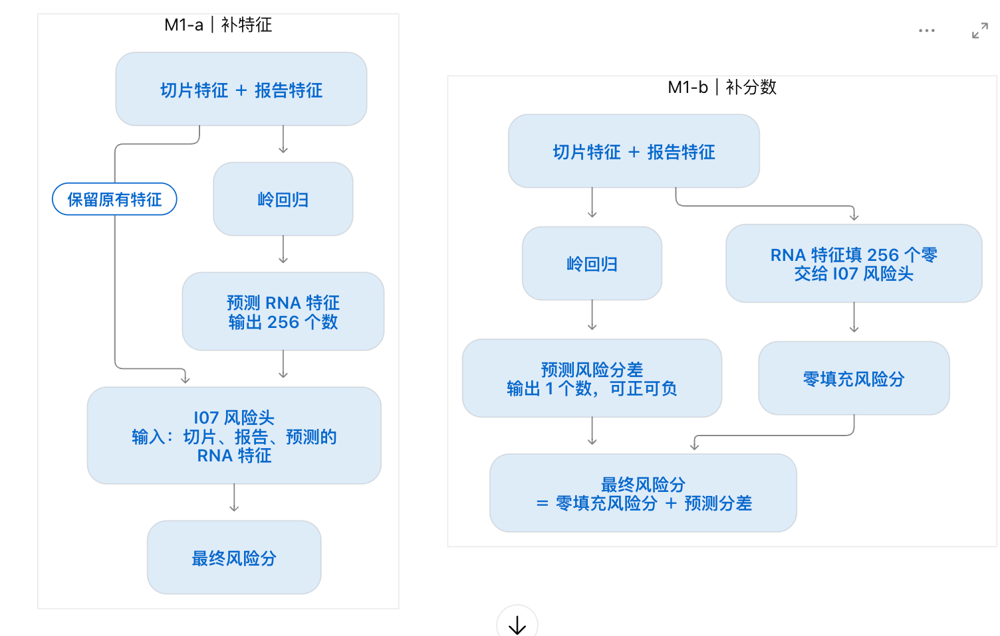

# I08 验证集消融与可解释性报告 v1（开发期 val，不进论文主表）

> 生成：`train_eval.py report`｜缓存 manifest sha256 `b52767a8c5f871f164762b2b180237002bf3a02adb0040a13d757ab1a75e1f6f`｜config sha256 `3afdcb16e9b080a3f92e20802f3d19be3bbb0b29815e8169b3f108c3ed5f4085`｜源码 commit `5c508587deec0c88e0b85ca7e162a90ae7ba5185`｜结果摘要 sha256 `832da25189ca694268faba506ea936c2324d02cea8c29d4de0453b218f29ee91`
> 范围：5 癌（BLCA, BRCA, LUAD, LGG, UCEC）× 5 折，只用本折 train / val；test 未读取（test_access: false）。
>
>

> sdfdsfsd

## 口径与必须一并阅读的事实

- **开发期 val**：本报告的 val 同时用于 Stage 2a 选 epoch / 选配置（`r=32, λ_m=0.1` 全部 25 折固定）与 Stage 2b 选 K、τ、α_max，数字对网格大的方法偏乐观；`@default` 行不在 val 上选超参（Stage 2a 仍按 val 选最佳 epoch），是更公平的参照。不进论文主表；test 需另行授权。
- **Full 列对所有方法相同**：Full 场景一律直通缓存的 I07 原风险分（D0 恒等，导出时逐患者误差 < 1e-6）。
- **M0-a 与 M0-b 的 C-index 必然相同**：常数填充经线性风险头只给所有患者加同一常数，排序不变（I07 已证实）；两者只在 Cox 损失上不同。M0-a 直接使用缓存的 I07 缺失前向风险；本机用缓存特征重算的零填充风险与它的差 < 1e-5（跨设备容差）。I07 历史只存了 test 预测，“与 I07 历史逐值一致”只能由导出时的 D0 守卫证明。#Re
- **LOO 留一法杠杆去偏与自掩码（M6-a vs M5）**：在 `M6-a`（`in_fold_masked`）中，本折训练集 `B1` 的预测残差按可见潜空间拼接输入 $b_{\text{in}}$ 的 Hat 矩阵对角元做留一杠杆去偏校准 $e_{j,u}^{\text{LOO}} = (z_{j,u}^F - \hat{z}_{j,u}^{\text{B1}}) / \max(1 - H_{jj}, 10^{-4})$，且门控统计量 $\delta_\Omega, \text{IQR}_\Omega$ 通过自掩码（$j \neq q$）由训练集留一最近邻相似度算出；M5 按用户裁定（2026-11-08）定义为“去门控（$\alpha_i \equiv \alpha_{\max}$）+ 样本内未去偏残差 + $\delta/\text{IQR}$ 统计不做自掩码”。#？？？ LOO 自掩码对 val 查询不起作用的话，是否应该起作用？是否应该补充下mask掩码的实验？（已通过补齐 B1 自身残差的 Hat 矩阵留一杠杆去偏 $(1-H_{jj})^{-1}$ 修复）
- **M6-b 口径**：残差池来自固定 U_m 上 (b_in → z^F_u) 的闭式 Ridge 精确留一残差（λ = ridge_lam_for_hat），基座预测仍是梯度训练的 B1，两者不是同一个预测器；保留 B1 基座是为了保证 α_max = 0 时与 M2 逐值相同。
- **B5 口径**：M4-a 的单模态映射 R_{m→u} 在单模态视角 p^{m} 上训练，用于双模态视角时输入的是 p^{Ω} 下的 z_m，存在分布偏移；σ²_{m→u} 为 train 上的样本内均方误差（handoff 写“留一”，公式为样本内，按公式实现）。M4-b 假设 C1 已把各模态坐标对齐。
- **零初始化**：B1 的 R、b 零初始化（起点 = 缺失位填 μ^F_u，即 M0-b），〔裁定〕handoff 未规定初始化。
- **正交参数化**：U_m 用 torch orthogonal 参数化的 cayley 映射；tall 矩阵默认的 householder 映射叠加 weight decay 会失去正交性（本会话实测）。
- **可解释性表**（表 4、表 5）对 M2 默认基座（r=32、λ_m=0.1）+ B6-LOO 默认超参（K=10、τ=0.1、α_max=0.5）计算，避免 val 选出 α_max=0 时修正量恒为 0、无法分析；不代表选中配置。

## 表 1　总体消融（val C-index，折内平均 → 五癌宏平均）

#？？？ 为什么你可以默认将实验结果分成调参前（`@default`）和调参后，是我发送给你的患者级动态恢复_v1.handoff.md中含有这个约束条件？在我后续实验过程中，如何可以将`调参前（@default）和调参后`约束给其他执行实验的AI，让此技能可以完整地复用

`@default` = 固定默认超参，**没有调参**,、不在 val 上选择的参照行。#Re Δ 列为 6-Missing Avg 的配对差（25 个癌×折均值，括号内为严格胜场 / 25）。

| 方法                                                                                                                                                                                                                                                           | 变体                                                                                | 1-Mod Avg | 2-Mod Avg | Full   | 6-Missing Avg | Overall 7-Case | val Cox (6 缺失) | Δ vs M0-a      | Δ vs M2        | Δ vs M3        |
| -------------------------------------------------------------------------------------------------------------------------------------------------------------------------------------------------------------------------------------------------------------- | ----------------------------------------------------------------------------------- | --------- | --------- | ------ | ------------- | -------------- | ---------------- | --------------- | --------------- | --------------- |
| ~~M0-a~~ 特征层： 是每位患者都填256个零                                                                                                                                                                                                             | ~~I07 + Zero~~                                                                     | 0.6373    | 0.6666    | 0.6777 | 0.6519        | 0.6556         | 2.9040           | —              | -0.0046 (8/25)  | -0.0070 (10/25) |
| ~~M0-b~~                                                                                                                                                                                                                                                      | ~~I07 + Train-Mean (w/o B)~~                                                       | 0.6373    | 0.6666    | 0.6777 | 0.6519        | 0.6556         | 2.9040           | +0.0000 (0/25)  | -0.0046 (8/25)  | -0.0070 (10/25) |
| M1-a                                                                                                                                                                                                                                                           | B0 (256-d Ridge) 输入：现有模态做 方法：岭回归 输出：256维的预测特征 | 0.6535    | 0.6692    | 0.6777 | 0.6613        | 0.6637         | 2.8776           | +0.0094 (16/25) | +0.0049 (14/25) | +0.0024 (16/25) |
| M1-a@default                                                                                                                                                                                                                                                   | B0 (256-d Ridge)                                                                    | 0.6277    | 0.6568    | 0.6777 | 0.6423        | 0.6473         | 2.9438           | -0.0097 (13/25) | -0.0142 (9/25)  | -0.0166 (9/25)  |
| M1-b                                                                                                                                                                                                                                                           | C0 (risk-residual Ridge)                                                            | 0.6550    | 0.6712    | 0.6777 | 0.6631        | 0.6652         | 2.8759           | +0.0112 (17/25) | +0.0066 (14/25) | +0.0042 (19/25) |
| M1-b@default                                                                                                                                                                                                                                                   | C0 (risk-residual Ridge)                                                            | 0.6239    | 0.6548    | 0.6777 | 0.6394        | 0.6449         | 2.9684           | -0.0125 (11/25) | -0.0171 (8/25)  | -0.0195 (8/25)  |
| M2                                                                                                                                                                                                                                                             | A1 + B1 + C1                                                                        | 0.6452    | 0.6678    | 0.6777 | 0.6565        | 0.6595         | 2.8797           | +0.0046 (16/25) | —              | -0.0024 (13/25) |
| M2@default                                                                                                                                                                                                                                                     | A1 + B1 + C1                                                                        | 0.6452    | 0.6678    | 0.6777 | 0.6565        | 0.6595         | 2.8797           | +0.0046 (16/25) | +0.0000 (0/25)  | -0.0024 (13/25) |
| **M3  （RMoE患者级邻居追踪）**                                                                                                                                                                                                                 | A1 + B3 + C1                                                                        | 0.6505    | 0.6673    | 0.6777 | 0.6589        | 0.6616         | 2.8965           | +0.0070 (15/25) | +0.0024 (12/25) | —              |
| M3@default                                                                                                                                                                                                                                                     | A1 + B3 + C1                                                                        | 0.6397    | 0.6654    | 0.6777 | 0.6526        | 0.6562         | 2.9115           | +0.0006 (13/25) | -0.0039 (11/25) | -0.0063 (7/25)  |
| M4-a                                                                                                                                                                                                                                                           | A1 + B5-MapPrecision + C1                                                           | 0.6451    | 0.6683    | 0.6777 | 0.6567        | 0.6597         | 2.8856           | +0.0048 (15/25) | +0.0002 (13/25) | -0.0022 (13/25) |
| M4-a@default                                                                                                                                                                                                                                                   | A1 + B5-MapPrecision + C1                                                           | 0.6451    | 0.6683    | 0.6777 | 0.6567        | 0.6597         | 2.8856           | +0.0048 (15/25) | +0.0002 (13/25) | -0.0022 (13/25) |
| M4-b                                                                                                                                                                                                                                                           | A1 + B5-DirectCoord + C1                                                            | 0.6293    | 0.6653    | 0.6777 | 0.6473        | 0.6517         | 2.9061           | -0.0046 (9/25)  | -0.0092 (10/25) | -0.0116 (9/25)  |
| M4-b@default                                                                                                                                                                                                                                                   | A1 + B5-DirectCoord + C1                                                            | 0.6293    | 0.6653    | 0.6777 | 0.6473        | 0.6517         | 2.9061           | -0.0046 (9/25)  | -0.0092 (10/25) | -0.0116 (9/25)  |
| M5                                                                                                                                                                                                                        | A1 + B6-Naive + C1                                                                  | 0.6554    | 0.6774    | 0.6777 | 0.6664        | 0.6680         | 2.8544           | +0.0145 (19/25) | +0.0099 (15/25) | +0.0075 (15/25) |
| M5@default #todo 可以作为后续对照                                                                                                                                                                                                                         | A1 + B6-Naive + C1                                                                  | 0.6457    | 0.6721    | 0.6777 | 0.6589        | 0.6616         | 2.8762           | +0.0070 (15/25) | +0.0024 (15/25) | +0.0000 (11/25) |
| **M6-a  用现有模态补RNA,再看模型过去在相似患者身上通常会错多少（含留一杠杆去偏校准），越像的人影响越大**---  :但M5对每位患者都用同一个采纳比例, M6-a会看当前患者和最近邻有多像来调这个比例 | A1 + B6-LOO (in_fold_masked) + C1                                                   | 0.6551    | 0.6763    | 0.6777 | 0.6657        | 0.6674         | 2.8562           | +0.0138 (22/25) | +0.0092 (18/25) | +0.0068 (13/25) |
| M6-a@default                                                                                                                                                                                                                                                   | A1 + B6-LOO (in_fold_masked) + C1                                                   | 0.6479    | 0.6709    | 0.6777 | 0.6594        | 0.6620         | 2.8753           | +0.0075 (18/25) | +0.0029 (17/25) | +0.0005 (11/25) |
| M6-b 闭式Ridge残差对照                                                                                                                                                                                                                                    | A1 + B6-LOO (exact_loo_hat) + C1                                                    | 0.6553    | 0.6688    | 0.6777 | 0.6621        | 0.6643         | 2.8689           | +0.0102 (19/25) | +0.0056 (15/25) | +0.0032 (14/25) |
| M6-b@default                                                                                                                                                                                                                                                   | A1 + B6-LOO (exact_loo_hat) + C1                                                    | 0.6480    | 0.6686    | 0.6777 | 0.6583        | 0.6611         | 2.8782           | +0.0064 (17/25) | +0.0018 (16/25) | -0.0006 (13/25) |
| M7                                                                                                                                                                                                                                                             | 256-d B6-LOO (w/o A1)                                                               | 0.6584    | 0.6702    | 0.6777 | 0.6643        | 0.6662         | 2.8623           | +0.0124 (19/25) | +0.0078 (15/25) | +0.0054 (15/25) |
| M7@default                                                                                                                                                                                                                | 256-d B6-LOO (w/o A1)                                                               | 0.6256    | 0.6555    | 0.6777 | 0.6406        | 0.6459         | 2.9440           | -0.0114 (11/25) | -0.0159 (10/25) | -0.0183 (7/25)  |
| M8                                                                                                                                                                                                                                                             | A1 + B6-LOO (w/o C1)                                                                | 0.6542    | 0.6761    | 0.6777 | 0.6651        | 0.6669         | 2.8564           | +0.0132 (22/25) | +0.0086 (20/25) | +0.0062 (14/25) |
| M8@default  #todo 可以作为后续对照                                                                                                                                                                                                                   | **A1 + B6-LOO (w/o C1)**                                                      | 0.6465    | 0.6693    | 0.6777 | 0.6579        | 0.6607         | 2.8775           | +0.0060 (16/25) | +0.0014 (14/25) | -0.0010 (11/25) |
| M9                                                                                                                                                                                                                                                             | PCA-32 (A5) + B6-LOO                                                                | 0.6575    | 0.6754    | 0.6777 | 0.6664        | 0.6680         | 2.8557           | +0.0145 (20/25) | +0.0099 (21/25) | +0.0075 (15/25) |
| M9@default                                                                                                                                                                                                                                                     | PCA-32 (A5) + B6-LOO                                                                | 0.6463    | 0.6710    | 0.6777 | 0.6586        | 0.6614         | 2.8751           | +0.0067 (18/25) | +0.0021 (15/25) | -0.0003 (12/25) |
| M9-base                                                                                                                                                                                                                                                        | A5 + B1（M9 基座）                                                                  | 0.6445    | 0.6701    | 0.6777 | 0.6573        | 0.6602         | 2.8787           | +0.0054 (14/25) | +0.0008 (9/25)  | -0.0016 (12/25) |
| **M10-a**                                                                                                                                                                                                                                                | **A1 + B1 (λm=0, λc=0)**                                                    | 0.6437    | 0.6681    | 0.6777 | 0.6559        | 0.6590         | 2.8855           | +0.0040 (17/25) | -0.0006 (12/25) | -0.0030 (13/25) |
| M10-a@default                                                                                                                                                                                                                                                  | A1 + B1 (λm=0, λc=0)                                                              | 0.6437    | 0.6681    | 0.6777 | 0.6559        | 0.6590         | 2.8855           | +0.0040 (17/25) | -0.0006 (12/25) | -0.0030 (13/25) |
| M10-b                                                                                                                                                                                                                                                          | A1 + B1 + C1 (λm=0, λc=1)                                                         | 0.6452    | 0.6682    | 0.6777 | 0.6567        | 0.6597         | 2.8798           | +0.0048 (15/25) | +0.0002 (12/25) | -0.0022 (12/25) |
| M10-b@default                                                                                                                                                                                                                                                  | A1 + B1 + C1 (λm=0, λc=1)                                                         | 0.6452    | 0.6682    | 0.6777 | 0.6567        | 0.6597         | 2.8798           | +0.0048 (15/25) | +0.0002 (12/25) | -0.0022 (12/25) |
| M10-c                                                                                                                                                                                                                                                          | A1 + B1 + C1 (λm=0.1, λc=0)                                                       | 0.6441    | 0.6680    | 0.6777 | 0.6561        | 0.6592         | 2.8851           | +0.0042 (15/25) | -0.0004 (13/25) | -0.0028 (13/25) |
| M10-c@default                                                                                                                                                                                                                                                  | A1 + B1 + C1 (λm=0.1, λc=0)                                                       | 0.6441    | 0.6680    | 0.6777 | 0.6561        | 0.6592         | 2.8851           | +0.0042 (15/25) | -0.0004 (13/25) | -0.0028 (13/25) |

## 表 2　分缺失模式（五癌平均 val C-index；列 = 可见模态）

| 方法                                    | rna    | wsi    | text   | rna+wsi | rna+text | wsi+text |
| --------------------------------------- | ------ | ------ | ------ | ------- | -------- | -------- |
| M0-a                                    | 0.6554 | 0.6458 | 0.6107 | 0.6736  | 0.6715   | 0.6545   |
| M0-b                                    | 0.6554 | 0.6458 | 0.6107 | 0.6736  | 0.6715   | 0.6545   |
| M1-a                                    | 0.6690 | 0.6546 | 0.6369 | 0.6728  | 0.6779   | 0.6568   |
| M1-a@default                            | 0.6282 | 0.6419 | 0.6131 | 0.6680  | 0.6493   | 0.6531   |
| M1-b                                    | 0.6714 | 0.6567 | 0.6369 | 0.6738  | 0.6818   | 0.6581   |
| M1-b@default                            | 0.6248 | 0.6432 | 0.6037 | 0.6679  | 0.6407   | 0.6560   |
| M2                                      | 0.6630 | 0.6430 | 0.6297 | 0.6749  | 0.6755   | 0.6530   |
| M2@default                              | 0.6630 | 0.6430 | 0.6297 | 0.6749  | 0.6755   | 0.6530   |
| M3                                      | 0.6747 | 0.6512 | 0.6255 | 0.6731  | 0.6714   | 0.6574   |
| M3@default                              | 0.6523 | 0.6449 | 0.6219 | 0.6722  | 0.6690   | 0.6550   |
| M4-a                                    | 0.6625 | 0.6468 | 0.6259 | 0.6772  | 0.6723   | 0.6554   |
| M4-a@default                            | 0.6625 | 0.6468 | 0.6259 | 0.6772  | 0.6723   | 0.6554   |
| M4-b                                    | 0.6421 | 0.6334 | 0.6126 | 0.6711  | 0.6740   | 0.6507   |
| M4-b@default                            | 0.6421 | 0.6334 | 0.6126 | 0.6711  | 0.6740   | 0.6507   |
| M5 | 0.6727 | 0.6560 | 0.6376 | 0.6848  | 0.6837   | 0.6637   |
| M5@default                              | 0.6577 | 0.6500 | 0.6294 | 0.6808  | 0.6787   | 0.6568   |
| M6-a                                    | 0.6723 | 0.6518 | 0.6412 | 0.6829  | 0.6856   | 0.6606   |
| M6-a@default                            | 0.6656 | 0.6458 | 0.6324 | 0.6786  | 0.6776   | 0.6565   |
| M6-b                                    | 0.6782 | 0.6441 | 0.6437 | 0.6747  | 0.6788   | 0.6531   |
| M6-b@default                            | 0.6687 | 0.6438 | 0.6316 | 0.6750  | 0.6779   | 0.6527   |
| M7                                      | 0.6733 | 0.6537 | 0.6482 | 0.6704  | 0.6837   | 0.6565   |
| M7@default                              | 0.6229 | 0.6406 | 0.6134 | 0.6681  | 0.6457   | 0.6527   |
| M8                                      | 0.6725 | 0.6512 | 0.6388 | 0.6801  | 0.6896   | 0.6586   |
| M8@default                              | 0.6654 | 0.6489 | 0.6252 | 0.6789  | 0.6740   | 0.6549   |
| M9                                      | 0.6752 | 0.6505 | 0.6468 | 0.6771  | 0.6898   | 0.6591   |
| M9@default                              | 0.6643 | 0.6450 | 0.6295 | 0.6774  | 0.6774   | 0.6582   |
| M9-base                                 | 0.6616 | 0.6438 | 0.6282 | 0.6771  | 0.6744   | 0.6589   |
| M10-a                                   | 0.6635 | 0.6482 | 0.6195 | 0.6775  | 0.6746   | 0.6523   |
| M10-a@default                           | 0.6635 | 0.6482 | 0.6195 | 0.6775  | 0.6746   | 0.6523   |
| M10-b                                   | 0.6638 | 0.6431 | 0.6288 | 0.6745  | 0.6752   | 0.6551   |
| M10-b@default                           | 0.6638 | 0.6431 | 0.6288 | 0.6745  | 0.6752   | 0.6551   |
| M10-c                                   | 0.6639 | 0.6497 | 0.6187 | 0.6774  | 0.6748   | 0.6520   |
| M10-c@default                           | 0.6639 | 0.6497 | 0.6187 | 0.6774  | 0.6748   | 0.6520   |

## 表 3　分癌种（6 种缺失模式平均 val C-index，5 折平均）

| 方法          | BLCA   | BRCA   | LUAD   | LGG    | UCEC   |
| ------------- | ------ | ------ | ------ | ------ | ------ |
| M0-a          | 0.5713 | 0.5886 | 0.6591 | 0.7874 | 0.6532 |
| M0-b          | 0.5713 | 0.5886 | 0.6591 | 0.7874 | 0.6532 |
| M1-a          | 0.5782 | 0.5986 | 0.6592 | 0.8091 | 0.6617 |
| M1-a@default  | 0.5684 | 0.5748 | 0.6540 | 0.7893 | 0.6247 |
| M1-b          | 0.5816 | 0.5963 | 0.6581 | 0.8123 | 0.6673 |
| M1-b@default  | 0.5694 | 0.5695 | 0.6480 | 0.7855 | 0.6245 |
| M2            | 0.5829 | 0.5961 | 0.6592 | 0.7894 | 0.6550 |
| M2@default    | 0.5829 | 0.5961 | 0.6592 | 0.7894 | 0.6550 |
| M3            | 0.5691 | 0.6086 | 0.6545 | 0.8059 | 0.6564 |
| M3@default    | 0.5618 | 0.6020 | 0.6491 | 0.8031 | 0.6468 |
| M4-a          | 0.5814 | 0.5922 | 0.6585 | 0.7930 | 0.6583 |
| M4-a@default  | 0.5814 | 0.5922 | 0.6585 | 0.7930 | 0.6583 |
| M4-b          | 0.5625 | 0.5878 | 0.6421 | 0.7961 | 0.6481 |
| M4-b@default  | 0.5625 | 0.5878 | 0.6421 | 0.7961 | 0.6481 |
| M5            | 0.5887 | 0.6113 | 0.6628 | 0.8044 | 0.6648 |
| M5@default    | 0.5771 | 0.6048 | 0.6581 | 0.8039 | 0.6506 |
| M6-a          | 0.5875 | 0.6118 | 0.6613 | 0.7984 | 0.6696 |
| M6-a@default  | 0.5772 | 0.6023 | 0.6616 | 0.8003 | 0.6557 |
| M6-b          | 0.5821 | 0.6090 | 0.6651 | 0.7957 | 0.6585 |
| M6-b@default  | 0.5828 | 0.5974 | 0.6625 | 0.7947 | 0.6541 |
| M7            | 0.5776 | 0.5991 | 0.6623 | 0.8115 | 0.6710 |
| M7@default    | 0.5662 | 0.5739 | 0.6543 | 0.7874 | 0.6210 |
| M8            | 0.5865 | 0.6125 | 0.6588 | 0.7982 | 0.6696 |
| M8@default    | 0.5747 | 0.5985 | 0.6621 | 0.7964 | 0.6577 |
| M9            | 0.5904 | 0.6135 | 0.6573 | 0.7969 | 0.6740 |
| M9@default    | 0.5738 | 0.5999 | 0.6606 | 0.7951 | 0.6638 |
| M9-base       | 0.5832 | 0.5942 | 0.6570 | 0.7900 | 0.6623 |
| M10-a         | 0.5822 | 0.5919 | 0.6594 | 0.7879 | 0.6583 |
| M10-a@default | 0.5822 | 0.5919 | 0.6594 | 0.7879 | 0.6583 |
| M10-b         | 0.5837 | 0.5959 | 0.6579 | 0.7908 | 0.6553 |
| M10-b@default | 0.5837 | 0.5959 | 0.6579 | 0.7908 | 0.6553 |
| M10-c         | 0.5834 | 0.5920 | 0.6601 | 0.7874 | 0.6575 |
| M10-c@default | 0.5834 | 0.5920 | 0.6601 | 0.7874 | 0.6575 |

## 表 4　机理：可恢复子空间 vs 正交剩余的跨模态可预测性（val，25 个癌×折平均）

可见 = 另外两个模态的 x^Ω；Ridge 在本折 train 拟合（λ 固定）。ρ_r = 风险头权重在 U_u 列空间的能量占比，随机 r 维子空间期望 r/d。

| 目标模态 u | R²_val(p^sha) | R²_val(p^res) | cos(p^sha) | cos(p^res) | val 能量占比 p^sha | ρ_r(u) | 随机期望 r/d |
| ---------- | -------------- | -------------- | ---------- | ---------- | ------------------ | ------- | ------------ |
| rna        | 0.0974         | -0.5683        | 0.6160     | 0.2590     | 0.6364             | 0.6281  | 0.1250       |
| wsi        | -0.2492        | -0.4775        | 0.3222     | 0.0710     | 0.7258             | 0.6945  | 0.1250       |
| text       | 0.2493         | -0.3124        | 0.6545     | 0.3186     | 0.7015             | 0.6800  | 0.1250       |

## 表 5　可解释性定量核验（M2 默认基座 + B6-LOO 默认超参，val）

| 检验                              | 指标                                             | 值                            |
| --------------------------------- | ------------------------------------------------ | ----------------------------- |
| ① 稳定性（train 20×80% 子采样） | Top-K 邻居 Jaccard（均值 ± sd，25 折）          | 0.6845 ± 0.0046              |
| ① 稳定性                         | 残差修正方向余弦（均值 ± sd）                   | 0.9335 ± 0.0111              |
| ② 忠实性（Top-1 擦除）           | 中位\|Δh\|：Top-1 / 随机另一邻居（n=7554）      | 0.01296 / 0.00423             |
| ② 忠实性                         | 配对 Wilcoxon（Top-1 > 随机）                    | W=24013865.5, 单侧 p=0.00e+00 |
| ② 忠实性                         | Top-1 在线性贡献中的平均占比                     | 0.2420                        |
| ③ 门控-收益关联                  | Spearman(s_(1), ΔE)（n=7554）                   | ρ=0.1686, p=2.96e-49         |
| ③ 门控-收益关联                  | Spearman(α_i, ΔE)                              | ρ=0.1647, p=4.19e-47         |
| ③ 门控-收益关联                  | 平均 ΔE（>0 表示 B6 比 B1 更接近 I07 完整风险） | +0.03030                      |
| ③ 半区 ΔC-index（B6 − B1）     | 高置信 s_(1) ≥ δ（n=149 个模式×折）           | -0.0001                       |
| ③ 半区 ΔC-index（B6 − B1）     | 低置信 s_(1) < δ（n=150）                       | +0.0049                       |

## 选中的超参数（逐癌×折）

见同目录 `val_dev-5c508587/val_runs/<癌>_fold<k>.json` 的 `methods.<方法>.hparams`（全部 25 折严格锁定 `r=32, lambda_modal=0.1`）。
