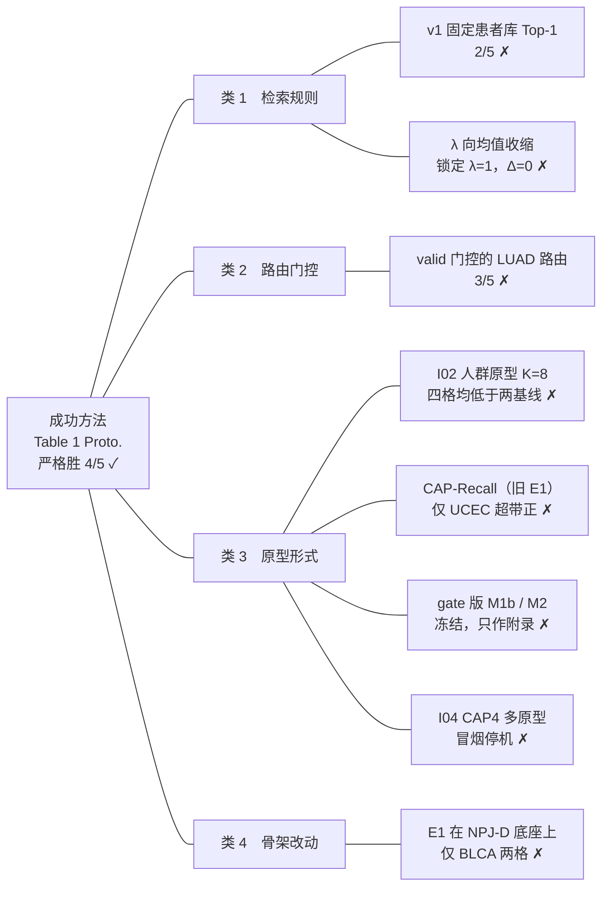

# 1.innovation-computation：缺失模态补偿的失败实验

本方向的问题：某个模态缺失时，推理阶段用什么填补，才能在五癌上超过「不补偿」和「均值补偿」。
成功方法：论文 Table 1 Proto.（S0-force），五癌中 4/5 严格胜两条基线。图例见 [README](README.md) 的「状态图例」。卡片里的表格和图都是当时输出的原表，原样复制。

## 实验地图



## 总览表

| 类别 | 实验 | 改了什么 | 严格胜 | 状态 | 可作论文对照 |
|---|---|---|---|---|---|
| 检索规则 | v1 固定患者库 Top-1 | 按行序展平余弦选 Top-1 donor，整段复制其 RNA/Text | 2/5 | ✗ negative | 与 Table 1 同一批权重，可逐列对照；无账本行 / tag |
| 检索规则 | λ 向均值收缩 | 填入值向同癌均值收缩 | valid 锁定 λ=1，test Δ=0 | ✗ 规则无效 | 同上 |
| 路由门控 | valid 门控的 LUAD 路由 | LUAD 改走固定路由，由 valid 决定开关 | 3/5 | ✗ 未达标 | 同上 |
| 原型形式 | I02 人群原型 K=8 | K-means 人群原型，重训 | 四格五癌均值均低于两基线 | ✗ negative | 历史对照，非同协议消融 |
| 原型形式 | CAP-Recall（旧 E1） | WSI 锚对癌种原型做 cross-attention 召回，重训 | 对 E0m 仅 UCEC 超带正 | ✗ | 同上 |
| 原型形式 | gate 版 M1b / M2 | gate 骨架上的可学习 bank / 召回 | — | ✗ 冻结，只作附录 | 同上 |
| 原型形式 | I04 CAP4 多原型 | 每个时间箱多个原型 | 仅冒烟 | ✗ 不开全量 | 同上 |
| 骨架改动 | E1 在 NPJ-D 底座上 | 底座换成 NPJ-D，25 seed | 「原型有效」仅 BLCA 两格 | ✗ 不稳健 | 同上 |

## 类 1　检索规则

改的是按什么选 donor、怎样填入，网络权重不变。

### v1 固定患者库 Top-1

来源：[v1-原型检索失败复盘.md](<../消融实验/1.innovation-computation/1progress-v1失败原型/v1-原型检索失败复盘.md>)（表由同目录 build_v1_tables.py 生成）· 协议 `patient-fixed-padmask-v2` · 2026-09-15 · 无账本行 / run tag；该目录未入 git

**当时输出的表**（v1-table1.png，版式同论文 Table 1）


**复盘表 C**（第 204–219 行原样复制）

##### 表 C：癌种胜负，v1 对比 v2（S0-force）

“严格胜”指该癌 overall 同时高于不补偿和均值补偿。v2 的数值取自 `4progress-claude交接/实验先验知识与公式说明.md` §3。

| 癌种 | 不补偿 | 均值补偿 | v1 检索 | v1 严格胜两条基线 | v2 S0-force | v2 严格胜两条基线 |
| --- | --- | --- | --- | --- | --- | --- |
| BRCA | 0.656557 | 0.651172 | 0.656659 | 胜 | 0.667270 | 胜 |
| UCEC | 0.616081 | 0.616292 | 0.623959 | 胜 | 0.630369 | 胜 |
| LUAD | 0.586206 | 0.587004 | 0.578457 | 负 | 0.587039 | 胜 |
| BLCA | 0.583388 | 0.582191 | 0.570767 | 负 | 0.578982 | 负 |
| LGG | 0.711525 | 0.722464 | 0.714976 | 负 | 0.738872 | 胜 |
| **五癌 100 组等权** | 0.630751 | 0.631825 | 0.628964 | **2/5** | 0.640506 | **4/5** |

脚注：
- 两轮基线出自同一批 checkpoint，但 4.progress 复用的 BRCA 均值补偿读数与 v1 存在 ≤ 1.2e-5 的差异（例如 BRCA/both_100 为 0.614750 对 0.614738；BRCA overall 为 0.651172 对 0.651170），不影响任何胜负判定。
- v2 的 LUAD 路由参考了已看过的 test 结果，且在 valid 反对（A = 0.654042，B = 0.645226）的情况下仍强制开启，属于探索性事后分析，存在 test 泄漏；v2 的 4/5 不能写成盲测结果。

### λ 向均值收缩

来源：[2.progress 零训练改推理1-5实验结果.md](<../../experiments/I01_patient_retrieval/knowledge/data-analysis-from-grok/2.progress/result/零训练改推理1-5实验结果.md>)（脚本生成）· 协议 `patient-fixed-padmask-v2-infer-rules1to5-v1` · 2026-09-16 · 无账本行 / run tag

**结果文件原表**（第 37–47 行原样复制；规则 3 即 `03_shrinkage_lambda`）

#### 五个单点与原检索

每个 valid 锁定单点各占一行；这里只做描述性 test 汇总。

| 单点协议 | candidate_id | Test均值 | 相对原检索Δ |
| --- | --- | --- | --- |
| 01_text100_skip_compensate | single-r1 | 0.635328 | +0.006365 |
| 02_wsi_meanpool_key | single-r2 | 0.637398 | +0.008435 |
| 03_shrinkage_lambda | single-r3-l1 | 0.628964 | +0.000000 |
| 04_wsi_rna_joint_sim | single-r4-a2 | 0.631184 | +0.002220 |
| 05_imputed_token_downweight | single-r5-w0p5 | 0.631906 | +0.002942 |

<details>
<summary>valid 全部 58 个候选（第 64–127 行原样复制，λ 曲线见 03_shrinkage_lambda 五行）</summary>

#### valid全部58个候选

该表来自 valid 选择结果，只用于说明冻结依据；不与 test 重新选参。

| 协议 | candidate_id | λ | α | w | raw均值 | routed均值 | Δm1 | Δm0real | 双基线可行 | UCEC例外 |
| --- | --- | --- | --- | --- | --- | --- | --- | --- | --- | --- |
| 01_text100_skip_compensate | single-r1 | 1（未生效） | 0（未生效） | 1（未生效） | 0.635698 | 0.635698 | 0.019746 | 0.008441 | 是 | 启用 |
| 02_wsi_meanpool_key | single-r2 | 1（未生效） | 0（未生效） | 1（未生效） | 0.638797 | 0.638797 | 0.022845 | 0.011541 | 是 | 固定m0real/不适用 |
| 03_shrinkage_lambda | single-r3-l0 | 0 | 0（未生效） | 1（未生效） | 0.615952 | 0.615952 | 0.000000 | -0.011304 | 否 | 固定m0real/不适用 |
| 03_shrinkage_lambda | single-r3-l0p25 | 0.25 | 0（未生效） | 1（未生效） | 0.621609 | 0.621609 | 0.005657 | -0.005647 | 否 | 固定m0real/不适用 |
| 03_shrinkage_lambda | single-r3-l0p5 | 0.5 | 0（未生效） | 1（未生效） | 0.627814 | 0.627814 | 0.011862 | 0.000558 | 是 | 固定m0real/不适用 |
| 03_shrinkage_lambda | single-r3-l0p75 | 0.75 | 0（未生效） | 1（未生效） | 0.632995 | 0.632995 | 0.017043 | 0.005739 | 是 | 固定m0real/不适用 |
| 03_shrinkage_lambda | single-r3-l1 | 1 | 0（未生效） | 1（未生效） | 0.637833 | 0.637833 | 0.021881 | 0.010577 | 是 | 固定m0real/不适用 |
| 04_wsi_rna_joint_sim | single-r4-a0p5 | 1（未生效） | 0.5 | 1（未生效） | 0.639169 | 0.639169 | 0.023217 | 0.011913 | 是 | 固定m0real/不适用 |
| 04_wsi_rna_joint_sim | single-r4-a1 | 1（未生效） | 1 | 1（未生效） | 0.637967 | 0.637967 | 0.022015 | 0.010710 | 是 | 固定m0real/不适用 |
| 04_wsi_rna_joint_sim | single-r4-a2 | 1（未生效） | 2 | 1（未生效） | 0.640670 | 0.640670 | 0.024718 | 0.013413 | 是 | 固定m0real/不适用 |
| 05_imputed_token_downweight | single-r5-w0p2 | 1（未生效） | 0（未生效） | 0.2 | 0.631513 | 0.631513 | 0.015561 | 0.004257 | 是 | 固定m0real/不适用 |
| 05_imputed_token_downweight | single-r5-w0p3 | 1（未生效） | 0（未生效） | 0.3 | 0.633500 | 0.633500 | 0.017548 | 0.006244 | 是 | 固定m0real/不适用 |
| 05_imputed_token_downweight | single-r5-w0p5 | 1（未生效） | 0（未生效） | 0.5 | 0.635954 | 0.635954 | 0.020002 | 0.008698 | 是 | 固定m0real/不适用 |
| combo | combo-l0-a0p5-w0p2 | 0 | 0.5（未生效） | 0.2 | 0.622495 | 0.622923 | 0.006971 | -0.004334 | 否 | 固定m0real/不适用 |
| combo | combo-l0-a0p5-w0p3 | 0 | 0.5（未生效） | 0.3 | 0.621566 | 0.621950 | 0.005998 | -0.005307 | 否 | 固定m0real/不适用 |
| combo | combo-l0-a0p5-w0p5 | 0 | 0.5（未生效） | 0.5 | 0.619056 | 0.619362 | 0.003410 | -0.007894 | 否 | 固定m0real/不适用 |
| combo | combo-l0-a1-w0p2 | 0 | 1（未生效） | 0.2 | 0.622495 | 0.622923 | 0.006971 | -0.004334 | 否 | 固定m0real/不适用 |
| combo | combo-l0-a1-w0p3 | 0 | 1（未生效） | 0.3 | 0.621566 | 0.621950 | 0.005998 | -0.005307 | 否 | 固定m0real/不适用 |
| combo | combo-l0-a1-w0p5 | 0 | 1（未生效） | 0.5 | 0.619056 | 0.619362 | 0.003410 | -0.007894 | 否 | 固定m0real/不适用 |
| combo | combo-l0-a2-w0p2 | 0 | 2（未生效） | 0.2 | 0.622495 | 0.622923 | 0.006971 | -0.004334 | 否 | 固定m0real/不适用 |
| combo | combo-l0-a2-w0p3 | 0 | 2（未生效） | 0.3 | 0.621566 | 0.621950 | 0.005998 | -0.005307 | 否 | 固定m0real/不适用 |
| combo | combo-l0-a2-w0p5 | 0 | 2（未生效） | 0.5 | 0.619056 | 0.619362 | 0.003410 | -0.007894 | 否 | 固定m0real/不适用 |
| combo | combo-l0p25-a0p5-w0p2 | 0.25 | 0.5（未生效） | 0.2 | 0.623554 | 0.623817 | 0.007865 | -0.003439 | 否 | 固定m0real/不适用 |
| combo | combo-l0p25-a0p5-w0p3 | 0.25 | 0.5（未生效） | 0.3 | 0.623217 | 0.623327 | 0.007375 | -0.003930 | 否 | 固定m0real/不适用 |
| combo | combo-l0p25-a0p5-w0p5 | 0.25 | 0.5 | 0.5 | 0.622515 | 0.622515 | 0.006563 | -0.004741 | 否 | 启用 |
| combo | combo-l0p25-a1-w0p2 | 0.25 | 1（未生效） | 0.2 | 0.623554 | 0.623817 | 0.007865 | -0.003439 | 否 | 固定m0real/不适用 |
| combo | combo-l0p25-a1-w0p3 | 0.25 | 1（未生效） | 0.3 | 0.623195 | 0.623327 | 0.007375 | -0.003930 | 否 | 固定m0real/不适用 |
| combo | combo-l0p25-a1-w0p5 | 0.25 | 1 | 0.5 | 0.622515 | 0.622515 | 0.006563 | -0.004741 | 否 | 启用 |
| combo | combo-l0p25-a2-w0p2 | 0.25 | 2（未生效） | 0.2 | 0.623565 | 0.623817 | 0.007865 | -0.003439 | 否 | 固定m0real/不适用 |
| combo | combo-l0p25-a2-w0p3 | 0.25 | 2（未生效） | 0.3 | 0.623195 | 0.623327 | 0.007375 | -0.003930 | 否 | 固定m0real/不适用 |
| combo | combo-l0p25-a2-w0p5 | 0.25 | 2 | 0.5 | 0.622526 | 0.622526 | 0.006574 | -0.004730 | 否 | 启用 |
| combo | combo-l0p5-a0p5-w0p2 | 0.5 | 0.5 | 0.2 | 0.625917 | 0.625917 | 0.009965 | -0.001339 | 否 | 启用 |
| combo | combo-l0p5-a0p5-w0p3 | 0.5 | 0.5 | 0.3 | 0.626248 | 0.626248 | 0.010296 | -0.001008 | 否 | 启用 |
| combo | combo-l0p5-a0p5-w0p5 | 0.5 | 0.5 | 0.5 | 0.626543 | 0.626543 | 0.010591 | -0.000713 | 否 | 启用 |
| combo | combo-l0p5-a1-w0p2 | 0.5 | 1 | 0.2 | 0.625928 | 0.625928 | 0.009976 | -0.001328 | 否 | 启用 |
| combo | combo-l0p5-a1-w0p3 | 0.5 | 1 | 0.3 | 0.626248 | 0.626248 | 0.010296 | -0.001008 | 否 | 启用 |
| combo | combo-l0p5-a1-w0p5 | 0.5 | 1 | 0.5 | 0.626543 | 0.626543 | 0.010591 | -0.000713 | 否 | 启用 |
| combo | combo-l0p5-a2-w0p2 | 0.5 | 2 | 0.2 | 0.625928 | 0.625928 | 0.009976 | -0.001328 | 否 | 启用 |
| combo | combo-l0p5-a2-w0p3 | 0.5 | 2 | 0.3 | 0.626237 | 0.626237 | 0.010285 | -0.001019 | 否 | 启用 |
| combo | combo-l0p5-a2-w0p5 | 0.5 | 2 | 0.5 | 0.626522 | 0.626522 | 0.010570 | -0.000735 | 否 | 启用 |
| combo | combo-l0p75-a0p5-w0p2 | 0.75 | 0.5 | 0.2 | 0.628174 | 0.628174 | 0.012222 | 0.000917 | 是 | 启用 |
| combo | combo-l0p75-a0p5-w0p3 | 0.75 | 0.5 | 0.3 | 0.629027 | 0.629027 | 0.013075 | 0.001771 | 是 | 启用 |
| combo | combo-l0p75-a0p5-w0p5 | 0.75 | 0.5 | 0.5 | 0.630625 | 0.630625 | 0.014673 | 0.003369 | 是 | 启用 |
| combo | combo-l0p75-a1-w0p2 | 0.75 | 1 | 0.2 | 0.628174 | 0.628174 | 0.012222 | 0.000917 | 是 | 启用 |
| combo | combo-l0p75-a1-w0p3 | 0.75 | 1 | 0.3 | 0.629038 | 0.629038 | 0.013086 | 0.001782 | 是 | 启用 |
| combo | combo-l0p75-a1-w0p5 | 0.75 | 1 | 0.5 | 0.630625 | 0.630625 | 0.014673 | 0.003369 | 是 | 启用 |
| combo | combo-l0p75-a2-w0p2 | 0.75 | 2 | 0.2 | 0.628152 | 0.628152 | 0.012200 | 0.000896 | 是 | 启用 |
| combo | combo-l0p75-a2-w0p3 | 0.75 | 2 | 0.3 | 0.629005 | 0.629005 | 0.013053 | 0.001749 | 是 | 启用 |
| combo | combo-l0p75-a2-w0p5 | 0.75 | 2 | 0.5 | 0.630603 | 0.630603 | 0.014651 | 0.003347 | 是 | 启用 |
| combo | combo-l1-a0p5-w0p2 | 1 | 0.5 | 0.2 | 0.629799 | 0.629799 | 0.013847 | 0.002542 | 是 | 启用 |
| combo | combo-l1-a0p5-w0p3 | 1 | 0.5 | 0.3 | 0.631444 | 0.631444 | 0.015492 | 0.004188 | 是 | 启用 |
| combo | combo-l1-a0p5-w0p5 | 1 | 0.5 | 0.5 | 0.633806 | 0.633806 | 0.017854 | 0.006550 | 是 | 启用 |
| combo | combo-l1-a1-w0p2 | 1 | 1 | 0.2 | 0.629799 | 0.629799 | 0.013847 | 0.002542 | 是 | 启用 |
| combo | combo-l1-a1-w0p3 | 1 | 1 | 0.3 | 0.631455 | 0.631455 | 0.015503 | 0.004199 | 是 | 启用 |
| combo | combo-l1-a1-w0p5 | 1 | 1 | 0.5 | 0.633839 | 0.633839 | 0.017887 | 0.006583 | 是 | 启用 |
| combo | combo-l1-a2-w0p2 | 1 | 2 | 0.2 | 0.629766 | 0.629766 | 0.013814 | 0.002509 | 是 | 启用 |
| combo | combo-l1-a2-w0p3 | 1 | 2 | 0.3 | 0.631422 | 0.631422 | 0.015470 | 0.004166 | 是 | 启用 |
| combo | combo-l1-a2-w0p5 | 1 | 2 | 0.5 | 0.633774 | 0.633774 | 0.017822 | 0.006517 | 是 | 启用 |

</details>

## 类 2　路由门控

改的是哪些场景走检索、哪些走均值，以及由谁决定开关。

### valid 门控的 LUAD 路由

来源：[3.progress 零训练改推理1-5实验结果.md](<../../experiments/I01_patient_retrieval/knowledge/data-analysis-from-grok/3.progress/result/零训练改推理1-5实验结果.md>)（脚本生成）· 协议 `patient-fixed-padmask-v2-infer-rules1to5-v1-luad-m1-v1` · 2026-09-17 · 无账本行 / run tag

**结果文件原表**（第 1–36 行原样复制）

协议：`patient-fixed-padmask-v2-infer-rules1to5-v1-luad-m1-v1`；冻结 test 指纹：`bfe858ced7933207a151c76dad3d0e291a9ade99664e17e36d6a31b9b24be800`。

- 主表为五癌×五seed×四场景共100格等权平均；`none`保留天然缺失，不是完整数据。
- 人工缺失表仅为75格（排除`none`），不替代主表。
- 标红、排名与Δ均基于未四舍五入原值；展示六位，Δ先减后舍入。
- 本轮是受既有test启发的探索性评测；若LUAD改善也只能归因于固定路由换填，不能证明患者检索机制成立。

#### valid冻结开关

| A（上游组合） | B（strategy0变体） | B−A | 冻结开关 |
| --- | --- | --- | --- |
| 0.654042 | 0.645226 | -0.008815 | 关闭 |

#### 汇总

| 范围 | strategy0组合 | 均值填补 | 不补偿 | 三臂最佳 | strategy0−均值 | strategy0−不补偿 |
| --- | --- | --- | --- | --- | --- | --- |
| 100格主表（含none） | <span style="color:#c62828"><strong>0.640155</strong></span> | 0.631824 | 0.630751 | <span style="color:#c62828"><strong>strategy0组合</strong></span> | +0.008331 | +0.009404 |
| 75格人工缺失（排除none） | <span style="color:#c62828"><strong>0.632923</strong></span> | 0.621348 | 0.620220 | <span style="color:#c62828"><strong>strategy0组合</strong></span> | +0.011575 | +0.012703 |

#### 五癌严格胜负

| 癌种 | strategy0 | m1 | m0real | 是否严格胜两基线 |
| --- | --- | --- | --- |
| BLCA | 0.578982 | 0.582191 | 0.583388 | 未胜 |
| BRCA | 0.667270 | 0.651170 | 0.656557 | 胜 |
| LGG | 0.738872 | 0.722464 | 0.711525 | 胜 |
| LUAD | 0.585284 | 0.587004 | 0.586206 | 未胜 |
| UCEC | 0.630369 | 0.616292 | 0.616081 | 胜 |

严格胜率：**3/5**；未胜癌种：BLCA、LUAD。

#### 结论边界

- 执行验收与效果目标分开：即使文件、哈希和矩阵完整，`4/5`目标未达也必须如实写为未达。
- strategy0关闭时，LUAD沿用冻结组合；不得把上游复用误写成新的路由收益。

## 类 3　原型形式

改的是原型本身的构造：人群原型、可学习 bank、召回式原型、多原型。

### I02 人群原型 K=8

来源：[report.md](<../../experiments/I02_population_prototypes/results/formal-k8-es15-e100-v1/raw/results-summary/report.md>)（本地文件，被 .gitignore 忽略，未入 git）· 实验 `formal-k8-es15-e100-v1` · 2026-09-15 · 无账本行 / run tag

**报告原表**（第 5–24 行原样复制）

#### 当前主线

[确定] **K=8 在四个共同评测点的五癌平均 C-index 均低于已有 NPJ-C 和均值填充基线，本轮没有观察到整体提升。** 分癌结果并非全负：UCEC 四格均高于两组历史基线。

[确定] 本轮 25/25 训练及缺失评测已完成，得到 325 个测试 C-index；已有 NPJ-C 无补全 E0 与均值填充 E0m 各提供 100 个测试 C-index。三方共同比较 4 格，不补造其余 9 格历史数据。

总体判定：以下比较是**历史结果对照，不是同训练协议的补全机制消融**。本轮与历史基线的最大轮数、早停及验证选 checkpoint 口径不同；数值高低不能直接归因于 K-means 或配对检索。

##### 四个共同评测点：五癌等权均值

| 测试缺失设置 | NPJ-C E0 | 均值填充 E0m | Population K8 | K8−E0 | K8−E0m |
| --- | --- | --- | --- | --- | --- |
| none | 0.6623 | 0.6633 | 0.6436 | -0.0187 | -0.0196 |
| rna_100 | 0.6545 | 0.6601 | 0.6402 | -0.0143 | -0.0199 |
| text_100 | 0.6246 | 0.6062 | 0.5735 | -0.0511 | -0.0328 |
| both_100 | 0.5816 | 0.5977 | 0.5655 | -0.0161 | -0.0322 |

上表先对每癌 5 seeds 求均值，再对 5 癌等权平均；不是将患者合并计算的 C-index。差值为 C-index 原始单位。

UCEC 相对均值填充的四格均值差为 +0.0156 至 +0.0332。BLCA、BRCA 四格均较两组基线低；LGG 的 Text 全缺及 RNA/Text 全缺较均值填充低（详见逐癌表）。这是观察到的数值分布，不解释机制原因。

### CAP-Recall（旧 E1）

来源：[A 测判定报告 r6](<../../experiments/I03_npj_d_dm_e1/results/legacy-r6-20260906/raw/20260902-A测缺失补偿/a_test_report.md>)（本地文件，被 .gitignore 忽略，未入 git）· 战役 `20260902-A测缺失补偿` · 2026-09-06 · 无账本行 / run tag

**当时输出的图**（E0 / E0d / E1 × 5 癌 × 4 格逐 seed，r4）


**报告原表**（r6 第 70–98 行原样复制）

#### 二 c、同底座最小判别：E0m（E0 ckpt + 评测期均值盲补）— 原型 vs 均值填（r5 新增；预注册规则）
留档表 `table_npjc_E0_E0m_E1_4grids.md`（E0m、E1 各自 vs E0）、`table_npjc_E1_E0d_vs_E0m_4grids.md`（E1、E0d 各自 vs E0m）、`table_both100_vs_E0m.md`；派生量 `r5_numbers.txt`（B 口径主，A 口径附）。
**定义**：E0m 用 E0 的 25 个 ckpt，评测期把缺失模态特征替换为训练集逐元素均值并把该位标记为有效 token 进入 attention（`scripts/eval_missing.py --arm m1 --network_type NPJC --m1-mark-valid`，零训练），填充定义与 gate 版 M1 相同。对拍：开关关闭时 gate 版 M1 与留档逐位一致；开关开启时 E0 ckpt 在无自然缺失的 BLCA s123 `none` 格点与 E0 留档逐位一致。
**预注册规则（2026-09-06 用户裁决，先于看数据）**：逐癌配对、同底座 E1 vs E0m；both_100 与单模态缺失分开报；每癌 胜:负:平 + 配对Δ中位；|Δ中位|<0.02 为噪声带；不设跨癌合计阈值（明确拒绝"4/5 癌 E1>E0"）；结论按癌种写成条件性。
**注记（自然缺失）**：`none` 格点下 E0m 与 E0 在 BRCA/LUAD/LGG/UCEC 不完全相同（最大 |Δ| 0.011）：这些癌种的 test 集存在自然缺失（无 manifest 遮挡也有患者缺 RNA/文本），均值填对其生效；BLCA test 无自然缺失，E0m 与 E0 在 `none` 逐 seed 相同（0:0:5）。gate 版 M1 vs M0-real 在 `none` 呈同一模式（BLCA 全平，其余非零）。
**(a) 均值填 vs 不填充：E0m vs E0（B）**（只测了均值填一种；正文"任何填充"为解释性措辞）
| 癌种 | 完整模态 | 缺 RNA | 缺文本 | 全缺 |
|---|---|---|---|---|
| BLCA | 0:0:5 (+0.0000) | 0:5:0 (−0.0036) | 2:3:0 (−0.0007) | 3:2:0 (+0.0026) |
| BRCA | 1:4:0 (−0.0058) | 3:2:0 (+0.0032) | 0:5:0 (**−0.0312**) | 4:1:0 (**+0.0241**) |
| LUAD | 4:1:0 (+0.0018) | 2:3:0 (−0.0005) | 0:5:0 (−0.0007) | 3:2:0 (+0.0033) |
| LGG | 5:0:0 (+0.0024) | 5:0:0 (**+0.0200**) | 0:5:0 (**−0.0390**) | 5:0:0 (**+0.0700**) |
| UCEC | 5:0:0 (+0.0049) | 5:0:0 (+0.0053) | 0:5:0 (−0.0096) | 4:1:0 (+0.0022) |
**(b) 原型 vs 均值填（同底座，预注册主判定）：E1 vs E0m（B）**
| 癌种 | 完整模态 | 缺 RNA | 缺文本 | 全缺 |
|---|---|---|---|---|
| BLCA | 1:4:0 (**−0.0248**) | 1:4:0 (**−0.0201**) | 1:4:0 (−0.0173) | 1:4:0 (−0.0160) |
| BRCA | 2:3:0 (−0.0143) | 2:3:0 (−0.0050) | 1:4:0 (**−0.0443**) | 1:4:0 (**−0.0584**) |
| LUAD | 4:1:0 (+0.0082) | 4:1:0 (+0.0119) | 3:2:0 (+0.0082) | 4:1:0 (+0.0135) |
| LGG | 0:5:0 (**−0.0393**) | 0:5:0 (**−0.0407**) | 2:3:0 (−0.0110) | 3:2:0 (+0.0055) |
| UCEC | **5:0:0 (+0.0231)** | **5:0:0 (+0.0332)** | **5:0:0 (+0.0710)** | **5:0:0 (+0.0630)** |
预注册判定（超带正 / 带内 / 超带负）：UCEC 四格点超带正；LUAD 四格点带内；LGG 完整/缺 RNA 超带负、缺文本/全缺带内；BRCA 缺文本/全缺超带负、完整/缺 RNA 带内负；BLCA 完整/缺 RNA 超带负、缺文本/全缺带内负。A 口径同向（差异：LUAD 缺 RNA 在 A 口径超带正 +0.0237）。
**结论 2c**：
1. 原型相对均值填的增量**只在 UCEC 成立**（四格点 5:0，+0.023 / +0.033 / +0.071 / +0.063，全部超带）。
2. **LGG 两模态全缺的收益无法归因于学习式召回**（方向判定，不做份额分解）：均值填单独相对不填充已达 +0.0700（5:0），不低于召回的 +0.0535；原型相对均值填 +0.0055（3:2，带内，逐 seed 跨度 0.10）。非全缺格点中，完整 −0.039、缺 RNA −0.041（均 0:5）超带负，缺文本 −0.011（2:3）带内。剔除 s213 后 LGG 全缺 E1 vs E0m 为 −0.0055（仍带内）、E0m vs E0 仍 +0.058（超带正），结论不变。
3. BLCA/BRCA：原型相对均值填仍为负（BLCA 完整/缺 RNA 超带负；BRCA 缺文本/全缺超带负）；BRCA 缺文本时均值填本身也有害（E0m vs E0 −0.031，0:5），即 BRCA 文本缺失时"填什么"都不如不填（UCEC 相反：缺文本时 E1 vs E0 +0.0556）。剔除 s123 后 BRCA 缺文本 −0.0401、全缺 −0.0302 仍超带负；剔除 s213 后 BLCA 四格点 0:4，结论不变。
4. LUAD：四格点带内偏正（+0.008～+0.014）。
5. 均值填并非普遍有益：缺文本时 E0m 在 BRCA（−0.031）、LGG（−0.039）超带负；只有全缺时 LGG（+0.070）、BRCA（+0.024）与缺 RNA 时 LGG（+0.020）超带正。
**边界**：E0m 是评测期填充、E1 是训练期带 dropout + 一致性 loss 的召回，训练协议不同；二 b 已示 UCEC 完整模态收益的大部分已在 E0d（协议）上出现，因此 UCEC 的"原型 > 均值填"仍含协议混淆。分离方法是 E0d 上做均值填（E0dm，零训练，本轮未跑）。

### gate 版 M1b / M2

来源：[A 测判定报告 r3](<../../experiments/_comparisons/legacy-missing-compensation-20260902/raw/20260902-A测缺失补偿/a_test_report_r3.md>)、[table_gate_4arms.md](<../../experiments/_comparisons/legacy-missing-compensation-20260902/raw/20260902-A测缺失补偿/table_gate_4arms.md>) · 2026-09-02 · 无账本行 / run tag

**当时输出的图**（四臂在缺失率 0–100% 下的曲线）


**报告原文**（r3 第 34 行原样复制）

**补充证据（gate 版四臂，附录表 `table_gate_4arms.md`，both_100 格点 vs M0-real）**：两模态全缺、仅剩 WSI 锚时，gate 版 M2（CAP-Recall）BLCA +0.018 / BRCA +0.060 / LUAD −0.0005（2:3）/ LGG +0.037 / UCEC +0.022；**均值盲补 M1 五癌全正**（+0.008 / +0.015 / +0.007 / **+0.048** / **+0.032**），且在 LGG/UCEC/LUAD 幅度高于 M2。因此 both_100 的增益主要归因于**"任何合理填充都优于作者的常量 bias token"**，学习式原型召回相对盲补的增量仅在 BRCA（+0.060 vs +0.015）与 BLCA（+0.018 vs +0.008）成立。基线提示：M0-real 在 both_100 上 LGG 极差 ~0.19、UCEC ~0.14，属高方差参照；BLCA M2 s213=0.4816 为另一崩坏 seed。E0/E1 的 both_100 补评测进行中。综合读法：**填充收益随信息缺口增大而增大——单模态缺失时（信息充足癌种）应关闭补偿，全缺时应开启填充；召回相对盲补的增量待 both_100 补评测与消融验证**。

<details>
<summary>四臂逐 seed 全表（table_gate_4arms.md 第 1–328 行原样复制）</summary>

#### 臂对比（主口径 cindex_B；对照臂 m0real）

#### 格点 none

| 癌种 | 臂 | s123 | s132 | s213 | s231 | s321 | 中位 | vs m0real 严格胜负 |
|---|---|---|---|---|---|---|---|---|
| BLCA | m0real | 0.5985 | 0.6341 | 0.6183 | 0.6103 | 0.6251 | 0.6183 |  |
| BLCA | m1 | 0.5985 | 0.6341 | 0.6183 | 0.6103 | 0.6251 | 0.6183 | 0:5 (Δ中位 +0.0000) |
| BLCA | m1b | 0.6180 | 0.5663 | 0.6003 | 0.5916 | 0.6214 | 0.6003 | 1:4 (Δ中位 -0.0180) |
| BLCA | m2 | 0.6202 | 0.6096 | 0.5736 | 0.5744 | 0.6242 | 0.6096 | 1:4 (Δ中位 -0.0245) |
| BRCA | m0real | 0.6946 | 0.6825 | 0.6853 | 0.7005 | 0.6530 | 0.6853 |  |
| BRCA | m1 | 0.6899 | 0.6765 | 0.6791 | 0.6980 | 0.6623 | 0.6791 | 1:4 (Δ中位 -0.0047) |
| BRCA | m1b | 0.6951 | 0.6842 | 0.6835 | 0.6546 | 0.6659 | 0.6835 | 3:2 (Δ中位 +0.0006) |
| BRCA | m2 | 0.6632 | 0.7026 | 0.6780 | 0.6763 | 0.6723 | 0.6763 | 2:3 (Δ中位 -0.0073) |
| LUAD | m0real | 0.5895 | 0.5404 | 0.5479 | 0.5672 | 0.5834 | 0.5672 |  |
| LUAD | m1 | 0.5870 | 0.5391 | 0.5462 | 0.5670 | 0.5828 | 0.5670 | 0:5 (Δ中位 -0.0012) |
| LUAD | m1b | 0.5876 | 0.5700 | 0.5562 | 0.5828 | 0.5811 | 0.5811 | 3:2 (Δ中位 +0.0082) |
| LUAD | m2 | 0.5609 | 0.5828 | 0.5706 | 0.5716 | 0.5627 | 0.5706 | 3:2 (Δ中位 +0.0044) |
| LGG | m0real | 0.8081 | 0.6905 | 0.7174 | 0.7267 | 0.6808 | 0.7174 |  |
| LGG | m1 | 0.8095 | 0.6912 | 0.7177 | 0.7274 | 0.6815 | 0.7177 | 5:0 (Δ中位 +0.0007) |
| LGG | m1b | 0.8019 | 0.7415 | 0.6011 | 0.7046 | 0.6163 | 0.7046 | 1:4 (Δ中位 -0.0221) |
| LGG | m2 | 0.7664 | 0.6201 | 0.7843 | 0.7095 | 0.7336 | 0.7336 | 2:3 (Δ中位 -0.0173) |
| UCEC | m0real | 0.5248 | 0.6637 | 0.5882 | 0.6408 | 0.6156 | 0.6156 |  |
| UCEC | m1 | 0.5337 | 0.6653 | 0.5929 | 0.6468 | 0.6223 | 0.6223 | 5:0 (Δ中位 +0.0060) |
| UCEC | m1b | 0.5395 | 0.6586 | 0.6154 | 0.6601 | 0.6241 | 0.6241 | 4:1 (Δ中位 +0.0147) |
| UCEC | m2 | 0.6227 | 0.6299 | 0.6272 | 0.5733 | 0.6321 | 0.6272 | 3:2 (Δ中位 +0.0165) |

#### 格点 rna_25

| 癌种 | 臂 | s123 | s132 | s213 | s231 | s321 | 中位 | vs m0real 严格胜负 |
|---|---|---|---|---|---|---|---|---|
| BLCA | m0real | 0.5939 | 0.6329 | 0.6136 | 0.6095 | 0.6320 | 0.6136 |  |
| BLCA | m1 | 0.5989 | 0.6334 | 0.6180 | 0.6114 | 0.6256 | 0.6180 | 4:1 (Δ中位 +0.0019) |
| BLCA | m1b | 0.6142 | 0.5416 | 0.5975 | 0.5946 | 0.6235 | 0.5975 | 1:4 (Δ中位 -0.0149) |
| BLCA | m2 | 0.6128 | 0.6095 | 0.5413 | 0.5581 | 0.6227 | 0.6095 | 1:4 (Δ中位 -0.0234) |
| BRCA | m0real | 0.6856 | 0.6857 | 0.6963 | 0.6965 | 0.6539 | 0.6857 |  |
| BRCA | m1 | 0.6937 | 0.6797 | 0.6816 | 0.6973 | 0.6680 | 0.6816 | 3:2 (Δ中位 +0.0008) |
| BRCA | m1b | 0.6984 | 0.6885 | 0.6915 | 0.6452 | 0.6721 | 0.6885 | 3:2 (Δ中位 +0.0028) |
| BRCA | m2 | 0.5714 | 0.6783 | 0.6565 | 0.6313 | 0.6694 | 0.6565 | 1:4 (Δ中位 -0.0397) |
| LUAD | m0real | 0.5777 | 0.5583 | 0.5558 | 0.5518 | 0.5677 | 0.5583 |  |
| LUAD | m1 | 0.5883 | 0.5363 | 0.5491 | 0.5681 | 0.5851 | 0.5681 | 3:2 (Δ中位 +0.0105) |
| LUAD | m1b | 0.5769 | 0.5878 | 0.5511 | 0.5897 | 0.5730 | 0.5769 | 3:2 (Δ中位 +0.0053) |
| LUAD | m2 | 0.5404 | 0.5558 | 0.5428 | 0.5581 | 0.5481 | 0.5481 | 1:4 (Δ中位 -0.0130) |
| LGG | m0real | 0.8061 | 0.7164 | 0.7233 | 0.7243 | 0.6850 | 0.7233 |  |
| LGG | m1 | 0.7857 | 0.6943 | 0.7181 | 0.7250 | 0.6874 | 0.7181 | 2:3 (Δ中位 -0.0052) |
| LGG | m1b | 0.8047 | 0.7384 | 0.6487 | 0.6994 | 0.6304 | 0.6994 | 1:4 (Δ中位 -0.0248) |
| LGG | m2 | 0.7105 | 0.6425 | 0.7754 | 0.6767 | 0.7250 | 0.7105 | 2:3 (Δ中位 -0.0476) |
| UCEC | m0real | 0.5028 | 0.6506 | 0.5738 | 0.6308 | 0.5903 | 0.5903 |  |
| UCEC | m1 | 0.5342 | 0.6628 | 0.5987 | 0.6535 | 0.6203 | 0.6203 | 5:0 (Δ中位 +0.0249) |
| UCEC | m1b | 0.5161 | 0.6381 | 0.5925 | 0.6468 | 0.5963 | 0.5963 | 4:1 (Δ中位 +0.0134) |
| UCEC | m2 | 0.5604 | 0.6285 | 0.6323 | 0.5382 | 0.5851 | 0.5851 | 2:3 (Δ中位 -0.0051) |

#### 格点 rna_50

| 癌种 | 臂 | s123 | s132 | s213 | s231 | s321 | 中位 | vs m0real 严格胜负 |
|---|---|---|---|---|---|---|---|---|
| BLCA | m0real | 0.6031 | 0.6289 | 0.6244 | 0.6164 | 0.6350 | 0.6244 |  |
| BLCA | m1 | 0.6006 | 0.6334 | 0.6157 | 0.6128 | 0.6256 | 0.6157 | 1:4 (Δ中位 -0.0036) |
| BLCA | m1b | 0.6131 | 0.5038 | 0.6121 | 0.6037 | 0.6228 | 0.6121 | 1:4 (Δ中位 -0.0123) |
| BLCA | m2 | 0.6005 | 0.5998 | 0.5076 | 0.5649 | 0.6077 | 0.5998 | 0:5 (Δ中位 -0.0291) |
| BRCA | m0real | 0.6437 | 0.6838 | 0.6602 | 0.6992 | 0.6103 | 0.6602 |  |
| BRCA | m1 | 0.6898 | 0.6797 | 0.6812 | 0.6969 | 0.6674 | 0.6812 | 3:2 (Δ中位 +0.0210) |
| BRCA | m1b | 0.6574 | 0.6835 | 0.6594 | 0.6481 | 0.6269 | 0.6574 | 2:3 (Δ中位 -0.0002) |
| BRCA | m2 | 0.5516 | 0.6825 | 0.6762 | 0.6302 | 0.6748 | 0.6748 | 2:3 (Δ中位 -0.0012) |
| LUAD | m0real | 0.5953 | 0.5518 | 0.5809 | 0.5612 | 0.5639 | 0.5639 |  |
| LUAD | m1 | 0.5895 | 0.5337 | 0.5469 | 0.5663 | 0.5837 | 0.5663 | 2:3 (Δ中位 -0.0058) |
| LUAD | m1b | 0.5867 | 0.5765 | 0.5639 | 0.6007 | 0.5851 | 0.5851 | 3:2 (Δ中位 +0.0212) |
| LUAD | m2 | 0.5463 | 0.5560 | 0.5693 | 0.5674 | 0.5616 | 0.5616 | 2:3 (Δ中位 -0.0023) |
| LGG | m0real | 0.7950 | 0.7195 | 0.7150 | 0.7191 | 0.6691 | 0.7191 |  |
| LGG | m1 | 0.7792 | 0.6939 | 0.7181 | 0.7257 | 0.6856 | 0.7181 | 3:2 (Δ中位 +0.0031) |
| LGG | m1b | 0.8057 | 0.7419 | 0.6553 | 0.6994 | 0.6215 | 0.6994 | 2:3 (Δ中位 -0.0197) |
| LGG | m2 | 0.6822 | 0.6491 | 0.7681 | 0.6636 | 0.6922 | 0.6822 | 2:3 (Δ中位 -0.0556) |
| UCEC | m0real | 0.5086 | 0.6544 | 0.5838 | 0.6127 | 0.5923 | 0.5923 |  |
| UCEC | m1 | 0.5344 | 0.6615 | 0.5967 | 0.6548 | 0.6321 | 0.6321 | 5:0 (Δ中位 +0.0258) |
| UCEC | m1b | 0.5310 | 0.6528 | 0.6023 | 0.6528 | 0.5918 | 0.6023 | 3:2 (Δ中位 +0.0185) |
| UCEC | m2 | 0.5306 | 0.6207 | 0.6165 | 0.5066 | 0.5444 | 0.5444 | 2:3 (Δ中位 -0.0336) |

#### 格点 rna_75

| 癌种 | 臂 | s123 | s132 | s213 | s231 | s321 | 中位 | vs m0real 严格胜负 |
|---|---|---|---|---|---|---|---|---|
| BLCA | m0real | 0.6138 | 0.6308 | 0.6234 | 0.6232 | 0.6350 | 0.6234 |  |
| BLCA | m1 | 0.6003 | 0.6336 | 0.6155 | 0.6116 | 0.6247 | 0.6155 | 1:4 (Δ中位 -0.0102) |
| BLCA | m1b | 0.6164 | 0.5260 | 0.6098 | 0.6147 | 0.6315 | 0.6147 | 1:4 (Δ中位 -0.0085) |
| BLCA | m2 | 0.6178 | 0.6117 | 0.5215 | 0.5651 | 0.6279 | 0.6117 | 1:4 (Δ中位 -0.0191) |
| BRCA | m0real | 0.6441 | 0.6682 | 0.6641 | 0.7061 | 0.5861 | 0.6641 |  |
| BRCA | m1 | 0.6933 | 0.6770 | 0.6815 | 0.6960 | 0.6677 | 0.6815 | 4:1 (Δ中位 +0.0174) |
| BRCA | m1b | 0.6495 | 0.6767 | 0.6636 | 0.6577 | 0.6175 | 0.6577 | 3:2 (Δ中位 +0.0053) |
| BRCA | m2 | 0.5765 | 0.7058 | 0.6740 | 0.6435 | 0.6837 | 0.6740 | 3:2 (Δ中位 +0.0099) |
| LUAD | m0real | 0.5897 | 0.5558 | 0.5639 | 0.5493 | 0.5690 | 0.5639 |  |
| LUAD | m1 | 0.5885 | 0.5326 | 0.5481 | 0.5655 | 0.5849 | 0.5655 | 2:3 (Δ中位 -0.0012) |
| LUAD | m1b | 0.5855 | 0.5700 | 0.5549 | 0.5809 | 0.5842 | 0.5809 | 3:2 (Δ中位 +0.0142) |
| LUAD | m2 | 0.5377 | 0.5630 | 0.5576 | 0.5604 | 0.5544 | 0.5576 | 2:3 (Δ中位 -0.0063) |
| LGG | m0real | 0.7905 | 0.7170 | 0.7139 | 0.7229 | 0.6605 | 0.7170 |  |
| LGG | m1 | 0.7795 | 0.6936 | 0.7170 | 0.7288 | 0.6863 | 0.7170 | 3:2 (Δ中位 +0.0031) |
| LGG | m1b | 0.8109 | 0.7488 | 0.6622 | 0.7057 | 0.6194 | 0.7057 | 2:3 (Δ中位 -0.0173) |
| LGG | m2 | 0.6991 | 0.6449 | 0.7571 | 0.6701 | 0.6943 | 0.6943 | 2:3 (Δ中位 -0.0528) |
| UCEC | m0real | 0.5088 | 0.6719 | 0.5889 | 0.6000 | 0.6049 | 0.6000 |  |
| UCEC | m1 | 0.5346 | 0.6626 | 0.6012 | 0.6590 | 0.6383 | 0.6383 | 4:1 (Δ中位 +0.0258) |
| UCEC | m1b | 0.5339 | 0.6550 | 0.6152 | 0.6548 | 0.6130 | 0.6152 | 4:1 (Δ中位 +0.0252) |
| UCEC | m2 | 0.5206 | 0.6254 | 0.6107 | 0.4803 | 0.5177 | 0.5206 | 2:3 (Δ中位 -0.0465) |

#### 格点 rna_100

| 癌种 | 臂 | s123 | s132 | s213 | s231 | s321 | 中位 | vs m0real 严格胜负 |
|---|---|---|---|---|---|---|---|---|
| BLCA | m0real | 0.6244 | 0.6301 | 0.6242 | 0.6242 | 0.6301 | 0.6244 |  |
| BLCA | m1 | 0.6011 | 0.6338 | 0.6143 | 0.6126 | 0.6270 | 0.6143 | 1:4 (Δ中位 -0.0099) |
| BLCA | m1b | 0.6282 | 0.5652 | 0.6119 | 0.6230 | 0.6289 | 0.6230 | 1:4 (Δ中位 -0.0012) |
| BLCA | m2 | 0.6317 | 0.6277 | 0.5666 | 0.5460 | 0.6277 | 0.6277 | 1:4 (Δ中位 -0.0024) |
| BRCA | m0real | 0.6771 | 0.6868 | 0.6789 | 0.6850 | 0.5808 | 0.6789 |  |
| BRCA | m1 | 0.6841 | 0.6776 | 0.6828 | 0.6952 | 0.6674 | 0.6828 | 4:1 (Δ中位 +0.0070) |
| BRCA | m1b | 0.6681 | 0.6891 | 0.6779 | 0.6756 | 0.6240 | 0.6756 | 2:3 (Δ中位 -0.0010) |
| BRCA | m2 | 0.7001 | 0.7098 | 0.6875 | 0.6756 | 0.6776 | 0.6875 | 4:1 (Δ中位 +0.0229) |
| LUAD | m0real | 0.5799 | 0.5465 | 0.5551 | 0.5367 | 0.5781 | 0.5551 |  |
| LUAD | m1 | 0.5874 | 0.5344 | 0.5504 | 0.5625 | 0.5851 | 0.5625 | 3:2 (Δ中位 +0.0070) |
| LUAD | m1b | 0.5734 | 0.5548 | 0.5458 | 0.5649 | 0.5837 | 0.5649 | 3:2 (Δ中位 +0.0056) |
| LUAD | m2 | 0.5481 | 0.5788 | 0.5565 | 0.5546 | 0.5528 | 0.5546 | 3:2 (Δ中位 +0.0014) |
| LGG | m0real | 0.7809 | 0.7032 | 0.7198 | 0.7291 | 0.6881 | 0.7198 |  |
| LGG | m1 | 0.7902 | 0.6936 | 0.7164 | 0.7305 | 0.6891 | 0.7164 | 3:2 (Δ中位 +0.0010) |
| LGG | m1b | 0.7885 | 0.7488 | 0.6870 | 0.7101 | 0.6301 | 0.7101 | 2:3 (Δ中位 -0.0190) |
| LGG | m2 | 0.7453 | 0.6808 | 0.7788 | 0.7315 | 0.6998 | 0.7315 | 3:2 (Δ中位 +0.0024) |
| UCEC | m0real | 0.5310 | 0.6621 | 0.5871 | 0.6688 | 0.5874 | 0.5874 |  |
| UCEC | m1 | 0.5595 | 0.6635 | 0.5972 | 0.6555 | 0.6330 | 0.6330 | 4:1 (Δ中位 +0.0100) |
| UCEC | m1b | 0.5493 | 0.6570 | 0.5956 | 0.6751 | 0.6058 | 0.6058 | 4:1 (Δ中位 +0.0085) |
| UCEC | m2 | 0.6383 | 0.6588 | 0.6272 | 0.6007 | 0.6443 | 0.6383 | 3:2 (Δ中位 +0.0401) |

#### 格点 text_25

| 癌种 | 臂 | s123 | s132 | s213 | s231 | s321 | 中位 | vs m0real 严格胜负 |
|---|---|---|---|---|---|---|---|---|
| BLCA | m0real | 0.5973 | 0.6279 | 0.6187 | 0.6027 | 0.6190 | 0.6187 |  |
| BLCA | m1 | 0.5982 | 0.6296 | 0.6176 | 0.6034 | 0.6152 | 0.6152 | 3:2 (Δ中位 +0.0007) |
| BLCA | m1b | 0.6181 | 0.5673 | 0.6022 | 0.5895 | 0.6129 | 0.6022 | 1:4 (Δ中位 -0.0132) |
| BLCA | m2 | 0.6232 | 0.6001 | 0.5684 | 0.5800 | 0.6199 | 0.6001 | 2:3 (Δ中位 -0.0227) |
| BRCA | m0real | 0.7210 | 0.7142 | 0.6955 | 0.7067 | 0.6532 | 0.7067 |  |
| BRCA | m1 | 0.6404 | 0.6263 | 0.6511 | 0.6774 | 0.6205 | 0.6404 | 0:5 (Δ中位 -0.0444) |
| BRCA | m1b | 0.7182 | 0.7019 | 0.6909 | 0.6438 | 0.6697 | 0.6909 | 1:4 (Δ中位 -0.0045) |
| BRCA | m2 | 0.6876 | 0.6973 | 0.7051 | 0.6859 | 0.6824 | 0.6876 | 2:3 (Δ中位 -0.0169) |
| LUAD | m0real | 0.5756 | 0.5397 | 0.5500 | 0.5623 | 0.5832 | 0.5623 |  |
| LUAD | m1 | 0.5790 | 0.5365 | 0.5483 | 0.5690 | 0.5832 | 0.5690 | 2:3 (Δ中位 +0.0000) |
| LUAD | m1b | 0.5870 | 0.5695 | 0.5586 | 0.5756 | 0.5846 | 0.5756 | 5:0 (Δ中位 +0.0114) |
| LUAD | m2 | 0.5541 | 0.5702 | 0.5700 | 0.5700 | 0.5623 | 0.5700 | 3:2 (Δ中位 +0.0077) |
| LGG | m0real | 0.8085 | 0.6960 | 0.7184 | 0.7246 | 0.6818 | 0.7184 |  |
| LGG | m1 | 0.7792 | 0.6970 | 0.7181 | 0.7298 | 0.6874 | 0.7181 | 3:2 (Δ中位 +0.0010) |
| LGG | m1b | 0.8030 | 0.7412 | 0.6046 | 0.7039 | 0.6184 | 0.7039 | 1:4 (Δ中位 -0.0207) |
| LGG | m2 | 0.7657 | 0.6273 | 0.7892 | 0.7136 | 0.7281 | 0.7281 | 2:3 (Δ中位 -0.0110) |
| UCEC | m0real | 0.5391 | 0.6572 | 0.5927 | 0.6443 | 0.6012 | 0.6012 |  |
| UCEC | m1 | 0.5384 | 0.6557 | 0.5976 | 0.6463 | 0.6047 | 0.6047 | 3:2 (Δ中位 +0.0020) |
| UCEC | m1b | 0.5542 | 0.6548 | 0.6199 | 0.6610 | 0.6138 | 0.6199 | 4:1 (Δ中位 +0.0151) |
| UCEC | m2 | 0.5916 | 0.6234 | 0.6219 | 0.5733 | 0.6279 | 0.6219 | 3:2 (Δ中位 +0.0267) |

#### 格点 text_50

| 癌种 | 臂 | s123 | s132 | s213 | s231 | s321 | 中位 | vs m0real 严格胜负 |
|---|---|---|---|---|---|---|---|---|
| BLCA | m0real | 0.5909 | 0.6216 | 0.6187 | 0.6063 | 0.6117 | 0.6117 |  |
| BLCA | m1 | 0.5956 | 0.6211 | 0.6180 | 0.6070 | 0.6152 | 0.6152 | 3:2 (Δ中位 +0.0007) |
| BLCA | m1b | 0.6159 | 0.5425 | 0.6050 | 0.5907 | 0.6109 | 0.6050 | 1:4 (Δ中位 -0.0137) |
| BLCA | m2 | 0.6214 | 0.5978 | 0.5477 | 0.5850 | 0.6152 | 0.5978 | 2:3 (Δ中位 -0.0213) |
| BRCA | m0real | 0.6941 | 0.6687 | 0.6614 | 0.6820 | 0.6200 | 0.6687 |  |
| BRCA | m1 | 0.6156 | 0.5619 | 0.6147 | 0.6623 | 0.5778 | 0.6147 | 0:5 (Δ中位 -0.0467) |
| BRCA | m1b | 0.6890 | 0.6624 | 0.6585 | 0.6237 | 0.6315 | 0.6585 | 1:4 (Δ中位 -0.0051) |
| BRCA | m2 | 0.6515 | 0.6854 | 0.6655 | 0.6533 | 0.6650 | 0.6650 | 3:2 (Δ中位 +0.0041) |
| LUAD | m0real | 0.5763 | 0.5641 | 0.5484 | 0.5658 | 0.5779 | 0.5658 |  |
| LUAD | m1 | 0.5797 | 0.5605 | 0.5504 | 0.5727 | 0.5734 | 0.5727 | 3:2 (Δ中位 +0.0019) |
| LUAD | m1b | 0.5860 | 0.5869 | 0.5583 | 0.5878 | 0.5870 | 0.5869 | 5:0 (Δ中位 +0.0098) |
| LUAD | m2 | 0.5537 | 0.5707 | 0.5802 | 0.5728 | 0.5656 | 0.5707 | 3:2 (Δ中位 +0.0067) |
| LGG | m0real | 0.8054 | 0.6919 | 0.7246 | 0.7274 | 0.6763 | 0.7246 |  |
| LGG | m1 | 0.7840 | 0.6960 | 0.7239 | 0.7398 | 0.6846 | 0.7239 | 3:2 (Δ中位 +0.0041) |
| LGG | m1b | 0.7995 | 0.7391 | 0.6011 | 0.7053 | 0.6177 | 0.7053 | 1:4 (Δ中位 -0.0221) |
| LGG | m2 | 0.7657 | 0.6256 | 0.7943 | 0.7181 | 0.6994 | 0.7181 | 2:3 (Δ中位 -0.0093) |
| UCEC | m0real | 0.5379 | 0.6486 | 0.5967 | 0.6479 | 0.5878 | 0.5967 |  |
| UCEC | m1 | 0.5299 | 0.6430 | 0.5845 | 0.6468 | 0.5840 | 0.5845 | 0:5 (Δ中位 -0.0056) |
| UCEC | m1b | 0.5560 | 0.6399 | 0.6190 | 0.6564 | 0.5996 | 0.6190 | 4:1 (Δ中位 +0.0118) |
| UCEC | m2 | 0.5669 | 0.6265 | 0.6123 | 0.5905 | 0.6301 | 0.6123 | 3:2 (Δ中位 +0.0156) |

#### 格点 text_75

| 癌种 | 臂 | s123 | s132 | s213 | s231 | s321 | 中位 | vs m0real 严格胜负 |
|---|---|---|---|---|---|---|---|---|
| BLCA | m0real | 0.5900 | 0.6093 | 0.5914 | 0.6053 | 0.6032 | 0.6032 |  |
| BLCA | m1 | 0.5956 | 0.6055 | 0.5939 | 0.6069 | 0.6053 | 0.6053 | 4:1 (Δ中位 +0.0021) |
| BLCA | m1b | 0.6100 | 0.5347 | 0.5718 | 0.5902 | 0.6055 | 0.5902 | 2:3 (Δ中位 -0.0151) |
| BLCA | m2 | 0.6100 | 0.5907 | 0.5217 | 0.5952 | 0.6070 | 0.5952 | 2:3 (Δ中位 -0.0101) |
| BRCA | m0real | 0.6638 | 0.6424 | 0.6279 | 0.6686 | 0.5618 | 0.6424 |  |
| BRCA | m1 | 0.6317 | 0.5683 | 0.6062 | 0.6700 | 0.5879 | 0.6062 | 2:3 (Δ中位 -0.0217) |
| BRCA | m1b | 0.6585 | 0.6338 | 0.6256 | 0.6015 | 0.5776 | 0.6256 | 1:4 (Δ中位 -0.0053) |
| BRCA | m2 | 0.6019 | 0.6688 | 0.6277 | 0.6272 | 0.6449 | 0.6277 | 2:3 (Δ中位 -0.0002) |
| LUAD | m0real | 0.5862 | 0.6021 | 0.5512 | 0.5783 | 0.5865 | 0.5862 |  |
| LUAD | m1 | 0.5951 | 0.6028 | 0.5586 | 0.5804 | 0.5856 | 0.5856 | 4:1 (Δ中位 +0.0021) |
| LUAD | m1b | 0.5837 | 0.6048 | 0.5586 | 0.5930 | 0.5860 | 0.5860 | 3:2 (Δ中位 +0.0026) |
| LUAD | m2 | 0.5616 | 0.5879 | 0.5913 | 0.5776 | 0.5688 | 0.5776 | 1:4 (Δ中位 -0.0142) |
| LGG | m0real | 0.7667 | 0.6763 | 0.7208 | 0.7295 | 0.6580 | 0.7208 |  |
| LGG | m1 | 0.7426 | 0.6718 | 0.7177 | 0.7302 | 0.6636 | 0.7177 | 2:3 (Δ中位 -0.0031) |
| LGG | m1b | 0.7702 | 0.7305 | 0.5966 | 0.7046 | 0.6046 | 0.7046 | 2:3 (Δ中位 -0.0248) |
| LGG | m2 | 0.7660 | 0.6159 | 0.7750 | 0.7001 | 0.7060 | 0.7060 | 2:3 (Δ中位 -0.0007) |
| UCEC | m0real | 0.5117 | 0.6363 | 0.5560 | 0.6174 | 0.5667 | 0.5667 |  |
| UCEC | m1 | 0.5339 | 0.6417 | 0.5753 | 0.6374 | 0.6049 | 0.6049 | 5:0 (Δ中位 +0.0200) |
| UCEC | m1b | 0.5259 | 0.6343 | 0.5769 | 0.6370 | 0.5787 | 0.5787 | 4:1 (Δ中位 +0.0142) |
| UCEC | m2 | 0.5384 | 0.6221 | 0.5987 | 0.5923 | 0.6081 | 0.5987 | 3:2 (Δ中位 +0.0267) |

#### 格点 text_100

| 癌种 | 臂 | s123 | s132 | s213 | s231 | s321 | 中位 | vs m0real 严格胜负 |
|---|---|---|---|---|---|---|---|---|
| BLCA | m0real | 0.5857 | 0.5937 | 0.5828 | 0.6060 | 0.6020 | 0.5937 |  |
| BLCA | m1 | 0.5946 | 0.5972 | 0.5874 | 0.6081 | 0.6046 | 0.5972 | 5:0 (Δ中位 +0.0035) |
| BLCA | m1b | 0.6129 | 0.5298 | 0.5588 | 0.5887 | 0.6034 | 0.5887 | 2:3 (Δ中位 -0.0173) |
| BLCA | m2 | 0.6098 | 0.5862 | 0.4851 | 0.6365 | 0.6055 | 0.6055 | 3:2 (Δ中位 +0.0035) |
| BRCA | m0real | 0.6577 | 0.6363 | 0.6099 | 0.6767 | 0.5814 | 0.6363 |  |
| BRCA | m1 | 0.6498 | 0.5851 | 0.5892 | 0.6793 | 0.5584 | 0.5892 | 1:4 (Δ中位 -0.0207) |
| BRCA | m1b | 0.6518 | 0.6149 | 0.6126 | 0.5887 | 0.5904 | 0.6126 | 2:3 (Δ中位 -0.0059) |
| BRCA | m2 | 0.5944 | 0.6596 | 0.5960 | 0.6252 | 0.6427 | 0.6252 | 2:3 (Δ中位 -0.0139) |
| LUAD | m0real | 0.5946 | 0.5960 | 0.5591 | 0.5858 | 0.5927 | 0.5927 |  |
| LUAD | m1 | 0.5983 | 0.5962 | 0.5555 | 0.5888 | 0.5913 | 0.5913 | 3:2 (Δ中位 +0.0002) |
| LUAD | m1b | 0.5899 | 0.6037 | 0.5690 | 0.6065 | 0.5879 | 0.5899 | 3:2 (Δ中位 +0.0077) |
| LUAD | m2 | 0.5691 | 0.5890 | 0.6064 | 0.5797 | 0.5770 | 0.5797 | 1:4 (Δ中位 -0.0070) |
| LGG | m0real | 0.7522 | 0.6684 | 0.7174 | 0.7243 | 0.6605 | 0.7174 |  |
| LGG | m1 | 0.7516 | 0.6508 | 0.7112 | 0.7253 | 0.6573 | 0.7112 | 1:4 (Δ中位 -0.0031) |
| LGG | m1b | 0.7529 | 0.7226 | 0.5952 | 0.7088 | 0.6039 | 0.7088 | 2:3 (Δ中位 -0.0155) |
| LGG | m2 | 0.7529 | 0.6118 | 0.7495 | 0.6915 | 0.6919 | 0.6919 | 3:2 (Δ中位 +0.0007) |
| UCEC | m0real | 0.5497 | 0.6501 | 0.5820 | 0.6312 | 0.6506 | 0.6312 |  |
| UCEC | m1 | 0.5513 | 0.6495 | 0.5789 | 0.6314 | 0.6452 | 0.6314 | 2:3 (Δ中位 -0.0007) |
| UCEC | m1b | 0.5642 | 0.6519 | 0.6154 | 0.6461 | 0.6575 | 0.6461 | 5:0 (Δ中位 +0.0145) |
| UCEC | m2 | 0.5885 | 0.6219 | 0.6350 | 0.6170 | 0.6247 | 0.6219 | 2:3 (Δ中位 -0.0142) |

#### 格点 both_25

| 癌种 | 臂 | s123 | s132 | s213 | s231 | s321 | 中位 | vs m0real 严格胜负 |
|---|---|---|---|---|---|---|---|---|
| BLCA | m0real | 0.5697 | 0.6083 | 0.5751 | 0.5925 | 0.5488 | 0.5751 |  |
| BLCA | m1 | 0.5845 | 0.6244 | 0.5937 | 0.6055 | 0.6074 | 0.6055 | 5:0 (Δ中位 +0.0161) |
| BLCA | m1b | 0.6076 | 0.5501 | 0.5746 | 0.5819 | 0.5998 | 0.5819 | 2:3 (Δ中位 -0.0005) |
| BLCA | m2 | 0.5722 | 0.5543 | 0.4613 | 0.6234 | 0.5796 | 0.5722 | 3:2 (Δ中位 +0.0024) |
| BRCA | m0real | 0.6131 | 0.6344 | 0.5722 | 0.6730 | 0.5483 | 0.6131 |  |
| BRCA | m1 | 0.6371 | 0.6159 | 0.6360 | 0.6806 | 0.5870 | 0.6360 | 4:1 (Δ中位 +0.0240) |
| BRCA | m1b | 0.6089 | 0.6395 | 0.6001 | 0.6302 | 0.5481 | 0.6089 | 2:3 (Δ中位 -0.0002) |
| BRCA | m2 | 0.5990 | 0.6746 | 0.6430 | 0.6301 | 0.6586 | 0.6430 | 3:2 (Δ中位 +0.0402) |
| LUAD | m0real | 0.5995 | 0.5476 | 0.5569 | 0.5641 | 0.5956 | 0.5641 |  |
| LUAD | m1 | 0.5972 | 0.5351 | 0.5493 | 0.5688 | 0.5914 | 0.5688 | 1:4 (Δ中位 -0.0042) |
| LUAD | m1b | 0.5892 | 0.5535 | 0.5612 | 0.5721 | 0.5869 | 0.5721 | 3:2 (Δ中位 +0.0044) |
| LUAD | m2 | 0.5660 | 0.5879 | 0.5474 | 0.5621 | 0.5498 | 0.5621 | 1:4 (Δ中位 -0.0095) |
| LGG | m0real | 0.7122 | 0.7067 | 0.6898 | 0.7312 | 0.6829 | 0.7067 |  |
| LGG | m1 | 0.7502 | 0.6808 | 0.7084 | 0.7233 | 0.6808 | 0.7084 | 2:3 (Δ中位 -0.0021) |
| LGG | m1b | 0.7202 | 0.7308 | 0.6090 | 0.6905 | 0.6225 | 0.6905 | 2:3 (Δ中位 -0.0407) |
| LGG | m2 | 0.7398 | 0.6411 | 0.7767 | 0.7029 | 0.7195 | 0.7195 | 3:2 (Δ中位 +0.0276) |
| UCEC | m0real | 0.5618 | 0.6628 | 0.5644 | 0.6323 | 0.5849 | 0.5849 |  |
| UCEC | m1 | 0.5558 | 0.6624 | 0.5943 | 0.6439 | 0.5998 | 0.5998 | 3:2 (Δ中位 +0.0116) |
| UCEC | m1b | 0.5709 | 0.6377 | 0.5849 | 0.6475 | 0.5905 | 0.5905 | 4:1 (Δ中位 +0.0091) |
| UCEC | m2 | 0.5531 | 0.6150 | 0.5911 | 0.5239 | 0.5709 | 0.5709 | 1:4 (Δ中位 -0.0140) |

#### 格点 both_50

| 癌种 | 臂 | s123 | s132 | s213 | s231 | s321 | 中位 | vs m0real 严格胜负 |
|---|---|---|---|---|---|---|---|---|
| BLCA | m0real | 0.5678 | 0.5996 | 0.5644 | 0.5840 | 0.5340 | 0.5678 |  |
| BLCA | m1 | 0.5890 | 0.6152 | 0.5815 | 0.6128 | 0.6044 | 0.6044 | 5:0 (Δ中位 +0.0212) |
| BLCA | m1b | 0.6140 | 0.5607 | 0.5614 | 0.5876 | 0.5972 | 0.5876 | 3:2 (Δ中位 +0.0036) |
| BLCA | m2 | 0.5491 | 0.5389 | 0.4525 | 0.6011 | 0.5645 | 0.5491 | 2:3 (Δ中位 -0.0187) |
| BRCA | m0real | 0.6001 | 0.6298 | 0.5435 | 0.6746 | 0.5400 | 0.6001 |  |
| BRCA | m1 | 0.6213 | 0.5870 | 0.6139 | 0.6704 | 0.5814 | 0.6139 | 3:2 (Δ中位 +0.0212) |
| BRCA | m1b | 0.5882 | 0.6222 | 0.5791 | 0.6205 | 0.5356 | 0.5882 | 1:4 (Δ中位 -0.0076) |
| BRCA | m2 | 0.6166 | 0.6646 | 0.6571 | 0.6216 | 0.6637 | 0.6571 | 4:1 (Δ中位 +0.0347) |
| LUAD | m0real | 0.5974 | 0.5595 | 0.5504 | 0.5849 | 0.6009 | 0.5849 |  |
| LUAD | m1 | 0.6014 | 0.5597 | 0.5551 | 0.5807 | 0.6000 | 0.5807 | 3:2 (Δ中位 +0.0002) |
| LUAD | m1b | 0.5916 | 0.5620 | 0.5562 | 0.5813 | 0.5902 | 0.5813 | 2:3 (Δ中位 -0.0037) |
| LUAD | m2 | 0.5856 | 0.6071 | 0.5820 | 0.5860 | 0.5790 | 0.5856 | 3:2 (Δ中位 +0.0011) |
| LGG | m0real | 0.7167 | 0.6825 | 0.7070 | 0.7346 | 0.6515 | 0.7070 |  |
| LGG | m1 | 0.7409 | 0.6787 | 0.7112 | 0.7298 | 0.6846 | 0.7112 | 3:2 (Δ中位 +0.0041) |
| LGG | m1b | 0.7250 | 0.7281 | 0.6304 | 0.7032 | 0.6135 | 0.7032 | 2:3 (Δ中位 -0.0314) |
| LGG | m2 | 0.6542 | 0.6121 | 0.7564 | 0.6287 | 0.6304 | 0.6304 | 1:4 (Δ中位 -0.0625) |
| UCEC | m0real | 0.6087 | 0.6688 | 0.5760 | 0.6383 | 0.5671 | 0.6087 |  |
| UCEC | m1 | 0.6330 | 0.6626 | 0.6250 | 0.6526 | 0.6067 | 0.6330 | 4:1 (Δ中位 +0.0243) |
| UCEC | m1b | 0.6190 | 0.6459 | 0.5994 | 0.6519 | 0.5733 | 0.6190 | 4:1 (Δ中位 +0.0102) |
| UCEC | m2 | 0.4912 | 0.6047 | 0.5551 | 0.5003 | 0.5226 | 0.5226 | 0:5 (Δ中位 -0.0641) |

#### 格点 both_75

| 癌种 | 臂 | s123 | s132 | s213 | s231 | s321 | 中位 | vs m0real 严格胜负 |
|---|---|---|---|---|---|---|---|---|
| BLCA | m0real | 0.5637 | 0.5958 | 0.5612 | 0.5998 | 0.5248 | 0.5637 |  |
| BLCA | m1 | 0.5887 | 0.6041 | 0.5779 | 0.6103 | 0.5999 | 0.5999 | 5:0 (Δ中位 +0.0167) |
| BLCA | m1b | 0.6112 | 0.5272 | 0.5545 | 0.5885 | 0.5902 | 0.5885 | 2:3 (Δ中位 -0.0068) |
| BLCA | m2 | 0.5762 | 0.5581 | 0.4311 | 0.6554 | 0.5859 | 0.5762 | 3:2 (Δ中位 +0.0125) |
| BRCA | m0real | 0.5399 | 0.6059 | 0.5097 | 0.6821 | 0.5119 | 0.5399 |  |
| BRCA | m1 | 0.5962 | 0.5801 | 0.5823 | 0.6696 | 0.5535 | 0.5823 | 3:2 (Δ中位 +0.0417) |
| BRCA | m1b | 0.5306 | 0.6099 | 0.5374 | 0.6038 | 0.5124 | 0.5374 | 3:2 (Δ中位 +0.0006) |
| BRCA | m2 | 0.6228 | 0.6758 | 0.6641 | 0.6386 | 0.6826 | 0.6641 | 4:1 (Δ中位 +0.0829) |
| LUAD | m0real | 0.5928 | 0.5658 | 0.5498 | 0.5802 | 0.5846 | 0.5802 |  |
| LUAD | m1 | 0.6060 | 0.5830 | 0.5581 | 0.5921 | 0.6069 | 0.5921 | 5:0 (Δ中位 +0.0132) |
| LUAD | m1b | 0.5962 | 0.6048 | 0.5627 | 0.6057 | 0.5927 | 0.5962 | 5:0 (Δ中位 +0.0128) |
| LUAD | m2 | 0.5518 | 0.5623 | 0.6081 | 0.5641 | 0.5698 | 0.5641 | 1:4 (Δ中位 -0.0147) |
| LGG | m0real | 0.7160 | 0.6567 | 0.7246 | 0.7381 | 0.6146 | 0.7160 |  |
| LGG | m1 | 0.7622 | 0.6777 | 0.7164 | 0.7422 | 0.6853 | 0.7164 | 4:1 (Δ中位 +0.0210) |
| LGG | m1b | 0.7326 | 0.7239 | 0.6456 | 0.7153 | 0.6052 | 0.7153 | 2:3 (Δ中位 -0.0093) |
| LGG | m2 | 0.6339 | 0.5849 | 0.7398 | 0.6228 | 0.5773 | 0.6228 | 1:4 (Δ中位 -0.0718) |
| UCEC | m0real | 0.5593 | 0.6334 | 0.4945 | 0.6181 | 0.5246 | 0.5593 |  |
| UCEC | m1 | 0.6196 | 0.6483 | 0.5749 | 0.6341 | 0.6419 | 0.6341 | 5:0 (Δ中位 +0.0603) |
| UCEC | m1b | 0.5760 | 0.6312 | 0.5246 | 0.6263 | 0.5293 | 0.5760 | 4:1 (Δ中位 +0.0082) |
| UCEC | m2 | 0.6007 | 0.6203 | 0.6138 | 0.6225 | 0.6236 | 0.6203 | 4:1 (Δ中位 +0.0414) |

#### 格点 both_100

| 癌种 | 臂 | s123 | s132 | s213 | s231 | s321 | 中位 | vs m0real 严格胜负 |
|---|---|---|---|---|---|---|---|---|
| BLCA | m0real | 0.5781 | 0.5883 | 0.5802 | 0.6103 | 0.5633 | 0.5802 |  |
| BLCA | m1 | 0.5954 | 0.5961 | 0.5819 | 0.6083 | 0.6055 | 0.5961 | 4:1 (Δ中位 +0.0078) |
| BLCA | m1b | 0.6180 | 0.5449 | 0.5543 | 0.5925 | 0.5973 | 0.5925 | 2:3 (Δ中位 -0.0179) |
| BLCA | m2 | 0.6050 | 0.5786 | 0.4816 | 0.6282 | 0.5985 | 0.5985 | 3:2 (Δ中位 +0.0179) |
| BRCA | m0real | 0.5677 | 0.6038 | 0.5816 | 0.6663 | 0.5597 | 0.5816 |  |
| BRCA | m1 | 0.6194 | 0.6192 | 0.5912 | 0.6713 | 0.5822 | 0.6192 | 5:0 (Δ中位 +0.0153) |
| BRCA | m1b | 0.5649 | 0.6184 | 0.5968 | 0.5719 | 0.5864 | 0.5864 | 3:2 (Δ中位 +0.0145) |
| BRCA | m2 | 0.6471 | 0.6640 | 0.6377 | 0.6345 | 0.6662 | 0.6471 | 4:1 (Δ中位 +0.0602) |
| LUAD | m0real | 0.5863 | 0.5663 | 0.5679 | 0.5830 | 0.5888 | 0.5830 |  |
| LUAD | m1 | 0.5963 | 0.5876 | 0.5579 | 0.5849 | 0.5960 | 0.5876 | 4:1 (Δ中位 +0.0072) |
| LUAD | m1b | 0.5899 | 0.5900 | 0.5679 | 0.5890 | 0.5867 | 0.5890 | 3:2 (Δ中位 +0.0035) |
| LUAD | m2 | 0.5714 | 0.5895 | 0.6083 | 0.5825 | 0.5784 | 0.5825 | 2:3 (Δ中位 -0.0005) |
| LGG | m0real | 0.6384 | 0.5983 | 0.7302 | 0.7419 | 0.5487 | 0.6384 |  |
| LGG | m1 | 0.7105 | 0.6463 | 0.7098 | 0.7243 | 0.6598 | 0.7098 | 3:2 (Δ中位 +0.0480) |
| LGG | m1b | 0.6850 | 0.7067 | 0.6304 | 0.6988 | 0.5697 | 0.6850 | 3:2 (Δ中位 +0.0210) |
| LGG | m2 | 0.7381 | 0.6349 | 0.7381 | 0.7136 | 0.6104 | 0.7136 | 4:1 (Δ中位 +0.0366) |
| UCEC | m0real | 0.5854 | 0.6679 | 0.5284 | 0.6216 | 0.5275 | 0.5854 |  |
| UCEC | m1 | 0.6176 | 0.6441 | 0.5885 | 0.6374 | 0.6601 | 0.6374 | 4:1 (Δ中位 +0.0323) |
| UCEC | m1b | 0.6087 | 0.6394 | 0.5562 | 0.6441 | 0.5353 | 0.6087 | 4:1 (Δ中位 +0.0225) |
| UCEC | m2 | 0.6025 | 0.6352 | 0.6368 | 0.6434 | 0.6348 | 0.6352 | 4:1 (Δ中位 +0.0218) |

缺格：0

</details>

### I04 CAP4 多原型

来源：[冒烟 v3 留档](<../../experiments/I04_cap4_multi_prototypes/results/legacy-cap4-20260907/raw/20260907-ProSurv-CAP4-L32/smoke/v3/README.md>)（本地文件，被 .gitignore 忽略，未入 git）· `20260907-ProSurv-CAP4-L32` · 2026-09-08 · 仅冒烟，无账本行 / run tag

**冒烟原表**（v3 README 第 1–14 行原样复制）

#### 重冒烟 v3 留档（2026-09-08 09:01–09:41 JST，landau 卡 1 与他人共享）

| 项 | dq_capl32（L=32） | dq_capl1（L=1） |
|---|---|---|
| 训练 | 50 epoch 跑满，无 NaN，`CAPL_INIT` k=[27,21,32,32] / [1,1,1,1] | 同 |
| scale（exp 温度）轨迹 | 14.28 → 13.95（单调略降） | 14.28 → 13.95 |
| 熵均值 text（上限 4.7185） | 4.608 → 4.616，全程贴近上限 | 1.380 → 1.384（上限 1.386） |
| 熵均值 rna（上限 4.7095） | 4.706 → 4.702 | 1.386 → 1.386 |
| top1 均值 text / rna | 0.026→0.029 / 0.0115→0.0127 | 0.29→0.27 / 0.25→0.26 |
| updated_slots（本 epoch 接收 EMA 更新的槽） | text 101→7/128，rna 83→5/128 | 4/4 恒定 |
| test c-index B（none / rna_100 / text_100 / both_100） | 0.5293 / 0.5632 / 0.5047 / 0.5416 | 0.5307 / 0.5638 / 0.5031 / 0.5411 |
| 对照 dq0 / Dm_q（v2，同 seed） | 0.5463 / 0.5085 / 0.5311 / 0.5125 ；0.5463 / 0.5585 / 0.5297 / 0.5517 | — |

判定（按计划 v2 第 5 步）：机制层面新公式把 logit 极差从 0.004 拉到 2.6（text），但**训练后锚依赖没有增长**（送评 ckpt 的锚打乱指标与未重训的 v2 ckpt 相同：text 0.0234 vs 0.0238，rna 0.0020 vs 0.0020），温度参数还被训练略微调小，L=1 也近均匀。结论：**锚依赖持平** → 收窄"个体化召回"声称，先定位退化环节（候选：查询方向近共线——ReLU 后特征都在正象限，所有患者的 q̂ 与全部 k̂ 的余弦都接近；训练信号弱——余弦一致性损失只在 15% dropout 位上、且目标是原始 token 的投影，等权均值已是不错的最小化点；温度上限 100 未被利用），暂不改箱内分配。全量不开。

**注意力探针原始输出**（probe_cap_attention.txt 第 1–11 行原样复制）

```text
# 只读探针（landau，CPU，tools/probe_cap_attention.py；2026-09-07 22:0x JST）：test 集 138 个 WSI 锚上的召回注意力
=== E1（NPJC+CAP4，作者分箱）BLCA s123 ckpt out_capr/123/..._NPJC_BLCA_surv.pth ===
anchor_norm_mean=0.2595
[text] valid_slots=4 entropy_mean=1.3863 entropy_max=ln(4)=1.3863 top1_mean=0.2502 | logit_std_within_row=0.0005 logit_range_mean=0.0011 | ||q||=0.3456 ||k||=0.6155 ||p||=1.4169 key_pairwise_dist_mean=0.3115
[rna]  valid_slots=4 entropy_mean=1.3863 entropy_max=ln(4)=1.3863 top1_mean=0.2501 | logit_std_within_row=0.0006 logit_range_mean=0.0013 | ||q||=0.3404 ||k||=2.5899 ||p||=8.8065 key_pairwise_dist_mean=0.4854
=== dq_capl32 冒烟 ckpt BLCA s123 out_dq_capl32_capl/123/... ===
anchor_norm_mean=0.5999
[text] valid_slots=112 entropy_mean=4.7185 entropy_max=ln(112)=4.7185 top1_mean=0.0089 | logit_std_within_row=0.0006 logit_range_mean=0.0036 | ||q||=0.3654 ||k||=0.8337 ||p||=2.2503 key_pairwise_dist_mean=0.6741
[rna]  valid_slots=111 entropy_mean=4.7095 entropy_max=ln(111)=4.7095 top1_mean=0.0090 | logit_std_within_row=0.0007 logit_range_mean=0.0035 | ||q||=0.3861 ||k||=3.2581 ||p||=11.2208 key_pairwise_dist_mean=0.5668
# 读法：logit = q·k/√256，‖q‖≈0.35、键两两距离≈0.3–0.7 → 行内 logit 极差 ≈ 0.001–0.004 → softmax 恒均匀。
# 结论：CAP 与 CAPL 的"WSI 锚召回"实际输出 = output(全部有效原型的等权均值)，与锚无关；CAP4 = 4 个箱均值的平均过线性层 = 学得的常量填充。
```

## 类 4　骨架改动

原型方法不变，改的是底座网络。

### E1 在 NPJ-D 底座上

来源：[A 测判定报告 r6](<../../experiments/I03_npj_d_dm_e1/results/legacy-r6-20260906/raw/20260902-A测缺失补偿/a_test_report.md>)（本地文件，被 .gitignore 忽略，未入 git）· `20260906-NPJ-D消融` · 2026-09-07 · 无账本行 / run tag

**报告原表**（r6 第 100–151 行原样复制）

#### 二 d、NPJ-D 底座：E0 = D（NPJ-A 去 GatedFusion，等权均值融合）— 25 seed 系统级对比 + 填充护栏（r6 新增；预注册规则）
留档（`collab/20260906-NPJ-D消融/`）：`results_npjd_d0/`（125 JSON + 训练/评测 log）、`results_npjd_dm/`（125）、`results_npjc_e1_25/`（100，E1 seed 1–20）、`table_npjd_D_Dm_E1_3grids_{A,B}.md`、`table_npjd_D_Dm_E1_both100_{A,B}.md`、`r6_numbers.txt`；冒烟与对拍 `smoke/`；对抗审查 `审查/`。
**定义**：D = `MainModalityMoE(fusion_type="mean")`：去掉 GatedFusion，三模态 projector 输出等权平均，其余与 NPJ-A 逐字相同（无跨 token attention、无可学习模态嵌入、无 modality dropout、无一致性 loss、缺失位不处理：零特征→常量 token 照常参与平均）；gate 路径逐位不变（S5 ckpt 对拍 BLCA/LGG 四格点 PARITY_PASS）。Dm = 同一 D ckpt，评测期把缺失特征替换为训练集均值（零训练）。E1 = NPJ-C + CAP-Recall（+dropout 0.15 + λ0.1），原 5 seed 原样保留、补训 seed 1–20。三臂 seed 列表相同（25 个）。
**预注册（2026-09-06，先于看数据）**：主判定 E1 vs D 逐癌配对（同 seed）、4 格点分报、胜:负:平 + 配对Δ中位、|Δ中位|<0.02 噪声带、A/B 双读数并列、不做跨癌投票；护栏 E1 vs Dm 与 Dm vs D 并列，**"原型有效"措辞仅限 E1 vs Dm 超带正的癌种/格点**；辅助 D vs S5 NPJ-A（5 seed 交集，完整模态）、E0(C) vs D（5 seed 交集）。无统计推断。
**注记**：(1) E1 与 D 相差五项（attention 融合、模态嵌入、modality dropout、一致性 loss、缺失位召回），本节是**系统级对比**，不是单因素消融；(2) 同 seed 是**协议配对而非初始化配对**——mean 分支不消耗 GatedFusion 的初始化随机数，同 seed 下 backbone/head 初始化与后续随机流不同（对抗审查发现，本地复现 20 个共享张量 8 个不同；坑 V32）；(3) 自然缺失：`none` 格点 Dm 与 D 在 BRCA/LUAD/LGG/UCEC 非零（最大 |Δ| 0.0100），BLCA 逐位相同（V31）；(4) **异常 seed 不剔除**：D 在 BLCA 有 s4/s13/s16 完整模态 <0.5（训练 50 epoch 跑满、无 NaN，test loss 0.89–0.98）；E1 同样在 BLCA s12/s13、BRCA s17/s123、UCEC s2 塌陷（A 口径清单见 `r6_numbers.txt` 末节）——BLCA 小队列不稳定是跨臂现象，D 的 BLCA 25-seed 中位 0.5704 明显低于其 S5 五 seed 交集中位 0.6133。

**(a) 主判定：E1 vs D（系统级；B 口径；胜:负:平（配对Δ中位））**
| 癌种 | 完整模态 | 缺 RNA | 缺文本 | 全缺 |
|---|---|---|---|---|
| BLCA | 14:11:0 (+0.0071) | 14:11:0 (+0.0128) | 19:6:0 (**+0.0425**) | 18:7:0 (**+0.0314**) |
| BRCA | 3:22:0 (**−0.0285**) | 4:21:0 (**−0.0244**) | 10:15:0 (−0.0156) | 10:15:0 (**−0.0242**) |
| LUAD | 8:17:0 (−0.0084) | 19:6:0 (+0.0107) | 0:25:0 (−0.0186) | 17:8:0 (+0.0114) |
| LGG | 6:19:0 (**−0.0259**) | 10:15:0 (−0.0107) | 0:25:0 (**−0.0997**) | 10:15:0 (**−0.0214**) |
| UCEC | 6:19:0 (**−0.0203**) | 13:12:0 (+0.0080) | 2:23:0 (**−0.0507**) | 19:6:0 (**+0.0483**) |

**(b) 护栏：E1 vs Dm（原型 vs 均值填；B）**
| 癌种 | 完整模态 | 缺 RNA | 缺文本 | 全缺 |
|---|---|---|---|---|
| BLCA | 14:11:0 (+0.0071) | 14:11:0 (+0.0021) | 19:6:0 (**+0.0429**) | 18:7:0 (**+0.0364**) |
| BRCA | 3:22:0 (**−0.0274**) | 3:22:0 (−0.0157) | 12:13:0 (−0.0018) | 13:12:0 (+0.0057) |
| LUAD | 8:17:0 (−0.0086) | 15:9:1 (+0.0044) | 0:25:0 (−0.0190) | 3:22:0 (−0.0119) |
| LGG | 5:20:0 (**−0.0269**) | 10:14:1 (−0.0097) | 0:25:0 (**−0.0911**) | 1:24:0 (**−0.0870**) |
| UCEC | 4:21:0 (**−0.0256**) | 4:21:0 (−0.0171) | 2:23:0 (**−0.0487**) | 3:21:1 (**−0.0314**) |

**(c) 护栏：Dm vs D（均值填 vs 常量 token；B）**
| 癌种 | 完整模态 | 缺 RNA | 缺文本 | 全缺 |
|---|---|---|---|---|
| BLCA | 0:0:25 (+0.0000) | 11:13:1 (−0.0007) | 12:11:2 (+0.0000) | 15:10:0 (+0.0023) |
| BRCA | 7:18:0 (−0.0017) | 8:17:0 (−0.0032) | 3:22:0 (−0.0091) | 7:18:0 (**−0.0219**) |
| LUAD | 5:16:4 (−0.0002) | 20:5:0 (+0.0084) | 17:5:3 (+0.0002) | 25:0:0 (**+0.0202**) |
| LGG | 23:0:2 (+0.0010) | 10:15:0 (−0.0021) | 7:18:0 (−0.0021) | 21:4:0 (**+0.0635**) |
| UCEC | 23:2:0 (+0.0038) | 21:4:0 (+0.0140) | 14:11:0 (+0.0007) | 24:1:0 (**+0.0719**) |

**(d) 辅助（5 seed 交集；B）**：去 gate 效应 D vs S5 NPJ-A（完整模态）：BLCA 2:3:0 (−0.0118)、BRCA 5:0:0 (**+0.0321**)、LUAD 4:1:0 (**+0.0402**)、LGG 4:1:0 (**+0.0914**)、UCEC 5:0:0 (**+0.0628**)。attention 效应 E0(C) vs D：完整模态 BLCA 2:3:0 (−0.0108)、BRCA 0:5:0 (**−0.0236**)、LUAD 1:4:0 (−0.0158)、LGG 1:4:0 (−0.0159)、UCEC 0:5:0 (**−0.0401**)；缺文本 LUAD 0:5:0 (**−0.0270**)、LGG 0:5:0 (**−0.0890**)、UCEC 1:4:0 (**−0.0605**)；全缺 BRCA 0:5:0 (**−0.0702**)、LGG 0:5:0 (**−0.1349**)、其余带内。

**(e) 各臂中位（B；D/Dm/E1 各 25 seed）**
| 臂 | 格点 | BLCA | BRCA | LUAD | LGG | UCEC |
|---|---|---|---|---|---|---|
| D | 完整 / 缺 RNA / 缺文本 / 全缺 | 0.5704 / 0.5859 / 0.5271 / 0.5326 | 0.7116 / 0.7082 / 0.6537 / 0.6574 | 0.5988 / 0.5772 / 0.6214 / 0.5899 | 0.8061 / 0.7816 / 0.7812 / 0.6667 | 0.6864 / 0.6773 / 0.6579 / 0.5773 |
| Dm | 完整 / 缺 RNA / 缺文本 / 全缺 | 0.5704 / 0.5822 / 0.5246 / 0.5590 | 0.7115 / 0.7008 / 0.6403 / 0.6311 | 0.5986 / 0.5865 / 0.6218 / 0.6106 | 0.8073 / 0.7778 / 0.7785 / 0.7371 | 0.6900 / 0.6886 / 0.6595 / 0.6499 |
| E1 | 完整 / 缺 RNA / 缺文本 / 全缺 | 0.6024 / 0.6050 / 0.5859 / 0.5871 | 0.6840 / 0.6805 / 0.6287 / 0.6238 | 0.5918 / 0.5916 / 0.5993 / 0.6007 | 0.7781 / 0.7754 / 0.6687 / 0.6546 | 0.6646 / 0.6679 / 0.6083 / 0.6172 |

**(f) A 口径与 B 的差异点**（其余格点方向与带内/超带判定一致）：E1 vs D 全缺 UCEC A 16:9:0 (+0.0134，带内) vs B 超带正；E1 vs D 缺文本 LUAD A 0:25:0 (−0.0219，超带负) vs B 带内；Dm vs D 全缺 LUAD A +0.0109 带内 vs B 超带正、BRCA A −0.0199 带内 vs B 超带负；E1 vs Dm 全缺 UCEC A 2:23:0 (−0.0356) 与 B 同为超带负。

**预注册判定（B 口径；逐癌）**
- **"原型有效"只能写 BLCA 缺文本与全缺**（E1 vs Dm 19:6:0 +0.0429、18:7:0 +0.0364；A 口径同向 +0.0354 / +0.0260）。其余 18 个癌种×格点无一满足。
- **UCEC**：E1 相对 D 在全缺超带正（+0.0483），但相对 Dm 超带负（3:21:1，−0.0314），而 Dm 相对 D +0.0719——UCEC 的全缺收益由均值填即可达到且更高；完整模态 E1 相对 D/Dm 均超带负（−0.0203 / −0.0256）。
- **LGG**：E1 相对 D 与 Dm 在缺文本 0:25:0（−0.0997 / −0.0911）、全缺 −0.0214 / −0.0870；均值填相对常量 token 在全缺 +0.0635。
- **BRCA**：E1 相对 D 在完整/缺 RNA/全缺超带负；相对 Dm 除完整模态（−0.0274）外带内；均值填在全缺反而有害（−0.0219）。
- **LUAD**：E1 相对 D 四格点带内（缺文本 0:25:0 但 −0.0186 带内）；均值填在全缺 +0.0202 超带正。
- **去 gate**：D 相对 S5 NPJ-A 在 BRCA/LUAD/LGG/UCEC 超带正、BLCA 带内（5 seed）——"移除门控、等权平均"本身即改善 4/5 癌完整模态；**attention 不填充（E0）在 D 底座上并不优于等权平均**，缺文本/全缺时 LGG 显著更差。
- **与 C 线（二 c）的对照**：C 线原型相对均值填的增量在 UCEC（四格点 5:0）；D 线在 BLCA（两格点）；两条线互不重合——**原型增量随底座改变，不稳健**。

## 附：没跑出结果的放弃项

以下为原文原样复制。

**patient-fixed-v1（WSI 全零行阻断，未产生 C-index，后由 padmask-v2 即 v1 检索取代）**：出自 [M3Surv-fixed-bank README](<../../archive/legacy_collab/source-774f/20260915-M3Surv-fixed-bank/README.md>) 第 7–11 行

**实现已落地；正式评测暂停。** 固定库、三臂评测、严格汇总器与更新后的讨论文档均在本 worktree。训练入口和 NPJC 融合实现未改；新模型直接 compensator=None。

证据：r2 远端 49 项测试全部通过、证据校验另 3 项通过，Claude r2 修复复审 PASS。历史 25 份约定 E0 权重 strict load、有限值和跨 seed 内容去重通过；3 个未阻断癌种做过修复前小样本 CPU 冒烟。没有正式 C-index。

警告：BLCA test 1 人、LGG train 2 人及 test 1 人含 WSI 全零行；不能删除这些行/患者后继续冒充原协议。权重的历史 seed→SHA 映射未独立闭合，交原资产负责人/Claude 核验。
