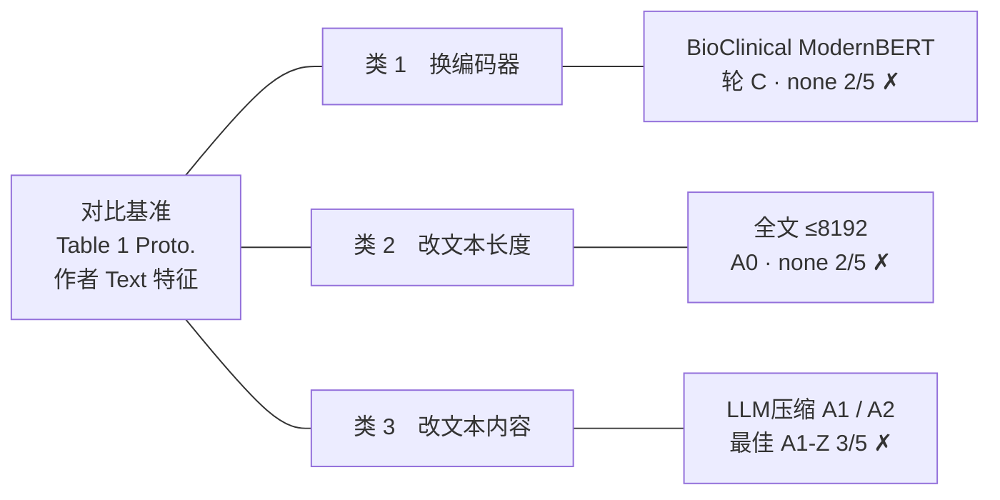

# 2.innovation-secode-part：Text 表征的失败实验

本方向的问题：只改 Text 输入（encoder、文本长度、文本内容），能不能在五癌上超过论文 Table 1 Proto.。
对比基准：Table 1 Proto.，Text 用的是作者公开的 768 维 token embeddings。图例见 [README](README.md) 的「状态图例」。卡片里的表格都是当时输出的原表，原样复制。

## 实验地图

## 总览表

| 类别 | 实验 | 改了什么 | 严格胜 | 状态 | 可作论文对照 |
|---|---|---|---|---|---|
| 换编码器 | BioClinical ModernBERT（轮 C） | Text encoder 换成冻结的 NeuML BioClinical ModernBERT 嵌入版，前 200 token | none 行 2/5 | ✗ negative | 账本记「不进论文」（溯源失效）；I06 按用户裁决作对照 B1 |
| 改文本长度 | 全文 ≤8192（A0） | 同一 encoder，不截断，全文编码 | none 行 2/5 | ✗ negative | ✓（tag 在 main） |
| 改文本内容 | LLM压缩（A1 / A2） | 病理报告先经 LLM 浓缩，再用冻结 encoder 编码 | 最佳 3/5（A1-Z） | ✗ 未达标 | ✓（tag 在 main） |

## 类 1　换编码器

改的是 Text encoder 本身，文本输入不变。

### BioClinical ModernBERT（轮 C，bcmbert200）

来源：[encoder-table.md](<../../experiments/BioClinical ModernBERT/results/i05-bcmbert200-20260924d/encoder-table.md>)（脚本生成）· run `i05-bcmbert200-20260924d` · tag `run/i05-bcmbert200-20260924d` → `6631662`（不在 main 上）· 账本：negative，溯源失效，不进论文（[结果账本](<../../experiments/BioClinical ModernBERT/results/index.md>) 第 5、11 行）

**结果文件原表**（encoder-table.md 第 7–31 行原样复制；逐 seed 表见同目录 癌症为单位.md）

场景为 `none`（保留天然缺失）；数值为五 seed 平均 B 口径 C-index。

| Encoder | LGG | BRCA | BLCA | LUAD | UCEC |
| --- | --- | --- | --- | --- | --- |
| MLP | 未实验（占位） | 未实验（占位） | 未实验（占位） | 未实验（占位） | 未实验（占位） |
| 原论文的 Encoder | 未实验 | 未实验 | 未实验 | 未实验 | 未实验 |
| 其他方法的 Encoder | 未实验（算法待定） | 未实验（算法待定） | 未实验（算法待定） | 未实验（算法待定） | 未实验（算法待定） |
| 我们提出来的 Encoder | 0.744099 | 0.654820 | 0.594865 | 0.594875 | 0.634676 |

表外独立参考：

| 对照 | LGG | BRCA | BLCA | LUAD | UCEC |
| --- | --- | --- | --- | --- | --- |
| 现有系统 None / Proto.†（Table 1） | 0.797723 | 0.688112 | 0.589972 | 0.582485 | 0.650968 |
| Δ_c（我们提出来的 Encoder − 现有系统） | -0.053623 | -0.033292 | +0.004892 | +0.012390 | -0.016292 |
| 判定 | 负 | 负 | 胜 | 胜 | 负 |

严格胜率（none，Q 判定）：**2/5**（未达标）；未胜癌种：LGG、BRCA、UCEC。

注：

1. 「我们提出来的 Encoder」= UNI2-h（WSI，不变）+ BioClinical ModernBERT 嵌入版（Text，本实验唯一改动）+ 自制 BulkRNABert（RNA，不变）。
2. 「其他方法的 Encoder」只是占位行，具体算法尚未确定。
3. 「MLP」行的层级、输入与训练方式尚未定义，同样只占位。
4. 现有系统的 Text 为作者公开嵌入，编码器身份未核；WSI 用 UNI2-h，而原论文为 ViT/Marugoto。因此现有系统不塞进「原论文的 Encoder」行，放在表外作独立参考。

## 类 2　改文本长度

encoder 不变，改的是送进 encoder 的文本长度。

### 全文 ≤8192（A0，bcmbert8192）

来源：[encoder-table.md](<../../experiments/BioClinical ModernBERT/results/i05-a0-20260924/encoder-table.md>)（脚本生成）· run `i05-a0-20260924` · tag `run/i05-a0-20260924` → `3c46f37`（在 main 上）· 账本：negative（[结果账本](<../../experiments/BioClinical ModernBERT/results/index.md>) 第 12 行）

**结果文件原表**（encoder-table.md 第 7–34 行原样复制；逐 seed 表见同目录 癌症为单位.md）

场景为 `none`（保留天然缺失）；数值为五 seed 平均 B 口径 C-index。

| Encoder | LGG | BRCA | BLCA | LUAD | UCEC |
| --- | --- | --- | --- | --- | --- |
| MLP | 未实验（占位） | 未实验（占位） | 未实验（占位） | 未实验（占位） | 未实验（占位） |
| 原论文的 Encoder | 未实验 | 未实验 | 未实验 | 未实验 | 未实验 |
| 其他方法的 Encoder | 未实验（算法待定） | 未实验（算法待定） | 未实验（算法待定） | 未实验（算法待定） | 未实验（算法待定） |
| 我们提出来的 Encoder（全文 ≤8192） | 0.718772 | 0.654275 | 0.596079 | 0.596665 | 0.636768 |

表外独立参考：

| 对照 | LGG | BRCA | BLCA | LUAD | UCEC |
| --- | --- | --- | --- | --- | --- |
| 现有系统 None / Proto.†（Table 1） | 0.797723 | 0.688112 | 0.589972 | 0.582485 | 0.650968 |
| Δ_c（我们提出来的 Encoder（全文 ≤8192） − 现有系统） | -0.078951 | -0.033837 | +0.006107 | +0.014180 | -0.014200 |
| 判定 | 负 | 负 | 胜 | 胜 | 负 |
| 轮 C：bcmbert200（同配方重训，前 200 token） | 0.744099 | 0.654820 | 0.594865 | 0.594875 | 0.634676 |
| Δ（本臂 − bcmbert200） | -0.025328 | -0.000545 | +0.001214 | +0.001790 | +0.002092 |

严格胜率（none，Q 判定）：**2/5**（未达标）；未胜癌种：LGG、BRCA、UCEC。
相对 bcmbert200 严格胜 3/5（同代码对照，信息性，不进 Q）。

注：

1. 「我们提出来的 Encoder（全文 ≤8192）」= UNI2-h（WSI，不变）+ BioClinical ModernBERT 嵌入版（Text，本实验唯一改动）+ 自制 BulkRNABert（RNA，不变）。
2. 「其他方法的 Encoder」只是占位行，具体算法尚未确定。
3. 「MLP」行的层级、输入与训练方式尚未定义，同样只占位。
4. 现有系统的 Text 为作者公开嵌入，编码器身份未核；WSI 用 UNI2-h，而原论文为 ViT/Marugoto。因此现有系统不塞进「原论文的 Encoder」行，放在表外作独立参考。

## 类 3　改文本内容

改的是文本本身：病理报告先经 LLM 浓缩，再送进冻结 encoder。

### LLM压缩（I06：A1 / A2）

来源：[6.LLM浓缩-A1-result-癌症为单位.md](<../消融实验/2.innovation-secode-part- Encoder/6.LLM浓缩-A1/6.LLM浓缩-A1-result-癌症为单位.md>)（脚本生成）· run `i06-a1a2-20260926` · tag `run/i06-a1a2-20260926` → `c5aa9ea`（在 main 上）· 正式结果账本目前只提交在 dev 分支

**当时的输出（test 完成后的汇报，原样）**

四档 test 已全部完成，没有候选达到 4/5，主目标未达成。按规则胜者是 A1-Z（NeuML 摘要），严格胜 3/5。

| 候选 | 严格胜 | 五癌平均 Δ | 胜的癌种 | BRCA Δ | LGG Δ |
|---|---|---|---|---|---|
| A1-S NeuML 结构化 | 2/5 | −0.0124 | LUAD、BLCA | −0.040 | −0.034 |
| A1-Z NeuML 摘要（胜者） | 3/5 | −0.0124 | UCEC、LUAD、BLCA | −0.046 | −0.045 |
| A2-S Qwen 结构化 | 1/5 | −0.0272 | LUAD | −0.039 | −0.049 |
| A2-Z Qwen 摘要 | 1/5 | −0.0228 | LUAD | −0.017 | −0.040 |

**结果文件原表**（第 7–43 行原样复制，只把二级标题降为四级；逐 seed 表见来源文件）

#### 口径

- 数值为 test 上 B 口径 C-index，全部为开检索（Proto. = strategy0）。每癌先对每个场景取五 seed 均值，再对 None / RNA masked / Text masked / Both masked 等权平均得 **Overall**（与论文 Table 1 相同）。
- 判定：候选的 Overall 与 Table 1 Proto. 列的 Overall 逐癌比较，未舍入严格 > 记胜、相等不算胜；四个候选中任一候选胜 ≥4/5 即达标。胜者 = 胜癌数最多者，相同比五癌平均 Overall Δ，仍相同按 A1-S、A1-Z、A2-S、A2-Z 的顺序。
- 归因：A1 与 B2 编码规格逐项相同（NeuML，max_length 8192、不截断），只差文本来源（浓缩 vs 原文全文），A1 − B2 是单变量差，为主对照（研究计划书 v3.12 起）；B1 为原文前 200 token，A1 − B1 同时改变文本内容与长度，只作辅助比较；A2（Qwen）没有同 encoder 的原文对照，只作系统级比较。
- LUAD 的推理路由受已见 test 启发（研究计划书 4.9），其各列数字属探索性：主判定按预先定义照计五癌（机械门），同时给出不计 LUAD 的确认性口径（k/4）。
- 零效应下单个候选至少 4/5 严格胜出的偶然概率约 18.8%；四个候选全部报告。

#### 五癌 Overall 汇总（主判定）

| 癌种 | 作者特征（Table 1 Proto.） | B1 NeuML 原文前 200 | B2 NeuML 全文 | A1-S NeuML 结构化 | A1-Z NeuML 摘要 | A2-S Qwen 结构化 | A2-Z Qwen 摘要 |
| --- | --- | --- | --- | --- | --- | --- | --- |
| BRCA | **0.667270** | 0.635290 | 0.628455 | 0.627075 | 0.621506 | 0.628142 | 0.650341 |
| UCEC | 0.630369 | 0.638805 | 0.623392 | 0.626986 | **0.638860** | 0.574126 | 0.580180 |
| LUAD（探索性） | 0.587039 | 0.592603 | 0.588066 | 0.589128 | 0.587671 | **0.596437** | 0.590409 |
| BLCA | 0.578982 | 0.586225 | 0.585028 | 0.592158 | **0.598326** | 0.577672 | 0.568303 |
| LGG | **0.738872** | 0.706487 | 0.683609 | 0.705331 | 0.694117 | 0.690338 | 0.699344 |

| 候选 | Overall 严格胜 | 不计 LUAD（确认性） | 五癌平均 Overall Δ | 胜的癌种 | None 行严格胜（参考） | 胜者 |
| --- | --- | --- | --- | --- | --- | --- |
| A1-S NeuML 结构化 | 2/5 | 1/4 | -0.012371 | LUAD（探索性）、BLCA | 3/5 |  |
| A1-Z NeuML 摘要 | 3/5 | 2/4 | -0.012411 | UCEC、LUAD（探索性）、BLCA | 2/5 | 是 |
| A2-S Qwen 结构化 | 1/5 | 0/4 | -0.027163 | LUAD（探索性） | 1/5 |  |
| A2-Z Qwen 摘要 | 1/5 | 0/4 | -0.022791 | LUAD（探索性） | 1/5 |  |

**胜者：A1-Z NeuML 摘要，Overall 严格胜 3/5（不计探索性的 LUAD：2/4），未达标（目标 ≥4/5）。**

#### 同 encoder 归因（NeuML：A1 − B2 为主对照，A1 − B1 为辅助）

逐癌 Overall 差；A1 − B2 只差文本来源（浓缩 vs 原文全文），A1 − B1 同时改变文本内容与长度。只报为正的癌种数，不做显著性检验。

| 比较 | BRCA | UCEC | LUAD（探索性） | BLCA | LGG | 为正的癌种 |
| --- | --- | --- | --- | --- | --- | --- |
| A1-S − B2（主对照） | -0.001380 | +0.003594 | +0.001062 | +0.007130 | +0.021722 | 4/5 |
| A1-Z − B2（主对照） | -0.006949 | +0.015469 | -0.000395 | +0.013298 | +0.010507 | 3/5 |
| A1-S − B1（辅助） | -0.008215 | -0.011818 | -0.003475 | +0.005933 | -0.001156 | 1/5 |
| A1-Z − B1（辅助） | -0.013784 | +0.000056 | -0.004932 | +0.012101 | -0.012371 | 2/5 |

## 附：没跑出结果的放弃项

以下为原文原样复制。

**方案 A / B（轮 C 设计期，只选了 A）**：出自 [0.BioClinical ModernBERT-记录.md](<../消融实验/2.innovation-secode-part- Encoder/0.BioClinical ModernBERT-记录.md>) 第 87–92 行

|             | A 截断 200                                   | B 整篇压成一句再复制 200 行          |
| ----------- | -------------------------------------------- | ------------------------------------ |
| 槽          | 不动                                         | 形状没变，语义变了                   |
| 改了几件事  | 编码器（外加 tokenizer）                     | 编码器 + 覆盖长度 + 粒度             |
| mean(dim=1) | 仍在对 token 求均值                          | 200 行相同，均值是恒等，等于没这个槽 |
| 论文        | 「冻结换更强临床编码器，token 预算仍是 200」 | 一次改三处，涨了也写不清是谁的功     |

**方案 A / C / C′（轮 C 设计期选 C；C′ 后来作为 A0 执行）**：同文件第 106–110 行

| 选项                        | 这个 768 维从哪来                           | 短报告                            | 长报告            | 相对旧协议多改了什么        |
| --------------------------- | ------------------------------------------- | --------------------------------- | ----------------- | --------------------------- |
| **A**零填充           | 前 200 token 含零行再除以 200               | 被n/200缩小，一句话≈空向量       | 等于前 200 的均值 | **零** （代码不动）   |
| **C**有效均值再铺满✅ | 前 200 里只对有效 token 求均值，复制 200 行 | 不缩小，等于 NeuML 自己的 pooling | 仍只有前 200      | 只改提取脚本怎么填槽        |
| **C′**全文均值再铺满       | 最多 8192 token 的 masked mean，复制 200 行 | 同 C                              | 整篇报告          | 提取脚本 + 推翻「截断 200」 |

**legacytext-rerun 对照臂（未评测）**：出自 [结果账本](<../../experiments/BioClinical ModernBERT/results/index.md>) 第 9–10、13 行

| run_id | 阶段 | 档案 | 状态 | 说明 |
|---|---|---|---|---|
| `i05-a0-20260924`（同一 run，对照臂） | 第二轮 | legacytext-rerun | **未评测**（用户裁决记为发现） | 25 个重训 ckpt 与历史 E0 **逐字节相同**（25/25 sha256 相等，`i05-a0-20260924/checkpoint-sha256-legacytext-rerun.txt`）：冻结环境下未观察到重跑漂移；加上回放 IDENTICAL，此臂 test 结果必然等于 Table 1（节点二审查：不推广为“训练在任意环境下完全确定”）。preflight 按“仍是历史 E0 权重”门拒绝（设计行为） |

**≤200 token 浓缩版（归档，不进入冻结）**：出自 [I06 结果账本](<../../experiments/I06_llm_condensation/results/index.md>) 第 17 行

- API 花费合计约 $160（200 版全量 $128 + 摘要臂重跑 $27.5 + 两轮试点约 $4）。200 版文本与其 Codex 抽查只作归档，不进入冻结（研究计划书 v3.10–v3.12）。
