# v1 原型检索（失败版）复盘：原理、网络位置、失败原因与结果

整理日期：2026-09-25。本文件是对已有历史结果的只读复盘，不是新实验，也不授权任何实验。

## 0. 身份与一句话结论

| 项目 | 内容 |
| --- | --- |
| v1 协议 ID | `patient-fixed-padmask-v2`（ID 里的 `v2` 是协议字面版本号，**不是**本文所说的 v2） |
| 本文的 v2 | 2.progress 零训练推理规则 1–5 组合 → 4.progress S0-force 路由（`strategy0`），即 4progress-claude交接 中的“原型补偿†” |
| 数据 | TCGA BLCA / BRCA / LGG / LUAD / UCEC；seed 123 / 132 / 213 / 231 / 321；场景 rna_100 / text_100 / both_100 / none |
| 模型 | 25 份已有 E0 / NPJ-C 权重（`compensator=none`），三臂共用同一癌种、同一 seed 的同一权重；零训练，只换推理时的填值 |
| 指标 | B 口径 C-index（sigmoid → clamp → cumprod → risk） |
| 三臂 | `m0real` 不补偿（缺失位 invalid、融合时屏蔽）；`m1` 均值补偿（同癌 train 逐元素均值）；`retrieval` v1 检索 |

**结论**：v1 在五癌 × 五 seed × 四场景（100 组等权）上的 C-index 为 **0.628964**，**低于**不补偿 0.630751 和均值补偿 0.631825；只在 **2/5** 个癌种（BRCA、UCEC）上严格胜过两条基线。损失主要集中在 text_100 场景和 BLCA / LUAD 两个癌种。v2 在同一批权重上只改推理规则，逐步提升到 0.640155（3/5）和 0.640506（4/5）。

## 1. v1 在整个网络中的位置

红框是 v1 唯一的改动（固定患者检索库，零训练）；橙色虚线框是底座里原有、但放大了 v1 失败的节点；⚠ 编号对应 §3 的失败原因。其余节点全部沿用现有 NPJ-C。

```mermaid
flowchart LR
    WSI[("WSI：UNI2-h 128×1536<br/>历史冻结缓存，不变")] --> CACHE
    RNA[("RNA：自制 BulkRNABert 2048×256<br/>历史冻结缓存，不变")] --> CACHE
    TXT[("Text：legacy text 200×768<br/>历史冻结缓存，不变")] --> CACHE
    CACHE[("tmp_sur_cache<br/>三模态投影前原始 token 特征")] --> IN["患者三模态输入<br/>场景掩码：rna_100 / text_100 / both_100 / none"]
    subgraph V1["v1 固定患者检索库（patient-fixed-padmask-v2，只用同癌 train，零训练）"]
        B1["valid_row_mask<br/>非零前缀 = 有效行，零后缀 = padding"] --> B2["患者等权中心 μ<br/>Z = X − μ（仅有效行）"]
        B2 --> B3["⚠② 共同有效行 V_q∩V_p<br/>按原行序展平 128×1536 → 余弦"]
        B3 --> B4["Top-1 donor<br/>须真实拥有缺失模态；双缺用同一 donor"]
        B4 --> B5["⚠①③ 整段复制 donor 原始 RNA / Text<br/>并把填入位设为 valid = 1"]
    end
    CACHE --> B1
    B5 -->|"缺失即替换：不分癌种、不分场景<br/>无路由、无收缩、无降权"| IN
    IN --> MEAN["沿 token 维 mean<br/>（WSI 对 128 行含 padding 求均值）"]
    MEAN --> PROJ["Linear → ReLU → Dropout<br/>text 768→256｜img 1536→256｜rna 256→256"]
    PROJ --> EMB["+ modality embedding"]
    EMB --> TF["⚠③ TransformerEncoder<br/>1 层 × 4 头，d=256，FFN 1024<br/>key padding mask = ¬valid；训练时 modality_dropout=0"]
    TF --> POOL["⚠③ valid 均值池化<br/>u = Σ valid·h / Σ valid，填入位权重 = 1"]
    POOL --> HEAD["癌种 SurvivalHead（4 个时间箱）"]
    HEAD --> RISK["sigmoid → clamp → cumprod → risk<br/>B 口径 C-index"]
    classDef changed fill:#ffe0e0,stroke:#c62828,stroke-width:2px;
    classDef amplify fill:#fff4d6,stroke:#b26a00,stroke-width:2px,stroke-dasharray:5 3;
    class B1,B2,B3,B4,B5 changed;
    class TF,POOL amplify;
    style V1 fill:#efe3ff,stroke:#7e22ce,stroke-width:2px
```

- **注入位置**：批数据缺失判定之后、`NPJC.forward` 的模态内 `mean(dim=1)` 之前（`experiments/I01_patient_retrieval/model.py:179` `FixedPatientBank.compensate`，标记 `# [创新 I01-01]`）。
- **检索用什么、模型吃什么不一致**：检索用的是按行序展平的 128×1536（B3），模型实际使用的是 128 行（含 padding）的 mean（MEAN）。这是失败原因 ②。

## 2. v1 公式原理

符号：c 为癌种，i 为 query 患者，j 为 donor，m ∈ {W, R, T} 分别对应 WSI / RNA / Text，g 为场景，I_c 为同癌 train 患者集合，X_i^m 为投影前缓存特征。代码里的模态顺序是 (img, text, rna)，公式按 (W, R, T) 书写。

**V1-1 场景掩码**（n = 真实可用，v = 本场景可见；none 仍保留天然缺失）

$$
v_{i,g}^{m}=n_i^m\,b_g^m,\qquad b_{\text{none}}=(1,1,1),\ b_{\text{rna\_100}}=(1,0,1),\ b_{\text{text\_100}}=(1,1,0),\ b_{\text{both\_100}}=(1,0,0).
$$

**V1-2 有效行与患者等权去中心**（`valid_row_mask`、`FixedPatientBank.__init__`）

$$
P_i=X_i^W\in\mathbb R^{128\times1536},\quad
V_i=\{k:P_{ik}\neq\mathbf 0\},\quad
\bar p_i=\frac1{|V_i|}\sum_{k\in V_i}P_{ik},\quad
\mu_c=\frac1{|I_c|}\sum_{j\in I_c}\bar p_j,\quad
Z_{ik}=\begin{cases}P_{ik}-\mu_c,&k\in V_i\\ \mathbf 0,&k\notin V_i\end{cases}
$$

合法布局是“非零前缀 + 零后缀”；中心按患者等权计算，valid / test 不参与。

**V1-3 共同有效行展平余弦**（`masked_cosine`，这是 v1 的核心几何）

$$
s_{ij}=\frac{\operatorname{vec}\!\big(Z_i[V_i\cap V_j]\big)^{\top}\operatorname{vec}\!\big(Z_j[V_i\cap V_j]\big)}
{\big\|\operatorname{vec}(Z_i[V_i\cap V_j])\big\|_2\,\big\|\operatorname{vec}(Z_j[V_i\cap V_j])\big\|_2}
$$

保持原行序逐行对齐后展平，分子和分母都只用共同有效行；用 float64 计算，空交集或范数 ≤ 1e-12 时报错。**行序来自各患者独立的 K-means，第 k 行在两名患者之间没有语义对应关系。**

**V1-4 候选集合**

$$
M_{i,g}=\{m\in\{R,T\}:v_{i,g}^m=0\},\qquad
\mathcal D_{i,g}=\{j\in I_c:\ j\neq i,\ \forall m\in M_{i,g},\ n_j^m=1\}.
$$

**V1-5 Top-1 donor**（`retrieve`；patient ID 排序后，完全同分时取最前者）

$$
j^*=\operatorname*{argmax}_{j\in\mathcal D_{i,g}}\ s_{ij}.
$$

**V1-6 原值替换并标记有效**（`compensate`）

$$
X_{i,\text{in}}^m=\begin{cases}X_i^m,&v_{i,g}^m=1\\ X_{j^*}^m,&v_{i,g}^m=0\end{cases},\qquad f_i^m=1\quad(\forall m\in M_{i,g}).
$$

双缺失时 RNA 和 Text 来自同一个 j\*。任何癌种、任何场景都无条件替换，不做收缩，也不走路由。

**V1-7 冻结 NPJ-C 前向与 B 风险**（`src/trimodalsurv/models/npjc.py:118-123`）

$$
e_i^m=\phi_m\!\big(\operatorname{mean}_{\text{token}}X_{i,\text{in}}^m\big)+d_m,\quad
h_i=\operatorname{Transformer}_\theta(e_i;\ \text{mask}=\neg f_i),\quad
u_i=\frac{\sum_m f_i^m h_i^m}{\sum_m f_i^m},
$$

$$
\eta_{it}=\operatorname{clip}(\sigma(H_c(u_i)_t),10^{-6},1-10^{-6}),\quad S_{it}=\prod_{\tau\le t}(1-\eta_{i\tau}),\quad R_i=-\sum_t S_{it}.
$$

填入位 f = 1，在池化里与本人真实模态**同权**（权重 1）。

## 3. 为什么失败

先列事实，再列原因。每条原因都注明它后来是否被 2.progress 的单规则实验支持（单规则 test 均值相对 v1 检索 0.628964 的 Δ；规则由 valid 锁定，test 只做描述性汇总）。

**事实**
- 总体：v1 0.628964 < 不补偿 0.630751 < 均值 0.631825（100 组等权）。
- 100 组逐组比较：v1 独胜 17 组，均值独胜 39 组，不补偿独胜 39 组，并列最高 5 组。v1 对均值 32 胜 / 5 平 / 63 负。
- 损失集中在 text_100 场景（5 癌中有 4 癌低于不补偿）和 BLCA / LUAD 两个癌种；稳定正向只出现在 UCEC 的 text_100 / both_100 和 BRCA 的 both_100。
- BLCA/none 每个 seed 138/138 名患者都是完整输入，三臂必然相同，这 5 组并列不算检索胜。

| # | 失败原因 | 矩阵证据（五 seed 均值，v1 − 不补偿） | 后续验证 |
| --- | --- | --- | --- |
| ① | **借来的 Text 与本人 RNA 冲突**：text_100 时本人 RNA 还在，别人的 Text 以 valid = 1 进入融合，与本人 RNA 相互矛盾 | text_100：LGG −0.054313、BLCA −0.025920、BRCA −0.026456、LUAD −0.020604；而 both_100 中 LGG 为 +0.053968（没有 RNA 可冲突时，填补反而有益）。反例：UCEC text_100 +0.008324 | **支持**：规则 1（text_100 不补偿，UCEC 例外）单独 +0.006365；规则 4（WSI + RNA 联合相似度，让借来的 Text 与本人 RNA 同向）单独 +0.002220 |
| ② | **检索几何与模型输入不一致**：检索按行序展平 128×1536，但各患者行序来自独立 K-means，行与行之间没有对应关系；模型实际用的是 128 行 mean | 选错 donor 的影响遍及各场景，均值在 63/100 组胜过 v1 | **支持且作用最大**：规则 2（改用有效行 mean-pool 的 1536 维 key）单独 +0.008435，是五条规则中最大的一条 |
| ③ | **填入 token 全权信任 + 底座 OOD**：填入位 valid = 1，在 attention 和池化中与本人模态同权；底座训练时 `modality_dropout = 0`，从没见过“本人 RNA + 别人 Text”这种输入 | 均值补偿在 text_100 同样输给不补偿（BRCA −0.036、LGG −0.042），说明“任何填补都按真值对待”本身就有害 | **部分支持**：规则 5（填入位池化权重 w = 0.5）单独 +0.002942。OOD 部分需要重训底座才能验证，本轮**未验证** |
| ④ | Top-1 单患者方差大于条件信息（grok 原假设） | v1 对均值 32/5/63 | **不支持**：规则 3（向均值收缩，λ ∈ {0, 0.25, 0.5, 0.75, 1}）在 valid 上 λ 越小越差（0.615952 → 0.637833），锁定 λ = 1，test Δ = +0.000000。v1 的问题在于“检索依据什么选人”（②），而不是“只取一个人” |

**癌种层面**：LUAD 在所有检索变体下都不稳定。4.progress 用 S0-force 把 LUAD 的 rna_100 / both_100 强制改走均值、text_100 改走不补偿，才拿到第 4 个胜出癌种，而且 LUAD 只比均值高约 0.000035。BLCA 在 v1 和 v2 下都没有胜出。

## 4. 实验结果（5 seed × 5 癌种 × 4 场景 × 3 臂）

全部数值由同目录 `build_v1_tables.py` 从 75 个原始 JSON（`experiments/I01_patient_retrieval/results/archive/legacy-tako-formal-20260915/raw/tako-formal/evidence/formal/`，字段 `grids[g].cindex_B`）生成，并与 v1 历史报告 `癌症为单位.md` 300/300 逐条对拍到 6 位。粗体为同癌、同场景三臂中的最大值（用未舍入原值比较，并列全部加粗）；overall 为该癌 4 个场景等权平均。

### 表 A：五 seed 均值 ± 样本标准差（ddof = 1），版式同 4.progress Table 1

| 场景 | BRCA/不补偿 | BRCA/均值补偿 | BRCA/v1 检索 | UCEC/不补偿 | UCEC/均值补偿 | UCEC/v1 检索 | LUAD/不补偿 | LUAD/均值补偿 | LUAD/v1 检索 | BLCA/不补偿 | BLCA/均值补偿 | BLCA/v1 检索 | LGG/不补偿 | LGG/均值补偿 | LGG/v1 检索 |
| --- | --- | --- | --- | --- | --- | --- | --- | --- | --- | --- | --- | --- | --- | --- | --- |
| rna_100 | 0.683842 ± 0.0089 | 0.684751 ± 0.0044 | **0.685886 ± 0.0058** | 0.647229 ± 0.0176 | **0.655464 ± 0.0131** | 0.650612 ± 0.0152 | 0.580660 ± 0.0137 | 0.580239 ± 0.0068 | **0.581011 ± 0.0073** | **0.593546 ± 0.0565** | 0.589105 ± 0.0579 | 0.589938 ± 0.0548 | 0.767219 ± 0.0199 | **0.790959 ± 0.0117** | 0.782195 ± 0.0132 |
| text_100 | **0.655002 ± 0.0142** | 0.619121 ± 0.0235 | 0.628545 ± 0.0153 | 0.589272 ± 0.0261 | 0.577743 ± 0.0294 | **0.597596 ± 0.0134** | **0.596630 ± 0.0037** | 0.595156 ± 0.0045 | 0.576027 ± 0.0051 | **0.575989 ± 0.0292** | 0.574913 ± 0.0321 | 0.550069 ± 0.0338 | **0.705866 ± 0.0212** | 0.664113 ± 0.0352 | 0.651553 ± 0.0221 |
| both_100 | 0.596026 ± 0.0349 | 0.614750 ± 0.0268 | **0.624276 ± 0.0166** | 0.576319 ± 0.0256 | 0.575072 ± 0.0287 | **0.596751 ± 0.0118** | 0.585469 ± 0.0062 | **0.588803 ± 0.0015** | 0.573535 ± 0.0055 | 0.574046 ± 0.0407 | **0.574774 ± 0.0350** | 0.553088 ± 0.0284 | 0.576190 ± 0.0271 | **0.635266 ± 0.0359** | 0.630159 ± 0.0223 |
| none | **0.691359 ± 0.0052** | 0.686068 ± 0.0046 | 0.687930 ± 0.0037 | 0.651502 ± 0.0143 | **0.656888 ± 0.0147** | 0.650879 ± 0.0157 | 0.582064 ± 0.0113 | **0.583819 ± 0.0091** | 0.583257 ± 0.0092 | **0.589972 ± 0.0560** | **0.589972 ± 0.0560** | **0.589972 ± 0.0560** | 0.796825 ± 0.0108 | **0.799517 ± 0.0102** | 0.795997 ± 0.0105 |
| overall | 0.656557 | 0.651172 | **0.656659** | 0.616081 | 0.616292 | **0.623959** | 0.586206 | **0.587004** | 0.578457 | **0.583388** | 0.582191 | 0.570767 | 0.711525 | **0.722464** | 0.714976 |

### 表 B：逐 seed 原始值

**seed 123**

| 场景 | BRCA/不补偿 | BRCA/均值补偿 | BRCA/v1 检索 | UCEC/不补偿 | UCEC/均值补偿 | UCEC/v1 检索 | LUAD/不补偿 | LUAD/均值补偿 | LUAD/v1 检索 | BLCA/不补偿 | BLCA/均值补偿 | BLCA/v1 检索 | LGG/不补偿 | LGG/均值补偿 | LGG/v1 检索 |
| --- | --- | --- | --- | --- | --- | --- | --- | --- | --- | --- | --- | --- | --- | --- | --- |
| rna_100 | 0.682752 | **0.688884** | 0.686613 | 0.648119 | **0.650790** | 0.645448 | 0.568270 | **0.573008** | 0.572657 | **0.611728** | 0.608779 | 0.607391 | 0.789510 | **0.804003** | 0.795376 |
| text_100 | **0.650959** | 0.587260 | 0.619394 | 0.565769 | 0.556866 | **0.582462** | **0.596174** | 0.595823 | 0.583012 | **0.581714** | 0.581020 | 0.569570 | **0.731194** | 0.704624 | 0.648378 |
| both_100 | 0.544907 | 0.573124 | **0.611559** | 0.563766 | 0.548186 | **0.586468** | **0.591787** | 0.589856 | 0.581783 | 0.581888 | **0.584490** | 0.570611 | 0.606970 | **0.677019** | 0.626639 |
| none | **0.695015** | 0.691495 | 0.690246 | 0.651458 | **0.656354** | 0.648787 | 0.569323 | **0.574061** | 0.572833 | **0.607391** | **0.607391** | **0.607391** | 0.808144 | **0.810904** | 0.807108 |
| overall | 0.643409 | 0.635191 | **0.651953** | 0.607278 | 0.603049 | **0.615791** | 0.581388 | **0.583187** | 0.577571 | **0.595680** | 0.595420 | 0.588740 | 0.733954 | **0.749137** | 0.719375 |

**seed 132**

| 场景 | BRCA/不补偿 | BRCA/均值补偿 | BRCA/v1 检索 | UCEC/不补偿 | UCEC/均值补偿 | UCEC/v1 检索 | LUAD/不补偿 | LUAD/均值补偿 | LUAD/v1 检索 | BLCA/不补偿 | BLCA/均值补偿 | BLCA/v1 检索 | LGG/不补偿 | LGG/均值补偿 | LGG/v1 检索 |
| --- | --- | --- | --- | --- | --- | --- | --- | --- | --- | --- | --- | --- | --- | --- | --- |
| rna_100 | 0.675485 | **0.682412** | 0.679800 | 0.673047 | **0.677943** | 0.676163 | 0.568094 | 0.577396 | **0.578449** | **0.615024** | 0.607564 | 0.608432 | 0.759834 | **0.779848** | 0.772947 |
| text_100 | **0.661860** | 0.630635 | 0.614511 | **0.631427** | 0.625640 | 0.617405 | **0.594770** | 0.589856 | 0.572482 | 0.584143 | **0.586919** | 0.555170 | **0.679779** | 0.622843 | 0.620083 |
| both_100 | **0.627228** | 0.627115 | 0.608493 | 0.617405 | **0.619631** | 0.616292 | **0.590734** | 0.586346 | 0.571955 | **0.595767** | 0.585704 | 0.559334 | 0.584196 | 0.593513 | **0.600069** |
| none | 0.685591 | **0.685818** | 0.684228 | 0.674605 | **0.681282** | 0.677276 | 0.577396 | **0.580379** | 0.579502 | **0.607564** | **0.607564** | **0.607564** | 0.784334 | **0.786404** | 0.782264 |
| overall | **0.662541** | 0.656495 | 0.646758 | 0.649121 | **0.651124** | 0.646784 | 0.582748 | **0.583494** | 0.575597 | **0.600625** | 0.596938 | 0.582625 | **0.702036** | 0.695652 | 0.693841 |

**seed 213**

| 场景 | BRCA/不补偿 | BRCA/均值补偿 | BRCA/v1 检索 | UCEC/不补偿 | UCEC/均值补偿 | UCEC/v1 检索 | LUAD/不补偿 | LUAD/均值补偿 | LUAD/v1 检索 | BLCA/不补偿 | BLCA/均值补偿 | BLCA/v1 检索 | LGG/不补偿 | LGG/均值补偿 | LGG/v1 检索 |
| --- | --- | --- | --- | --- | --- | --- | --- | --- | --- | --- | --- | --- | --- | --- | --- |
| rna_100 | **0.692404** | 0.687181 | 0.691041 | 0.648119 | **0.655241** | 0.651903 | **0.587399** | 0.580906 | 0.583187 | **0.493060** | 0.486468 | 0.492713 | 0.781573 | **0.802968** | 0.797101 |
| text_100 | **0.656977** | 0.633814 | 0.652549 | 0.574227 | 0.564656 | **0.602270** | **0.592664** | 0.592138 | 0.572482 | **0.525850** | 0.519951 | 0.490978 | **0.709800** | 0.670807 | 0.679434 |
| both_100 | 0.614738 | 0.625866 | **0.649824** | 0.549744 | 0.552637 | **0.597596** | 0.578624 | **0.589154** | 0.575114 | 0.503470 | **0.513706** | 0.503296 | 0.535887 | 0.628364 | **0.662526** |
| none | **0.696037** | 0.689452 | 0.692971 | 0.651903 | **0.656354** | 0.650568 | 0.578800 | 0.579853 | **0.580555** | **0.490978** | **0.490978** | **0.490978** | 0.808144 | **0.808834** | 0.806073 |
| overall | 0.665039 | 0.659078 | **0.671596** | 0.605998 | 0.607222 | **0.625584** | 0.584372 | **0.585512** | 0.577834 | **0.503340** | 0.502776 | 0.494492 | 0.708851 | 0.727743 | **0.736284** |

**seed 231**

| 场景 | BRCA/不补偿 | BRCA/均值补偿 | BRCA/v1 检索 | UCEC/不补偿 | UCEC/均值补偿 | UCEC/v1 检索 | LUAD/不补偿 | LUAD/均值补偿 | LUAD/v1 检索 | BLCA/不补偿 | BLCA/均值补偿 | BLCA/v1 检索 | LGG/不补偿 | LGG/均值补偿 | LGG/v1 检索 |
| --- | --- | --- | --- | --- | --- | --- | --- | --- | --- | --- | --- | --- | --- | --- | --- |
| rna_100 | 0.674918 | 0.678097 | **0.680027** | 0.623859 | **0.645003** | 0.641665 | **0.579151** | 0.578624 | 0.578449 | **0.618841** | 0.615198 | 0.617106 | 0.738440 | **0.781228** | 0.768461 |
| text_100 | **0.671625** | 0.642216 | 0.634382 | 0.596706 | 0.585800 | **0.597151** | **0.602492** | 0.601615 | 0.579853 | **0.585704** | 0.582582 | 0.561242 | **0.719462** | 0.689096 | 0.663561 |
| both_100 | 0.618372 | **0.642444** | 0.629953 | 0.580904 | 0.583797 | **0.594703** | 0.579326 | **0.588452** | 0.571955 | 0.582755 | **0.586919** | 0.560895 | 0.589372 | **0.667012** | 0.633540 |
| none | **0.685932** | 0.680141 | 0.684910 | 0.641220 | **0.645003** | 0.638326 | 0.585118 | **0.586873** | 0.585820 | **0.614677** | **0.614677** | **0.614677** | 0.792616 | **0.795031** | 0.791925 |
| overall | **0.662711** | 0.660724 | 0.657318 | 0.610672 | 0.614901 | **0.617961** | 0.586522 | **0.588891** | 0.579019 | **0.600494** | 0.599844 | 0.588480 | 0.709972 | **0.733092** | 0.714372 |

**seed 321**

| 场景 | BRCA/不补偿 | BRCA/均值补偿 | BRCA/v1 检索 | UCEC/不补偿 | UCEC/均值补偿 | UCEC/v1 检索 | LUAD/不补偿 | LUAD/均值补偿 | LUAD/v1 检索 | BLCA/不补偿 | BLCA/均值补偿 | BLCA/v1 检索 | LGG/不补偿 | LGG/均值补偿 | LGG/v1 检索 |
| --- | --- | --- | --- | --- | --- | --- | --- | --- | --- | --- | --- | --- | --- | --- | --- |
| rna_100 | **0.693653** | 0.687181 | 0.691950 | 0.643000 | **0.648342** | 0.637881 | **0.600386** | 0.591260 | 0.592313 | **0.629077** | 0.627516 | 0.624046 | 0.766736 | **0.786749** | 0.777088 |
| text_100 | **0.633587** | 0.601680 | 0.621892 | 0.578233 | 0.555753 | **0.588694** | **0.597052** | 0.596350 | 0.572306 | 0.602533 | **0.604094** | 0.573387 | **0.689096** | 0.633195 | 0.646308 |
| both_100 | 0.574884 | 0.605200 | **0.621551** | 0.569775 | 0.571111 | **0.588694** | 0.586873 | **0.590207** | 0.566866 | **0.606350** | 0.603053 | 0.571305 | 0.564527 | 0.610421 | **0.628019** |
| none | **0.694221** | 0.683434 | 0.687294 | 0.638326 | **0.645448** | 0.639439 | **0.599684** | 0.597929 | 0.597578 | **0.629251** | **0.629251** | **0.629251** | 0.790890 | **0.796411** | 0.792616 |
| overall | 0.649086 | 0.644374 | **0.655672** | 0.607334 | 0.605164 | **0.613677** | **0.595999** | 0.593936 | 0.582266 | **0.616803** | 0.615978 | 0.599497 | 0.702812 | 0.706694 | **0.711008** |

### 表 C：癌种胜负，v1 对比 v2（S0-force）

“严格胜”指该癌 overall 同时高于不补偿和均值补偿。v2 的数值取自 `4progress-claude交接/实验先验知识与公式说明.md` §3。

| 癌种 | 不补偿 | 均值补偿 | v1 检索 | v1 严格胜两条基线 | v2 S0-force | v2 严格胜两条基线 |
| --- | --- | --- | --- | --- | --- | --- |
| BRCA | 0.656557 | 0.651172 | 0.656659 | 胜 | 0.667270 | 胜 |
| UCEC | 0.616081 | 0.616292 | 0.623959 | 胜 | 0.630369 | 胜 |
| LUAD | 0.586206 | 0.587004 | 0.578457 | 负 | 0.587039 | 胜 |
| BLCA | 0.583388 | 0.582191 | 0.570767 | 负 | 0.578982 | 负 |
| LGG | 0.711525 | 0.722464 | 0.714976 | 负 | 0.738872 | 胜 |
| **五癌 100 组等权** | 0.630751 | 0.631825 | 0.628964 | **2/5** | 0.640506 | **4/5** |

脚注：
- 两轮基线出自同一批 checkpoint，但 4.progress 复用的 BRCA 均值补偿读数与 v1 存在 ≤ 1.2e-5 的差异（例如 BRCA/both_100 为 0.614750 对 0.614738；BRCA overall 为 0.651172 对 0.651170），不影响任何胜负判定。
- v2 的 LUAD 路由参考了已看过的 test 结果，且在 valid 反对（A = 0.654042，B = 0.645226）的情况下仍强制开启，属于探索性事后分析，存在 test 泄漏；v2 的 4/5 不能写成盲测结果。

## 5. v1 → v2：改了什么，对应哪条失败原因

| 步骤 | 改动 | 针对的失败原因 | test 总体 | 胜出癌种 |
| --- | --- | --- | --- | --- |
| v1 | 行序展平余弦 → Top-1 → 原值替换，valid = 1 | — | 0.628964 | 2/5（BRCA、UCEC） |
| 规则 1 | text_100 整场景不补偿（UCEC 例外，仍检索） | ① | 单独 0.635328 | — |
| 规则 2 | WSI key 改为有效行 mean-pool（1536 维） | ② | 单独 0.637398 | — |
| 规则 3 | donor 向同癌均值收缩（锁定 λ = 1，等于未收缩） | ④ | 单独 0.628964 | — |
| 规则 4 | 相似度 = WSI + α·RNA（仅 text_100 且本人 RNA 可用时生效） | ① | 单独 0.631184（α = 2） | — |
| 规则 5 | 填入位池化权重 w = 0.5 | ③ | 单独 0.631906 | — |
| 2.progress 组合 | 规则 1–5，λ = 1，α = 1，w = 0.5 | ①②③ | 0.640155 | 3/5（BRCA、LGG、UCEC） |
| 4.progress S0-force | 组合 + LUAD 强制路由（rna_100 / both_100 → 均值，text_100 → 不补偿） | 癌种层面 | 0.640506 | 4/5（+LUAD，差距约 0.000035） |

## 6. 证据来源

| 内容 | 路径 |
| --- | --- |
| v1 原始 C-index（75 个 JSON） | `experiments/I01_patient_retrieval/results/archive/legacy-tako-formal-20260915/raw/tako-formal/evidence/formal/` |
| v1 历史报告 | `experiments/I01_patient_retrieval/results/原因分析-ai-prompt&md/癌症为单位.md`、`seed单位-实验结果.md` |
| v1 机制 | `experiments/I01_patient_retrieval/knowledge/method.md`、`model.py`、`config.yaml` |
| 失败归因原稿 | `experiments/I01_patient_retrieval/knowledge/data-analysis-from-grok/1.progress/实验结果分析-grok.md` |
| 规则 1–5 单点与组合 | `experiments/I01_patient_retrieval/knowledge/data-analysis-from-grok/2.progress/result/零训练改推理1-5实验结果.md`、`癌症为单位.md` |
| v2 最终结果 | `manuscript/消融实验/1.innovation-computation/4progress-claude交接/实验先验知识与公式说明.md` |

本目录原来的三个 v1 文件夹从未进入 git，无法恢复；本文完全由上述仍在库中的原始证据重建。
