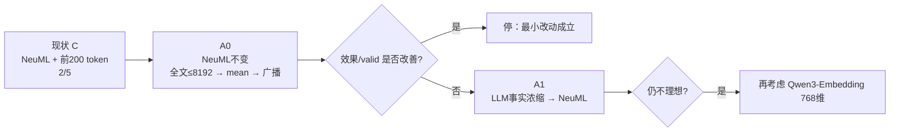
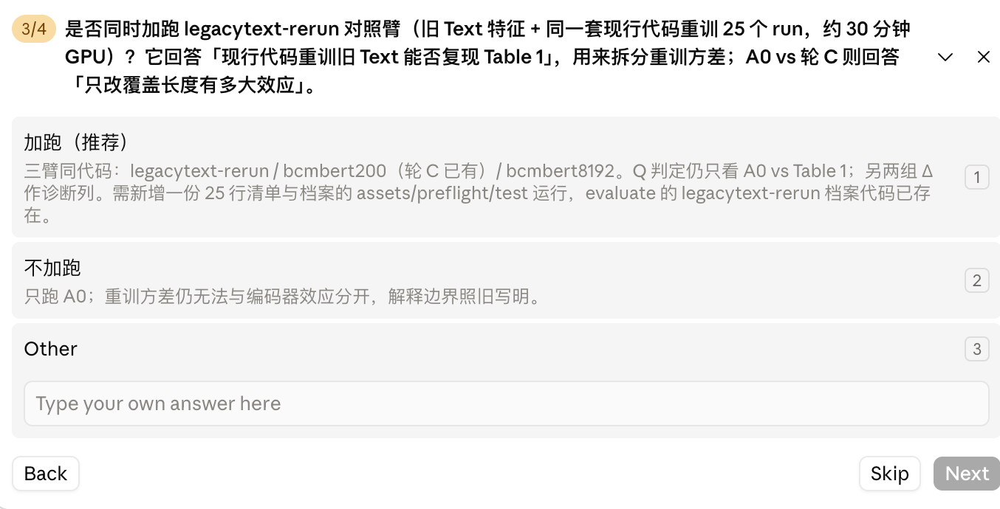

# 0.自己编写的prompt


## 【Trigger：触发场景/背景】

	实验的核心创新点，消融实验已经获得在五个癌症的种类中的五分之四的胜率，接下来实验也是消融实验，证明（NPJ骨架➕原型学习➕新的辅助创新点：我们选择的新的encoder）实验结果大于（NPJ骨架➕原型学习➕NPJ架构中，文本图像和rna三个模态的所使用的encoder），既可以证明新的辅助创新点：我们选择的新的encoder大于NPJ架构中文本图像和rna所使用的encoder，证明新的辅助创新点：我们选择的新的encoders以有效的

**Q_draft**：What should be true afterward?

	1.证明新的encoder的实验表格的设计图,必须严格参考/Users/wuhao/Desktop/TriModalSurv/experiments/innovation-secode-part- Encoder/Framework-encoder-tabel.excalidraw.svg

	2. 我们提出来的encoder的实验效果在五个癌症中的实现结果，最后的胜率达到五分之四。

	3.因为是辅助的创新点，所以不希望花费太多时间去修改算法，最好的情况就是基于现在已经验证后的包含模型（包含原型学习的架/Users/wuhao/Desktop/TriModalSurv/manuscript/消融实验/4progress-claude交接/实验先验知识与公式说明.md

	4.因为新的encoder是辅助创新点，所以无需像是主创新点原型学习那样，在四个不同场景做实验，只需要在none，也就是三模态都完整，不存在缺失的的情况下，证明在五个癌症种类中（NPJ骨架➕原型学习➕新的辅助创新点：我们选择的新的encoder）实验结果大于（NPJ骨架➕原型学习➕NPJ架构中文本图像和rna所使用的encoder）的实验即可 #re-1

	5.后选的encoder的strategy首先必须是比较新，比较炫酷的特征融合方式，因为只有这样才有创新性，编写论文故事的时候才可以。

6.**文件位置**：上述的prompt.md和先验知识的markdown文件都放在/Users/wuhao/Desktop/TriModalSurv/experiments/innovation-secode-part- Encoder

#### 候选与决策

	1.首先，模态的选择：评价下先选择替换rna，text还是图片wsi的哪个模态的encoder？？

		接下来我们打算加入第二个辅助创新点，指的是将原先的NPJ的骨架enocder模块替换成一个先进前沿的特征提取模块，例如，

	npj论文中的rna使用的是bulkrnabert，

	npj论文中的的text使用的bert，（很古老了，可以将text使用的bert修改成新进的encoder，几乎实验肯定涨点！！）

	npj论文中的wsi图片模块使用的是vision transformer

				判断标准：**遵循最小改动原则（不改槽；在能填这个槽的临床 encoder 里取最强冻结权重）**和改动后实验结果大概率在五个cancer中，c-index上升

	2. 策略方法的选择和择优；关键 P 与 Boundary：选择完修改某个模态的encoder之后，基于此项目的多模态癌症分析中模态缺失问题和数据集的数据量和数据特点，去刷选候选的前沿模型，检查标准是每个候选特征融合策略和S_state交集，将满足后的交集【ki】，再去考虑满足后的交集【ki】和本任务的适用域和Q_draft，刷选出最合适的两个策略k1，k2.

#### S_state

当前代码/配置版本；原始结果与日志的位置；
已证实的事实、未核验的假设、已经失败的尝试。 #re-2

/Users/wuhao/Desktop/TriModalSurv/experiments/innovation-secode-part- Encoder/给ChatGPT-Pro的结构化Prompt.md

/Users/wuhao/Desktop/TriModalSurv/experiments/innovation-secode-part- Encoder/Encoder实验先验知识-Pro版.md

/Users/wuhao/Desktop/TriModalSurv/experiments/innovation-secode-part- Encoder/ChatGPT-Pro交接包.zip

[github.com/hbhggh/TriModalSurv/tree/55887e4886d6eb0443cdc0fef76264d891e88cbc/handoffs/encoder-pro](https://github.com/hbhggh/TriModalSurv/tree/55887e4886d6eb0443cdc0fef76264d891e88cbc/handoffs/encoder-pro)

## how to do it

	workflow:Gemini (构建框架) **$\rightarrow$** ChatGPT Pro (发散创新) **$\rightarrow$** Claude (代码落地)。

		1. ChatGPT Pro (发散创新)：

				1. 1使用chatgpt网页端的pro的网页搜索能力，结合consensus插件搜索顶级论文（生物信息）和顶级最新的会议（CVPR / ICCV / ECCV等）尤其关注multimodal、missing modality、token fusion方面的论文和生成实验的markdown作为先验知识（此md文件包含【trigger：触发场景/背景】，**Q_draft**：What should be true afterward?，S_state）的说明文件

		1.2 只给 {k} + 每条的 P/B，不许改 T/Q

              2. 必要文件同步上传GitHub并读取GitHub项目：因为gemini和chatgpt pro没办法读去mac的本地文件，所以将润色上述的prompt.md和生成实验的markdown作为先验知识（此md文件包含【trigger：触发场景/背景】，**Q_draft**：What should be true afterward?，S_state）的说明文件所引用的文件都上传到GitHub中去，然后后续的ai去执行操作之前，必须读取[github.com/hbhggh/TriModalSurv](https://github.com/hbhggh/TriModalSurv)

【how to 避免信息损失】为了避免ai在数据传输中的信息损失，所以选择所有模型读同一份证据，不做逐级转述，下一位可以读上一位的建议，但上一位的建议不能代替原始需求和原始证据。 #re-3

**本次交接**：/你的任务：

作为codex的你，

	1.首先润色上述的prompt，这次跳过workflow:Gemini (构建框架)环节，直接进入ChatGPT Pro (发散创新)环节，所以这次生成的事发送给ChatGPT Pro (发散创新)环节的prompt。

2. 然后并同步生成实验的markdown作为先验知识（此md文件包含【trigger：触发场景/背景】，**Q_draft**：What should be true afterward?，S_state）的说明文件，作为原始需求和原始证据，避免ai在数据传输中的信息损失。

## **不可变约束**

1. none的定义指的就是在both_100，text_100，rna_100，none的中的历史 none 保留天然缺失，因为消融实验二-encoder的实验结果中，（NPJ骨架➕原型学习➕新的辅助创新点：我们选择的新的encoder）实验结果可以直接使用/Users/wuhao/Desktop/TriModalSurv/manuscript/bmc_initial_draft/main.pdf中的Table 1的Scenario为None的实验数据
2. 新 encoder 优于文本图像和rna三个模态的所使用的encoder，也就是/Users/wuhao/Desktop/TriModalSurv/manuscript/bmc_initial_draft/main.pdf中的Table 1的Scenario为None所使用的文本图像和rna三个模态的所使用的encoder）
3. 对照：Table 1 中 **None / Proto.†** 对应的现有系统；新 encoder 成绩尚未产生。
4. 不需要去执行ChatGPT Pro (发散创新)和workflow:Gemini (构建框架) 的工作，

# 2.选择策略记录


选  **A** 。用  **base** （thomas-sounack/BioClinical-ModernBERT-base），不要 large。

槽是每人 [200, 768]，进模型后 mean(dim=1)。base 的 hidden_size 就是 768，和旧 ClinicalBERT 一样，projector 不用动。large 是 1024，槽和线性层都要改，直接出局。


|             | A 截断 200                                   | B 整篇压成一句再复制 200 行          |
| ------------- | ---------------------------------------------- | -------------------------------------- |
| 槽          | 不动                                         | 形状没变，语义变了                   |
| 改了几件事  | 编码器（外加 tokenizer）                     | 编码器 + 覆盖长度 + 粒度             |
| mean(dim=1) | 仍在对 token 求均值                          | 200 行相同，均值是恒等，等于没这个槽 |
| 论文        | 「冻结换更强临床编码器，token 预算仍是 200」 | 一次改三处，涨了也写不清是谁的功     |


## 问题二：具体的模型的来源   -> 选择1:NeuML 嵌入版


 


| 选项                  | 这个 768 维从哪来                           | 短报告                            | 长报告            | 相对旧协议多改了什么        |
| ----------------------- | --------------------------------------------- | ----------------------------------- | ------------------- | ----------------------------- |
| **A**零填充           | 前 200 token 含零行再除以 200               | 被n/200缩小，一句话≈空向量       | 等于前 200 的均值 | **零** （代码不动）         |
| **C**有效均值再铺满✅ | 前 200 里只对有效 token 求均值，复制 200 行 | 不缩小，等于 NeuML 自己的 pooling | 仍只有前 200      | 只改提取脚本怎么填槽        |
| **C′**全文均值再铺满 | 最多 8192 token 的 masked mean，复制 200 行 | 同 C                              | 整篇报告          | 提取脚本 + 推翻「截断 200」 |

## 为什么不是 C′（即使「特征越多越好」）

更致命的是归因：旧缓存是 200 token 预算。C′ = 换 encoder + 换上下文长度 + 换池化。分涨了，审稿人问「赢的是 ModernBERT 还是全文」。分跌了，你不知道该退回 200 还是换权重。这就是你项目里反复推倒的那种双因素。

## 

* 按 negative 收官，代码保留在仓库里；
* 另开一轮新的 Q。例如加跑“旧 Text 用同一套代码重训”的对照臂，把重训方差和 encoder 效应分开；或者去掉 200 token 截断（86% 的报告被截断了）。

### 结果（none，五个 seed 平均的 B 口径 C-index）


|                                     | LGG        | BRCA       | BLCA          | LUAD          | UCEC       |
| ------------------------------------- | ------------ | ------------ | --------------- | --------------- | ------------ |
| 我们提出来的 Encoder                | 0.744099   | 0.654820   | 0.594865      | 0.594875      | 0.634676   |
| 现有系统 None / Proto.†（Table 1） | 0.797723   | 0.688112   | 0.589972      | 0.582485      | 0.650968   |
| Δ（新 − 现有）                    | −0.053623 | −0.033292 | **+0.004892** | **+0.012390** | −0.016292 |
| 判定                                | 负         | 负         | 胜            | 胜            | 负         |

只请求解决哪个未决问题；允许改什么；不得改什么。

# 4.0修补BioClinical ModernBERT（200-token）

## 一、审查 · 保留


| 关键词    | 详细≤40字                                            | 依据                                                                                                                                                    | 下一步＋理由                                                 | 坑                       |
| ----------- | ------------------------------------------------------- | --------------------------------------------------------------------------------------------------------------------------------------------------------- | -------------------------------------------------------------- | -------------------------- |
| Text 方向 | 当前失败很可能确实来自新 Text 表示                    | none 仅2/5；LGG/BRCA/UCEC显著下降。                                                                                                                     | <span style="color: #0000ff;">继续深挖 k1，不先换模态</span> | 不把2/5全归因encoder强弱 |
| k1 本体   | NeuML 是768维、8192上下文、mean-pooling embedding模型 | 当前只人为截到200。 官方模型卡也明确8192。([Hugging Face][1]https://huggingface.co/NeuML/bioclinical-modernbert-base-embeddings?utm_source=chatgpt.com) | 先把模型原生长上下文用起来 #TODO                             | 不先加第二个生成模型     |

---

## 二、审查 · 舍弃


| 关键词               | 详细≤40字         | 依据                                                                                                                          | 下一步＋理由                                     | 坑                        |
| ---------------------- | -------------------- | ------------------------------------------------------------------------------------------------------------------------------- | -------------------------------------------------- | --------------------------- |
| **广播抹平方差**     | 这个归因基本不成立 | 当前先求masked mean，再把同一向量广播；NPJ-C随后又沿200行mean。                                                               | 把主要嫌疑转向**200-token截断＋mean bottleneck** | 不把广播当独立信息损失    |
| **Qwen因1024维剔除** | 这一条事实错误     | 官方 Qwen3-Embedding 支持**32–1024自定义维度**，768合法。([Hugging Face][2]https://huggingface.co/Qwen/Qwen3-Embedding-0.6B) | 可留后备候选，不作为当前首选                     | Qwen≠Clinical ModernBERT |

---

## 三、<span style="color: #ff0000;">归因分析</span>

### 1. 最大嫌疑不是 broadcast，而是 **200-token coverage**

当前实现明确：

```text
原报告
→ 截断到200 token
→ BioClinical ModernBERT
→ 有效token mean
→ [768]
→ 重复200次
→ [200,768]
→ NPJ-C再次mean
```

因此数学上：

$$
\operatorname{mean}([v,v,\ldots,v])=v

$$

**broadcast 本身没有再次破坏表示。**

真正发生信息损失的位置是：

$$
\text{完整报告} \rightarrow \text{前200 tokens}

$$

Phase 0 已经得到：报告中位数 **558词**、25分位数222词，而且当前结论明确记录“超过75%的报告被截断”。

<span style="color: #00ff00;">但 k1 本身支持 8192 tokens。也就是说，目前是在拿一个长文本 encoder，当成200-token BERT用。</span>([Hugging Face][1]https://huggingface.co/NeuML/bioclinical-modernbert-base-embeddings?utm_source=chatgpt.com)

这比“模型不够强”更值得先修。

### 2. 现有结果也支持「Text表示本身在拖后腿」

用现有 `text_100` 作**辅助诊断**：


| 癌种 |   none Δ | text_100 平均Δ | 现象               |
| ------ | ----------: | ----------------: | -------------------- |
| LGG  | -0.053623 |    ≈ -0.008834 | 去掉Text后大幅收窄 |
| BRCA | -0.033292 |    ≈ -0.014125 | 去掉Text后收窄     |
| UCEC | -0.016292 | ≈**+0.034365** | 去掉Text后直接翻正 |

原始逐 seed 数字见结果表。

这不是严格因果消融——checkpoint 本身已经在新 Text 上重训、不同缺失场景还有路由影响——但方向很清楚：

> **失败不只是重训噪声；当前 Text 表示确实很可疑。**

---

## 四、信息补充：A/B 应该怎么重新定义

#### **A0｜首选：Full-context BioClinical ModernBERT**

不是摘要，而是：

```text
完整报告
   ↓
NeuML BioClinical ModernBERT
max_length = min(8192, full report)
   ↓
所有有效 token masked mean
   ↓
768维
   ↓
广播200行
   ↓
[200,768]
```

##### 为什么它比 LLM 摘要先做

1. **槽完全不变**：仍然 `[200,768]`。
2. **encoder完全不变**：还是锁定的 NeuML revision。
3. **NPJ-C完全不变**。
4. **不引入幻觉**。
5. **直接修复你现在最明显的异常：人为200-token截断。**

NeuML 官方模型卡本身就是 **8192-token + attention-mask mean pooling → 768维 embedding**。([Hugging Face][1]https://huggingface.co/NeuML/bioclinical-modernbert-base-embeddings?utm_source=chatgpt.com)

所以你当前的 200-token 其实不是模型限制，而是为了迁就历史槽位人为加的限制。

##### Boundary

只有一件事要先检查：

> 用 **NeuML tokenizer** 对2506名报告重新统计 token 长度：`P95 / P99 / max / >8192数量`。

如果绝大多数≤8192，这条路非常干净。

---

## **A1｜第二步：LLM pathology-aware compression**

如果 A0 仍然弱，再加摘要。

这是有直接 TCGA 任务依据的：Song 等用 Llama-3.1-8B-Instruct 浓缩病理报告后，BioMistral 文本单模态 C-index 从 **0.694 → 0.752**，并报告在8个高频癌种上摘要版本均优于未摘要版本。([arXiv][3]https://arxiv.org/html/2505.07683)

该研究使用：

* Llama-3.1-8B-Instruct；
* greedy decoding；
* temperature = 0；
* 报告摘要后再做 embedding；
* 人工检查40例，24例需要小修，因此幻觉风险真实存在。([arXiv][3]https://arxiv.org/html/2505.07683)

但它的生存管线是 **BioMistral embedding → PCA → CoxPH → 5-fold CV**，不是你的 NPJ-C，所以只能作为机制依据，不能保证当前 C-index 上升。

### 更适合你的浓缩 Prompt

不要做开放式“总结这份报告”，而应做**固定字段、source-grounded compression**：

> Compress the pathology report using **only facts explicitly stated in the source**.
> Preserve diagnosis/histology, grade, tumor size and extent, invasion, margins, lymphovascular/perineural invasion, lymph-node status, TNM/stage if explicitly reported, biomarkers/IHC/molecular findings, and relevant prior pathology.
> Preserve all numbers and negations exactly.
> Do not infer stage, diagnosis, prognosis, treatment, age, or missing facts.
> Omit administrative text, duplicated passages, gross-description boilerplate and irrelevant incidental findings.
> If information is absent, omit the field rather than guessing.
> Output one compact factual paragraph. No explanation.

然后再用 **NeuML tokenizer** 验收长度，而不是用 Llama tokenizer 判断是否“≤200”。

---

## 五、选项 B 的重新评价

### `thomas-sounack/BioClinical-ModernBERT-base`

**不建议。**

它是 MLM/domain-pretraining 底座；你当前 NeuML 正是在这个 base 上又做过 sentence-embedding 对比训练，且明确以 mean pooling 作为 embedding 输出。([Hugging Face][1]https://huggingface.co/NeuML/bioclinical-modernbert-base-embeddings?utm_source=chatgpt.com)

换回 base 相当于：

> 已经有“专门训练过怎么产embedding”的模型，却退回只做 MLM 的版本。

机制上没有优势。

## <span style="color: rgb(0, 0, 255);">六、审查综合 · How to do</span>



**A｜首选：`A0 = NeuML full-context ≤8192 → mean → [200,768]`。**
**B｜A0失败后：`A1 = LLM浓缩 → NeuML`。**

- ① 不应直接从 C 跳到“LLM摘要”。先用 k1 原生8192上下文，是更便宜、更干净、更符合单因素归因的实验。****
  C｜再失败：Qwen3-Embedding-0.6B，锁768维。

  ② Qwen3-Embedding-0.6B 并不因1024维违反槽位；官方支持直接输出768维，应从“剔除”改成“后备候选”**

# 5. V2-Full-context BioClinical ModernBERT


