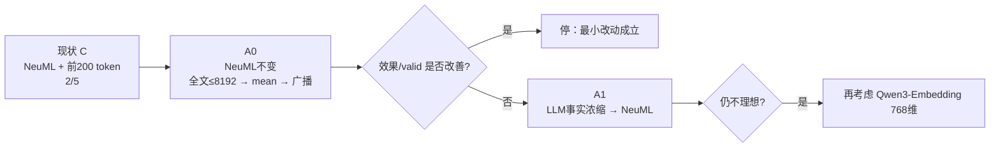
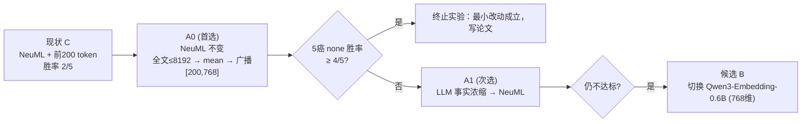

# 实验先验知识与下一步研究决策（I05 第二轮 · A0）

[系统状态：S_state 已核验到「轮 C 账本原始数据 + Hugging Face 模型卡/配置文件 + arXiv 2505.07683 正文 + 仓库代码」一级 | 当前阶段：Q_new 已声明，A0 实现中]

| 文档 | 作用 |
|---|---|
| 本文件第 1 节 | 用户 2026-09-24 粘贴的两份文档，原文照录（零信息丢失） |
| 本文件第 2–6 节 | Claude 的核验与整理：逐条事实核对、S_state、Q_new、解释边界、裁决记录（事实层） |
| [5.如何修补BioClinical-ModernBERT.md](5.如何修补BioClinical-ModernBERT.md) | A0 研究计划书：设计、两张 mermaid、阶段门、风险（建议层） |
| [seed单位-实验结果.md](seed单位-实验结果.md)、[癌症为单位.md](癌症为单位.md)、[encoder-table.md](encoder-table.md) | 渲染脚本生成的 bcmbert8192 结果模板（跑完后由脚本回填） |
| [../4.BioClinical ModernBERT-程序性知识/](../4.BioClinical%20ModernBERT-程序性知识/) | 轮 C（前 200 token）的全部材料与结果 |

## 1. 原文照录（不改 T/Q）

### 1.1 ChatGPT：4.0修补BioClinical ModernBERT（200-token）

````text
4.0修补BioClinical ModernBERT（200-token）

## 一、审查 · 保留


| 关键词    | 详细≤40字                                            | 依据                                                                                                                                                    | 下一步＋理由                                                 | 坑                       |
| ----------- | ------------------------------------------------------- | --------------------------------------------------------------------------------------------------------------------------------------------------------- | -------------------------------------------------------------- | -------------------------- |
| Text 方向 | 当前失败很可能确实来自新 Text 表示                    | none 仅2/5；LGG/BRCA/UCEC显著下降。                                                                                                                     | <span style="color: #0000ff;">继续深挖 k1，不先换模态</span> | 不把2/5全归因encoder强弱 |
| k1 本体   | NeuML 是768维、8192上下文、mean-pooling embedding模型 | 当前只人为截到200。 官方模型卡也明确8192。([Hugging Face][1]https://huggingface.co/NeuML/bioclinical-modernbert-base-embeddings?utm_source=chatgpt.com) | 先把模型原生长上下文用起来 #TODO                             | 不先加第二个生成模型     |

---

## 二、审查 · 舍弃


| 关键词               | 详细≤40字         | 依据                                                                                                                          | 下一步＋理由                                     | 坑                        |
| ---------------------- | -------------------- | ------------------------------------------------------------------------------------------------------------------------------- | -------------------------------------------------- | --------------------------- |
| **广播抹平方差**     | 这个归因基本不成立 | 当前先求masked mean，再把同一向量广播；NPJ-C随后又沿200行mean。                                                               | 把主要嫌疑转向**200-token截断＋mean bottleneck** | 不把广播当独立信息损失    |
| **Qwen因1024维剔除** | 这一条事实错误     | 官方 Qwen3-Embedding 支持**32–1024自定义维度**，768合法。([Hugging Face][2]https://huggingface.co/Qwen/Qwen3-Embedding-0.6B) | 可留后备候选，不作为当前首选                     | Qwen≠Clinical ModernBERT |

---

## 三、<span style="color: #ff0000;">归因分析</span>

### 1. 最大嫌疑不是 broadcast，而是 **200-token coverage**

当前实现明确：

```text
原报告
→ 截断到200 token
→ BioClinical ModernBERT
→ 有效token mean
→ [768]
→ 重复200次
→ [200,768]
→ NPJ-C再次mean
```

因此数学上：

$$
\operatorname{mean}([v,v,\ldots,v])=v

$$

**broadcast 本身没有再次破坏表示。**

真正发生信息损失的位置是：

$$
\text{完整报告} \rightarrow \text{前200 tokens}

$$

Phase 0 已经得到：报告中位数 **558词**、25分位数222词，而且当前结论明确记录"超过75%的报告被截断"。

但 k1 本身支持 **8192 tokens**。也就是说，目前是在拿一个长文本 encoder，当成200-token BERT用。([Hugging Face][1]https://huggingface.co/NeuML/bioclinical-modernbert-base-embeddings?utm_source=chatgpt.com)

这比"模型不够强"更值得先修。

### 2. 现有结果也支持「Text表示本身在拖后腿」

用现有 `text_100` 作**辅助诊断**：


| 癌种 |   none Δ | text_100 平均Δ | 现象               |
| ------ | ----------: | ----------------: | -------------------- |
| LGG  | -0.053623 |    ≈ -0.008834 | 去掉Text后大幅收窄 |
| BRCA | -0.033292 |    ≈ -0.014125 | 去掉Text后收窄     |
| UCEC | -0.016292 | ≈**+0.034365** | 去掉Text后直接翻正 |

原始逐 seed 数字见结果表。

这不是严格因果消融——checkpoint 本身已经在新 Text 上重训、不同缺失场景还有路由影响——但方向很清楚：

> **失败不只是重训噪声；当前 Text 表示确实很可疑。**

---

## 四、信息补充：A/B 应该怎么重新定义

#### **A0｜首选：Full-context BioClinical ModernBERT**

不是摘要，而是：

```text
完整报告
   ↓
NeuML BioClinical ModernBERT
max_length = min(8192, full report)
   ↓
所有有效 token masked mean
   ↓
768维
   ↓
广播200行
   ↓
[200,768]
```

##### 为什么它比 LLM 摘要先做

1. **槽完全不变**：仍然 `[200,768]`。
2. **encoder完全不变**：还是锁定的 NeuML revision。
3. **NPJ-C完全不变**。
4. **不引入幻觉**。
5. **直接修复你现在最明显的异常：人为200-token截断。**

NeuML 官方模型卡本身就是 **8192-token + attention-mask mean pooling → 768维 embedding**。([Hugging Face][1]https://huggingface.co/NeuML/bioclinical-modernbert-base-embeddings?utm_source=chatgpt.com)

所以你当前的 200-token 其实不是模型限制，而是为了迁就历史槽位人为加的限制。

##### Boundary

只有一件事要先检查：

> 用 **NeuML tokenizer** 对2506名报告重新统计 token 长度：`P95 / P99 / max / >8192数量`。

如果绝大多数≤8192，这条路非常干净。

---

## **A1｜第二步：LLM pathology-aware compression**

如果 A0 仍然弱，再加摘要。

这是有直接 TCGA 任务依据的：Song 等用 Llama-3.1-8B-Instruct 浓缩病理报告后，BioMistral 文本单模态 C-index 从 **0.694 → 0.752**，并报告在8个高频癌种上摘要版本均优于未摘要版本。([arXiv][3]https://arxiv.org/html/2505.07683)

该研究使用：

* Llama-3.1-8B-Instruct；
* greedy decoding；
* temperature = 0；
* 报告摘要后再做 embedding；
* 人工检查40例，24例需要小修，因此幻觉风险真实存在。([arXiv][3]https://arxiv.org/html/2505.07683)

但它的生存管线是 **BioMistral embedding → PCA → CoxPH → 5-fold CV**，不是你的 NPJ-C，所以只能作为机制依据，不能保证当前 C-index 上升。

### 更适合你的浓缩 Prompt

不要做开放式"总结这份报告"，而应做**固定字段、source-grounded compression**：

> Compress the pathology report using **only facts explicitly stated in the source**.
> Preserve diagnosis/histology, grade, tumor size and extent, invasion, margins, lymphovascular/perineural invasion, lymph-node status, TNM/stage if explicitly reported, biomarkers/IHC/molecular findings, and relevant prior pathology.
> Preserve all numbers and negations exactly.
> Do not infer stage, diagnosis, prognosis, treatment, age, or missing facts.
> Omit administrative text, duplicated passages, gross-description boilerplate and irrelevant incidental findings.
> If information is absent, omit the field rather than guessing.
> Output one compact factual paragraph. No explanation.

然后再用 **NeuML tokenizer** 验收长度，而不是用 Llama tokenizer 判断是否"≤200"。

---

## 五、选项 B 的重新评价

### `thomas-sounack/BioClinical-ModernBERT-base`

**不建议。**

它是 MLM/domain-pretraining 底座；你当前 NeuML 正是在这个 base 上又做过 sentence-embedding 对比训练，且明确以 mean pooling 作为 embedding 输出。([Hugging Face][1]https://huggingface.co/NeuML/bioclinical-modernbert-base-embeddings?utm_source=chatgpt.com)

换回 base 相当于：

> 已经有"专门训练过怎么产embedding"的模型，却退回只做 MLM 的版本。

机制上没有优势。

## <span style="color: rgb(0, 0, 255);">六、审查综合 · How to do</span>



**A｜首选：`A0 = NeuML full-context ≤8192 → mean → [200,768]`。**
**B｜A0失败后：`A1 = LLM浓缩 → NeuML`。**

- ① 不应直接从 C 跳到"LLM摘要"。先用 k1 原生8192上下文，是更便宜、更干净、更符合单因素归因的实验。****
  **C｜再失败：Qwen3-Embedding-0.6B，锁768维。

  ② Qwen3-Embedding-0.6B 并不因1024维违反槽位；官方支持直接输出768维，应从"剔除"改成"后备候选"**
````

### 1.2 修补后的 Prompt 与先验知识（用户整理版）

````text
ChatGPT 的这份判读逻辑非常严密且完全切中要害。

1. 数学归因完全成立：广播向量后经下游沿行求均值满足 $\operatorname{mean}([v, v, \ldots, v]) = v$，证明"广播抹平方差"不是信息损失源，真正的信息瓶颈 100% 在于人为的 200-token 强制截断（中位数 558 词，超过 75% 的病理报告被砍掉了长尾特征）。

2. 底层事实勘误正确：NeuML 本身原生支持 8192 tokens，且 Qwen3-Embedding 支持 Matryoshka 维度缩减（可直接输出 768 维），此前将 Qwen3 因"1024 维"直接剔除确实存在误判。

3. 递进逻辑最符合科研单因素控制：直接从 C 跃迁到 LLM 摘要（引入生成模型与幻觉偏倚）粒度过大。先做 A0（解锁 NeuML 原生 8192 长上下文） 是成本最低、最干净、最无损的单因素对照实验。

以下是对原 Prompt 和先验知识文档的完整修补版本，可以直接更新使用：

1. 修补后的 Prompt（供输入 Consensus / 多模型评估）
Plaintext

```
Role & Context
你是一个深耕计算生物学与深度学习交叉领域的资深 AI 研究员，擅长多组学癌症预后分析（Survival Analysis）与表征学习工程。
目前，我们正在优化一个基于 TCGA 数据的泛癌种三模态（WSI、RNA、Text）生存预测模型。在保留天然缺失（none）且固定 5 个 seed（123、132、213、231、321）的严格对照下，将 Text Encoder 替换为 BioClinical ModernBERT 的初步实验（策略 C：截断前 200 token + mean pooling + 广播至 [200, 768]）仅取得了 2/5 的胜率（胜出 BLCA、LUAD，但在 LGG、BRCA、UCEC 败北）。

最新数学与数据诊断：
1. 广播本身的数学特性：mean([v, v, ..., v]) = v。广播后经下游模型再次求均值对特征没有额外信息损失。
2. 真正瓶颈在于信息截断：TCGA 病理报告中位数为 558 词（25%分位数 222 词），>75% 的报告被截断；而 NeuML/bioclinical-modernbert-base-embeddings 本身原生支持 8192 上下文。之前使用 200-token 是为了迁就历史槽位人为设置的瓶颈。

现确定递进修补路线（严格遵循"最小改动、不改槽位 [200, 768]"原则）：
- 步骤 A0（首选）：解除人为 200-token 限制，改用 NeuML 原生 max_length=min(8192, report_len) -> mean pooling -> 广播至 [200, 768]。零新组件、零幻觉风险、不改网络槽位。
- 步骤 A1（次选/后备）：若 A0 提升仍有限，加入 LLM（如 Llama-3.1-8B-Instruct）进行事实约束型病理浓缩（Source-grounded compression），再经 NeuML 提取 embedding。
- 步骤 B（候选）：若 k1 (NeuML) 在长文本下表现仍不佳，切换至 Qwen3-Embedding-0.6B（配置自定义 768 维输出）。

请针对【步骤 A0】的工程落地与论文写作提供指导：
1. 【验证指标建议】：在解禁 8192 上下文之前，如何对 TCGA 全部 2506 例病理报告的 token 长度分布（NeuML Tokenizer）进行统计与异常值排查？
2. 【论文写作包装】：如何在论文中将"从 200-token 强制截断提升至 8192 全文上下文表征"合理表述为应对临床病理文本长尾依赖（Long-tail clinical dependencies）的轻量级特征对齐工程优化？
3. 【失败退路策略】：若 A0 在 5 癌种上的胜率仍无法达到 4/5，进入 A1（LLM 浓缩）时，如何设计免受幻觉干扰的 Prompt 结构？

```

2. 修补后的 Markdown 先验知识文档 (`innovation-BioClinical_ModernBERT-NextStep.md`)
Markdown

```
# 实验先验知识与下一步研究决策文档（修补版）

## 【trigger / 触发场景 / 大背景】

在 I05 实验中，我们将现有系统中的 Text Encoder 替换为 `BioClinical ModernBERT` 的嵌入版。在保持保留天然缺失（none）且固定五种 seed（123、132、213、231、321）的严格评估标准下，我们期望 C-index 在五种癌症中的胜率能达到 4/5 或 5/5[cite: 16, 17]。

初步实验结果显示，策略 C（截断前 200 token + mean pooling + 广播至 `[200, 768]`）仅在 BLCA 和 LUAD 上胜出，在 LGG、BRCA、UCEC 上败给了原有基线（Proto.†），胜率仅为 2/5[cite: 17]。

## 【归因分析与数学诊断】

通过对数据与表达管道的再次审查，确认当前失败的核心原因：

1. **"广播抹平方差"假说不成立**：
   数学逻辑为 $\operatorname{mean}([v, v, \ldots, v]) = v$。将单向量 $v$ 广播写入 200 行后，下游 NPJ-C 沿着 200 行求 mean 得到的依然是 $v$。广播本身没有引入二次信息损失。
2. **主要嫌疑确认为 200-token 信息瓶颈**：
   病理报告词数中位数为 558 词（25%分位数 222 词），超过 75% 的报告被严重截断。而 `NeuML/bioclinical-modernbert-base-embeddings` (k1) 本身原生支持 **8192 tokens**[cite: 16]。之前使用的 200-token 限制属于为了迁就历史槽位人为加上的信息瓶颈。
3. **辅助诊断证据**：
   在 `text_100` 辅助消融中，去掉 Text 后 LGG 和 BRCA 的差距大幅收窄，UCEC 去掉 Text 后 Δ 直接翻正（+0.034365）。证明当前的 Text 表示质量确实在拖后腿。

## 【不可变约束】

1. **评估标准**：保持 none（保留天然缺失），固定的 5 个 seed：123、132、213、231、321[cite: 16, 17]。
2. **架构约束**：遵循最小改动原则（输入下游网络的槽位必须保持为 `[200, 768]`，不改动 NPJ-C 结构）。

## 【修补后的递进执行路线】



1. 策略 A0｜首选：Full-context BioClinical ModernBERT

* 做法：保留 NeuML 权重与 `[200, 768]` 槽位不变。仅将 Tokenizer 截断长度扩展至 `max_length = min(8192, full_report_len)`，对所有有效 token 做 masked mean pooling 得到 768 维向量，再广播写入 200 行。

* 优势：零额外模型开销、零幻觉风险、完全符合单因素对照。

* 前置验收条件：用 NeuML Tokenizer 重新对 2506 例病理报告进行 token 长度分布统计，确认是否存在极端越界（>8192）。

2. 策略 A1｜后备：LLM Pathology-Aware Compression

* 触发条件：A0 实验后 5 癌胜率仍未达 4/5。

* 做法：使用 Llama-3.1-8B-Instruct (greedy decoding, temp=0) 进行严格事实约束（Source-grounded）的摘要，将长报告无损浓缩至短文本后，再送入 NeuML 提取表征。

* Prompt 约束：禁止推断分期/预后，仅保留肿瘤等级、尺寸、浸润、淋巴结及分子标记物等明确事实。

3. 候选模型状态勘误

* `Qwen3-Embedding-0.6B`：更正此前判定。该模型原生支持 Matryoshka 维度裁切，可直接输出 768 维特征，槽位兼容。将其由"剔除"调整为"末位后备候选"。

* `thomas-sounack/BioClinical-ModernBERT-base`：维持不建议。其仅为 MLM 预训练底座，未经过 sentence-embedding 专项训练，效果预期弱于 NeuML[cite: 16]。
````

## 2. 逐条核验（Claude，2026-09-24）

| 原文断言 | 核验 | 依据 |
|---|---|---|
| NeuML 是 768 维、8192 上下文、mean-pooling embedding 模型 | **成立** | revision `048ad449…` 的 `sentence_bert_config.json`：`max_seq_length 8192`；`tokenizer_config.json`：`model_max_length 8192`；`1_Pooling/config.json` 只开 mean-token；`config.json`：ModernBertModel、22 层、hidden 768 |
| 广播本身不造成信息损失 | **成立** | 数学 mean([v,…,v]) = v；代码：NPJ-C 对 Text 先 `mean(dim=1)` 再 `Linear(768,256)`，无跨 token 注意力（`src/trimodalsurv/models/npjc.py`） |
| 超过 75% 的报告被截断 | **成立且更严重** | 轮 C 提取 manifest：NeuML token 数 >200 的 2165/2506（**86.4%**）；中位 1044 token、P75 1774 |
| 用 NeuML 分词器统计 P95/P99/max/>8192 | **已完成，不必上机** | 同一 manifest 的 `n_tokens_untruncated`：P95 **3059**、P99 **4177**、max **6822**、**>8192 为 0**（>4096 为 32） |
| `text_100` 平均 Δ：LGG ≈ −0.008834、BRCA ≈ −0.014125、UCEC ≈ +0.034365 | **逐位一致** | 账本 `experiments/BioClinical ModernBERT/results/i05-bcmbert200-20260924d/evidence/formal_eval/runs/test/complete.json` 重算（另：BLCA +0.001804、LUAD +0.001053） |
| "去掉 Text 后收窄 / 翻正" | **措辞需修正** | `text_100` 下 Text 不是被去掉，而是由检索到的 donor Text 替换（新臂在新空间里检索）；只能作方向性证据，原文也已注明"不是严格因果消融" |
| Qwen3-Embedding 支持 32–1024 自定义维度，768 合法 | **成立** | 模型卡：MRL Support = Yes，"user-defined output dimensions ranging from 32 to 1024"；池化为 last-token、上下文 32k、L2 归一化 |
| Song 等：Llama-3.1-8B-Instruct、greedy、temperature 0、0.694 → 0.752、8 个高频癌种、40 例人工复核 24 例修正、BioMistral → PCA → CoxPH → 5-fold CV | **逐项成立** | arXiv 2505.07683 正文 |
| `thomas-sounack/BioClinical-ModernBERT-base` 不建议 | **成立** | NeuML 以它为底座再做 sentence-embedding 对比训练（MultipleNegativesRankingLoss） |
| 报告中位数 558 词、25 分位数 222 词 | 成立（轮 C Phase 0，按空格分词的词数） | 研究计划书 3.2；注意与 token 数（中位 1044）是两种单位 |

**原文未提、但影响 A0 解释的事实**：NeuML 的嵌入微调数据是 **PubMed 标题–摘要对**（摘要级长度），模型卡自述"略低于 PubMedBERT embeddings（512 上下文），但支持 8192"。所以 8192 是配置上限，不代表"训练过长文档"；对 3000+ token 报告做均值池化处于 base 预训练范围内、嵌入微调分布之外。

## 3. S_state（A0 开工时）

**已证实**
- 轮 C 结果（negative）：none 下严格胜 2/5（BLCA +0.004892、LUAD +0.012390；LGG −0.053623、BRCA −0.033292、UCEC −0.016292）；回放 IDENTICAL；25 个 ckpt 训练身份与资产锁全部核对通过。
- 各癌种 ≤200 token 覆盖率：LGG 26.5%、BRCA 14.6%、BLCA 12.0%、LUAD 13.2%、UCEC 2.1%；各癌种 token 中位 / P95 / max：BLCA 1727 / 4034 / 5243，BRCA 990 / 2818 / 6822，LGG 478 / 1848 / 2896，LUAD 986 / 2575 / 4444，UCEC 1572 / 3003 / 4684。
- 代码：槽位行数与分词长度已拆开（`SLOT_ROWS=200`）；新档案 `bcmbert8192`：`max_length 8192`、`padding longest`、`truncation false`、`batch_size 1`；下游 NPJ-C、检索/原型、训练 dataset 零改动（它们对 Text 只做整块复制、逐元素运算与行均值，与广播可交换）。
- ≤200 token 的 341 份报告在两档下特征理论上相同（本地测试 `test_short_text_identical_across_profiles` 逐位验证替身模型）。

**未核验**
- 服务器当前 GPU 负载与磁盘；A0 提取实际耗时（估 5–15 分钟）；transformers 4.48.3 的 ModernBERT eager 路径在 L≈6800 单样本下的显存（估约 4.7 GB 激活 + 0.6 GB 权重）。

**已否决 / 修正**
- 轮 C 的"Qwen3 因 1024 维违反槽位而剔除"——事实错误，改为末位后备。
- "广播抹平方差"——数学不成立。

## 4. Q_new 与执行验收门

- **Q_new（进论文口径）**：Δ_c = 五 seed 均值 C_A0(c, none, strategy0) − 五 seed 均值 C_Table1(c, none, Proto.†)；按未舍入值 Δ_c > 0 计胜，平局不算胜；目标胜癌数 ≥ 4/5；不删癌、不删 seed。
- **同代码对照（信息性，不进 Q）**：A0 − 轮 C bcmbert200（只差上下文长度）；A0 − legacytext-rerun（只差 Text 管线，两者同配方重训）。
- **执行验收门（非 Q）**：特征 manifest `n_truncated == 0` 且 2506/2506 人 `n_valid_tokens == n_tokens_untruncated`；assets 逐条核对与资产锁；候选冒烟通过、回放 IDENTICAL；25 + 25 个 ckpt 训练身份核对；test 300 行 × 2；`verify_results.py` 两路重算一致；数字只来自脚本（坑 V23）。

## 5. 解释边界

1. 癌种层面不支持"截断是主因"的整齐叙事：LGG 报告最短（≤200 覆盖 26.5%）却在轮 C 跌得最多，BLCA 较长却胜出。A0 是最便宜的单因素实验，但不能预期它必然修复 LGG/BRCA。
2. 嵌入微调分布：见第 2 节末段。
3. A0 相对 Table 1 同时改了编码器与覆盖长度，并混有重训方差；三臂同代码对照用来拆分，但只作信息性报告。
4. 零效应下 ≥ 4/5 严格胜出的偶然概率约 18.8%；结论只按 Q 陈述。
5. 论文写作（原文 Prompt 第 2 问）：只能写"用编码器原生上下文长度编码完整报告，消除了为适配历史槽位而人为引入的 200-token 截断"；是否称为"应对长尾依赖"取决于 A0 的结果，不预设结论。

## 6. 用户裁决记录（2026-09-24）

| 裁决 | 落地 |
|---|---|
| 采纳 A0 为本轮唯一执行项；A1、B 留作后续 Q | 研究计划书第 0 节 |
| I05 续做，新增档案 `bcmbert8192` | 代码同目录；账本 `experiments/BioClinical ModernBERT/results/` |
| 加跑 `legacytext-rerun` 对照臂 | `train_plan_legacytext.yaml`，25 个 run |
| 重建 `run/i05-bcmbert200-20260924d` → `6631662` | 已完成；a/b/c 三个中间冻结点不重建 |
| Git 工作流：互审通过后先从候选 H 的快照上机冒烟，冒烟通过才 squash | AGENTS.md「Git 工作流」第 5 条、`docs/workflow/git-workflow.md` |
