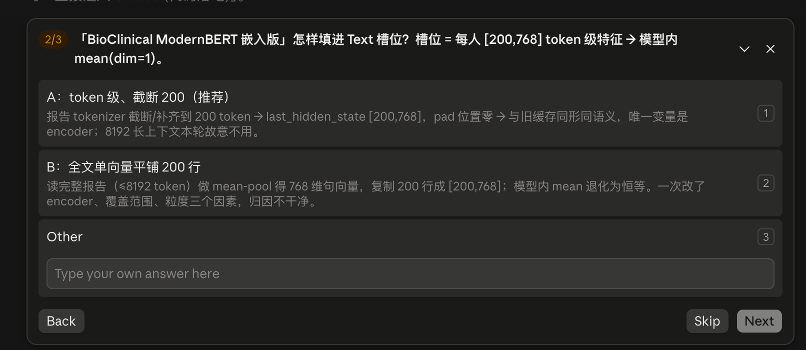
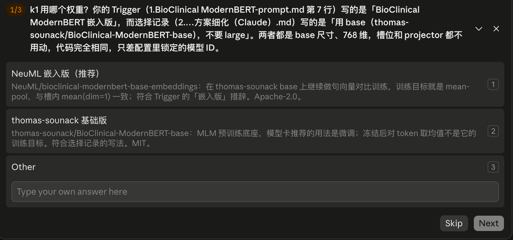

# 选择记录




选  **A** 。用  **base** （thomas-sounack/BioClinical-ModernBERT-base），不要 large。

槽是每人 [200, 768]，进模型后 mean(dim=1)。base 的 hidden_size 就是 768，和旧 ClinicalBERT 一样，projector 不用动。large 是 1024，槽和线性层都要改，直接出局。


|             | A 截断 200                                   | B 整篇压成一句再复制 200 行          |
| ------------- | ---------------------------------------------- | -------------------------------------- |
| 槽          | 不动                                         | 形状没变，语义变了                   |
| 改了几件事  | 编码器（外加 tokenizer）                     | 编码器 + 覆盖长度 + 粒度             |
| mean(dim=1) | 仍在对 token 求均值                          | 200 行相同，均值是恒等，等于没这个槽 |
| 论文        | 「冻结换更强临床编码器，token 预算仍是 200」 | 一次改三处，涨了也写不清是谁的功     |



## 问题二：具体的模型的来源   -> 选择1:NeuML 嵌入版


# proposed plan （claude）

# I05｜把 Text encoder 换成 BioClinical ModernBERT 嵌入版：计划书、规则改版与代码落地

[系统状态：S_state 已核验到"仓库代码与本地证据"一级；远端数据、HF 权重、GPU 未核 | 当前阶段：P_specific / Q_specific 已锁定，批准后执行 A]

## Context

主创新点"原型检索方法（S0-force，含固定路由）"已在五癌四场景取得 4/5（探索性，带 LUAD 路由的 test 泄漏声明）。消融实验二要证明：只把 Text 特征提取器换成冻结的 BioClinical ModernBERT 嵌入版，NPJ-C、原型检索方法、训练配方全部不变，在历史 `none`（保留天然缺失）下，五癌五 seed 平均 B 口径 C-index 相对论文 Table 1 `None / Proto.†` 严格胜出至少 4/5。本轮跳过 Gemini 与 ChatGPT Pro，由 Claude 直接指挥并构建代码。

本会话的用户裁决：

1. ~~两份结果模板保留四场景结构。只有 `none` 进入 Q 判定，其余三场景作附录。~~
2. ~~填槽用方案 A：token 级，截断或补齐到 200，pad 行置零，形状保持 `[200,768]`。~~
3. ~~同时改 CLAUDE.md、AGENTS.md、STATUS.md：Claude Code 任指挥官并构建代码；Codex 只做实验前研究计划书审查（含代码 diff）和实验后结果审查。~~
4. ~~模型 ID 你无偏好。按 Trigger 的"嵌入版"锁定 `NeuML/bioclinical-modernbert-base-embeddings`。它由 `thomas-sounack/BioClinical-ModernBERT-base` 继续做句向量训练而来，同为 base 尺寸，满足选择记录里"用 base，不要 large"。~~
5. ~~上机顺序：Phase 0 只读核验可用 exp 分支已提交版本；从 Phase 1 提特征起，一律先经 Codex 候选审查、squash 进 main、freeze，再同步上机。~~
6. ~~本会话结束时提交到 `exp/innovation-encoder`，不 push。三份规则文件里你已有的未提交改动会随文件一并进入提交。~~

三行意图确认：

- **要**：五份文档、规则文件改版、I05 实验代码与本地测试，最后提交到 `exp/innovation-encoder`。
- **不要**：不改 NPJ-C、原型检索、训练超参和 I01 代码；不上服务器、不下载权重、不训练评测、不 push、不动 main。
- **成功标准**：本地测试全绿；模板里的基线数值由脚本从原始 JSON 生成，并与 Table 1 逐位相同；Codex 候选审查所需材料齐备。

## 1. 润色后的 prompt（执行时落盘为 `给Claude的结构化Prompt.md`）

- **目标**：落地 k1 = BioClinical ModernBERT 嵌入版的消融实验二。产出先验知识文档、研究计划书（含两张 mermaid）、两份四场景结果模板和 I05 实验代码，并改写项目分工。
- **背景**：证明（NPJ 骨架 + 原型学习 + 新 encoder）优于（NPJ 骨架 + 原型学习 + NPJ 现有 encoder），本轮只换 Text。选型原则是"不改槽；在能填这个槽的临床 encoder 里取最强冻结权重"。
- **证据真源**：`1.原始发给ai的信息/`（结构化 Prompt、Pro 版先验知识、交接包 zip）、`2.来自ai的回答/` 的三份回答、`4.…程序性知识/1.BioClinical ModernBERT-prompt.md`（原始需求）与 `2.BioClinical ModernBERT-方案细化（Claude）.md`（选择记录）。下一位可以读上一位的建议，但建议不能代替原始需求和原始证据。
- **约束**：不可变约束 1–4 原文照录；不改 T/Q；最小改动；执行前完整阅读坑台账（已读）。分支 `exp/innovation-encoder`，不污染 main。
- **具体步骤、涉及文件、预期结果**：见第 4、6、8 节。

## 2. 约束清单与策略筛选（TPBHQ）

`[ T：只换 Text encoder 的辅助创新消融 + Q_draft（none 下五癌五 seed 均值 B C-index，严格胜 Table 1 None/Proto.† 的癌种数 ≥ 4/5） + ∩P_i：原文可得 · 槽位兼容 · 冻结权重可得 · 单因素对照 · 可溯源 ∥ S_state（第 5 节） ]`


| 候选                                             | 与 Text 槽位的关系                                | P × S_state                                            | 结论                           |
| -------------------------------------------------- | --------------------------------------------------- | --------------------------------------------------------- | -------------------------------- |
| k1`NeuML/bioclinical-modernbert-base-embeddings` | 双向 token 编码器，768 维，训练目标就是 mean-pool | Apache-2.0 权重可得；768 接口满足；原文可得性待 Phase 0 | **锁定**                       |
| k2`thomas-sounack/BioClinical-ModernBERT-base`   | 同槽 MLM 底座                                     | 模型卡用法是微调，冻结取均值不是其训练目标              | 同槽备选，配置可切换，本轮不跑 |
| k3 Clinical ModernBERT                           | 同槽                                              | 官方基准弱于 k1                                         | 剔除                           |
| k4 Qwen3-Embedding-0.6B                          | 改槽（1024 维 last-token 单向量）                 | 违反"不改槽"                                            | 剔除                           |

- **P_specific**：标签 CSV 有报告原文列，且覆盖旧 Text 特征的全部患者；新旧特征患者集合逐一相同；img/rna 缓存按内容复用历史冻结件；HF revision 固定；transformers ≥ 4.48。
- **Q_specific**：Δ_c = 五 seed 均值 C_new(c, none, strategy0) − 五 seed 均值 C_Table1(c, none, Proto.†)。按未舍入值 Δ_c > 0 算胜，平局不算胜，目标胜癌数 ≥ 4。不删癌、不删 seed。
- **执行验收门（非 Q）**：25 个新 ckpt 全部完成，溯源 commit 在 main 且 dirty=0；100 格 × 3 臂齐全；旧资产回放通过；进结论的数字只来自脚本留档表（坑 V23）。

## 3. 异议（默认交付仍按你的口径）

Table 1 的基线 ckpt 是历史训练，新臂在现行代码上重训，Δ 会同时包含 encoder 效应和重训方差；默认仍对照 Table 1，另提供可选的"旧 Text 同代码重训"成对臂，由你在正式授权时决定是否加跑。零效应下 ≥ 4/5 的偶然概率约 18.8%，所以结论只按 Q 陈述，并列出逐 seed Δ。

## 4. 本会话交付物

文档（目录 `manuscript/消融实验/2.innovation-secode-part- Encoder/4.BioClinical ModernBERT-程序性知识/`；原文写的 `4.BioClinical ModernBERT` 不存在，用这个已有目录）：


| 文件                                    | 内容                                                                                                                                                                              |
| ----------------------------------------- | ----------------------------------------------------------------------------------------------------------------------------------------------------------------------------------- |
| `给Claude的结构化Prompt.md`             | 第 1 节润色版，附原始需求与选择记录的链接、六条裁决                                                                                                                               |
| `innovation-BioClinical ModernBERT.md`  | 先验知识，只放事实。原文照录区：背景、Trigger、Q_draft、不可变约束 1–4。整理区：Q_specific、执行验收门、S_state 三栏（已证实 / 未核验 / 已失败，逐条带出处）、决策记录、解释边界 |
| `研究计划书-BioClinical ModernBERT.md`  | Claude 的方案：候选与决策、**mermaid① 创新点在网络中的位置**、**mermaid② 实验实现顺序与逻辑链条**、4×5 表格设计与表外对照、阶段门、风险登记、Post-Mortem 预留                  |
| `seed单位-实验结果.md`、`癌症为单位.md` | 渲染脚本生成：现有系统列已填真值，新 encoder 列写"未实验"                                                                                                                         |

规则文件：


| 文件        | 修改                                                                                                                                                                                                                                                                                                                                      |
| ------------- | ------------------------------------------------------------------------------------------------------------------------------------------------------------------------------------------------------------------------------------------------------------------------------------------------------------------------------------------- |
| `CLAUDE.md` | "角色与边界"加 2026-09-23 指定：用户另行指定前，Claude 任指挥官与执行方（构建代码），Codex 任审查方；实验前审查 = 研究计划书 + 节点一全清单（含代码 diff），实验后审查 = 节点二清单。写明 Claude 作为执行方要准备审查包、提醒你发起审查、修复阻断项，不替审查方出 PASS 记录；写明本仓库覆盖全局`~/.claude/CLAUDE.md` 中"Codex 实施"的分工 |
| `AGENTS.md` | "角色"节加同一指定，说明它是 09-22"按任务指定"规则下的当前指定                                                                                                                                                                                                                                                                            |
| `STATUS.md` | §1 加分工；§2 总览加 I05 行；按 §9 模板加 I05 卡片                                                                                                                                                                                                                                                                                     |

附带改动（批准计划即同意，可在批准时划掉）：AGENTS.md 里已失效的 `NPJ/scripts/train_launcher.py`、`NPJ/scripts/launch_formal.sh` 改为实际路径 `scripts/...`；`experiments/README.md` 索引加 I05；评测器保留可选的 `legacytext-rerun` 档案。

代码（新目录 `experiments/I05_text_encoder_bcmbert/`，按 I01/I04 约定手建）：


| 文件                                                                                        | 作用                                                                                                                                                                                                                                                            |
| --------------------------------------------------------------------------------------------- | ----------------------------------------------------------------------------------------------------------------------------------------------------------------------------------------------------------------------------------------------------------------- |
| `README.md`、`__init__.py`、`knowledge/index.md`、`knowledge/method.md`、`results/index.md` | 实验入口与索引，链接两份文档                                                                                                                                                                                                                                    |
| `model.py`                                                                                  | 核心算子：冻结 encoder 包装。分词 200、前向、按 attention_mask 置零 pad 行、FP32、形状与有限值断言；后端可注入，便于无 transformers 测试                                                                                                                        |
| `extract_text_features.py`                                                                  | `--audit` 只读核验：CSV 列与非空率、旧特征患者集合、旧特征每人非零行数与不同行数、新分词器下的 token 长度分布、历史缓存内容摘要。`--extract`：只为旧特征已有的患者生成 `{pid}.pkl`，原子写、回读复验，写 `manifest.json`（含提取器 sha256 与 git commit/dirty） |
| `model_config.yml`                                                                          | 默认 model 配置的副本，只把`modality.text.path` 改为 `data/text_embeddings_bcmbert200`                                                                                                                                                                          |
| `train_plan.yaml`、`train_plan_smoke.yaml`                                                  | 25 行正式清单（arm`e0_bcmbert200`，NPJC，compensator none，bin_mode author，按 seed 主序）与 1 行冒烟清单                                                                                                                                                       |
| `config.yaml`                                                                               | 协议 ID、模型 ID 与 revision 占位、冻结 combo 规格原样、S0-force 路由表原样、上游源码 sha256 锁、历史证据路径与哈希、资产档案；只用相对路径，服务器路径经 CLI 传入（仓库公开）                                                                                  |
| `evaluate.py`                                                                               | 冻结方法推理器，阶段 assets / preflight / smoke / replay / test（见 5.3、5.4）                                                                                                                                                                                  |
| `tools/render_encoder_tables.py`                                                            | 生成两份结果 md 与 4×5 表（见 5.5）                                                                                                                                                                                                                            |
| `tests/`                                                                                    | 配置与锁、提取器、路由组合、档案门、授权门、回放比对、渲染、发车 dry-run 逐参对比、CPU 合成数据端到端冒烟                                                                                                                                                       |

## 5. 关键设计（每条都有已核证据）

**5.1 Text 槽位（方案 A）**

- 槽位证据：`npjc.py:52-56` 对 token 维做无 mask 的 `mean(dim=1)`，再进 `Linear(768,256)`；`tcga_dataset.py:187` 写死 `(200,768)`；`I01/evaluate.py:30` 与推理器 `runtime.py:71` 都锁定 `[200,768]`。
- 做法：`tokenizer(max_length=200, truncation=True, padding='max_length')`，保留 [CLS]/[SEP]；取 `last_hidden_state`；pad 行置零；FP32；写出前对全部输出断言 shape、dtype、有限值（坑 D6）；pickle protocol 4 原子写并回读复验（坑 D7）。
- 语义说明：报告 ≥ 200 token 时，槽内均值恰好等于该模型训练时用的 masked mean；更短的报告，均值会按有效长度比例缩小。这一点写进解释边界。
- 患者集合：只为旧 `data/text_embeddings_parsed` 已有的患者生成。旧有而原文缺失则整体失败；原文有而旧无则不生成，天然缺失口径不变。历史 test 天然缺 Text 人数为 BRCA 36、UCEC 8、LUAD 5、LGG 3、BLCA 0（legacy-preflight.json）。

**5.2 隔离运行根**

- 训练子进程的工作目录固定为仓库根（`train_launcher.py:914-916`），dataset 用相对路径 `tmp_sur_cache`（`tcga_dataset.py:87`），缓存键不含特征路径且有 glob 兜底（`:90`、`:254-274`，坑 D2）。预热会切到 `--cache-dir` 的父目录，训练却不会，所以改 `--cache-dir` 只会让两者读写不同位置。唯一做法是全新运行根，即同步到服务器的 run worktree，`--cache-dir` 保持默认。
- 播种：把 30 个历史冻结 img/rna 缓存（3 split × 5 癌 × 2 模态）复制进新根，按 legacy-preflight.json 与 valid-source.json 的哈希核对；15 个 text 缓存由预热从新特征目录冷建（dataset 按模态独立加载缓存，`tcga_dataset.py:276-291`）。不碰原 `tmp_sur_cache/`。
- ckpt：`--result-path` 指向运行根之外的新目录。feature_dim 仍为 768，文件名与历史同名（`train_launcher.py:509-542`），不同根即不冲突。
- 残余竞态：dataset 构造末尾无条件、非原子地重写三类缓存（`_save_cache`）。清单按 seed 主序、总槽位 ≤ 5，并且不启用 `--eval_grids`，可以降低同癌种并发初始化的概率，但不能保证杜绝；因此训练后复验全部缓存的内容摘要，评测时逐条核对 text 缓存与特征文件及 manifest 一致。
- 训练配方不动：lr 1e-4、epochs 50、batch 32、hidden 256、Adam wd=1、bf16、best-valid、bin_mode author、无早停。GPU 沿用 `configs/gpu_train.yaml` 的既有豁免，因为计算图不变（写明理由）。dry-run 与 `--arms e0` 逐参对比，只允许 `--model_config`、`--result_path` 两项不同（坑 D16）。

**5.3 冻结方法复用**

- 已核：推理器绑定的 5 个公共源码当前 sha256 与其锁定值全等；6 个推理器文件与 4.progress 锁定值全等，代码可原样复用。
- 不能直接跑 `run.py`：test 阶段必须读取绑定资产哈希的 valid 选参锁（`run.py:216-223`，58 个候选见 `selection.py:100-160`），而 `rt.preflight` 硬绑历史 ckpt 与缓存（`runtime.py:454-513`）。新 encoder 不能重新选参，否则方法就变了。
- 所以写薄运行器 `evaluate.py`：只调用 `rt.load_cancer`、`run.evaluate_cell`、`inference` 和 `strict_e0_load`，规格为 [m0real, m1, 历史锁定 combo 原样]。combo 取自 2.progress `runs/valid/selection-lock.json`：`combo-l1-a1-w0p5`，rules 1–5，λ=1、α=1、w=0.5，ucec_exception=true。
- strategy0：非 LUAD 等于 combo。LUAD 调用 `4.progress/luad_m1_force/model.py` 的 `route_patient`，按天然可得性（不是遮挡后的掩码）逐患者从 combo/m1/m0real 的 logits 组合，再算 B 风险与 C-index，并记录路由计数。
- 不变量：天然缺失没变，所以新档案每格 LUAD 路由计数必须等于历史 `luad_route_counts`，天然缺失人数必须等于 legacy-preflight。

**5.4 资产档案、回放与阶段门**


| 档案                             | 资产要求                                                                                                                                                                         | 用途       |
| ---------------------------------- | ---------------------------------------------------------------------------------------------------------------------------------------------------------------------------------- | ------------ |
| `legacy-replay`                  | 标签、manifest、全部缓存、25 ckpt 均为历史件                                                                                                                                     | 回放门     |
| `bcmbert200`                     | 标签、manifest、img/rna 与历史相同；text 缓存与历史不同，每个 split 的患者键集合与历史相同，且逐条等于特征文件；25 ckpt 为新训练，run record 的 commit 等于 GIT_STAMP 且 dirty=0 | 正式       |
| `legacytext-rerun`（附带，可选） | 全部缓存为历史件；ckpt 为新训练                                                                                                                                                  | 成对重训臂 |

- 回放容差按坑 I01-R15-06 事先分档：同主机、同 gpu_cached 后端、batch 383 时，300 行 `c_index_b` 必须逐值相同；跨硬件时，donor、mask、路由必须完全一致，logits 最大绝对差 ≤ 1e-6，C-index 差异单列上报。其余情况判失败，保留证据后问你。
- 阶段：`assets` 不需要 ckpt，训练前跑；`preflight` 加查 ckpt；`smoke` 用子集患者且不算 C-index；`replay` 只接受 legacy-replay 档案；`test` 需要三份记录：source_hashes 相同的回放 PASS 记录、Codex 审查记录（reviewer=Codex、decision=PASS、绑定 source_hashes）、你的授权记录。审查记录由 Codex 输出或你本人写，Claude 不代写。

**5.5 渲染与 Q 判定**

- 输入：4.progress `complete.json`（基线 strategy0 行），可选 I05 `complete.json`（新臂）。输出：`seed单位-实验结果.md`、`癌症为单位.md`、`encoder-table.md`。
- 表头：`| 癌种或 Seed | 场景 | 我们提出来的 Encoder | 现有系统 Proto.† | 较优 | Δ（新−现有） |`。按未舍入值比较，平局全部标红，Δ 保留六位并带符号；癌种顺序 LGG/BRCA/BLCA/LUAD/UCEC（v2 锁定）；每张表的分隔行列数与表头一致。
- 结论沿用 I01 的双口径：绝对均值最高的 seed 或癌种，与相对现有系统 Δ 最大的 seed 或癌种，二者不混称；另给 none 下的 k/5 与未胜癌种；四场景结论只作附录。新臂缺失时写"未实验"。
- 4×5 表按手绘设计：行为 MLP / 原论文的 Encoder / 其他方法的 Encoder / 我们提出来的 Encoder，列为 LGG/BRCA/BLCA/LUAD/UCEC。现有系统放在表外独立参考，因为原论文 encoder 身份未核，不塞进行内。
- 解释边界写进两份文档：只换了 Text，结论支持"换 Text 后的三模态 encoder 组合优于现有组合"，不支持"每个模态的 encoder 都更好"；none 下完整患者不走检索，Proto.† 在这些患者上等于基础模型，所以 Δ 主要反映 encoder 加重训的效应。

## 6. 执行步骤（批准后，本会话内）

1. 用 exp1 环境跑 `scripts/ci.sh`，留存基线结果，用于区分既有失败。
2. 重新列出目标目录与证据目录，按修改时间核对有无新增材料。
3. 落盘三份文档：结构化 Prompt、先验知识、研究计划书。
4. 改 CLAUDE.md、AGENTS.md、STATUS.md 与附带改动。改前先读当前工作区版本，你已有的改动保持不动。
5. 建 I05 代码，源码锁的 sha256 现场计算后写入 config。
6. 写测试并跑通。同一方案连续失败两次就换路线并报告。
7. 用渲染脚本生成两份模板到 4.* 目录。
8. 本地发车 dry-run，并与 `--arms e0` 逐参对比。
9. 把本次新增的失效模式按 Post-Mortem 格式写入研究计划书，去重后追加到 `docs/engineering/pitfalls.md`。已知一条：定稿前没有重新列目标目录，漏读了你新增的选择记录。
10. 再跑一次 CI。CI 为绿才提交：只 add 本次新建或修改的文件，提交信息 `feat(I05): ...`，不 push。如果基线本来就红且原因与本次无关，提交前先停下告诉你。
11. 汇总候选审查包（commit、文件清单、测试输出、dry-run 对比），给出可直接运行的 Codex 审查命令，提醒你发起审查，然后停。

## 7. 后续上机阶段（本会话不做；每道门由你点头）


| 阶段           | 内容                                                                                                           | 门                                                                                                                               |
| ---------------- | ---------------------------------------------------------------------------------------------------------------- | ---------------------------------------------------------------------------------------------------------------------------------- |
| Codex 候选审查 | 研究计划书、代码 diff、配置、本地测试、dry-run                                                                 | 阻断项由我修复后复审                                                                                                             |
| Phase 0        | 用 exp 分支已提交版本做只读核验：`extract --audit`、主机与 GPU、transformers 版本                              | 需你授权上机。原文不可得、旧特征不是 token 级（各行几乎相同，或非零行数与报告长度无关）、旧 pad 位不为零，任一出现就停，由你裁决 |
| Git 门         | squash 进 main（`gitflow.sh` 的 DEV_BRANCH 与 exp 分支的对应方式由你定）；freeze `run/<id>`；同步 run worktree | 由你裁决                                                                                                                         |
| Phase 1        | 从冻结版本经 jobrun 下载固定 revision 权重并提特征；预热 text 缓存；`evaluate --stage assets`                  | HF 是新增联网域名（坑 C2），随上机授权一并确认                                                                                   |
| Phase 2 冒烟   | 1 癌 1 seed 训练只判通/不崩；`evaluate smoke`；`legacy-replay` 回放                                            | 冒烟通过即停                                                                                                                     |
| 发车前核对     | 节点一的 provenance 三项（commit 在 main、run worktree 干净、GIT_STAMP 对应 tag）                              | 你授权正式实验，并决定是否加成对臂                                                                                               |
| Phase 3        | 正式训练 25 个 run（train_launcher + jobrun）                                                                  | 同上                                                                                                                             |
| Phase 4        | `evaluate test`：5 癌 × 5 seed × 4 场景 × 3 臂                                                              | 需回放 PASS、Codex PASS 与你的授权记录                                                                                           |
| Phase 5        | 渲染两份 md、4×5 表与 Q 判定；结果回传`experiments/I05_text_encoder_bcmbert/results/<run_id>/`                | Codex 结果审查后，由你决定入论文或标 negative                                                                                    |

## 8. 验证（本会话）

```bash
PY=/Users/wuhao/miniconda3/envs/protomasksurv-exp1/bin/python
PYTHON_BIN=$PY bash scripts/ci.sh
PYTHONDONTWRITEBYTECODE=1 $PY -m pytest -q -p no:cacheprovider experiments/I05_text_encoder_bcmbert/tests
```

- I05 测试全部通过；CI 与第 1 步基线相比无新增失败，既有失败照实列出。
- 渲染结果：none 五癌均值等于 0.797723 / 0.688112 / 0.589972 / 0.582485 / 0.650968，25 个原值等于 None基线明细；连续渲染两次字节一致。
- 配置测试：model_config 与默认配置只差 text.path；清单 25 行无重复并覆盖 5 癌 × 5 seed；冻结规格等于选参锁里的 combo；源码锁等于现场 sha256。
- dry-run 对比只出现允许的两项差异。
- CPU 合成数据端到端：assets → preflight → smoke 走通，路由计数与合成设定一致。

## 9. 风险登记


| 风险                         | 检测                                                      | 缓解                                    |
| ------------------------------ | ----------------------------------------------------------- | ----------------------------------------- |
| 旧 text 缓存被静默命中（D2） | assets：text 摘要与历史不同、键集合相同、逐条等于特征文件 | 全新运行根，只播种 img/rna              |
| ckpt 同名被跳过或拒写        | dry-run 打印路径；preflight 核 ckpt 不是历史件            | 独立结果根                              |
| 天然缺失口径漂移             | 键集合逐一比对；缺失人数与路由计数等于历史                | 只按旧患者集合生成，缺原文即失败        |
| 旧槽位语义与方案 A 不符      | Phase 0 统计非零行数、不同行数、token 长度                | 停下由你裁决                            |
| 缓存并发重写（D15 残余）     | 训练后复验缓存摘要                                        | seed 主序、槽位 ≤ 5、不启用 eval_grids |
| 训练口径漂移（D16）          | dry-run 逐参对比                                          | 只允许两项差异                          |
| 运行器逻辑偏差               | legacy-replay 按分档容差比对 300 行                       | 不过即停                                |
| 权重或依赖漂移               | manifest 记 revision 与版本                               | 固定 sha；transformers ≥ 4.48          |
| 溯源失败或 dirty 拒跑        | gitstamp 拒跑；preflight 核 run record                    | 走 freeze，不用`--allow-dirty`          |
| 手抄数字（V23）或结论过度    | 模板只由脚本生成；列逐 seed Δ                            | 结论只按 Q 陈述，附解释边界             |

## 10. 假设

- 角色指定写成"用户另行指定前的当前指定"，与 09-22"按任务指定、对称互审"的规则并存，不删旧条款。
- 你在 4.* 目录与证据目录里的原有文件不纳入本次提交；需要一并提交时由你决定。
