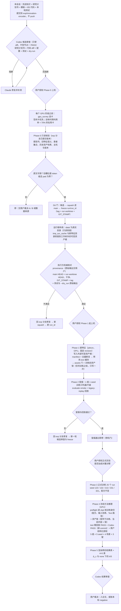

# 研究计划书：BioClinical ModernBERT 嵌入版替换 Text encoder（I05）

[系统状态：S_state 已核验到"仓库代码与本地证据"一级；远端数据、HF 权重下载、GPU 占用未核 | 当前阶段：A 已完成代码落地与本地验证；Codex 候选审查（`347612b`）4 项 high、复核 r2（`2f374e7`）2 项 high、复核 r3（`14f722e`）2 项 high 均已修复，等待 Codex 再复核候选]


| 文档                                                                                                               | 作用                                                            |
| -------------------------------------------------------------------------------------------------------------------- | ----------------------------------------------------------------- |
| [4.1.BioClinical ModernBERT-prompt.md](4.1.BioClinical%20ModernBERT-prompt.md)                                     | 原始需求，原样保留                                              |
| [innovation-BioClinical ModernBERT.md](innovation-BioClinical%20ModernBERT.md)                                     | 先验知识：原文照录、用户裁决、Q、S_state（事实层）              |
| 本文件                                                                                                             | Claude 的方案：设计、顺序、门、风险（建议层，不替代上面两份）   |
| [给Claude的结构化Prompt.md](给Claude的结构化Prompt.md)                                                             | 本轮润色后的 prompt                                             |
| [seed单位-实验结果.md](seed单位-实验结果.md)、[癌症为单位.md](癌症为单位.md)、[encoder-table.md](encoder-table.md) | 脚本生成的结果模板：现有系统列已填真值，新 encoder 列写"未实验" |

## 0. 约束清单与策略筛选

`[ T：只换 Text encoder 的辅助创新消融 + Q_draft（none 下五癌五 seed 均值 B C-index，严格胜 Table 1 None/Proto.† 的癌种数 ≥ 4/5） + ∩P_i：原文可得 · 槽位兼容 · 冻结权重可得 · 单因素对照 · 可溯源 ∥ S_state（先验知识第 4 节） ]`


| 候选                                             | 与 Text 槽位的关系                                              | P × S_state                                             | 结论                                                             |
| -------------------------------------------------- | ----------------------------------------------------------------- | ---------------------------------------------------------- | ------------------------------------------------------------------ |
| k1`NeuML/bioclinical-modernbert-base-embeddings` | 双向 token 编码器（22 层，hidden 768），池化配置只开 mean-token | 权重 Apache-2.0 可得；768 接口满足；原文可得性待 Phase 0 | **用户锁定**，revision `048ad449…`                              |
| k2`thomas-sounack/BioClinical-ModernBERT-base`   | 同槽 MLM 底座                                                   | 模型卡用法是微调，冻结取均值不是其训练目标               | 同槽备选，配置可切换，本轮不跑，也不预设为「其他方法的 Encoder」 |
| k3 Clinical ModernBERT                           | 同槽                                                            | 公开基准弱于 k1                                          | 剔除                                                             |
| k4 Qwen3-Embedding-0.6B                          | 改槽（1024 维 last-token 单向量）                               | 违反"不改槽"                                             | 剔除                                                             |

- **P_specific**：标签 CSV 有报告原文列并覆盖旧 Text 特征的全部患者；新旧特征的患者集合逐一相同；img/rna 缓存按内容复用历史冻结件；HF revision 固定；transformers ≥ 4.48；实验只在 GPU 上跑；种子固定为 123、132、213、231、321。
- **Q_specific**：见先验知识第 3 节。执行验收门与 Q 分开报告。

## 1. 创新点在整个网络中的位置

红框是本实验唯一的改动。其余节点全部沿用现有系统。

```mermaid
flowchart LR
    subgraph OFF["离线特征提取：冻结、零训练，只在 GPU 上运行"]
        RPT["病理报告原文<br/>标签 CSV 的报告列"] --> TOK["ModernBERT 分词器<br/>max_length=200，截断或右侧补齐<br/>保留 CLS / SEP"]
        TOK --> ENC["BioClinical ModernBERT 嵌入版<br/>NeuML/bioclinical-modernbert-base-embeddings<br/>revision 048ad449，冻结，FP32"]
        ENC --> LHS["last_hidden_state → 有效 token 均值<br/>广播写入 200×768（方案 C）"]
        LHS --> PKL[("data/text_embeddings_bcmbert200<br/>每人一个 pkl + manifest.json")]
    end
    WSI[("WSI：UNI2-h 128×1536<br/>历史冻结缓存，不变")] --> CACHE
    RNA[("RNA：自制 BulkRNABert 2048×256<br/>历史冻结缓存，不变")] --> CACHE
    PKL --> CACHE[("运行根的 tmp_sur_cache<br/>text 由新特征重建<br/>img / rna 按内容复用")]
    CACHE --> BANK["原型检索库（只用同癌 train）<br/>WSI key 与 donor 身份不变<br/>μ_c^text 与 donor 的 Text 值在新空间重建"]
    CACHE --> IN["患者三模态输入"]
    BANK -->|"天然缺失：检索填入<br/>λ=1、α=1；LUAD 按 S0-force 路由"| IN
    IN --> MEAN["沿 token 维 mean"]
    MEAN --> PROJ["Linear → ReLU → Dropout<br/>text 768→256｜img 1536→256｜rna 256→256"]
    PROJ --> EMB["+ modality embedding"]
    EMB --> TF["TransformerEncoder<br/>1 层 × 4 头，d=256，FFN 1024"]
    TF --> POOL["valid / imputed 加权池化<br/>检索填入位 w=0.5"]
    POOL --> HEAD["癌种 SurvivalHead（4 个时间箱）"]
    HEAD --> RISK["sigmoid → clamp → cumprod → risk<br/>B 口径 C-index"]
    classDef changed fill:#ffe0e0,stroke:#c62828,stroke-width:2px;
    class TOK,ENC,LHS,PKL changed;
```



- 
- 模型只看到 `[200, 768]`，所以 NPJ-C 的代码一行不改；200 行都是有效 token 均值，模型内的均值恰好等于前 200 token 的 masked mean（该模型训练时的池化），对长短报告都成立。
- ~~检索 key 只用 WSI，donor 是谁不变；变的是 donor 提供的 Text 值和同癌 train 的 Text 均值，它们与患者本人的 Text 落在同一个新空间里。~~

```
原报告
→ 截断到200 token
→ BioClinical ModernBERT
→ 有效token mean
→ [768]
→ 重复200次
→ [200,768]
→ NPJ-C再次mean
```

问题

$$
\text{完整报告} \rightarrow \text{前200 tokens}

$$

但 k1 本身支持 **8192 tokens**。也就是说，目前是在**拿一个长文本 encoder**，当成**200-token BERT用**。([Hugging Face][1]https://huggingface.co/NeuML/bioclinical-modernbert-base-embeddings?utm_source=chatgpt.com)


## 2. 实验实现顺序与逻辑链条



Q 的判定链条：

```text
每癌 c：新臂五 seed 均值（none，strategy0）− Table 1 None/Proto.† 五 seed 均值 = Δ_c
Δ_c > 0 记胜，= 0 记平（不算胜），< 0 记负
胜的癌种数 ≥ 4 → Q 达标；否则如实写未达标，不删癌、不删 seed、不换口径
```

## 3. 实验设计

### 3.1 两臂与对照


| 臂                                  | Text                                  | WSI / RNA    | 模型权重                   | 原型检索方法               |
| ------------------------------------- | --------------------------------------- | -------------- | ---------------------------- | ---------------------------- |
| 我们提出来的 Encoder                | BioClinical ModernBERT 嵌入版，方案 C | 历史冻结缓存 | 现行代码按原配方重训 25 个 | 冻结 combo + S0-force 路由 |
| 现有系统（Table 1 None / Proto.†） | 作者公开嵌入                          | 同左         | 历史 25 个 E0              | 同左                       |

默认对照是 Table 1，不重训现有系统。可选的"旧 Text 同代码重训"成对臂（`legacytext-rerun` 档案）用来把重训方差和 encoder 效应分开，是否加跑在正式授权时决定。

### 3.2 方案 C 填槽（用户裁决 2026-09-24，取代方案 A）

分词截断或补齐到 200 token，保留 [CLS]/[SEP]；取 `last_hidden_state`；按 `attention_mask` 求有效 token 均值（pad 位不参与，float64 累加）；把均值广播写入全部 200 行；FP32。写出前逐人断言形状、dtype、有限值、非零，并要求 200 行逐位相同（坑 D6）；排他写入后回读复验（坑 D7）。只为旧特征已有的患者生成，天然缺失口径不变。

改定原因（Phase 0，landau，2026-09-24）：旧特征 2,506 人全部 200 行非零且互不相同，连 1 个词的报告也是，每行范数约 27.6（≈√768）；旧 pad 位不为零，与方案 A 的“pad 行置零”不符。报告中位 558 词、18% 不足 150 词；方案 A 会让这些短报告的槽内均值按有效长度/200 缩小。方案 C 仍覆盖前 200 token，与已否决的方案 B（整篇单向量平铺）不同：它不改覆盖长度；NPJ-C 只使用 200 行的均值，行排布对模型不可见，所以不引入 encoder 之外的新变量。

### 3.3 运行根隔离与缓存

训练子进程的工作目录固定为仓库根，缓存键不含特征路径（坑 D2），所以隔离靠全新运行根：同步到服务器的 run worktree。run worktree 只读（AGENTS.md「Git 工作流」第 7 条），可变资产一律放在工作树之外的可变资产根：`data/` 是真实目录，里面逐项软链到只读数据；`data/text_embeddings_bcmbert200` 与 `tmp_sur_cache` 都是软链，指向可变资产根下的全新目录。评测器检测到冻结工作树时，这两处解析后若仍在工作树内就拒跑（Codex 候选审查 finding 4）。30 个历史 img/rna 缓存复制进新缓存目录并按哈希核对，15 个 text 缓存由预热重建。ckpt 写到运行根之外的独立结果根。清单按 seed 主序、总槽位 ≤ 5，只能降低同癌种并发初始化 dataset 的概率；训练后复验全部缓存摘要，评测时逐条核对 text 缓存与特征文件。

### 3.4 冻结方法与回放门

推理器源码按 sha256 锁核对后原样复用。规格为 [m0real, m1, 历史锁定 combo 原样]，不重新选参。strategy0：非 LUAD 等于 combo；LUAD 按 `route_patient` 逐患者组合已存的 logits 与 risk_b，不重算。本地已用历史产物验证：20 个 LUAD 单元逐值复现，非 LUAD 80 行等于 combo。上机后先在历史资产上回放：同主机须 300 行逐值相同；跨硬件时 donor、mask、路由完全一致且 logits 差 ≤ 1e-6 才算通过（坑 I01-R15-06）。

### 3.5 GPU 与种子规则（用户锁定）

- 提取、训练、推理都只在 GPU 上跑，禁止 CPU。评测器在 smoke / replay / test 阶段、提取器在真实提取时，遇到 CPU 直接拒绝；CPU 只留给使用替身证据的本地合成测试。
- 选卡：先在 Mac 本机运行 `tools/gpu_survey.py`，查询 landau、tako、hitode、tetra 四台服务器；所有空闲卡优先，没有空闲卡时才用每次采样利用率都低于 70% 的在用卡；两类卡都要求显存余量 ≥ 8192 MiB。进入主机后，`gpu_policy.gate` 用 `--gpu-id` 再复核一次；同机有空闲卡时拒绝占用共享卡。
- 训练由 launcher 的 `--gpus` 指定卡号，只填按规则选出的卡。
- 种子固定为 123、132、213、231、321；评测器与渲染脚本遇到其他种子直接拒绝。

### 3.6 阶段门与授权


| 阶段                | 内容                                                                                                                               | 门                                                                                                                         |
| --------------------- | ------------------------------------------------------------------------------------------------------------------------------------ | ---------------------------------------------------------------------------------------------------------------------------- |
| Codex 候选审查      | exp 分支的研究计划书、代码 diff、配置、本地测试、dry-run                                                                           | 阻断项由 Claude 修复后复核。候选审查不签节点一 PASS，因为此时 provenance 三项必然不满足                                    |
| Phase 0             | exp 分支已提交版本做只读核验                                                                                                       | 需用户授权上机；任一 decision hint 出现就停                                                                                |
| Git 门              | candidate → squash 进 main → freeze（tag、run worktree、GIT_STAMP）→ 建运行根布局                                               | 由用户裁决                                                                                                                 |
| provenance 机械核对 | 冻结 commit：main HEAD、run worktree HEAD 与干净状态、GIT_STAMP 与`run/<run_id>` tag 一致；测试与 `--dry_run` 原始输出；运行根布局 | 审查只审一次（用户裁决 2026-09-23），由执行方跑命令并交原始输出；满足后用户授权才进入 Phase 1                              |
| Phase 1             | 冻结版本经 jobrun 提特征（写外部可变资产根）、预热 text 缓存、assets 门并写训练前资产锁（必须早于任何训练，含冒烟）                | Hugging Face 属新增联网域名（坑 C2），随上机授权一并确认                                                                   |
| Phase 2             | 冒烟训练、推理冒烟、历史回放                                                                                                       | 冒烟通过即停                                                                                                               |
| 发车前核对          | commit 在 main、run worktree 干净、GIT_STAMP 对应 tag                                                                              | 用户授权正式实验                                                                                                           |
| Phase 3–4          | 25 个训练 run；冻结方法推理                                                                                                        | preflight 逐 ckpt 核训练身份；test 需回放 PASS、Codex PASS（绑冻结 commit）与用户结构化授权三份 JSON 记录（格式见第 7 节） |
| Phase 5             | 渲染与 Q 判定，结果账本`experiments/BioClinical ModernBERT/results/<run_id>/`，结果表回传本目录                                    | Codex 结果审查后由用户决定                                                                                                 |

## 4. 表格设计

### 4.1 4×5 Encoder 表（严格按交接包的手绘设计图）

设计图标题写"情况：在三个模态都齐全（NONE），放弃对比 RNA_100…"，按最新定义理解为历史 none（保留天然缺失）。表中数值为 none 下五 seed 平均 B 口径 C-index，由 [encoder-table.md](encoder-table.md) 脚本生成。


| Encoder              | LGG                | BRCA               | BLCA               | LUAD               | UCEC               |
| ---------------------- | -------------------- | -------------------- | -------------------- | -------------------- | -------------------- |
| MLP                  | 未实验（占位）     | 未实验（占位）     | 未实验（占位）     | 未实验（占位）     | 未实验（占位）     |
| 原论文的 Encoder     | 未实验             | 未实验             | 未实验             | 未实验             | 未实验             |
| 其他方法的 Encoder   | 未实验（算法待定） | 未实验（算法待定） | 未实验（算法待定） | 未实验（算法待定） | 未实验（算法待定） |
| 我们提出来的 Encoder | 未实验             | 未实验             | 未实验             | 未实验             | 未实验             |

表外独立参考：


| 对照                                | LGG      | BRCA     | BLCA     | LUAD     | UCEC     |
| ------------------------------------- | ---------- | ---------- | ---------- | ---------- | ---------- |
| 现有系统 None / Proto.†（Table 1） | 0.797723 | 0.688112 | 0.589972 | 0.582485 | 0.650968 |

- 「其他方法的 Encoder」只是占位行，具体算法尚未确定；「MLP」行的层级、输入与训练方式也未定义。
- 现有系统的 Text 编码器身份未核，WSI 用 UNI2-h 而原论文为 ViT/Marugoto，所以不塞进「原论文的 Encoder」行。

### 4.2 两份四场景结果表

沿用 I01 4.progress 的结构：先写口径与解释边界，再按 seed 或按癌种展开，每个单元四行（none、rna_100、text_100、both_100），最后给结论。

- 表头：`| 癌种或 Seed | 场景 | 我们提出来的 Encoder | 现有系统 Proto.† | 较优 | Δ（新−现有） |`。
- 按未舍入值比较与标红，展示六位，Δ 先减后舍入，平局两臂同时标红。
- 结论沿用双口径（绝对均值最高 vs 相对 Δ 最大，二者不混称）；只有 none 进入 Q，四场景结论只作附录。
- `癌症为单位.md` 顶部另有"五癌 none 汇总（Q 判定）"表，给出每癌 Δ_c、胜负平与 k/5。

## 5. 代码与本地验证

代码在 [experiments/I05_text_encoder_bcmbert/](../../../../experiments/I05_text_encoder_bcmbert/README.md)，文件分工见其 README。本地验证结果：


| 项目     | 结果                                                                                                                                                                                                                                                                                                                                                                         |
| ---------- | ------------------------------------------------------------------------------------------------------------------------------------------------------------------------------------------------------------------------------------------------------------------------------------------------------------------------------------------------------------------------------ |
| I05 测试 | 69 个全部通过（配置与锁、种子锁、提取器、GPU 规则、LUAD 组合对历史逐值复现、回放分档、渲染、文档数字一致性、发车契约、CPU 合成数据端到端；另含候选审查修复后新增的训练身份门、结构化授权门、冻结工作树布局门与 commit 身份门、训练前资产锁与“替身证据不开旁路”的正例和负例；训练记录由训练端真实的`resolved_config()` 与 `start_run_record()` 生成，新特征目录为外部软链） |
| 发车契约 | 25 对 dry-run 命令只差`--model_config` 与 `--result_path`；清单为 seed 主序                                                                                                                                                                                                                                                                                                  |
| 组合复现 | 20 个 LUAD 单元的 logits 与 risk_b 逐值等于 4.progress；非 LUAD 80 行等于 2.progress combo                                                                                                                                                                                                                                                                                   |
| 模板     | none 五癌基线均值与 Table 1 逐位相同；连续渲染两次字节一致                                                                                                                                                                                                                                                                                                                   |
| 全仓 CI  | 改动前 145 通过、4 失败、6 跳过；4 个失败与本实验无关（3 个因 I02 目录改名，1 个因本机缺 sksurv）                                                                                                                                                                                                                                                                            |

## 6. 风险登记


| 风险                                                               | 检测                                                                                                                              | 缓解                                                              |
| -------------------------------------------------------------------- | ----------------------------------------------------------------------------------------------------------------------------------- | ------------------------------------------------------------------- |
| 旧 text 缓存被静默命中（D2）                                       | assets：text 摘要与历史不同、键集合相同、逐条等于特征文件                                                                         | 全新运行根，只播种 img/rna                                        |
| ckpt 同名被跳过或拒写                                              | dry-run 打印路径；preflight 核 ckpt 不是历史件                                                                                    | 独立结果根                                                        |
| 天然缺失口径漂移                                                   | 键集合逐一比对；缺失人数与 LUAD 路由计数等于历史                                                                                  | 只按旧患者集合生成，缺原文即失败                                  |
| 旧槽位语义与填槽方案不符                                           | Phase 0 统计非零行数、不同行数与 token 长度                                                                                       | 已触发：旧 pad 位非零 → 用户裁决改用方案 C（2026-09-24）         |
| 缓存并发重写（D15 残余）                                           | 训练后复验缓存摘要                                                                                                                | seed 主序、槽位 ≤ 5、不启用 eval_grids                           |
| 训练口径漂移（D16）                                                | dry-run 逐参对比                                                                                                                  | 只允许两项差异                                                    |
| 运行器逻辑偏差                                                     | legacy-replay 按分档容差比对 300 行                                                                                               | 不过即停                                                          |
| 共享卡负载上升或显存被挤占                                         | 选卡时连续采样；gate 复核                                                                                                         | 显存余量下限 8192 MiB；失败任务按 jobrun 记录重跑，不改口径       |
| 权重或依赖漂移                                                     | manifest 记 revision、模型文件哈希与版本                                                                                          | 固定 sha；transformers ≥ 4.48                                    |
| 溯源失败或 dirty 拒跑                                              | gitstamp 拒跑；preflight 核 run record                                                                                            | 走 freeze，不用`--allow-dirty`                                    |
| 同一 commit 下用旧 Text 或其他超参训出的 ckpt 混入                 | preflight 读`resolved_config.yaml` 与 `data_manifest.json`，逐键核配方、输入哈希、Text 路径（与本运行根下逻辑路径的解析结果比较） | 配方写死在`config.yaml` 的 `training_contract`                    |
| 陈旧或他处的授权、审查记录解锁 test                                | 结构化 JSON 逐字段核对协议、源码摘要、冻结 commit、审查记录哈希                                                                   | 旧式纯文本授权一律拒绝                                            |
| 可变资产写进冻结 run worktree                                      | 评测器布局门                                                                                                                      | 可变资产根放在工作树之外，经软链接入                              |
| 用 CLI 指定旧 commit，让旧代码训出的 ckpt 配上旧审查与授权记录过门 | 期望 commit 只取当前源码身份，CLI 与 GIT_STAMP 只作核对                                                                           | 无例外分支；替身证据参数不开 commit、CPU 旁路，输出带`_SYNTHETIC` |
| 训练后同一路径的特征或缓存被替换，ckpt 被错误归因到当前特征        | 训练前资产锁：锁早于每个 run record，当前内容逐癌等于锁                                                                           | 锁只写一次；特征目录锁后设只读。残余：训练中替换又恢复无法发现    |
| 手抄数字（V23）或结论过度                                          | 模板只由脚本生成；列逐 seed Δ                                                                                                    | 结论只按 Q 陈述，附解释边界                                       |

## 7. 分工与审查（用户裁决 2026-09-23）

- 代码开发由 Claude Code（Claude Opus 5.5）执行；Claude 同时任指挥官，负责设计、构建代码、本地验证、准备审查包，并提醒用户发起审查。
- Codex 只负责审核，不参与任何代码生成：实验开始前审核本研究计划书与代码 diff（按 CLAUDE.md 节点一全清单）；实验结束后审核实验结果与结论（节点二）。审核发现的问题由 Claude 修复。
- 实验前审查只审一次、只看核心逻辑（用户裁决 2026-09-23）：exp 分支上的 Codex 审查已发生（`347612b` 起三轮，之后不再复审）；squash、freeze 之后的 provenance 三项由执行方机械核对，原始输出交用户。
- 审查记录由 Codex 输出或用户本人写，Claude 不代写 PASS。评测器的 test 阶段要求审查记录为 `{"reviewer": "Codex", "decision": "PASS", "protocol_id", "source_hashes_sha256", "commit"}`。
- 用户授权记录由用户本人写，格式为 `{"authority": "user", "decision": "APPROVE_FORMAL_TEST", "stage": "test", "protocol_id", "source_hashes_sha256", "commit", "review_record_sha256", "approved_at"}`，任一字段不属于本轮都拒绝（Codex 候选审查 finding 3）。
- 审查通过不等于启动授权；每道上机门仍由用户点头。

## 8. Post-Mortem（本轮）

### Bug Post-Mortem 1

- **现象**：计划定稿前，决策审查指出目标目录新增了用户的选择记录（`4.2.BioClinical ModernBERT-方案细化（Claude）.md`），而计划仍引用已改名的旧 prompt 文件，模型 ID 也未吸收这份记录。
- **根因**：探索阶段列过一次目录，之后没有在定稿前重新列目录、核对修改时间，默认用户材料不再变化。
- **修复**：重新列目录、读取新增文件，把模型 ID 作为待裁决项交用户确认，并把两份文件列为证据。执行中渲染模板时再次列目录，发现两份文件已改名为 `4.1.`、`4.2.` 前缀，随即更新全部链接。
- **Prevention Rule**：计划或交付定稿前，重新列出目标目录与证据目录，按修改时间核对新增或改名文件，再引用路径。

### Bug Post-Mortem 2

- **现象**：用历史 logits 在 CPU 上重算 B 口径风险，与历史存值在 2 个 LUAD 单元出现 ≤ 3.6e-7 的 float32 差，而 logits 本身逐值相同。
- **根因**：risk 由 sigmoid、clamp 与累乘得到，不同设备与内核的浮点结果不保证逐位一致。
- **修复**：strategy0 组合改为逐患者取各臂已存的 logits 与 risk_b，不重算；复现测试逐值通过。
- **Prevention Rule**：组合或复用历史预测时，逐患者取已存的风险值，不在另一设备上从 logits 重算；需要重算时按跨硬件容差单列差异。

### Bug Post-Mortem 3

- **现象**：为确认 Codex 审查命令的参数，对 companion 的 `adversarial-review` 与 `task` 子命令传了 `--help`。companion 不认识该参数，把它当成审查焦点正文，实际发起了一次只读对抗审查和一个只读任务线程，违背了"由用户发起审查"的规则。
- **根因**：坑台账 C8 已记录 companion 会把不认识的参数拼进正文；执行前没有对照台账，按一般命令行习惯用 `--help` 试探。
- **修复**：核实两次运行都是只读、没有改动任何文件；改为从 companion 源码的 `printUsage` 读取参数；把那次审查的结论（针对未跟踪的 `scripts/gitflow.sh`、`scripts/ci.sh`，不涉及 I05）如实报告用户，并单独立为后续任务。
- **Prevention Rule**：查 companion 用法一律读插件源码的 `printUsage`，禁止对其子命令传 `--help` 等探测参数（坑 C8 再次出现）。

### Bug Post-Mortem 4

- **现象**：Codex 候选审查（`347612b`）给出 4 项 high。一是计划把节点一审查排在 squash、freeze 之前，此时 provenance 三项必然不满足。二是新 ckpt 只核了 commit 与 dirty，同一 commit 下用旧 Text 配置或其他超参训出的 ckpt 也能通过。三是 test 的用户授权只检查文件非空，任意旧文件都能解锁。四是 Phase 1 要把新特征和缓存写进声明为只读的 run worktree。
- **根因**：门的设计只检查“记录存在、身份字段对得上”，没有把记录内容绑定到获审的配方、冻结 commit 和本轮协议；审查顺序照搬了 exp 分支阶段的习惯，没有按节点一的前提条件排序；隔离运行根的设计没有对照 run worktree 只读纪律。
- **修复**：`config.yaml` 新增 `training_contract`，preflight 逐 ckpt 核 `resolved_config.yaml` 的运行参数、输入文件哈希、标签哈希与 `data_manifest.json` 的 Text 路径；审查记录加 commit 绑定，用户授权改为结构化 JSON，逐字段核对并绑定审查记录的哈希；评测器新增冻结工作树布局门，README 与本计划改为外部可变资产根布局；审查顺序改为“候选审查 → squash/freeze → 节点一复审”。补了对应的正例与负例测试。
- **Prevention Rule**：任何放行门都要把记录内容绑定到获审对象（配方、commit、协议、上游记录的哈希），并配“换一个字段就拒绝”的负例测试；审查节点按其前提条件排序，节点一复审必须晚于 freeze；冻结工作树内不放任何可变资产。

### Bug Post-Mortem 5

- **现象**：修复候选审查时发现，已提交的 I05 README 本地验证命令写了带用户名的本机绝对路径，而仓库是公开的。
- **根因**：从本机终端复制命令进文档时，没有做路径脱敏检查。
- **修复**：改为 `<protomasksurv-exp1 环境的 python>` 占位符。用户原始需求与先验知识里的原文照录路径按零信息丢失原则保留，不改。
- **Prevention Rule**：提交前对本次新增或修改的文件做 `git grep -n "/Users/\|/home/"`，自己写的内容一律用占位符；用户原文照录的路径不改，但要在交付时说明。

### Bug Post-Mortem 6

- **现象**：Codex 复核（`2f374e7`）指出，训练身份门按未解析的相对串 `data/text_embeddings_bcmbert200` 比较 Text 路径，而训练入口写 `data_manifest.json` 之前会把模态路径 resolve 成绝对路径。正式训练后，25 个新 ckpt 会在 preflight 全部被拒。同一轮复核还指出 `--expected-commit` 可由 CLI 任意指定，没有与当前源码身份比较。
- **根因**：核对训练端格式时只读了 `common_tools.parse_to_modality`，没有跟到 `training/runtime.py` 随后对 `modality.path` 的 resolve 赋值，就把“未 resolve”写进了代码注释和 `2f374e7` 的提交说明（“精确相等”）；测试替身又按这个错误假设手写记录，与假设自洽，掩盖了差异。commit 门沿用了早期“CLI 优先”的写法，身份检查已经拿到的 `identity.commit` 没有接入比较。
- **修复**：Text 路径改为与本运行根下逻辑路径的解析结果比较，只回传逻辑路径与布尔结论；测试改用训练端真实的 `resolved_config()` 与 `start_run_record()` 生成记录，新特征目录做成外部软链，并加入“逻辑串不是真实格式”的负例。新增 `resolve_expected_commit`：非合成运行的期望 commit 只取当前源码身份，要求 dirty=false，CLI 与 GIT_STAMP 不一致即拒。
- **Prevention Rule**：凡是校验另一模块写出的记录，测试必须用该模块真实的写出函数生成记录，不得按自己的理解手写替身；读字段来源时要跟到写出前的最后一次赋值。身份类参数一律从运行时实测身份派生，CLI 只作核对。

### Bug Post-Mortem 7

- **现象**：Codex 复核 r3（`14f722e`）又提出 2 项 high。一是 Text 路径相等只证明“读的是同一个目录”，不证明训练用的特征内容就是现在的内容；训练后同一路径下的特征或缓存被替换，旧 ckpt 仍能过门。二是只要传入替身历史证据参数就被判为合成运行，随之接受任意 `--expected-commit`，并且在冒烟阶段放行 CPU，违反用户的仅 GPU 规则。
- **根因**：上一轮只修了复核指出的具体症状（路径格式、CLI 覆盖），没有追问门禁要证明的命题本身（“ckpt 用的是本轮获审的特征内容”）；测试便利分支挂在公开 CLI 参数上，等于给生产入口留了开关。
- **修复**：新增训练前资产锁，assets 阶段只写一次，含锁定时间、commit、新特征 manifest 哈希与 text 缓存内容摘要；从 preflight 起要求锁早于每个 run record、绑定本轮 commit 与协议、当前内容逐癌等于锁。删除 commit 的合成例外；源码身份与 CPU 放行改为只能由测试 monkeypatch 的注入点；替身证据输出一律带 `_SYNTHETIC` 状态后缀。补充缺锁、锁晚于训练、锁 commit 不符、锁被篡改、训练后替换内容、替身证据开旁路等负例。
- **Prevention Rule**：修门禁时先写出它要证明的命题，并检查每个输入是否被绑定到该命题（内容、时间先后、身份），不能只修审查点名的症状；测试专用放行只能经代码注入（monkeypatch），不得挂在任何公开 CLI 参数上。

### Bug Post-Mortem 8

- **现象**：freeze `run/i05-bcmbert200-20260924`（`4a5a32e`）后在 run worktree 里跑 I05 测试，52 个通过、17 个 error，全部是“GIT_STAMP.json 的 commit 与当前源码身份不同”。
- **根因**：e2e 测试注入了假的源码身份（commit `c0ffee…`），但 commit 门还会核对仓库根的 `GIT_STAMP.json`；开发目录没有这个文件，冻结工作树有（真实 commit），两者冲突后生产逻辑正确地拒跑。测试只在开发目录跑过，没有在“有 GIT_STAMP 的冻结形态”下跑过。
- **修复**：只改测试夹具，GIT_STAMP 核对改看一个空临时目录；生产代码不变。回 exp 分支修复后重新 squash、以新 run_id 冻结，旧 run worktree 清理、tag 保留（未产生任何结果）。
- **Prevention Rule**：freeze 后必须在 run worktree 里重跑实验测试；注入身份的测试要同时隔离所有身份来源（`.git`、`GIT_STAMP.json`）。

### Bug Post-Mortem 9

- **现象**：landau 上从冻结版本 `9c25a5c`（只有 `GIT_STAMP.json`、没有 `.git`）跑 `evaluate --stage assets`，源码身份门判 dirty 拒跑，指向 `selection-lock.json`；该文件与冻结 commit 逐字节相同。
- **根因**：`git_stamp.py` 只记录 `.py/.yaml/.yml/.sh` 四类源码的哈希，而 evaluate 交给身份门的清单包含上游锁定的 JSON 数据文件；有 `.git` 时身份门直接读 git 对象所以一直通过，只有 stamp 时找不到记录就判 dirty。冻结形态的测试是在有 `.git` 的目录里做的，没覆盖“只有 stamp”的服务器形态。
- **修复**：新增 `identity_closure()`，身份门只接收 stamp 覆盖的后缀；非源码锁定文件继续由 `verify_pins` 按 sha256 逐字节核对。新增回归测试：按 stamp 规则造一个只有 stamp 的目录，旧清单复现 dirty、新清单干净。以新 run_id 重新冻结；已提取的特征由未改动的提取器源码产生，继续使用。
- **Prevention Rule**：凡是交给 gitstamp 身份门的文件清单，必须用“只有 GIT_STAMP、没有 .git”的目录测一遍；非源码文件用内容锁（sha256）保护，不进身份门。

### Bug Post-Mortem 10

- **现象**：tako 上从冻结版本 `7074100` 发冒烟训练，train_launcher 调用 `scripts/launch_formal.sh` 时 `PermissionError`，训练没有启动。
- **根因**：该脚本在 git 里登记为 `100644`（本创新之前已存在）；历史训练用的 landau `~/NPJ` 副本曾手工 chmod，所以一直没暴露。dry-run 与发车契约核对都不真正执行它。
- **修复**：仓库里补可执行位（`100755`），新增“检出目录里 launch_formal.sh 可执行”的测试；以新 run_id 重新冻结并重新写资产锁。
- **Prevention Rule**：凡被 Popen 直接执行的脚本，必须有检出后可执行的测试；从干净的冻结版本部署后，先跑一次真实冒烟再宣布发车链路可用。

### Bug Post-Mortem 11

- **现象**：经 `git archive | ssh landau tar -x` 同步冻结代码时连接超时断开，远端只解出约 35 个文件，命令没有报错退出。
- **根因**：管道传输中断时 tar 只写出已收到的部分；没有在远端做完整性核对就继续下一步。
- **修复**：改为本地打包、算 sha256、scp 传输、远端 `sha256sum -c` 通过后再解压，并逐文件比对 16,543 个文件。
- **Prevention Rule**：向服务器同步冻结代码或数据，一律“打包 → 校验和 → 传输 → 远端校验 → 解压 → 逐文件比对”，不用裸管道。

### Bug Post-Mortem 12

- **现象**：tako 上用 jobrun 建环境失败（exit 127），但日志文件没有生成，看不到原因。
- **根因**：jobrun.sh 以 `$cmd >> log` 执行，当命令是 `a && b && c` 时重定向只作用于最后一条；首条命令失败的输出进了 /dev/null。另外 tako 只有拷贝来的 conda 环境目录，没有 conda 本体。
- **修复**：命令一律包成 `{ ...; } 2>&1` 再交给 jobrun；环境改用 `tcga_env` 的 Python 建 venv。
- **Prevention Rule**：交给 jobrun 的复合命令必须整体用 `{ ...; } 2>&1` 包起来；在新主机上建环境前先确认 conda 本体存在。
