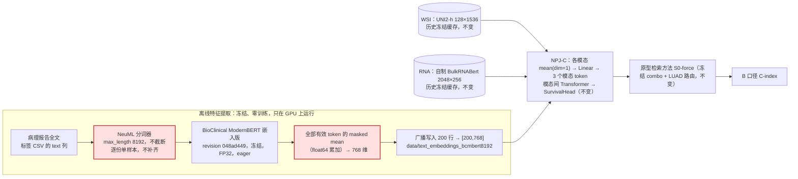
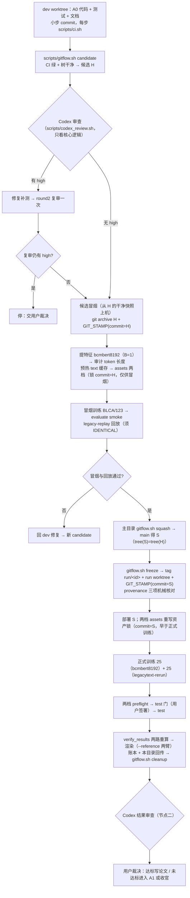

# 研究计划书：A0 全文上下文 BioClinical ModernBERT（I05 第二轮，档案 bcmbert8192）

[系统状态：S_state 已核验到「轮 C 账本 + HF 配置 + 仓库代码」一级 | 当前阶段：dev 上 A0 代码与测试完成，待 Codex 审查与候选冒烟]

| 文档 | 作用 |
|---|---|
| [innovation-BioClinical_ModernBERT-NextStep.md](innovation-BioClinical_ModernBERT-NextStep.md) | 先验知识：两份粘贴文档原文、逐条核验、S_state、Q_new、解释边界、裁决（事实层） |
| 本文件 | Claude 的方案：设计、顺序、门、风险（建议层） |
| [seed单位-实验结果.md](seed单位-实验结果.md)、[癌症为单位.md](癌症为单位.md)、[encoder-table.md](encoder-table.md) | 脚本生成的 bcmbert8192 结果模板 |
| [../4.BioClinical ModernBERT-程序性知识/](../4.BioClinical%20ModernBERT-程序性知识/) | 轮 C（bcmbert200）的计划书、先验与结果 |

## 0. 约束清单与策略筛选

`[ T：只解除 Text 的 200-token 截断 + Q_new（none 下五癌五 seed 均值 B C-index 相对 Table 1 None/Proto.† 严格胜 ≥ 4/5；另报两组同代码 Δ） + ∩P_i：槽位 [200,768] 不变 · 权重/revision 不变 · NPJ-C、原型检索方法、训练配方不变 · 全部报告 ≤ 8192 token · 溯源可核 ∥ S_state（先验知识第 3 节） ]`

| 候选 | 改了什么 | P × S_state | 结论 |
|---|---|---|---|
| **A0** 全文 ≤8192 → masked mean → 广播 200 行 | 分词长度与补齐策略 | 最长 6822 token < 8192；零新组件、零幻觉 | **本轮唯一执行项** |
| A1 LLM 事实约束浓缩 → NeuML | 加生成模型 | 有 TCGA 任务依据（Song 等），但管线非 NPJ-C、有幻觉风险 | A0 未达标后再议 |
| B Qwen3-Embedding-0.6B（MRL 768） | 换编码器 | 维度合法（旧剔除理由不成立） | 末位后备 |
| thomas-sounack base | MLM 底座 | 无 sentence-embedding 训练 | 不建议 |

## 1. A0 在整个网络中的位置



- 与轮 C 相比只有两个方框变了（标红）：分词从"截断或补齐到 200"改为"全文不截断、单样本不补齐"；均值从"前 200 token"扩到"全部有效 token"。广播、槽位与下游完全不变。
- mean([v,…,v]) = v：NPJ-C 的 `mean(dim=1)` 之后与单向量等价，广播不损失信息；检索/原型对 Text 只做整块复制与逐元素运算，同样与广播可交换。

## 2. 实现顺序与逻辑链条



Q 的判定链条：

```text
每癌 c：A0 五 seed 均值（none，strategy0）− Table 1 None/Proto.† 五 seed 均值 = Δ_c
Δ_c > 0 记胜，= 0 记平（不算胜），< 0 记负；胜的癌种数 ≥ 4 → Q 达标
同代码对照：A0 − 轮 C bcmbert200、A0 − legacytext-rerun，只作信息性报告
```

## 3. 实验设计

### 3.1 三臂

| 臂 | Text | 模型权重 | 用途 |
|---|---|---|---|
| **bcmbert8192（A0）** | NeuML 全文 ≤8192，masked mean 广播 200 行 | 现行代码按原配方重训 25 个 | Q 判定对象 |
| bcmbert200（轮 C，已有） | NeuML 前 200 token | 同上（轮 C 已训） | 只差上下文长度的同代码对照 |
| legacytext-rerun（新增） | 作者公开嵌入（原有特征） | 同上 | 拆分重训方差；只差 Text 管线的同代码对照 |
| 现有系统（Table 1 None/Proto.†） | 作者公开嵌入 | 历史 25 个 E0 | Q 的基线 |

### 3.2 A0 填槽（代码已实现）
- 分词：`max_length=8192`、`truncation=False`、`padding='longest'`、B=1（无补齐）；超过 8192 直接报错，不静默截断。
- 编码：`last_hidden_state` → 按 `attention_mask` 对全部有效 token 求均值（float64 累加）→ float32 → 广播 200 行。
- 断言：形状 `[200,768]`、float32、有限、非零、各行逐位相同；manifest 逐人断言 `n_valid_tokens == n_tokens_untruncated`。
- 为什么 B=1：eager attention 下最长 6822 token 单样本约 4.7 GB 激活，批处理会 OOM；B=1 同时消除补齐带来的批次组成浮点差异，使 manifest 可复现。

### 3.3 运行根与缓存
- 两个运行根：bcmbert8192 用全新 `tmp_sur_cache`（复制 30 个历史 img/rna，text 由预热从 8192 特征生成）；legacytext-rerun 用历史 45 个缓存。缓存键不含特征路径（坑 D2），assets 阶段逐条核对缓存与特征文件，用错缓存即拒绝（有测试）。
- 三档 ckpt 文件名相同，必须独立 `--result-path` / `--state-file`。

### 3.4 冻结方法与回放
- 推理器、原型检索方法、LUAD 路由全部复用轮 C（sha256 锁）；evaluate.py 有改动，源码摘要变化，所以候选冒烟时必须重跑 legacy-replay 回放（要求 IDENTICAL）；tree(S)=tree(H) 保证回放记录在 S 上仍然有效。

### 3.5 GPU、种子、授权
- 种子 123、132、213、231、321；只用 GPU；四台服务器空闲卡优先，其次利用率 < 70% 的在用卡，显存余量 ≥ 8192 MiB。
- 用户已批准本轮连续执行至 Phase 5；唯一必停点是 test 门的签署（另：冒烟或回放不过、Codex 复审仍有 high、需改研究口径时停）。

## 4. 表格设计

- 4×5 Encoder 表：行 MLP / 原论文的 Encoder / 其他方法的 Encoder / **我们提出来的 Encoder（全文 ≤8192）**，列 LGG/BRCA/BLCA/LUAD/UCEC；表外独立参考：Table 1 基线、Δ_c、判定，以及「轮 C：bcmbert200」「旧 Text：legacytext-rerun」两行与各自 Δ，另起一行"相对 × 严格胜 k/5（信息性，不进 Q）"。
- 两份四场景结果表：结构同轮 C；末尾各加一段「同代码对照（none，不进 Q）」。
- 所有数字由 `tools/render_encoder_tables.py --profile bcmbert8192 --reference …` 从原始 JSON 生成（坑 V23）。

## 5. 代码与本地验证（dev，提交 `7eb1dbb`）

| 项目 | 结果 |
|---|---|
| I05 测试 | 全部通过：广播行数固定 200、短文本两档逐位相同、`longest` 批处理等于单样本、8192 manifest/超长拒绝/批大小锁、配置三处交叉核对负例、8192 端到端（含用 200 缓存被拒）、渲染参考臂、三份清单发车契约 |
| 全仓 CI | 343 通过、6 跳过 |
| 发车契约 | bcmbert8192 与 bcmbert200 清单只差 `--model_config`、`--result_path`；legacytext 清单只差 `--result_path` |
| bcmbert200 兼容 | 默认渲染与论文目录、账本逐字节相同（测试守门） |

## 6. 风险登记

| 风险 | 检测 | 缓解 |
|---|---|---|
| A0 不改善 LGG/BRCA | Q 与两组同代码 Δ 一起看 | 结论只按 Q；A1/B 留作后续 |
| 长文本显存（单样本 ~4.7 GB） | 选卡门 ≥8192 MiB；B=1 | OOM 走 jobrun 重试，不改口径 |
| 沿用 200 缓存（D2） | assets 逐条核对 | 独立运行根与缓存 |
| ckpt 同名覆盖/跳过 | 独立结果根/状态文件 | 发车契约测试 |
| 主目录被外部切换分支 | 每步前 `git status` | 只在 dev 改 |
| 审查原文含本机路径 | `.gitignore` 忽略原文 | 入库 `codex-review.public.json` |

## 7. Post-Mortem（本轮）

（执行中出现的失效模式按项目格式追加于此，并去重入账 `docs/engineering/pitfalls.md`。）
