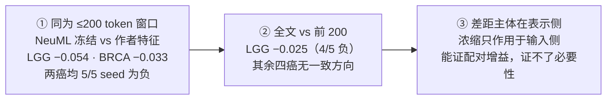
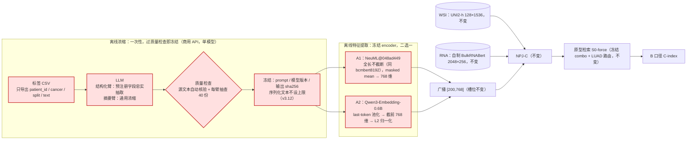
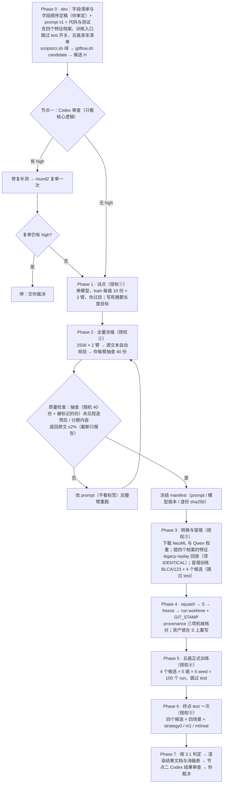

# 研究计划书：A1 LLM 浓缩（冻结公开 encoder 下，NeuML / Qwen × 结构化 / 摘要四个候选）

[系统状态：S_state 已核验（I05 两档结果与原始证据、B1 溯源证据链、B1 / B2 的 Overall 复算、训练入口行为、Claude API 与 Qwen3-Embedding 模型卡）| 当前阶段：计划书 v3.3（用户 2026-09-26 裁决：四候选五癌全训、主判定改为 Overall）→ Phase 0 编码 → Codex 节点一审查]

| 文档                                                                                                                           | 作用                                                      |
| ------------------------------------------------------------------------------------------------------------------------------ | --------------------------------------------------------- |
| 本文件                                                                                                                         | 方案：已锁定项、设计、顺序、门、风险（建议层）            |
| 交接（2026-09-24，对话内给出；`vscode 重构/in.md` 为空文件）                                                                 | 「已锁定 / 未定」清单、主因链、决策树、论文措辞规则的来源 |
| [../0.BioClinical ModernBERT-记录.md](<../0.BioClinical%20ModernBERT-记录.md>) 第 8 节                                          | 用户策略记录：LLM 抽取方式、商用 API 选择                 |
| [../5.如何修补BioClinical-ModernBERT.md/](../5.如何修补BioClinical-ModernBERT.md/5.如何修补BioClinical-ModernBERT.md)           | A0（= B2，bcmbert8192）计划书与结果                       |
| [../4.BioClinical ModernBERT-程序性知识/](<../4.BioClinical%20ModernBERT-程序性知识/4.2研究计划书-BioClinical%20ModernBERT.md>) | 轮 C（= B1，bcmbert200）计划书与结果                      |
| [I05 结果账本](<../../../../experiments/BioClinical%20ModernBERT/results/index.md>)                                             | B1、B2 的原始证据、哈希清单、验真报告                     |

修订记录：

| 版本 | 日期       | 变更                                                                                                                                                                                                                                                                                                                                               |
| ---- | ---------- | -------------------------------------------------------------------------------------------------------------------------------------------------------------------------------------------------------------------------------------------------------------------------------------------------------------------------------------------------- |
| v1   | 2026-09-24 | 初稿（未定项三轮问答后写成）                                                                                                                                                                                                                                                                                                                       |
| v2   | 2026-09-25 | 处理 decision-reviewer 的 REWORK（3 CRITICAL / 9 WARNING / 6 INFO，逐条见第 10 节）；新增用户裁决 6 项（1.2 第二批）；阶段顺序重排（阈值 τ 挪到探针之前、训练入口跳过 test、节点一在 freeze 后补增量审查）；质量门改为分层序贯估计；决策树补全，叶子声称以 test 为准；"拒答退回偏保守"的说法删除                                                  |
| v2.1 | 2026-09-26 | 用户批准 v2（8.1 按默认）；新增 1.2 第三批：执行路线 = 分阶段、终点结果文档的格式与文件名、"患者检索效果最好"的判定口径（表 R，第 5 节）                                                                                                                                                                                                           |
| v3   | 2026-09-26 | 用户再次明确核心约束：五癌对 Table 1 None/Proto.† 严格胜 ≥4/5，避免工程完善陷阱。按用户裁决瘦身（1.2 第四批）：单模型浓缩、取消两家交叉试点与全量预审、质量门改为"源文本自动核验 + 每臂抽查 40 份"、只保留防 test 泄漏与防算错的门、节点一合并为一次；保持 ≤200 token；新增第 11 节文献依据（Song 等、PS3、Labieb 全文）                        |
| v3.1 | 2026-09-26 | 消融表由 2×2 扩为 3×2（加 B1 行）；新增第 12 节全文设计逻辑与措辞约定；外部 baseline 对比等 A1 到终点再定（本行在 v3.3 补录：当时的修订行因表格被编辑器补齐空格、脚本未命中而漏写）                                                                                                                                                              |
| v3.2 | 2026-09-26 | 消融表改为只列开检索（Proto.）的 Text 表征消融，版式照论文 Table 1；原型检索的有效性交给论文 Table 1（本行在 v3.3 补录，原因同上）                                                                                                                                                                                                                 |
| v3.3 | 2026-09-26 | 用户裁决（1.2 第五批）：候选扩为 A1（NeuML）/ A2（Qwen3-Embedding）× 结构化 / 摘要四个，全部跑五癌（100 run）；消融表加 B2 列，A2 不配同 encoder 原文对照；取消 LGG 探针与 τ 门及决策树叶子；主判定改为照论文 Table 1 的 Overall（四场景等权平均）对 Table 1 Proto. 列严格胜 ≥4/5，四个候选任一达到即达标；第 3、4.7–4.10、5–8、12 节按此重写 |
| v3.4 | 2026-09-26 | 用户裁决：浓缩 LLM 改为 claude-opus-5-5、effort high（1.2 第六批），不设候补模型                                                                                                                                                                                                                                                                   |
| v3.5 | 2026-09-26 | 用户批准并锁定结构化臂的字段清单与字段顺序（4.2；以 I06 model.py 为准）；Phase 0 候选 H 已生成，节点一 Codex 审查进行中                                                                                                                                                                                                                            |
| v3.6 | 2026-09-26 | 节点一 Codex 首审 3 条 high 已修复（见`experiments/I06_llm_condensation/reviews/20260926-a1-node1/claude-response.md`）：用户 test 授权另绑定本轮 ckpt 集合摘要与资产锁；I06 档案的训练记录必须实际带 `skip_test=true`；冻结门要求质量报告绑定记录摘要、checked 数与抽查患者集合，并拒绝未知状态。口径不变                                     |
| v3.7 | 2026-09-26 | 节点一复审（round2）2 条 high 按用户裁决「最小修法后放行」处理：正式 test 禁止 runtime 覆盖参数，并把 runtime 摘要写进授权；抽查表逐行绑定记录摘要，旧表不能套到重新生成的记录上。不做第三轮审查，不做全局消费账本。口径不变                                                                                                                       |
| v3.8 | 2026-09-26 | 试点校准（用户裁决）：① 源文本核验对原文做归一化（分期 OCR 错字 O→0 / l→1、"pT: 2a" 合并、英文数字、百分号前空格、全阴性写成 0/N、标签名 Ki-67 不计数值），失败线仍为 5%，加总得出的总数照样标记；② 长度重试 2→3 次，上限仍 ≤200 token；③ 系统 prompt 加两条：计数按原文逐站照抄、不加总或换算，不写原文没涉及的内容（含「报告未说明 X」）；④ 摘要臂正式目标词数由试点算出（v1 为 107 词）。v1 试点：两臂 0 拒答 0 失败，花费约 $1.9，50 份一批 7–8 分钟 |
| v3.9 | 2026-09-26 | v2 试点后按文献定关口（用户裁决）：源文本自动核验改为只做初筛，被标记的份全部进入人工复核；比率只在随机 40 份上估计；捏造分期 / 预后一票否决；退回 + 截断上限 2%→10%。v2 试点：结构化臂标记 4%、摘要臂 10%（多为否定词同义改写），两臂截断各 8%，摘要臂正式目标 109 词。依据：Lanino 2025、Asgari 2025（人工抽查 + 区间）、Vachhani 2026（字面判定高估幻觉）、Song 2025（同数据源，幻觉不影响嵌入生存预测）。全量 2026-09-26 启动 |
| v3.10 | 2026-09-26 | 全量完成（两臂各 2506 份，0 拒答 0 失败，花费 $128）。结构化臂截断 17.1%（UCEC 28%、BLCA 24%、BRCA 20%、LUAD 8%、LGG 0.2%），摘要臂 8.2%；截断前中位仅超 8 token，几乎只截去末尾「标本 / 手术方式」字段，预后字段全部保留。按上限要防的风险拆分（用户裁决）：退回原文 ≤2%（实际结构化臂 1 份、摘要臂 0 份）；截断只报告，敏感性分析另加「剔除被截断患者」。本地轮询进程随会话中断一次，按批次号续跑，未重复计费 |
| v3.11 | 2026-09-26 | ① 抽查改为 Codex 只读全审 + 人工复核（用户裁决）：Codex 用 companion `task` 只读模式（不带 `--write`）评审，只给原文与浓缩文本，不给自动核验标记；Codex 判为有问题的行与每臂随机 10 行判为无问题的行由你复核。② 首轮 Codex 评审发现截断 bug：按 token 硬切把 TCGA-BG-A0M6 的「FIGO IIIC」切成「FIGO II」。修复：超长输出一律退回到最后一个完整句子 / 字段边界再截（`truncate_clean`），用保存的 payload 本地重截（结构化臂改 403 份、摘要臂 199 份，不调用 Claude），基于新记录重做核验、抽查表与 Codex 评审；首轮评审归档于 `codex-audit/v1/` |
| v3.12 | 2026-09-26 | **解开 200 token 上限**（用户裁决，在任何训练结果出来之前）：浓缩文本不设长度上限、编码不截断。依据：Text 槽位是对有效 token 取均值再广播成 [200,768]，槽位形状不约束编码长度；结构化臂无长度压力时（第 1 轮，prompt 未提长度）自然长度中位 260 token（≤200 仅 31%、≤512 占 97.6%、最长 806），200 上限迫使 69% 重写压缩、截断 17%，并曾把 FIGO IIIC 硬切成 FIGO II；文献（Song 2025 摘要 max_tokens 1024、OncoPT 2026、Labieb 2024）均不强制与原文等长。做法：A1 规格改为与 B2（bcmbert8192）逐项相同，A2 Qwen 上限 512→8192；**主对照改为 B2**（与 A1 编码条件一致，唯一差别是文本内容），B1 保留；档案去掉「200」后缀（a1struct / a1summ / a2struct / a2summ）。结构化臂直接回放第 1 轮批次（$0，截断 0、退回 1 份）；摘要臂目标按原规则重算为 155 词（260 ÷ 1.683 token/词）并重跑一轮。8 个全量批次的原始结果已本地存档（API 上保留 29 天）。200 版文本与首轮 Codex 抽查归档留底，不进入冻结 |
| v3.13 | 2026-09-26 | **Phase 2 冻结完成**（不设上限版）：两臂各 2506 份，截断 0；退回原文结构化臂 1 份（0.04%）、摘要臂 0。Codex 只读评审 630 行（两臂随机各 40 + 全部自动核验标记），人工复核 55 行（用户回复：全部同意 Codex，除 Z-10 不算捏造、Z-26 只算幻觉）。随机 40 份：两臂幻觉均 2/40（5.0%，95% CI 0.5–17.4%）、遗漏均 2/40、捏造分期 / 预后均 0/40（上界 10.4%），无明显失败。冻结文本 sha256：结构化 `95402d09…`、摘要 `7282a0ff…`；freeze manifest `f4e0b13a…`（`experiments/I06_llm_condensation/results/i06-condense-20260926/evidence/`）。API 合计约 $160。下一步：候选 H → 上机提取四个档案的特征 → 冒烟 |

## 0. 约束清单与策略筛选

`[ T：在 NPJ-C + 原型检索（= Table 1 基线系统）上，只把 Text 输入换成「LLM 浓缩 → 冻结公开 encoder」管线，检验完整体能否在五癌上超过基线 + Q（主 Q：候选在五癌上的 Overall——每癌五 seed 均值在四个场景上的等权平均，照论文 Table 1——对 Table 1 Proto. 列的 Overall 严格胜 ≥4/5，test；四个候选中任一达到即达标，胜者按 3.1 选出；none 行与各场景逐 seed 结果全报；归因：A1 − B1 为同一 encoder 下浓缩的单变量差） + ∩P_i：NPJ-C / 原型检索 S0-force / 训练配方 / [200,768] 槽位与广播不变 · LLM 只做忠实抽取、不做预后判断 · 过质量检查即冻结 prompt、模型版本字符串与输出 sha256，此后下游结果不触发改 prompt 或换 LLM · 浓缩文本 ≤200 NeuML token · test 只跑一次 · B1 按用户裁决作对照 ∥ S_state（1.3） ]`

两个问题（交接「总体判定」，v3.3 口径）：

- **Q-a**：输入侧能补回多少？→ A1 − B2（NeuML 全长编码下，浓缩文本对原文全文的配对差；v3.12 起为主对照）；A1 − B1 同时报告。
- **Q-b**：增益来自去冗余还是字段先验？→ 同一 encoder 下结构化臂 − 摘要臂（A1-S − A1-Z；A2-S − A2-Z）。

四个候选（用户裁决 2026-09-26，1.2 第五批）：

| 候选           | Text 输入                                    | 冻结 encoder                                          | 档案            |
| -------------- | -------------------------------------------- | ----------------------------------------------------- | --------------- |
| **A1-S** | LLM 按字段清单抽取 → 只序列化原文出现的字段 | NeuML/bioclinical-modernbert-base-embeddings@048ad449 | `a1struct` |
| **A1-Z** | LLM 通用浓缩（摘要）                         | 同上                                                  | `a1summ`   |
| **A2-S** | 与 A1-S 同一份冻结文本                       | Qwen/Qwen3-Embedding-0.6B（截 768 维）                | `a2struct` |
| **A2-Z** | 与 A1-Z 同一份冻结文本                       | 同上                                                  | `a2summ`   |

刷掉的方向（不变）：预后导向浓缩（违反"禁止预后判断"）；LLM 直接给风险分 / 微调 encoder（违反"只改 Text 输入"）。

Boundary：只执行上表四个候选；A2 不配同 encoder 的原文对照（用户裁决），A2 只作系统级比较。

## 1. 背景、已锁定项与 S_state

### 1.1 已锁定（用户 2026-09-24，不重新讨论）

| 项          | 决定                                                                                                                                                                                                                                                                          |
| ----------- | ----------------------------------------------------------------------------------------------------------------------------------------------------------------------------------------------------------------------------------------------------------------------------- |
| 定位        | 不是"换 encoder"：固定冻结公开 encoder NeuML/bioclinical-modernbert-base-embeddings@048ad449，只改文本输入，检验 LLM 浓缩的配对增益；声称收窄到"冻结公开 encoder 下"                                                                                                          |
| 层级        | LLM 浓缩与原型检索并列为主创新                                                                                                                                                                                                                                                |
| 对照侧用词  | 作者公开的 768 维 token embeddings（encoder 未公开，L=200）；论文不写"原 BERT / original encoder"                                                                                                                                                                             |
| I05         | 两档按 negative 收官，降级为对照：B1 = 前 200 token（bcmbert200）；B2 = 全文 ≤8192（bcmbert8192）。v3.12 解开 200 上限后，B2 与 A1 编码条件完全一致，改为主对照；B1 保留                                                                                                                                              |
| 两臂        | 结构化臂：预注册字段清单 = 五癌通用核心 + 各癌种特异字段，LLM 只做忠实抽取。摘要臂：通用浓缩，不做预后导向。两臂之差 = 字段先验的价值                                                                                                                                         |
| prompt 约束 | 只写原文出现的信息；保留 pertinent negatives（切缘阴性、无脉管侵犯、淋巴结 0/N 等）；允许"未提及"；禁止预后判断词                                                                                                                                                             |
| 长度        | v3.12 起不设上限、编码不截断（与 B2 同为全长编码）；摘要臂长度目标对齐结构化臂中位数                                                                                                                                                                                                                                      |
| LLM         | 商用 API；gpt-6-astra vs claude-fable-5-1（候补 claude-opus-5-5）交叉试点定胜者：胜者浓缩全量，另一家预审全量                                                                                                                                                                 |
| 试点        | train split 按癌种分层抽样；两家用同一版 prompt 各跑两臂；互为预审；用户复核分歧 + 随机抽未标记；胜负顺序：原文外推断数 → 字段召回（结构化臂）→ 拒答数                                                                                                                      |
| 范围与冻结  | 全量五癌 2,506 份一次浓缩；过质量门即冻结 prompt、模型版本字符串与输出 sha256；之后下游结果不触发改 prompt 或换 LLM                                                                                                                                                           |
| 质量门      | 另一家 LLM 预审全部 + 用户复核分歧 + 随机抽未标记估漏检；复核后确认的原文外推断 ≤1%，结构化臂字段召回 ≥95%；摘要臂只设忠实度门，字段召回只报告                                                                                                                              |
| split       | 门与选臂用 valid（探针 train 拟合、valid 评估；训练门与选胜出臂用 valid 配对 Δ）；test 只在最后报一次                                                                                                                                                                        |
| Q           | 主 Q：none 下五癌五 seed 均值严格胜 Table 1 None/Proto.† 的癌种数 ≥4/5（test）。Secondary：rna_100 / text_100 / both_100 全报。协同：{原型检索 on/off} × {浓缩 on/off（off = B1）} 四场景 2×2，同一批 ckpt 推理即得、不加训练。Methods 写明"每个主创新的主终点对应其机制" |
| 下一步      | A：质量门 → LGG 零训练探针 → 过门即 LGG 10 训练（5 seed × 2 臂）                                                                                                                                                                                                           |

### 1.2 本轮新锁定

第一批（2026-09-24，未定项问答）：

| 项                 | 决定                                                                                                                                                                                                                                                          |
| ------------------ | ------------------------------------------------------------------------------------------------------------------------------------------------------------------------------------------------------------------------------------------------------------- |
| B1 溯源            | **用户裁决**：B1 确实出自 `6631662`，该提交训练时就是 main 的 HEAD，后来因压缩历史不再包含在 main 中；只要 B1 的原始实验结果保留即可，不重训、不在 main 上打锚点、不做其他额外操作。这是对 AGENTS.md「Git 工作流」第 9 条的用户裁决例外，证据链见 1.3 |
| 字段清单           | Claude 起草（依据 CAP 各癌种病理报告协议；只用 train 报告核对字段在原文中能否出现；全程不看生存标签与结局），用户审定后锁定，锁定早于试点。草案见 4.2                                                                                                         |
| 试点样本           | 每癌 10 份（train 分层抽样，共 50 份）                                                                                                                                                                                                                        |
| 超长               | 用 NeuML tokenizer 计数；同一模型、同一 prompt，附"上次共 N token，请压到上限"，最多重试 3 次（v3.8 由 2 次改为 3 次）；仍超长则按句子边界截断（v3.12 上限改为 8192 后不再触发）（原规则中"结构化臂先删未提及字段"一步，已被第二批"序列化一律省略 not mentioned"取代）；超长份数逐臂报告                             |
| 拒答               | 不开 fallbacks（保持模型版本冻结）；同一模型重试 1 次；仍拒则该份退回原文（v3.12 起为全文 = B2 的输入）并打标记；拒答数逐癌报告                                                                                                                                  |
| 探针正则化         | 用户无偏好 → 采用推荐方案：岭 Cox + train 内重复 CV 选 λ（4.8）                                                                                                                                                                                             |
| secondary 的"退化" | 按 seed 计数：五个 seed 中严格为负 ≥4/5 称「退化」，严格为正 ≥4/5 称「改善」，其余称「无一致方向」；不设数值阈值                                                                                                                                            |
| 计划书结构         | 沿用 I05 计划书的 0–8 节（本版加第 9 节 Post-Mortem、第 10 节审查处理）                                                                                                                                                                                      |

第二批（2026-09-25，decision-reviewer 意见引出的口径裁决）：

| 项            | 决定                                                                                                                                                                                                                                                                                                                                                    |
| ------------- | ------------------------------------------------------------------------------------------------------------------------------------------------------------------------------------------------------------------------------------------------------------------------------------------------------------------------------------------------------- |
| 阈值下限      | 训练门阈值 τ = max(g/2, 0.01)，g = 基线 valid − B1 valid；g ≤ 0 时 A1 相对 B1 的配对 Δ 必须 ≥ 0.01 才能进五癌；其余逻辑不变。规则在任何 A1 结果出现前冻结                                                                                                                                                                                          |
| 叶子声称      | 以最终唯一一次 test 为准，不达标就降级：叶 3 要求 LGG test 上胜出臂 Δ(A1−B1) 严格为正的 seed ≥4/5，否则降为叶 2 措辞；「五癌 test 未达主 Q」单设叶子（叶 3′），只写逐癌 Δ(A1−B1) 的 k/5，不用 Prognosis-Preserving 命名；叶 4 归因于浓缩时必须同时报逐癌 Δ(A1−B1)。「是否扩五癌」在任何 A1 test 之前定死；LGG test 跑过后，本预注册下不再扩五癌 |
| 漏检抽样      | 两段序贯：每臂每癌先抽 10 份未标记（每臂 50）；零漏检按点估计判门；确认 ≥1 份漏检，则按预先写死的规则把该臂每癌加到 30 份（每臂 150）再判。被标记的文档一律整份复核                                                                                                                                                                                    |
| 摘要长度      | 试点结束时取结构化臂序列化文本的 NeuML token 中位数作为摘要臂的长度目标，在全量浓缩前写死；两臂长度分布逐臂报告                                                                                                                                                                                                                                         |
| not mentioned | 结构化臂序列化（送进 NeuML 的文本）时一律省略填 not mentioned 的字段，只写原文出现的字段；JSON 里始终保留，用于算召回                                                                                                                                                                                                                                   |
| 退回上限      | 每臂"拒答退回 + 超长截断"退回原文 ≤2%（≤50 份），超过即停交你；截断只报告（v3.10：截断只去掉浓缩文本末尾几个 token，不形成分簇）；另预注册敏感性分析：两臂与 B1 同时剔除带标记的患者后重算配对 Δ                                                                                                                                                                                                                            |

第三批（2026-09-26）：

| 项                   | 决定                                                                                                                                                                                                                                                                                                    |
| -------------------- | ------------------------------------------------------------------------------------------------------------------------------------------------------------------------------------------------------------------------------------------------------------------------------------------------------- |
| 目标（用户原话要点） | 在 none 与三种人工缺失场景（rna_100 / text_100 / both_100）、五癌、五 seed 上，检验 A1-Z 或 A1-S 是否在 ≥4/5 个癌种上超过基线 Table 1 None/Proto.†；以 seed 为基本单位、按癌种组织结果，并判定哪个癌种的患者检索效果最好                                                                              |
| 执行路线             | 按本计划书分阶段：先过 LGG 门，过门才扩五癌，胜出臂按 valid 选，test 只跑一次。用户知悉：两臂五癌全训后"哪臂在 test 上达标报哪臂"属于在 test 上选臂（零效应下偶然达标概率最高约 34%），本计划不采用                                                                                                     |
| 结果文档             | `6.LLM浓缩-A1-result-癌症为单位.md`（用户原给的文件名以"."开头，在访达中会被隐藏，按默认加 `6.` 前缀），放在本目录；格式参照 I05 的 `癌症为单位.md`，由脚本从原始 JSON 生成（表 R，第 5 节）。只包含实际跑到的阶段；门没过则如实写明停在哪一叶                                                    |
| 检索效果口径         | 四场景平均检索增益：对 A1 报告臂，按癌种计算 Proto.（`strategy0`）− No comp.（`m0real`），先取五 seed 均值，再在 none / rna_100 / text_100 / both_100 四个场景上平均，增益最大者为"患者检索效果最好"；同时报逐 seed 增益为正的 k/5。注意 none 下完整患者不走检索，只有天然缺失者走检索，会拉低平均 |

第四批（2026-09-26，瘦身裁决；取代 1.1 中"LLM""试点""质量门"三行以及第二批"漏检抽样"一行）：

| 项                       | 决定                                                                                                                                                                                                                                                                                                                                                      |
| ------------------------ | --------------------------------------------------------------------------------------------------------------------------------------------------------------------------------------------------------------------------------------------------------------------------------------------------------------------------------------------------------- |
| 核心约束（用户再次明确） | 五癌对 Table 1 None/Proto.† 严格胜 ≥4/5 是首要目标；框架逻辑正确即可，避免把时间花在工程完善上                                                                                                                                                                                                                                                          |
| LLM                      | 单模型：用你提供 key 的那一家（默认 claude-fable-5-1，候补 claude-opus-5-5），授权①时确认；取消两家交叉试点与另一家全量预审                                                                                                                                                                                                                              |
| 质量检查                 | 源文本自动核验（数字、分级 / 分期字样、否定表述须能在归一化后的原文中找到；v3.9 起只做初筛）+ 你每臂随机抽查 40 份并复核全部被标记的份，报幻觉率、遗漏率及 Agresti–Coull 95% 区间；只在明显失败时改 prompt（核验标记率 >5%，或抽查发现捏造的预后 / 分期内容）。取消"原文外推断 ≤1%、字段召回 ≥95%"硬门与分层序贯抽样。依据：Song 等 40 份摘要中 24 份需小修，但修正前后风险分层不变（第 11 节） |
| 工程门                   | 只保留防 test 泄漏与防算错的：训练跳过 test、阈值 τ 在 A1 结果前写死、legacy-replay 回放（证明评测器改动没算错）、患者集合门、LGG 探针。取消：E0 valid 回放（基线 valid 直接用 I01 已存值）、训练环境指纹比对、B1 特征重提必须逐位相同（改为只记录差异）、节点一-b（与节点一合并为一次审查）                                                             |
| 长度上限                 | v3.12 解开（用户裁决 2026-09-26）：不设上限、编码不截断，对照改为同为全长编码的 B2。依据：结构化臂无长度压力时自然长度中位 260 token（≤200 仅 31%），200 上限迫使 69% 重写压缩并截断 17%；Song 等的摘要同样不设上限（最长 1,389 token）                                                                                                                                                                                                                                               |
| 文献 1–4 条             | 写入：①质量表报遗漏率与区间（不做五类误差标注）②源文本自动核验 ③报告来源为 TCGA-Reports OCR 语料，prompt 写明容忍 OCR 伪字符 ④结果汇总表加"五癌平均"列。第 5 条（related work 按四种范式组织）留到写论文                                                                                                                                              |

第五批（2026-09-26，四候选与 Overall 终点；取代第一批"探针正则化"，第二批"阈值下限""叶子声称"，第三批"执行路线"中分阶段与 LGG 门的部分，第四批"工程门"中的 τ 与探针，以及 1.1 中"split""Q""下一步"三行里的 valid 门、"none 下"主判定与分阶段顺序）：

| 项                       | 决定                                                                                                                                                                                                                       |
| ------------------------ | -------------------------------------------------------------------------------------------------------------------------------------------------------------------------------------------------------------------------- |
| 候选                     | A1（NeuML + LLM 浓缩）与 A2（Qwen3-Embedding + LLM 浓缩）两个 encoder × 结构化 / 摘要两臂 = 四个候选，全部跑五癌（4 × 5 癌 × 5 seed = 100 个 run）                                                                      |
| 对照                     | 作者特征（Table 1）、B1（NeuML + 原文前 200）、B2（NeuML + 全文，v3.12 起为 A1 的主对照）；A2 不配同 encoder 的原文对照 B3（用户更正为"不配"）                                                                                                     |
| LGG 门                   | 探针与 τ 阈值门全部取消；过质量检查后直接五癌全训。理由（Claude 建议、用户采纳）：门只会让实验提前停下，不会提高达到 4/5 的概率；四臂全训后 τ 门已无可决定之事                                                           |
| 主判定（照论文 Table 1） | 每个癌种：五个 seed 的结果在四个场景下分别求平均，四个场景等权平均得到 Overall；候选的 Overall（strategy0）与 Table 1 Proto. 列的 Overall 逐癌比较，严格 > 记胜、相等不算胜；四个候选中任一候选胜 ≥4/5 即达标             |
| 胜者规则                 | 四个候选中 Overall 严格胜癌种数最多者胜；相同时比五癌平均 Overall Δ（全精度）；仍相同按 A1-S、A1-Z、A2-S、A2-Z 的顺序取前者。用户已知候选越多、零效应下偶然达标的概率越高（4 个候选最高约 56%）；论文如何表述由用户自己写 |
| 改口径时已知的信息       | 主判定由 none 改为 Overall 时（2026-09-26），A1 / A2 尚无任何结果；B1、B2 的四场景结果已知：Overall 口径下 B1 胜 3/5、B2 胜 2/5（1.3）                                                                                     |
| 结果文档                 | `6.LLM浓缩-A1-result-癌症为单位.md`：四种场景、五个癌种，以癌种为单位，每癌 5 seed × 4 场景，并给出每癌 Overall                                                                                                         |
| 检索效果口径             | 不变（第三批）：四场景平均检索增益，针对胜者                                                                                                                                                                               |
| 用户批注                 | 先用 ≤200 token；如果实验不理想，再尝试放宽 token 长度（作为下一轮，另起计划）。v3.12：在任何训练结果出来之前，用户决定提前解开（见 1.2 与修订行）                                                                                                                                            |

第六批（2026-09-26）：

| 项       | 决定                                                                                                                                                                                                                                                                                                 |
| -------- | ---------------------------------------------------------------------------------------------------------------------------------------------------------------------------------------------------------------------------------------------------------------------------------------------------- |
| 浓缩 LLM | 改为**claude-opus-5-5，effort = high**（取代第四批的"默认 claude-fable-5-1、候补 claude-opus-5-5"与 8.1 的 effort `medium`）；不再设候补模型。Opus 5.5 的 Batch 价 $2 / $10 每 MTok；有 `bio` 安全分类器；结构化输出在文档支持列表中未点名，试点第一步用 Models API 实测，不支持则停下交你 |

### 1.3 S_state（本对话核验）

| 项                                            | 事实                                                                                                                                                                                                                                                                                                                                                                                                                                                                                                                                                      | 证据                                                                                                                                                    |
| --------------------------------------------- | --------------------------------------------------------------------------------------------------------------------------------------------------------------------------------------------------------------------------------------------------------------------------------------------------------------------------------------------------------------------------------------------------------------------------------------------------------------------------------------------------------------------------------------------------------- | ------------------------------------------------------------------------------------------------------------------------------------------------------- |
| B1 训练记录                                   | tako 上 26 个`git.json`（25 正式 + 1 冒烟）全部为 commit `663166247783`、`dirty=False`、`source=stamp`、分支 `train/i05-bcmbert200-20260924d`                                                                                                                                                                                                                                                                                                                                                                                                   | tako`~/i05_out_20260924d/`                                                                                                                            |
| B1 服务器源码                                 | `GIT_STAMP.json` commit = `6631662`（生成于 2026-09-23T15:48:16Z）；源码包 `run_d.tar.gz`（sha256 `16b2bdb7…`）远端流式逐文件算 git blob，与 `6631662` 的树相比：**16543 个文件，内容差异 0**                                                                                                                                                                                                                                                                                                                                            | 本对话只读核验                                                                                                                                          |
| B1 当时是否在 main                            | 是。main 的 reflog：`6631662` 于 2026-09-24 00:48:13 JST 成为 main HEAD；stamp 晚 3 秒生成；正式训练 01:04 JST 开始。10:50 用户裁决把 main 上 I05 的 11 个未推送提交压成 `e6b54a8`；origin/main 仍为 `0a53b01`，没有发生公开历史重写                                                                                                                                                                                                                                                                                                                | `git reflog show main`                                                                                                                                |
| `6631662` 与 main 上 `e6b54a8` 的差异     | I05 运行代码完全相同；差异只有 I02 的 26 个文件（来自之后的`78d9e36` 包名修复）、`conftest.py`、I05 测试、`tools/verify_results.py` 与文档；I05 运行代码不引用 I02 与 conftest                                                                                                                                                                                                                                                                                                                                                                      | `git diff 6631662 e6b54a8`                                                                                                                            |
| B1 原始结果位置                               | 本地`experiments/BioClinical ModernBERT/results/i05-bcmbert200-20260924d/raw/`（按 .gitignore 不提交）；tako `~/i05_out_20260924d/`（26 个 ckpt 为只读）；ckpt 哈希清单 `checkpoint-sha256.txt`；tag `run/i05-bcmbert200-20260924d` → `6631662` 保留                                                                                                                                                                                                                                                                                           | 结果账本                                                                                                                                                |
| B1 valid                                      | **未跑过**：结果目录只有 `preflight`、`test`                                                                                                                                                                                                                                                                                                                                                                                                                                                                                                    | 同上                                                                                                                                                    |
| 基线 valid 值                                 | LGG none strategy0（LGG 取 combo`combo-l1-a1-w0p5`）在 valid 上五 seed：123 0.7411 · 132 0.7387 · 213 0.7570 · 231 0.7595 · 321 0.7167，**均值 0.742613**（test 为 0.797723）。combo 是"45 组 λ×α×w 联合 valid 筛选"选出来的 → 这个 valid 值偏乐观，g 因此偏大，门对 A1 偏严                                                                                                                                                                                                                                                             | `experiments/I01_patient_retrieval/knowledge/data-analysis-from-grok/2.progress/result/runs/valid/complete.json`；同目录上级 `研究计划.md` 第 26 行 |
| 训练入口会自动跑 test                         | `src/trimodalsurv/training/runtime.py` 训练结束后无条件加载 best ckpt、在 test 上预测、打印指标、写逐患者 test 预测 CSV 与 `_results.json`；没有跳过 test 的开关；训练过程按 valid c-index 选 best，并画出每个 epoch 的 valid 曲线                                                                                                                                                                                                                                                                                                                    | `runtime.py` 第 934–981 行                                                                                                                           |
| tako 资产现状                                 | bcmbert200 特征所在的可变资产根`~/i05_mutable_20260924b` 已在清理中删除；默认 HF 缓存没有 NeuML 权重 → 需重新下载（revision `048ad449`，配置里锁了文件哈希），需授权                                                                                                                                                                                                                                                                                                                                                                                 | 本对话只读核验                                                                                                                                          |
| landau                                        | 没有 I05 结果（训练与推理都在 tako）                                                                                                                                                                                                                                                                                                                                                                                                                                                                                                                      | 同上                                                                                                                                                    |
| B1 特征 manifest                              | 逐人记录特征 sha256 与原文`text_sha256`；2506 人；在 200 截断的 2165 人（86%）；原文 NeuML token 均值 1225、中位 1044.5、p25 408.5、p75 1774、最短 4、最长 6822                                                                                                                                                                                                                                                                                                                                                                                         | `.../i05-bcmbert200-20260924d/evidence/feature-manifest.json`                                                                                         |
| LGG 有文本人数                                | train 162 / valid 82 / test 163（队列 166/83/166，8 人无文本）                                                                                                                                                                                                                                                                                                                                                                                                                                                                                            | 同上                                                                                                                                                    |
| B1 / B2 的 Overall（照论文 Table 1 口径复算） | B1：LGG 0.706487（Δ −0.032385）、BRCA 0.635290（−0.031980）、BLCA 0.586225（+0.007243）、LUAD 0.592603（+0.005564）、UCEC 0.638805（+0.008436），**胜 3/5**；B2：LGG −0.055263、BRCA −0.038815、BLCA +0.006046、LUAD +0.001027、UCEC −0.006977，**胜 2/5**。同一文件复算出的 Table 1 Proto. Overall 与论文逐位相同                                                                                                                                                                                                                      | 由两份`癌症为单位.md` 按四场景五 seed 均值复算（2026-09-26）                                                                                          |
| 报告原文来源                                  | 标签 CSV`TCGA_9523_ex12.csv` 的 `text` 列（landau `~/NPJ/data/`；tako 两处副本；三份 sha256 前缀均为 `35c28659`）。同一文件含 `label / raw_censorship / raw_survival_months / days_to_death / censorship / survival_months` → 浓缩流水线只能读导出的纯文本清单。报告正文里是否含 TCGA 条码或日期未核实（本机没有该 CSV）                                                                                                                                                                                                                       | 本对话只读核验                                                                                                                                          |
| Table 1 协议                                  | No comp. =`m0real`，Mean = `m1`，Proto. = `strategy0`                                                                                                                                                                                                                                                                                                                                                                                                                                                                                               | `manuscript/bmc_initial_draft/main.tex`                                                                                                               |
| Claude API                                    | Fable 5.1 支持 structured outputs（文档点名）；Opus 5.5 不在支持列表中，但沿用 Opus 5 全部请求面，**试点第一步用 Models API 实测**；两者都有 `bio` 安全分类器，生命科学类正常任务偶有误触发，拒答为 HTTP 200 + `stop_reason: "refusal"`，输出前拒答不计费；两者不接受 temperature 等采样参数、thinking 常开 → 不能靠重跑复现，只能冻结输出；server-side fallbacks 会静默换模型（与冻结冲突），Batch API 也不接受 fallbacks；Batch API 可用（Fable 5.1 批处理价 $5 / $25 每 MTok）；Fable 5.1 要求 30 天数据保留（非 ZDR），TCGA 报告为公开数据 | Claude API 文档（claude-api skill）                                                                                                                     |
| gpt-6-astra                                   | 结构化输出、批处理、可固定的采样参数、返回的模型版本字符串**均未核实** [不确定] → 试点第一步实测                                                                                                                                                                                                                                                                                                                                                                                                                                                   | —                                                                                                                                                      |

### 1.4 当前主线与主因链（交接原文）

| 线                                                         | 定位                                             | 证据                                                                                                        | 警告                                                                    |
| ---------------------------------------------------------- | ------------------------------------------------ | ----------------------------------------------------------------------------------------------------------- | ----------------------------------------------------------------------- |
| **LLM 浓缩（结构化臂 / 摘要臂）— 保留，并列主创新** | Text 线唯一被检验的变量                          | 尚无；预注册对照 B1（LGG none 0.744099），次对照 B2（0.718772）                                             | 还不能归因给"预后保持"；"Prognosis-Preserving"命名只在决策树叶 3/4 可用 |
| **原型检索 — 主创新（已完成）**                     | 缺失模态补偿，推理时策略                         | Table 1 Overall 行严格胜 4/5；None 行只在 BLCA 三列并列，收益在缺失场景 [确定]                              | LUAD 路由受已见 test 启发，属探索性                                     |
| **NeuML 冻结 encoder — 组件**                       | 浓缩的载体；论文不写"可替换"                     | none 下两档均 2/5；LGG、BRCA 两档都是 5/5 seed 为负                                                         | 对照侧 encoder 未公开，不能写成 encoder 优劣                            |
| **I05 两档 — 对照臂 B1 / B2**                       | 附录报告"冻结公开 encoder × 原文不超过作者特征" | 25/25 重训 ckpt 与历史逐字节相同，Δ 是配对单变量差；BLCA 的"胜"来自 seed 213 的 +0.111，其余 4/5 seed 为负 | 不能用来证明浓缩必要；零效应下 ≥4/5 的偶然概率为 18.8%                 |



关键数字（none，五 seed 均值，test）：

|                       | LGG      | BRCA     | BLCA     | LUAD     | UCEC     |
| --------------------- | -------- | -------- | -------- | -------- | -------- |
| Table 1 None/Proto.† | 0.797723 | 0.688112 | 0.589972 | 0.582485 | 0.650968 |
| B1 前 200             | 0.744099 | 0.654820 | 0.594865 | 0.594875 | 0.634676 |
| B2 全文               | 0.718772 | 0.654275 | 0.596079 | 0.596665 | 0.636768 |

注意：B1 在 test 上已经赢了 BLCA 与 LUAD，所以主 Q 的 ≥4/5 里可能有两场与浓缩无关；归因于浓缩必须看逐癌 Δ(A1−B1)（4.10）。

## 2. A1 / A2 在整个网络中的位置



- 与 Table 1 基线系统相比只改了 Text 这一路（标红）；NPJ-C、原型检索、训练配方都不变。四个候选共用同一份冻结的浓缩文本，只差结构化 / 摘要与 encoder。
- 拒答退回的那几份直接用原文作输入（v3.12 起为全文）。退回的原文与浓缩文本在嵌入空间里会分成两簇，模型可能学到"这份被退回了"这个指示量，偏向方向未知；因此设 ≤2% 上限并做剔除敏感性分析（1.2 第二批），**不把它说成"保守"**。

## 3. 实现顺序与逻辑链条



| Phase | 内容                                                                          | 花费              | 停机点 / 授权                                   |
| ----- | ----------------------------------------------------------------------------- | ----------------- | ----------------------------------------------- |
| 0     | dev 编码 + 字段清单与字段顺序定稿 + prompt v1 + 测试 + CI → 候选 H → 节点一 | 无                | 字段清单与顺序需你审定；审查结论与逐条处理交你  |
| 1     | 单模型试点；写死摘要长度目标                                                  | API 小额          | **授权①** API 调用（同时确认用哪家 LLM） |
| 2     | 全量浓缩 → 源文本核验 → 抽查 40 份 → 冻结                                  | API（估算见 6.3） | **授权②** 全量 API；质量检查结论交你     |
| 3     | 下载 NeuML 与 Qwen 权重；四个档案特征提取；legacy-replay 回放；冒烟训练       | GPU 少量          | **授权③** 下载 + 转换 + 冒烟             |
| 4     | squash / freeze / provenance 三项 / 资产锁                                    | 无                | 原始输出交你                                    |
| 5     | 五癌正式训练 100 个 run                                                       | GPU               | **授权④** 正式训练                       |
| 6     | 终点 test 一次（四个候选）                                                    | GPU 推理          | **授权⑤** test                           |
| 7     | 判定、渲染、节点二审查                                                        | 无                | 停，你裁决                                      |

- 冒烟阶段在 H 上生成的数据资产（浓缩文本、特征、缓存）按内容哈希复用到 S（AGENTS.md「Git 工作流」第 7 条）；正式训练与推理只在 S 的 run worktree 源码上运行。
- 冒烟用 BLCA/123，四个候选各 1 个 run，只判通 / 不崩（坑 V21），冒烟 ckpt 不进正式结果。
- 若胜者未达 4/5：按你的批注，下一轮尝试放宽 token 长度，另起计划。

### 3.1 终点判定（取代原决策树）

- 对每个候选 c ∈ {A1-S, A1-Z, A2-S, A2-Z} 和每个癌种 k：先对每个场景取 5 个 seed 的均值，再在 none / rna_100 / text_100 / both_100 四个场景上等权平均，得到 Overall(c, k)；与论文 Table 1 Proto. 列的 Overall（BRCA 0.667270、UCEC 0.630369、LUAD 0.587039、BLCA 0.578982、LGG 0.738872）比较，全精度严格 > 记胜，相等不算胜。
- **达标**：四个候选中任一候选的 Overall 严格胜癌种数 ≥4。
- **胜者**：Overall 严格胜癌种数最多者；相同比五癌平均 Overall Δ；仍相同按 A1-S、A1-Z、A2-S、A2-Z 的顺序取前者。
- none 行单独报（原主 Q 口径），不参与判定。
- 四个候选的结果全部进结果文档与消融表，不隐藏未胜出的候选；论文如何表述择优由你自己写。
- 已取消：探针门、τ 门、叶 1–4 及其措辞规则、"LGG test 后不再扩五癌"（五癌一次全训，不再分阶段）。

## 4. <span style="color: #ff0000;">实验设计</span>

### 4.1 ~~<span style="color: #ff0000;">臂</span>  #inno~~

| 臂 / 候选                         | Text 输入                                                         | 冻结 encoder                                    | 模型权重                              | 用途                             |
| --------------------------------- | ----------------------------------------------------------------- | ----------------------------------------------- | ------------------------------------- | -------------------------------- |
| **A1-S**（`a1struct`） | LLM 按字段清单抽取 → 只序列化原文出现的字段（v3.12 不设长度上限） | NeuML@048ad449，全长不截断（同 bcmbert8192） | 同配方新训，五癌 × 5 seed            | 候选                             |
| **A1-Z**（`a1summ`）   | LLM 通用浓缩，长度目标对齐结构化臂中位数（v3.12：155 词）       | 同上                                            | 同上                                  | 候选                             |
| **A2-S**（`a2struct`） | 与 A1-S 同一份冻结文本                                            | Qwen3-Embedding-0.6B（截 768 维）               | 同上                                  | 候选                             |
| **A2-Z**（`a2summ`）   | 与 A1-Z 同一份冻结文本                                            | 同上                                            | 同上                                  | 候选                             |
| B1 bcmbert200（已有）             | 原文前 200 token                                                  | NeuML，max_length 200                           | `6631662` 的 25 个 ckpt（用户裁决） | A1 的同 encoder 截断对照（v3.12 起主对照为 B2） |
| B2 bcmbert8192（已有）            | 原文全文 ≤8192 token                                             | NeuML，max_length 8192                          | `3c46f37` 的 25 个 ckpt             | 说明增益不是来自更长上下文       |
| 基线 Table 1 None/Proto.†        | 作者公开的 768 维 token embeddings（encoder 未公开，L=200）       | —                                              | 历史 25 个 E0                         | 主判定的基线                     |

A2 不配同 encoder 的原文对照（用户裁决），只作系统级比较。

放开浓缩文本小于等于200Token的限制 #inno


放开浓缩文本小于等于200Token的限制 #inno


### 4.2 字段清单（用户 2026-09-26 批准锁定，以 I06 model.py 的定义为准）

JSON 字段名用英文（encoder 是英文临床模型，报告为英文）。取值一律来自原文：数字、单位、否定词原样保留；原文写了阴性就写阴性（pertinent negative），不得写成 "not mentioned"；原文没写才填 `not mentioned`；原文前后矛盾时两处分别列出，不裁决。

通用核心（五癌共用）：

| 字段                        | 含义                                            |
| --------------------------- | ----------------------------------------------- |
| `specimen_procedure`      | 标本 / 术式                                     |
| `histologic_type`         | 组织学类型                                      |
| `histologic_grade`        | 组织学分级（原文写法，如 "grade 2 of 3"）       |
| `tumor_size`              | 肿瘤大小（含单位）                              |
| `extent_invasion`         | 侵犯范围 / 深度                                 |
| `margins`                 | 切缘状态                                        |
| `lymphovascular_invasion` | 脉管侵犯（LVI）                                 |
| `perineural_invasion`     | 神经侵犯（PNI）                                 |
| `lymph_nodes`             | 淋巴结：阳性数 / 检出数（如 0/12）              |
| `ptnm`                    | 报告中明文写出的 pT / pN / pM（不推断）         |
| `ihc_molecular`           | 报告中已写的 IHC / 分子结果（"名称: 结果"列表） |

癌种特异：

| 癌种 | 字段                                                                                                                |
| ---- | ------------------------------------------------------------------------------------------------------------------- |
| LGG  | WHO 级别；亚型（星形 / 少突 / 少突星形）；坏死；微血管增生；核分裂；Ki-67                                           |
| BRCA | ER / PR / HER2；Nottingham 分项；DCIS 成分；导管 / 小叶                                                             |
| BLCA | 浸润深度（固有层 / 肌层 / 周围脂肪）；变异组织学；原位癌（CIS）；乳头状 / 非乳头状                                  |
| LUAD | 主要生长模式（贴壁 / 腺泡 / 乳头 / 微乳头 / 实性）；胸膜侵犯；支气管切缘                                            |
| UCEC | 组织学类型（子宫内膜样 / 浆液性 / 透明细胞）；FIGO 分级；肌层浸润 <50% / ≥50%；宫颈间质侵犯；LVSI；附件 / 浆膜受累 |

- 去重规则：癌种特异字段与通用字段语义重合时（UCEC 的组织学类型 / FIGO 分级 / LVSI 对应通用的 `histologic_type` / `histologic_grade` / `lymphovascular_invasion`），并入通用字段，只在取值说明中写明该癌种的类别，避免同一信息在序列化文本里出现两次。
- Phase 0 核对：只读纯文本清单里的 train 报告，用关键词粗查各字段在原文中的出现率；出现率极低的字段只标注不删，删改由你决定。
- 序列化（送进 NeuML 的文本）：按固定字段顺序，只写原文出现的字段，每个字段写成英文 "Field: value." 句子；填 not mentioned 的字段一律省略（1.2 第二批）。**字段顺序与字段清单一起在 Phase 0 由你审定**：截断时排在后面的字段会先被砍掉。
- 召回统计口径：列表字段（`ihc_molecular`、ER/PR/HER2 等）按逐项（一个"名称: 结果"算一对）计；以真正送进 NeuML 的序列化文本（截断后）为准，而不是 JSON。

### 4.3 Prompt v1（英文草案，定稿随代码进 Codex 审查）

两臂共用规则（system）：

```text
You are condensing a surgical pathology report. Use only information that is explicitly
stated in the report. Do not infer diagnosis, stage, grade, prognosis, treatment, or any
value that is not written in the text. Keep numbers, units and negations exactly as written.
Keep pertinent negatives (for example: negative margins, no lymphovascular invasion,
0/12 lymph nodes). Do not add any prognostic or evaluative judgement (for example:
favorable, poor prognosis, aggressive, high risk). Ignore administrative text, gross
description boilerplate and duplicated passages.
```

- 结构化臂（user）：给出癌种与该癌种的字段 JSON schema，要求逐字段填写，原文没写填 `not mentioned`。
- 摘要臂（user）：写一段事实性段落，覆盖诊断性发现，原文没写的内容直接省略；长度目标在试点结束时写死 = 结构化臂试点序列化文本的 NeuML token 中位数 T（prompt 里按试点摘要实测的 token/词比换算成词数表达），硬上限仍为 200 token。试点阶段先用"不超过约 120 词"。
- 输入只含癌种与报告正文；不含 patient_id、split 或任何标签（patient_id 只放在批处理的 `custom_id` 里）。
- 分化程度等组织学描述（如 "poorly differentiated"）属于原文事实，可以保留；禁止的是预后判断。
- 共用规则的任何改动，两臂一起重跑，保证两臂始终用同一版共用规则（W3）。

### 4.4 LLM 调用规范（单模型，1.2 第四批）

- **模型**：claude-opus-5-5，effort 固定 `high`（用户裁决 2026-09-26，1.2 第六批）；不设候补模型；两家交叉试点与另一家全量预审已取消。
- **参数**：结构化输出（JSON schema）；effort 固定 `high`；不传 temperature（Anthropic 5.x 会拒）；**不开 fallbacks**；走 Batch API；同一臂全部输出返回的模型版本字符串必须相同，不同即停。
- **逐份记录**：`custom_id`、返回的模型版本字符串、`stop_reason`、usage、输入文本 sha256、prompt sha256、输出 JSON 与序列化文本 sha256、NeuML token 数、重试 / 截断 / 退回标记。
- **失败处理**：传输错误与 429/5xx 由客户端重试；schema 不合格或到 `max_tokens` 被截断的，同一模型最多重新生成 2 次；拒答重试 1 次；仍失败则退回原文（v3.12 起为全文）并打标记，计入退回原文 ≤2% 上限。
- **运行位置**：landau 上经 `jobrun.sh` 运行；API key 由你放进仅本人可读（600）的环境文件，Claude 不接触 key。landau 访问不了 API 时改在本机运行，输入清单与输出按校验和传输（坑 I05-10）。
- **输入隔离**：从标签 CSV 导出纯文本清单（`patient_id / cancer / split / text` 与逐行 `text_sha256`，`text_sha256` 与 B1 manifest 逐人相同）；浓缩与核验代码只读这份清单；清单里出现任何生存列即拒绝。
- **报告来源**：标签 CSV 的前两列 `patient_filename`、`text` 与文件名里的 9523，与 Kefeli 等的 TCGA-Reports OCR 语料（9,523 份）吻合，PS3 与 Song 等用的也是这份语料（第 11 节）。Phase 0 做一次来源核对。prompt 写明"原文可能含 OCR 伪字符，不得据伪字符推断"；Methods 引用该语料。

### 4.5 试点（单模型）

- train split 每癌 10 份（按癌种分层、固定种子）× 2 臂 = 100 份输出，你全部过目（格式、捏造、"未提及"的处理）。第一步做技术核对：structured outputs 可用、landau 出网。
- 试点结束时写死摘要臂长度目标 T（结构化臂试点序列化文本的 NeuML token 中位数，见 4.3）。
- 试点期间可以改 prompt（不看标签）。只看 train 报告与质量，不看任何标签或下游指标。

### 4.6 全量浓缩、质量检查与冻结（瘦身版）

- 全量 2506 份 × 2 臂。
- **第一层：源文本自动核验**（借鉴 Dao 等的 source validation，第 11 节）：输出中的数字（含单位、分数如 0/12）、分级与分期字样（grade、G1–G4、pT/pN/pM 代码、FIGO、WHO grade）以及否定表述，在大小写与空白归一化后必须能在原文中字面找到，找不到即标记；另查预后判断词表（favorable、poor prognosis、aggressive、high risk 等）。
- **第二层：每臂随机抽查 40 份**（固定种子；与 Song 等的抽查量相同）加全部被标记的份。v3.11 起由 Codex（跨厂商模型，只读）逐份评审，你复核 Codex 判为有问题的行与每臂随机 10 行判为无问题的行（参照 Tripathi 2025：AI 全审 + 人工抽检；评审标准见 `prompts/judge_rubric.txt`）。逐份判断两件事：有没有原文外陈述；有没有遗漏原文里写明的关键内容（结构化臂按字段看）。
- **报告**（表 Q1）：抽查的幻觉率与遗漏率及 Agresti–Coull 95% 区间；核验标记率；退回与截断份数；两臂序列化文本长度分布。
- **只在明显失败时改 prompt**：抽查（随机样本或被标记的份）发现捏造的预后 / 分期内容。自动核验只做初筛、报告标记率，不单独判失败（v3.9；按字面判定会系统性高估幻觉，见 Vachhani 等 2026、Vasilev 等 2025）。改后整臂重跑（共用规则改动两臂一起重跑），不看标签。
- **退回上限**：退回原文 ≤2%（每臂 ≤50 份），超过即停交你；截断只报告各癌截断率与被截字段（v3.10）；敏感性分析（剔除带标记患者）保留，只报告。
- **冻结**：freeze manifest（prompt 文本与 sha256、模型版本字符串、effort、摘要长度目标 T、逐份输出与序列化文本 sha256、token 数与标记）进资产锁；此后下游结果不触发改 prompt 或换 LLM。浓缩文本与 sha256 全部公开。
- 说明：原"原文外推断 ≤1%、字段召回 ≥95%"硬门与分层序贯抽样已取消。依据是 Song 等的结果：40 份摘要中 24 份需小修，修正前后风险分层不变。质量检查的作用是挡住明显失败，不是证明零错误。

### 4.7 特征提取与核对（只留防算错的）

- **A1 档案** `a1struct` / `a1summ`：v3.12 起规格与 bcmbert8192（B2）逐项相同（max_length 8192、不截断、逐份单样本不补齐、masked mean、广播 [200,768]、FP32、eager），只换文本来源；A1 与 B2 的唯一差别是文本内容。
- **A2 档案** `a2struct` / `a2summ`：Qwen/Qwen3-Embedding-0.6B。官方模型卡（2026-09-26 核对）：0.6B 参数；默认 1024 维，支持 32–1024 自定义维度（MRL）；last-token 池化；推荐左侧补齐；文档端不需要 instruction；Apache 2.0；需要 transformers ≥4.51.0。做法：不加 instruction；左侧补齐；max_length 8192 并断言无截断（v3.12；浓缩文本最长约 800 NeuML token）；取 last-token 隐状态 → 截前 768 维 → L2 归一化 → 广播 [200,768]；FP32。revision 与模型文件 sha256 在 Phase 0 锁进配置。
- **环境**：I05 在 tako 上的提取环境是 transformers 4.48.3，低于 Qwen 的要求；A2 提取用单独的环境，A1 仍用原环境，保证与 B1 规格一致。
- **患者集合门**：四个档案有文本的患者集合都与 B1 逐人相同；无条件执行（坑 I05-15）。
- **评测器正确性**：I05 评测器加了四个档案，legacy-replay 回放（历史 E0 权重 + 历史缓存复算 Table 1 的 300 行）须 IDENTICAL。
- **已取消**：B1 特征重提、B1 test 回放、B1 commit 例外（B1 只用已有的 test 逐患者预测，不再重跑 B1 的 ckpt）、valid 推理、探针、τ 记录、训练环境指纹比对。

### 4.8 五癌正式训练（100 run）

- 4 个候选 × 五癌 × 5 seed（123 / 132 / 213 / 231 / 321）；NPJ-C + 方案 C + 同配方（lr 1e-4、50 epochs、batch 32）；GPU 合同按 NPJ 现架构的成文豁免（`allow_low_gpu_util` + 原因）。
- **训练入口跳过 test**：给 `src/trimodalsurv/training/runtime.py` 加默认关闭的开关，只在 A1 / A2 发车清单里打开，默认行为不变；清单不得启用 `train_launcher` 的 `--eval_grids`；发车契约与 B1 清单逐参比对，只允许 `--model_config`、`--result_path` 与这个开关三处不同（坑 D16）。正式 test 数字只由评测器在终点产出（与 I05 相同）。
- 与 B1 同一台机器（tako）、同型号 GPU 发车。

### 4.9 终点 test 与判定

- 100 个 run 全部完成后，test 只跑一次：四个候选 × 五癌 × 5 seed × 四场景 × {strategy0, m1, m0real}（沿用 I05 评测器的 test 阶段；需要你签署授权⑤）。
- 判定与胜者按 3.1（Overall 口径）。
- 对照数值：Table 1（legacy test_complete 的 strategy0 行）、B1（`i05-bcmbert200-20260924d`）、B2（`i05-a0-20260924`）全部用已有的逐患者预测（坑 I05-02：取已存的风险值，不跨设备重算）。
- none 行与各场景逐 seed 结果全报；场景层面的"退化 / 改善"按 seed 计数措辞（1.2 第二批）。
- 患者检索效果：对胜者，按癌种计算 strategy0 − m0real，先取五 seed 均值，再四场景平均，最大者为检索效果最好；同时报逐 seed 增益为正的 k/5（1.2 第三批）。
- 敏感性（只报告）：剔除带退回 / 截断标记的患者后重算。
- LUAD 路由受已见 test 启发，属探索性，论文标注。

### 4.10 结果文档与消融表

- **结果文档 R**（`6.LLM浓缩-A1-result-癌症为单位.md`，放本目录）：结构照 I05 `癌症为单位.md`——
  1. 口径与解释边界；
  2. 五癌 Overall 汇总（主判定）：四个候选各自的 Overall、对 Table 1 Proto. Overall 的 Δ、严格胜 k/5，胜者与是否达标；另附 none 行汇总；
  3. 按癌种展开：每癌一张表，行 = Seed × 场景（5 × 4 = 20 行），列 = Table 1 Proto.† / B1 / B2 / A1-S / A1-Z / A2-S / A2-Z（全为 strategy0），外加胜者对 Table 1 的 Δ 与较优标记；表尾给各列的四场景五 seed 均值与 Overall；
  4. 患者检索效果（胜者）；
  5. 癌种结论。
- **Text 表征消融表 X**：版式照论文 Table 1（横排；列 = 五癌 × Text 表征，行 = 四场景 + Overall，只列 Proto.）。每癌 7 列过宽时拆成两张：NeuML 一张（作者特征 / B1 / B2 / A1-S / A1-Z），Qwen 一张（作者特征 / A2-S / A2-Z）。每癌每行未舍入最高值加粗、并列都加粗。归因：A1 − B1 为同 encoder 的单变量差；A2 无同 encoder 原文对照，只作系统级比较。
- 所有数字由脚本从原始 JSON 生成（坑 V23），脚本放实验目录 `tools/`（坑 M7）。

## 5. 表格设计与论文措辞

| 表              | 内容                                                                                                                        |
| --------------- | --------------------------------------------------------------------------------------------------------------------------- |
| Q1 质量检查     | 每臂 × 每癌：核验标记率；抽查 40 份的幻觉率与遗漏率（Agresti–Coull 95% 区间）；退回 / 截断份数；序列化文本 token 长度分布 |
| R 结果文档      | 见 4.10                                                                                                                     |
| X Text 表征消融 | 见 4.10                                                                                                                     |

- 所有数字由脚本从原始 JSON 生成（坑 V23），生成脚本放进实验目录 `tools/`（坑 M7）。
- 论文措辞规则（交接原文，仍有效）：
  - 不写"原 BERT / original encoder"；不写"显著"（未做检验，改用 k/5 + 逐 seed Δ）。
  - 不写"I05 证明浓缩必要 / 不可替代"；不写"对任意 encoder 有效"。
  - "完全可复现"改为"浓缩文本与 sha256 全部公开，特征与训练可复现"。
  - 删掉"顶级期刊""范式重构""完美转化"等修饰。
  - Methods 写明"每个主创新的主终点对应其机制"；声称收窄到"冻结公开 encoder 下"。
- "Prognosis-Preserving"命名：原规则绑定决策树叶 3 / 叶 4，叶子已取消，按对应条件执行——胜者达标（叶 4 的条件），或 A1 相对 B1 在五癌 Overall 上严格为正的癌种占多数（叶 3 的条件）时可用；否则用中性名称。最终措辞由你定。
- 需要披露的事实：主判定改为 Overall 时 B1 / B2 结果已知（1.2 第五批）；拒答退回与截断的份数及敏感性分析；LLM 在取舍内容时可能带有的细微偏向写进局限。

## 6. 代码计划与本地验证（Phase 0，dev worktree）

### 6.1 目录与模块

代码结构（用户裁决 2026-09-26）：

- **四个特征档案加在 I05 里**（与 A0 加 bcmbert8192 的做法相同）：I05 的 `model.py` / `extract_text_features.py` / `evaluate.py` / `config.yaml` / 渲染与发车清单增加 `a1struct`、`a1summ`（NeuML，规格 = bcmbert200，只换文本来源）与 `a2struct`、`a2summ`（新增 Qwen 编码后端）；I05 源码摘要因此变化，由 legacy-replay 回放（须 IDENTICAL）兜底。
- **LLM 相关部分放新目录 `experiments/I06_llm_condensation/`**：纯文本导出、字段清单与 prompt、浓缩客户端、源文本核验与抽查表、freeze manifest、结果文档与消融表渲染（含 Overall 判定与胜者规则）。
- 公共代码只改训练入口的跳过 test 开关。

Phase 0 施工顺序（v3.3；每步 dev 上小步 commit，`scripts/ci.sh` 绿灯；CI 解释器为 `protomasksurv-exp1` 环境，改动前基线 357 passed / 6 skipped）：

1. I06 骨架 + 纯文本导出 + 字段清单 / schema / 序列化 / prompt（`model.py` 已起草，未提交）
2. 浓缩核心（重试、超长、拒答、退回、逐份记录）+ 单家批处理客户端（先核官方 SDK 文档，假客户端测试）
3. 源文本自动核验 + 抽查表 + freeze manifest
4. I05 扩展：四个档案（NeuML 两档换文本来源；Qwen 两档新增编码后端）、患者集合门、配置与 model_config、发车清单（冒烟 4 条、正式 100 条）
5. 训练入口跳过 test 开关 + 发车契约
6. 渲染：结果文档 R、消融表 X（Overall 判定、胜者规则）
7. 全仓 CI → `gitflow.sh candidate` → 节点一审查

| 模块                       | 职责                                                                                                                          |
| -------------------------- | ----------------------------------------------------------------------------------------------------------------------------- |
| `export_texts`           | 从标签 CSV 导出纯文本清单（四列 +`text_sha256`）；写出任何生存列即拒绝                                                      |
| `model`（字段 / prompt） | 字段清单与字段顺序 → JSON schema；prompt v1（两臂）；序列化规则（省略 not mentioned）                                        |
| `condense`               | 单家客户端：Batch 提交 / 轮询 / 取回、结构化输出、重试 / 超长 / 拒答 / 其他失败规则、模型版本一致性、逐份记录；不开 fallbacks |
| `verify`                 | 源文本自动核验；生成抽查表（每臂 40 份）并读回你的判断；算幻觉率、遗漏率与区间；退回上限                                      |
| `freeze`                 | freeze manifest 与资产锁                                                                                                      |
| 提取档案（I05）            | 四个档案；Qwen 后端（last-token 池化、截 768 维、L2 归一化、左侧补齐、无截断断言）；患者集合门                                |
| 训练入口                   | `runtime.py` 加默认关闭的跳过 test 开关                                                                                     |
| 发车清单                   | BLCA 冒烟 4 条、五癌正式 100 条                                                                                               |
| `tools/render`           | 结果文档 R 与消融表 X；Overall 计算、胜者规则                                                                                 |

### 6.2 测试（假 LLM 客户端，不产生 API 费用；只测会导致算错或泄漏的地方）

- JSON schema 校验；序列化省略 not mentioned 且字段顺序固定；拒答与其他失败"重试 → 退回原文"；退回上限超出即停。
- 源文本核验：原文有的数字 / 否定不标记，原文没有的标记（正负例）。
- 导出清单含生存列即拒；`text_sha256` 与 B1 manifest 不符即拒；患者集合门负例。
- Qwen 后端：左侧补齐下取到的是最后一个有效 token；截 768 维后 L2 范数为 1；输入超过 max_length 即拒（用假模型测试）。
- 跳过 test 开关：打开时不产出 test 文件、不打印 test 指标；默认关闭时行为不变。
- Overall 与胜者规则：用 Table 1 的已知数值复算出论文里的 Overall；平局按五癌平均 Δ、再按候选顺序；相等不算胜。
- 发车契约与 B1 清单逐参比对（只允许三处差异）；清单不含 `--eval_grids`。

### 6.3 API 成本粗估 [估算]

输入按"prompt 与字段清单约 900 / 500 token + 报告约 1350 token"估，两臂合计约 10.3M token；输出含常开的 thinking，按每份文档两臂合计 1000–3500 token 估，约 2.5M–8.8M token。

| 胜者                    | Batch 价（每 MTok） | 全量浓缩估算            |
| ----------------------- | ------------------- | ----------------------- |
| claude-fable-5-1        | $5 / $25            | 约 $115–$270           |
| claude-opus-5-5（候补） | $2 / $10            | 约 $45–$110            |
| gpt-6-astra             | 未核实              | 试点后按实测 usage 重估 |

单模型方案下只有浓缩这一家的费用（已取消另一家的全量预审）；试点结束后按实测 usage 重估，交你授权②。

## 7. 风险登记

| 风险                                                                | 检测                                     | 缓解                                                                            |
| ------------------------------------------------------------------- | ---------------------------------------- | ------------------------------------------------------------------------------- |
| LLM 幻觉 / 原文外陈述                                               | 源文本自动核验 + 抽查 40 份              | 明显失败才改 prompt；文献显示小错不改变风险分层（Song 等）                      |
| 抽查只有 40 份，幻觉率估计粗（零发现时 95% 上界约 9%）              | —                                       | 报区间，不宣称"零错误"                                                          |
| ≤200 token 截掉摘要里的有用信息                                    | 两臂长度分布与截断份数                   | v3.12 已解开：不设上限、不截断（用户裁决 2026-09-26，训练前决定）                              |
| test 上从四个候选择优，零效应下偶然达标概率最高约 56%               | —                                       | 用户裁决；四个候选全部报告；论文表述由用户写                                    |
| 主判定改为 Overall 时 B1 / B2 结果已知                              | —                                       | 如实记录时间点与当时已知信息（1.2 第五批）；Overall 与论文 Table 1 的主口径一致 |
| A2 无同 encoder 原文对照                                            | —                                       | A2 只作系统级比较，不写"浓缩效应跨 encoder 泛化"                                |
| Qwen 需要 transformers ≥4.51，I05 提取环境是 4.48.3                | Phase 3 前检查                           | A2 用单独环境；A1 保持原环境                                                    |
| Qwen 输出经 L2 归一化，与 NeuML 的量纲不同                          | —                                       | NPJ-C 的 Linear(768, 256) 重新训练，不影响；写进方法描述                        |
| Fable 5.1 的`bio` 分类器误拒                                      | 试点拒答数                               | 退回原文并计入 ≤2% 上限；拒答多则换 Opus 5.5                            |
| 退回 / 截断形成可被学到的指示量，偏向方向未知                       | 退回份数                                 | 退回原文 ≤2% 上限；剔除敏感性分析（另加：剔除被截断患者）；不称"保守"                                           |
| 静默换模型 / 版本漂移                                               | 核对返回的模型版本字符串                 | 不开 fallbacks；同臂不一致即停；冻结输出                                        |
| "不看标签"被破坏                                                    | 导出清单测试                             | 浓缩与核验代码只读纯文本清单                                                    |
| 训练入口自动跑 test 造成 test 泄漏                                  | 跳过 test 开关测试；运行根 test 文件检查 | A1 / A2 清单打开开关；不启用`--eval_grids`                                    |
| 浓缩无效时要跑完 100 个 run 才知道                                  | —                                       | 用户已接受（取消 LGG 门以最大化达标机会）                                       |
| 主判定的胜场可能与浓缩无关（B1 在 Overall 下已胜 BLCA、LUAD、UCEC） | 逐癌 A1 − B1                            | 归因于浓缩必须同时报逐癌 A1 − B1                                               |
| 零效应下单个候选 ≥4/5 的偶然概率 18.8%                             | —                                       | 报逐 seed Δ 与 k/5，不写"显著"                                                 |
| B1 溯源依赖用户裁决（第 9 条字面检查不通过）                        | Codex 可能标 high                        | `claude-response.md` 引用 1.2 的裁决与 1.3 的证据链                           |
| NeuML、Qwen 权重需下载                                              | 文件哈希锁                               | 授权后下载，哈希不符即拒                                                        |
| landau 无法访问 API                                                 | 试点第一步                               | 改在本机运行                                                                    |
| 报告为 OCR 文本，含伪字符                                           | 试点过目                                 | prompt 写明容忍 OCR 伪字符；核验层按字面回查                                    |
| LUAD 路由属探索性                                                   | —                                       | 论文标注                                                                        |
| 缓存串用 / ckpt 同名覆盖（坑 D2）                                   | assets 核对                              | 独立运行根；缓存目录 basename 必须是`tmp_sur_cache`（坑 I05-13）              |
| jobrun 复合命令日志丢失、flag 残留（坑 I05-11 / 14）                | —                                       | `( … )` 子 shell + `2>&1`                                                  |
| 公开仓库泄露本机路径（坑 I05-04 / 12）                              | 暂存区路径扫描                           | 只 add 明确列出的文件                                                           |

## 8. 分工与审查（用户裁决 2026-09-23；v3 瘦身、v3.3 四候选 2026-09-26）

- Claude（Opus 5.5）任指挥官兼执行方：编码、本地验证、上机、汇报。Codex 只审核（`adversarial-review`，只读，`gpt-5.6-sol`），不写代码。
- **节点一（一次）**：Phase 0 结束、任何 API 花费之前。审查包 = 本计划书 + 代码 diff + 测试与 CI 输出 + `--dry_run` + 字段清单、字段顺序与 prompt v1。审查目录 `experiments/I06_llm_condensation/reviews/<YYYYMMDD>-a1-node1/`。首审没有核心逻辑问题即放行；有则修复补测后复审一次（`round2/`），仍有则停下交你。
- 用户裁决取消节点一-b。坑 I05-03 的 Prevention Rule 要求"节点一复审必须在 freeze 之后"，本计划据用户裁决不执行这一条；freeze 后的 provenance 三项仍由执行方机械核对，原始输出交你（CLAUDE.md 节点一）。质量检查中若改了 prompt 或代码，向你说明，由你决定是否再审。
- **节点二**：Phase 7（终点 test 与判定之后）一次。
- 审查通过 ≠ 启动授权；授权 ①–⑤ 逐项由你点头。
- 收尾：新坑追加到 `docs/engineering/pitfalls.md`。

### 8.1 本计划补的默认值（v3.3 仍有效的部分）

1. 实验目录 ID `I06_llm_condensation`；计划书放在本目录。
2. LLM 为 claude-opus-5-5，effort 固定为 `high`（用户裁决，1.2 第六批）。
3. 不设候补 LLM（用户裁决，1.2 第六批）；若 Opus 5.5 不支持结构化输出或拒答过多，停下交你。
4. 试点 100 份输出由你全部过目。
5. 胜者平局的最后一级顺序：A1-S、A1-Z、A2-S、A2-Z。
6. 浓缩客户端在 landau 上经 `jobrun.sh` 运行（API key 由你放置）。
7. 非拒答类失败：最多重新生成 2 次，仍失败则退回并计入退回原文 ≤2% 上限。
8. 冒烟用 BLCA/123，四个候选各 1 个 run。
9. 跳过 test 的实现方式：在公共训练入口加默认关闭的开关。
10. 质量检查的"明显失败"阈值：抽查发现捏造的预后 / 分期内容（v3.9 起核验标记率只报告）。
11. Qwen 取 768 维的方式：last-token 隐状态截前 768 维后 L2 归一化；不加 instruction；max_length 512 且断言无截断。
12. Qwen 提取使用单独的 Python 环境（transformers ≥4.51）。

## 9. Post-Mortem（本轮）

### Bug Post-Mortem 1

- **现象**：核查 I05 运行代码是否引用 I02 时，`grep -rn … --include=*.py` 在 zsh 下报 `no matches found`，grep 根本没有执行；紧跟其后的 `echo "(无输出=不引用)"` 照常打印，差点把"命令没跑"读成"没有引用"。
- **根因**：zsh 对未加引号的 `*.py` 做文件名展开，无匹配时直接中止该条命令；结论行没有绑定 grep 的退出码。
- **修复**：参数加单引号重跑，确认结果确实为空。
- **Prevention Rule**：zsh 下含 `*`、`?` 的参数一律加引号；"无输出 = 否定结论"必须同时检查命令退出码（grep 退出码 1 = 无匹配，2 = 出错），不能只看输出为空。

### Bug Post-Mortem 2

- **现象**：比对 tako 源码包与 git 树时，报 3 个文件（`.gitignore` 等）"只在一侧"。
- **根因**：用 `name.lstrip("./")` 去 tar 成员名的 `./` 前缀；`lstrip` 按字符集剥离，把点文件的前导 `.` 也剥掉了。
- **修复**：按改名逐个比对 blob，3 个文件内容相同，"0 差异"的结论成立。
- **Prevention Rule**：去多字符前缀一律用 `removeprefix('./')`，不用 `lstrip` / `rstrip`；比对出现"只在一侧"时，先核对路径规范化再下结论。

### Bug Post-Mortem 3

- **现象**：计划书 v1 承诺"LGG 阶段不跑 test、test 只报一次"，但训练入口 `runtime.py` 训练结束后无条件在 test 上预测、打印指标并写出逐患者预测；按 v1 发车，冒烟与 10 个正式 run 都会在叶子判定前产出 A1 的 LGG test 结果（decision-reviewer C1，已核实）。
- **根因**：计划里的时序保证只按"评测器由门控制"推理，没有追到实际会产生 test 输出的全部入口；训练入口的副作用不在考虑范围内。
- **修复**：v2 给训练入口加默认关闭的跳过 test 开关，只在 A1 清单打开；时间先后门扩展到训练产物；A1 清单禁用 `--eval_grids`。
- **Prevention Rule**：计划里任何"某阶段不产生 X"的保证，必须读实际入口代码，找出所有能产生 X 的路径，并把保证写成可测的门或测试；不能只凭评测器的门推断。

### Bug Post-Mortem 4

- **现象**：v1 把阈值 g 放在探针之后计算，并把"g ≤ 0 时交你定阈值"写成分支；而探针会先产出 A1 的 valid 结果，这等于"看过结果再定规则"（decision-reviewer C2）。
- **根因**：只按"依赖哪一步的数据"排顺序，没有按"会不会先暴露被判对象的结果"排；带裁量的分支没有在数据出现前预注册。
- **修复**：v2 把 E0 valid 回放、B1 valid 推理与 τ 冻结挪到探针之前；g 过小的规则由你预先裁决为 τ = max(g/2, 0.01)。
- **Prevention Rule**：门的阈值只要能早算，就在被判对象的任何结果出现前冻结；所有需要人裁量的分支，在任何相关结果出现前预注册成公式。

### Bug Post-Mortem 5

- **现象**：v3.1、v3.2 两次修订的其余改动都已生效，但修订记录表里的 v3.1、v3.2 两行没有写进去，到 v3.3 才发现。
- **根因**：你的编辑器给表格补了对齐空格，`| v3 | 2026-09-26 |` 变成了 `| v3   | 2026-09-26 |`；那两次脚本对这一处用的是不检查命中次数的 `str.replace(..., 1)`，没匹配上也没有报错。
- **修复**：v3.3 补录两行；本次脚本所有锚点改为"命中恰好一次，否则中止且不写文件"，行锚点按行首前缀匹配。
- **Prevention Rule**：改写用户会用编辑器打开的文档时，脚本里每一处替换都必须断言命中次数为 1，禁止裸 `str.replace`；锚点避开表格行内容，优先用标题行等不会被重排的行首前缀。

## 10. decision-reviewer 审查处理（v1 → v2）

审查结论：REWORK（69/100）。逐条处理：

| 编号 | 级别     | 问题                                                               | 处理                                                                                                                                      |
| ---- | -------- | ------------------------------------------------------------------ | ----------------------------------------------------------------------------------------------------------------------------------------- |
| C1   | CRITICAL | 训练入口自动跑 test，并在训练中产出 valid 曲线                     | 采纳（已核实`runtime.py` 第 934–981 行）：跳过 test 开关、禁用 `--eval_grids`、时间先后门扩展到训练产物、冒烟改用 BLCA（3、4.9、6）  |
| C2   | CRITICAL | 探针先于阈值；g ≤ 0 分支是看过 A1 valid 再定规则                  | 采纳：τ 挪到探针之前；你裁决 τ = max(g/2, 0.01)（1.2 第二批、3、4.9）                                                                   |
| C3   | CRITICAL | test 之后决策树不完备，test 可能被看两次                           | 采纳：你裁决声称以 test 为准、不达标降级；新增叶 3′；扩五癌在任何 test 前定死；LGG test 跑过后不再扩（3.1、4.10）                        |
| W1   | WARNING  | 质量门由抽样噪声主导；估计公式未分层；召回口径不清；预审仪器未冻结 | 采纳：你裁决两段序贯抽样；分层公式；被标记文档整份复核；召回按序列化文本逐项计、五癌微平均；预审仪器试点后冻结，预审失败算已标记（4.6）   |
| W2   | WARNING  | 试点胜负依赖对方审查力                                             | 采纳：默认由你全量复核 200 份（4.5，8.1 第 4 条）                                                                                         |
| W3   | WARNING  | 两臂长度不对齐；共用规则只改一臂会分叉                             | 采纳：你裁决长度目标对齐结构化臂中位数；共用规则改动两臂一起重跑（4.3）                                                                   |
| W4   | WARNING  | "退回偏保守"不成立；格式随长度变化；非拒答失败无规则               | 采纳：删"保守"措辞；你裁决 ≤2% 上限与一律省略 not mentioned；剔除敏感性分析；字段顺序 Phase 0 审定；补非拒答失败规则（2、4.2、4.4、4.6） |
| W5   | WARNING  | 基线 valid 在 valid 上选参偏乐观；无 E0 valid 回放                 | 采纳：E0 valid 回放须 IDENTICAL；披露；m0real 口径 g 作敏感性（1.3、4.9、5）                                                              |
| W6   | WARNING  | 节点一之后的改动无审查；五癌清单会改 commit                        | 采纳：新增节点一-b（freeze 后、授权④前）；五癌清单 Phase 0 休眠写好（3、8）                                                              |
| W7   | WARNING  | 叶 4 路径下 Q-b 无 test 证据                                       | 采纳：终点 test 始终含 LGG 两臂（4.10）                                                                                                   |
| W8   | WARNING  | 训练环境是否与 B1 一致未核                                         | 采纳（不重训 B1）：环境指纹比对，同机同型号 GPU（4.7）                                                                                    |
| W9   | WARNING  | 叶 4 可能含与浓缩无关的胜场                                        | 采纳：归因于浓缩须同时报逐癌 Δ(A1−B1)（1.4、4.10）                                                                                      |
| I1   | INFO     | token 计数口径                                                     | 采纳：断言提取时无额外截断（4.7）                                                                                                         |
| I2   | INFO     | 模型版本一致性                                                     | 采纳：同臂版本不一致即停（4.4）                                                                                                           |
| I3   | INFO     | 报告含条码 / 日期的记忆通道                                        | 采纳：导出时统计并写进局限（4.4）                                                                                                         |
| I4   | INFO     | 探针检验力；叶 1 措辞偏重                                          | 部分采纳：写进风险；叶 1 措辞出自交接原文，交你决定（3.1）                                                                                |
| I5   | INFO     | 阈值比较精度与分支公式                                             | 采纳：全精度比较；统一公式（3.1、4.9）                                                                                                    |
| I6   | INFO     | B1 例外的实现方式                                                  | 采纳：受审配置硬编码常量，不挂 CLI 参数（4.7）                                                                                            |

v3 注（2026-09-26）：上表是 v2 的处理记录，原样保留。v3 按用户瘦身裁决（1.2 第四批）撤回了其中几项采纳：W1 的分层序贯抽样与预审仪器冻结、W2 的双家试点与全量复核 200 份（改为单模型试点 100 份）、W5 的 E0 valid 回放、W6 的节点一-b、W8 的训练环境指纹比对。C1、C2、C3 及其余采纳项不变。

## 11. 文献依据（2026-09-26，Consensus 检索 + 三份全文）

| 文献                                                                               | 做法                                                                                                                                                                                                    | 关键数字                                                                                                                                                                                                                                   | 对 A1 的意义                                                                                                                                      |
| ---------------------------------------------------------------------------------- | ------------------------------------------------------------------------------------------------------------------------------------------------------------------------------------------------------- | ------------------------------------------------------------------------------------------------------------------------------------------------------------------------------------------------------------------------------------------ | ------------------------------------------------------------------------------------------------------------------------------------------------- |
| Song 等 2025（arXiv 2505.07683），代码`StevenSong/multimodal-cancer-modeling`    | Llama-3.1-8B 贪心解码做摘要（prompt：单段、聚焦检验结果 / 诊断 / 病史、保留镜下描述、省略大体描述；不设长度上限）→ BioMistral 嵌入 → PCA 256 → 岭 Cox（α=0.1）→ 5 折分层 CV；报告来自 TCGA-Reports | 纯文本 C-index 原文 → 摘要：泛癌 0.694 → 0.752；LGG 0.630 → 0.716；UCEC 0.575 → 0.723；LUAD 0.593 → 0.645；BRCA 0.612 → 0.641；8 个常见癌种全部提升。幻觉：抽查 40 份，24 份共需 36 处小修（捏造 4 处、OCR 抄错 5 处），风险分层不变 | 摘要臂与探针的直接先例；增益最大的正是 B1 输掉的 LGG、UCEC、BRCA；质量检查瘦身的依据                                                              |
| PS3（Raza 等，ICCV 2025，arXiv 2509.20022），代码`manahilr/PS3`                  | 报告切段 → 冻结 PLIP → 自注意力选"诊断原型"；WSI 16 个 GMM 原型；50 条 Hallmark 通路；Transformer 融合，Cox 损失；5 折按中心分层 CV；报告同样来自 Kefeli 的 9,523 份语料；不用 LLM                    | 6 个 TCGA 队列（含 BLCA、LUAD）三模态平均 0.699；纯文本分支 0.615；去掉报告（通路 + 组织）0.653                                                                                                                                            | 最该对标的三模态同行；主表版式（行按模态分组，列为队列 + Avg，mean±std）与消融表版式（单项改动 + Δ%）可直接借鉴                                 |
| Labieb（Alzaid 等，J Pathol Clin Res 2024，PMC11565444），代码`EtharZaid/Labieb` | TCGA-COAD 599 份；GPT-4 抽取 11 个字段；抽取 agent 投票 20 次 + 验证 agent 投票 10 次 + Platt 校准得到置信度                                                                                            | 分级准确率 0.99；切缘 R 状态 κ 0.50（原文未写时默认填 R0）；结构化字段 C-index 0.74±0.04，原文嵌入 0.73±0.04                                                                                                                            | 结构化字段与原文嵌入打平，不如 Song 的摘要增益明显；"未提及被错填"正是我们 prompt 允许 not mentioned 要防的错；多次投票置信度属于工程重项，不采用 |
| Kefeli 等 2024（Patterns），TCGA-Reports                                           | 对 TCGA 报告 PDF 做 OCR，得到 9,523 份机读报告                                                                                                                                                          | —                                                                                                                                                                                                                                         | 我们报告原文的来源（待 Phase 0 核对）                                                                                                             |
| Dao 等 2025（AJRCCM 摘要）                                                         | schema 校验 + 输出值回查原文的 source validation                                                                                                                                                        | 130 份报告，1,820 个值，准确率 93%                                                                                                                                                                                                         | 源文本自动核验层的依据                                                                                                                            |
| Asgari 等 2025（npj Digit Med，CREOLA）；Lanino 等 2025（Blood）                   | 逐句或逐变量报幻觉率与遗漏率，给置信区间                                                                                                                                                                | CREOLA 幻觉 1.47%、遗漏 3.45%                                                                                                                                                                                                              | 表 Q1 报幻觉率与遗漏率并给区间的依据                                                                                                              |

链接：Song 等 https://arxiv.org/abs/2505.07683 ；PS3 https://arxiv.org/abs/2509.20022 ；Labieb https://pmc.ncbi.nlm.nih.gov/articles/PMC11565444/ ；TCGA-Reports https://doi.org/10.1016/j.patter.2024.100933 ；CREOLA https://doi.org/10.1038/s41746-025-01670-7 。

# 先尝试浓缩文本“≤200 token”，如果实验不理想，在尝试放宽token的长度  #inno

## 12. 全文设计逻辑与措辞约定（用户 2026-09-26；v3.3 更新）

全文三层：

1. **基线**：NPJ-C + 原型学习 = 论文 Table 1（主口径为 Overall，Proto. 列）。
2. **加创新点**：NPJ-C + 原型学习 + LLM 浓缩（A1 = NeuML、A2 = Qwen，各有结构化 / 摘要两臂）。原型学习的有效性由论文 Table 1（No comp. / Mean / Proto.）证明；LLM 浓缩：
   - 主判定：四个候选中任一候选的 Overall 对 Table 1 Proto. 列严格胜 ≥4/5（3.1）；
   - 归因：A1 − B1 是同一 encoder 下浓缩的单变量差；B2 说明增益不是来自更长的上下文；
   - A2 没有同 encoder 原文对照，只作系统级比较。
3. **对外比较**：完整体与 MCAT、PORPOISE 等做 baseline 对比。用户裁决：等终点结果出来再定。届时需核对三件事：S5 历史结果的 test 集是否与 A1 / A2 逐人相同（`custom424r2` 与标签 CSV 的 split）、历史上评过哪些场景、MCAT / PORPOISE 只用 WSI + 基因组（论文写明三模态对双模态）。若没有候选达到 4/5，完整体退回 NPJ-C + 原型学习，对外比较照做。

文本管线的论文分层（用户笔记）：核心创新 = LLM 浓缩；冻结公开 encoder（NeuML / Qwen）= 实现组件。措辞约定（与交接规则对齐）：

- 浓缩是"剥离流程性描述、大体描述与重复段落，**保留**阴性发现（pertinent negatives）"，不写"剥离阴性记录"。
- "Prognosis-Preserving"命名的条件见第 5 节；否则用中性名称（如 LLM-condensed report representation）。
- A1、A2 都胜时，可以写"两种冻结 encoder 下，浓缩管线都超过基线"；不写"浓缩效应跨 encoder 泛化"（A2 无同 encoder 原文对照）；不写"encoder 可替换 / 对任意 encoder 有效"。
- 不写"顶级期刊""范式重构""升维"等修饰；"完全可复现"改为"浓缩文本与 sha256 全部公开，特征与训练可复现"。
- 从四个候选择优这件事，论文里如何表述由用户自己写。
